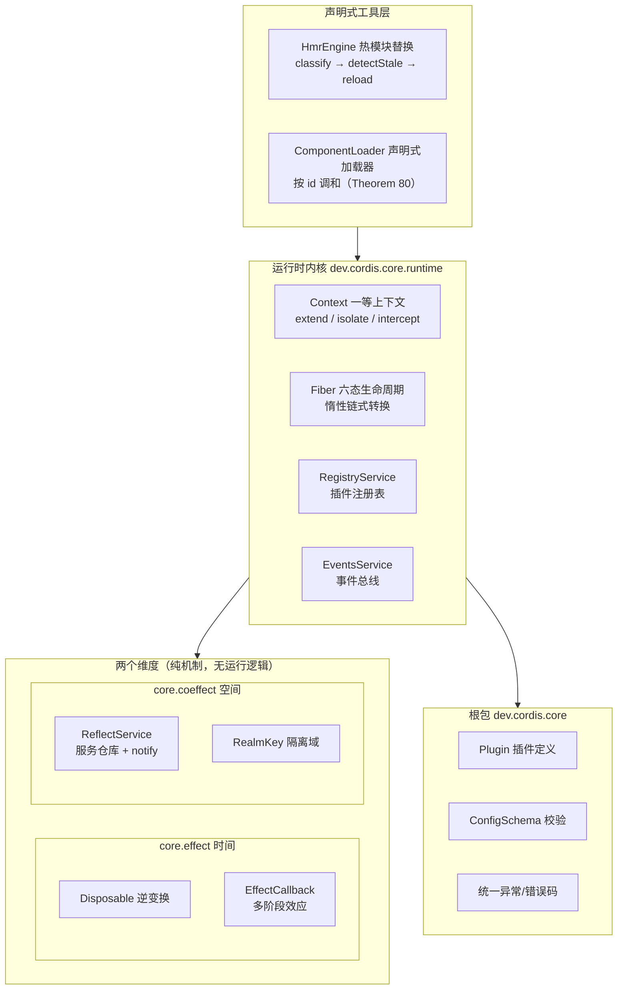

本页是整个文档的起点：你将了解 cordis-java **是什么、解决什么问题、由哪几块组成**，以及作为新手应该按什么顺序深入。本页只做全景式导览，每个专题的细节都有独立的深读页承接——读完本页，你应当能看懂目录中其余 29 篇的标题各自指向什么。

## 这是什么：一句话定位

cordis-java 是论文 *A Programming Paradigm for Spatiotemporal Composability*（Shi、Zhang、Cui；北京大学 & DeepSeek-AI）第 3–5 章运行时模型的 **Java 25 实现**，一个"时空可组合性元框架"。所谓"元框架"，是指它不提供具体业务功能（不是数据库、不是 Web 服务器），而是提供一套**组织插件的方式**：插件如何声明依赖、如何启动、如何在依赖消失时自动、完整地撤销自己做过的一切。它与 TypeScript 生态的 cordis v4 源码保持语义对齐，是同一范式在 JVM 上的移植。整个框架刻意保持小巧：主代码约 2,700 行，生产代码**零第三方依赖**（仅测试引入 JUnit 5），因此非常适合通读源码来理解论文思想。

Sources: [README.md](README.md#L1-L14) · [pom.xml](pom.xml#L21-L25) · [cordis-core/pom.xml](cordis-core/pom.xml#L15-L20)

## 为什么叫"时空可组合性"：两个维度

理解这个框架，只需要理解一个对偶。"**时间**"维度关注**组件做过的事如何可靠地撤销**：每次"打开一个连接、注册一个监听器"这样的操作（效应）都会登记一个逆变换，卸载时按后进先出（LIFO）顺序自动回滚——合上连接、注销监听器。"**空间**"维度关注**组件之间的依赖关系如何自动响应变化**：一个插件声明"我需要 db 服务"（余效应），当 db 的提供者上线、下线或被替换时，框架自动决定这个插件该激活、等待还是回退。两者最终经同一个 `Context` 上下文对象中介，这就是论文所谓"上下文范式"的统一。

| 维度 | 论文机制 | 本实现的对应物 |
|---|---|---|
| 时间可组合性 | 可回退效应（revertible effects）：每个上下文变换携带逆变换，按 LIFO 恢复（§3.1） | `Disposable`（逆变换）+ `Fiber` 效果栈（算法 1） |
| 空间可组合性 | 响应式余效应（reactive coeffects）：上下文变化按组件规范分为激活/去激活/中性（§3.2） | `inject` 声明 + `ReflectService.notify` 广播 + `Fiber.refresh` 重载判定 |
| 统一 | 上下文范式：效应与余效应经同一上下文中介（§3.3） | `Context`：`effect / get / provide / isolate / intercept / plugin` |

Sources: [README.md](README.md#L8-L14) · [package-info.java](cordis-core/src/main/java/dev/cordis/core/package-info.java#L1-L15)

## 架构全景：分层视图

整个仓库按概念分层，自下而上是"原子机制 → 运行时内核 → 声明式工具"。阅读下面的架构图前需要知道一个前提：**下层不知道上层存在**——`effect` 和 `coeffect` 两个包是纯数据与规则，`runtime` 把它们粘合成会自转的机器，而 `loader` 与 `hmr` 只是站在机器之上的便利封装。这种单向依赖是框架能保持小巧的关键。



Sources: [README.md](README.md#L18-L50)

## 仓库结构一览

仓库是标准的 Maven 双模块布局。**cordis-core** 是框架本体，**cordis-example** 是演示程序（六个插件类 + 一个 188 行的 `Main`，串起全部八个演示场景）。父 POM 声明 `maven.compiler.release=25` 与 JUnit 5.10.2，除此之外没有任何外部依赖。

```
cordis-java/
├── pom.xml                      父 POM：聚合模块，Java 25，JUnit 5
├── cordis-core/                 框架本体（约 2,700 行主代码 + 30 个测试）
│   └── src/main/java/dev/cordis/
│       ├── core/                根包：Plugin、ConfigSchema、CordisException
│       │   ├── effect/          时间维度：Disposable、EffectCallback、EffectMeta
│       │   ├── coeffect/        空间维度：ReflectService、Impl、RealmKey、Service
│       │   └── runtime/         内核：Context、Fiber、RegistryService、EventsService
│       ├── loader/              声明式加载器：Entry、ComponentLoader、PluginResolver
│       └── hmr/                 热模块替换：HmrEngine、ModuleGraph
└── cordis-example/              端到端演示：database/users/greeting 插件 + Main
```

| Maven 模块 | 角色 | 规模与内容 |
|---|---|---|
| `cordis-core` | 框架本体（可作为库引入） | 5 个包、24 个 Java 文件；最大单文件 `Fiber.java` 494 行 |
| `cordis-example` | 插件实例与端到端演示 | `DatabasePlugin` / `UserPlugin` / `GreetingPluginV1·V2` 等六个插件类 + `Main` |

Sources: [pom.xml](pom.xml#L16-L25) · [README.md](README.md#L44-L50)

## 三个核心角色：Plugin、Context、Fiber

新手最先要认识三个类，它们构成框架的全部主角戏份。**Plugin** 回答"你是谁"：一个接口声明三件事——需要什么（`inject()`）、提供什么（在 `apply` 里 `ctx.provide`）、做什么（`apply()` 本体）。同一个插件类配上不同配置就是不同组件实例。**Context** 是组件与外界打交道的**唯一通道**：登记效果、提供/获取服务、挂载子插件都经它；它还能派生子上下文——`extend` 普通派生、`isolate` 服务隔离（多租户）、`intercept` 配置收缩（如只读）。**Fiber** 是插件的一次运行实例（"一个插件装一次，就是一个 fiber"）：它记录依赖快照、目标视图摘要和撤销动作栈，驱动六态生命周期。

| 角色 | 一句话职责 | 关键 API / 字段 |
|---|---|---|
| `Plugin`（接口） | 声明依赖 + 启动逻辑 | `inject()` / `schema()` / `apply(ctx, config)` |
| `Context`（final 类） | 组件的操作通道与作用域 | `effect` / `provide` / `get` / `plugin` / `isolate` / `intercept` |
| `Fiber`（final 类） | 一次运行实例的状态机 | `state` / `store` / `target` / 效果栈 `records` |

`get` 的访问规则体现了"能力在声明时就定死"的设计：沿 fiber 链找不到已加载的服务时，声明过 `inject` 抛 `INACTIVE_ACCESS`（提供者还没上线），从未声明则抛 `UNDECLARED_ACCESS`（越权访问）。

```java
// 摘自 README"作为库使用"：三个角色的最小协作
Plugin database = Plugin.of("database", List.of(), (ctx, cfg) -> {
    ctx.effect(cb -> {                       // ① 效应：开连接，登记逆变换
        return (Disposable) () -> log.info("closed");
    }, "connection");
    ctx.provide("db", new DbService(ctx));   // ② 提供服务
    return null;
});
Plugin users = Plugin.of("users", List.of("db"), (ctx, cfg) -> {
    DbService db = ctx.get("db");            // ③ 能力受 inject 约束
    return null;                             //    db 消失时整段自动回滚
});
Fiber f = root.plugin(users);                // ④ PENDING：db 未提供，安静等待
root.plugin(database).await();               // ⑤ db ACTIVE → users 被通知并激活
```

Sources: [Plugin.java](cordis-core/src/main/java/dev/cordis/core/Plugin.java#L8-L46) · [Context.java](cordis-core/src/main/java/dev/cordis/core/runtime/Context.java#L18-L34) · [Fiber.java](cordis-core/src/main/java/dev/cordis/core/runtime/Fiber.java#L24-L40) · [Context.java](cordis-core/src/main/java/dev/cordis/core/runtime/Context.java#L175-L200) · [README.md](README.md#L61-L82)

### Fiber 的六个状态

Fiber 的生命周期是理解框架行为的钥匙，六个状态的语义如下表。特别地，`PENDING` 是**正常状态而非错误**——"等依赖"本身就是框架的响应式工作方式；而卸载顺序有严格保证：消费者先于提供者完成撤销，依赖方的收尾代码还能正常用到依赖。

| 状态 | 含义 |
|---|---|
| `PENDING` | 等依赖：所需服务未就绪，安静地等（正常状态） |
| `LOADING` | 正在启动（`apply` 执行中） |
| `ACTIVE` | 已加载并对外提供服务，唯一能被别人依赖的状态 |
| `FAILED` | 启动失败，错误只记在自己身上，不影响别人 |
| `UNLOADING` | 正在卸载：撤销动作按逆序执行 |
| `DISPOSED` | 已被移除，不能再用 |

Sources: [FiberState.java](cordis-core/src/main/java/dev/cordis/core/runtime/FiberState.java#L4-L22) · [Fiber.java](cordis-core/src/main/java/dev/cordis/core/runtime/Fiber.java#L34-L40)

## 能力全景：演示程序的八个场景

`cordis-example` 的 `Main` 用约 160 行主流程依次演示框架的全部能力，每个场景都打印可观察的状态迁移。下表同时给出"想深挖该能力应读哪一篇"。

| # | 演示场景 | 展示的能力 | 深读页 |
|---|---|---|---|
| 1 | users 声明 db，直到 db ACTIVE 才加载 | 响应式余效应、PENDING 等待 | [inject 能力检查](9-inject-neng-li-jian-cha-undeclared_access-yu-inactive_access-de-fang-wen-gui-ze) · [epoch 与 target 视图](16-epoch-yu-target-shi-tu-ti-gong-zhe-zhai-yao-qu-dong-de-zhong-zai-pan-ding) |
| 2 | 移除 database，其触碰过的一切都被逆转 | 时间可组合性、LIFO 回滚 | [Disposable 逆变换](7-disposable-ni-bian-huan-lifo-zhe-die-shi-bai-hui-gun-yu-dan-ci-chu-zhi) |
| 3 | 重新提供，users 针对新提供者重新激活 | 提供者替换触发重载 | [epoch 与 target 视图](16-epoch-yu-target-shi-tu-ti-gong-zhe-zhai-yao-qu-dong-de-zhong-zai-pan-ding) |
| 4 | 配置更新 + 禁用 + 移除 | 声明式加载器按 id 调和 | [ComponentLoader 按 id 调和](22-componentloader-an-id-diao-he-zhu-zi-duan-zui-xiao-rao-dong-fen-fa) |
| 5 | 两个租户共享同一插件，db 解析到不同 realm | 隔离域 | [RealmKey 隔离域](11-realmkey-ge-chi-yu-duo-zu-hu-ge-chi-yu-gong-xiang-biao-qian-join) |
| 6 | 租户-b 的 db 变为只读，不触碰两端 | 拦截与权限收缩 | [intercept 拦截](12-intercept-lan-jie-pei-zhi-zhu-ceng-he-bing-yu-quan-xian-shou-suo) |
| 7 | "编辑"greeting 模块，仅其 fiber 被替换 | HMR 三阶段流水线 | [HMR 总览](25-hmr-zong-lan-san-jie-duan-liu-shui-xian-yu-modulegraph-mo-kuai-tu-chou-xiang) |
| 8 | 坏模块重载失败，自动回滚到上一组件 | 事务性重载 | [陈旧 entry 检测与事务性重载](27-chen-jiu-entry-jian-ce-yu-shi-wu-xing-zhong-zai-de-shi-bai-hui-gun) |

Sources: [Main.java](cordis-example/src/main/java/dev/cordis/example/Main.java#L26-L38) · [Main.java](cordis-example/src/main/java/dev/cordis/example/Main.java#L61-L161)

## 与 TypeScript 版的关系（速览）

本实现不是从零发明，而是 cordis v4（TypeScript）的语义移植，并在 JVM 环境下做出四项明确取舍：**同步转换**（用同步 Runnable 链替代 JS 事件循环的异步惯性，语义等价且更易推理）、**无 Proxy**（`ctx.get(key)` 承担按需能力检查）、**模块解析交给宿主**（`PluginResolver` 抽象了 JVM 缺失的 Node 式模块注册表）、**隔离域标签**（`isolate(name, label)` 以对象相等性 Join，字符串标签全局共享）。这些取舍的完整对照留给专门的深读页，本页只需记住一句话：**Java 版与 TS 版行为对齐，但实现是命令式、同步、零依赖的**。

Sources: [README.md](README.md#L112-L134)

## 工程质量：30 个测试锁住行为契约

`cordis-core/src/test` 下共 6 个测试类、30 个用例，逐一覆盖 README 宣称的行为契约：LIFO 效应回滚、单次处置、多阶段效应、PENDING→ACTIVE 反应式加载、消费者先卸载的 guard 顺序、提供者替换重载、重复 provide 拒绝、restart/update、未声明/未激活访问错误、realm 隔离与通知不过界、同标签 Join、intercept 合并、加载器逐字段调和、schema 校验失败路径，以及 HMR 的分类不动点、环默认拒绝、陈旧检测与事务回滚。对学习者而言，这 30 个用例同时也是一份**可执行的行为规格说明书**。

Sources: [README.md](README.md#L136-L141)

## 推荐阅读路线

本 wiki 共 30 篇，按目录分四大区。新手建议走完下面的渐进路线，每一步都建立在前一步的直观感受之上。

**第一阶段 · 动手跑起来（入门指南区）**

1. [快速开始：环境搭建、Maven 构建与运行端到端演示](2-kuai-su-kai-shi-huan-jing-da-jian-maven-gou-jian-yu-yun-xing-duan-dao-duan-yan-shi) —— 装好环境，亲眼看到八个场景的输出；
2. [演示程序走读：八个场景覆盖框架全部能力](3-yan-shi-cheng-xu-zou-du-ba-ge-chang-jing-fu-gai-kuang-jia-quan-bu-neng-li) —— 逐场景对照源码；
3. [编写第一个插件：inject 声明、provide 提供与自动回滚](4-bian-xie-di-ge-cha-jian-inject-sheng-ming-provide-ti-gong-yu-zi-dong-hui-gun) —— 亲手写一个插件。

**第二阶段 · 建立理论坐标**

4. [时空可组合性范式：可回退效应与响应式余效应的统一](5-shi-kong-ke-zu-he-xing-fan-shi-ke-hui-tui-xiao-ying-yu-xiang-ying-shi-yu-xiao-ying-de-tong) —— 论文思想的中文导读；
5. [与 cordis（TypeScript 版）的语义映射与同步化设计取舍](6-yu-cordis-typescript-ban-de-yu-yi-ying-she-yu-tong-bu-hua-she-ji-qu-she) —— 理解移植决策。

**第三阶段 · 按兴趣选线深入**

时间线：[Disposable 逆变换](7-disposable-ni-bian-huan-lifo-zhe-die-shi-bai-hui-gun-yu-dan-ci-chu-zhi) → [多阶段效应](8-duo-jie-duan-xiao-ying-duo-xing-iterable-jian-cha-dian-zhong-duan-yu-bu-fen-hui-gun)；空间线：[inject 能力检查](9-inject-neng-li-jian-cha-undeclared_access-yu-inactive_access-de-fang-wen-gui-ze) → [ReflectService](10-reflectservice-fu-wu-cang-ku-yu-notify-bian-geng-yan-bo-ji-zhi) → [RealmKey](11-realmkey-ge-chi-yu-duo-zu-hu-ge-chi-yu-gong-xiang-biao-qian-join) → [intercept](12-intercept-lan-jie-pei-zhi-zhu-ceng-he-bing-yu-quan-xian-shou-suo) → [Service 基类](13-service-fu-wu-ji-lei-gou-zao-ji-provide-ke-yong-xing-jian-cha-yu-zi-dong-zhu-xiao)；内核线从 [Context 上下文范式](14-context-shang-xia-wen-fan-shi-parent-lian-extend-isolate-intercept-pai-sheng) 进入，止于 [内部事件协议](20-nei-bu-shi-jian-xie-yi-internal-status-internal-plugin-internal-service-yu-internal-config)；加载器线与 HMR 线（[第 21–27 篇](21-entry-pei-zhi-mo-xing-id-url-isolate-intercept-config-yu-disabled)）适合关心构建与热更新的读者；工程线（[第 28–30 篇](28-pei-zhi-xi-tong-configschema-xiao-yan-validationexception-yu-update-liu-cheng)）适合准备在生产中引入的人。