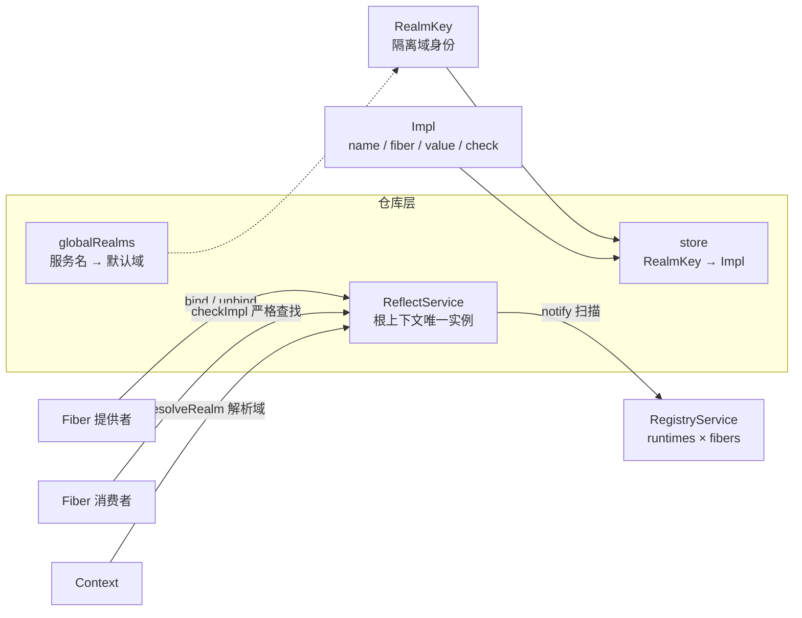
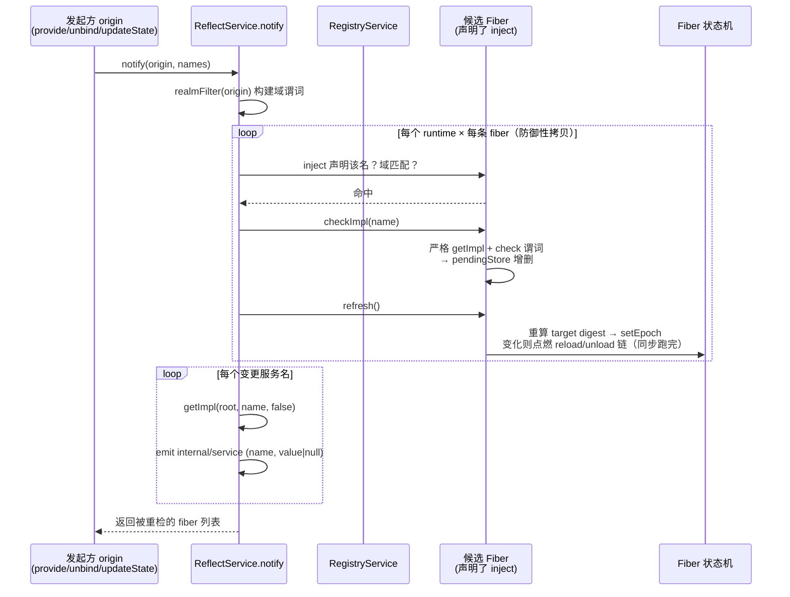

在 cordis-java 的空间可组合性体系中，**ReflectService 是全局唯一的服务仓库**——整个应用的服务绑定都存放在这里，且只挂载在根上下文上。它的职责可以拆成两半：前一半是**静态仓库**，以"隔离域 → 绑定"的键值结构存放所有服务绑定；后一半是**动态广播站**，即 `notify` 方法——绑定一旦变化，就通知所有声明了该服务的 fiber 重新核对依赖：依赖由缺变齐就自动启动，由齐变缺就自动卸载。框架文档中"响应式余效应"的"响应式"三个字，正来源于此。本文面向高级开发者，深入剖析这张仓库表的结构、provide/bind 的写入事务、notify 的过滤与扫描算法，以及它与 Fiber 状态机的联动细节。

Sources: [ReflectService.java](cordis-core/src/main/java/dev/cordis/core/coeffect/ReflectService.java#L14-L20), [package-info.java](cordis-core/src/main/java/dev/cordis/core/coeffect/package-info.java#L1-L11)

## 仓库的挂载位置与两张核心表

ReflectService 的生命周期与应用同构：`Context.createRoot()` 创建根上下文时，它与 RegistryService、EventsService、LoggerService 一并被构造为根上下文的四大内置服务。任何子上下文都通过 `ctx.getRoot().reflect()` 访问同一个实例——这保证了全应用只有一张绑定表，没有本地副本，也就没有一致性问题。

这张表实际上由两个 `LinkedHashMap` 组成，各司其职：

| 字段 | 键 | 值 | 语义 |
|---|---|---|---|
| `globalRealms` | 服务名 `String` | `RealmKey` | 每个服务名的**默认共享域**，第一次 provide 时惰性创建 |
| `store` | `RealmKey`（隔离域） | `Impl`（绑定） | **绑定本体表**：一个隔离域同一时刻最多一条同名绑定 |

`globalRealm(name)` 方法实现了默认域的惰性创建：查不到就 `RealmKey.fresh(name)` 新建并登记。这个方法有两个隐式调用方——`Context.resolveRealm` 在沿 parent 链找不到 isolate 覆盖时的兜底解析，以及 `Fiber.provide` 在绑定前"确保全局解析器有一个默认域可用"。`store` 选用 LinkedHashMap 而非 HashMap 是有意义的：插入序即绑定创建序，`bindingsOf(fiber)` 遍历时能按提供者登记的先后顺序返回。

Sources: [Context.java](cordis-core/src/main/java/dev/cordis/core/runtime/Context.java#L54-L62), [ReflectService.java](cordis-core/src/main/java/dev/cordis/core/coeffect/ReflectService.java#L25-L42)

## Impl：绑定即"提供者 + 值 + 检查"的三元组

store 表中的值是 `Impl`——一条服务绑定的完整描述。它持有四个字段：服务名 `name`、提供者 fiber（**绑定的生死跟随提供者**）、当前服务值 `value`（非 final，可通过 `ctx.set` 更新），以及可选的可用性检查谓词 `check`。理解 Impl 的关键在于它是一等公民对象而非纯数据快照：消费方 fiber 的依赖快照 `store` 直接持有 Impl 的引用，读取服务值时取的是 `impl.value` 的**当下值**，而非启动时的快照值。这意味着值的热更新天然可见，无需任何广播——这个设计取舍后文详述。

Sources: [Impl.java](cordis-core/src/main/java/dev/cordis/core/coeffect/Impl.java#L13-L35)

三类角色围绕这张仓库表协作，关系如下：

提供者 fiber 通过 `provide` 写入绑定；消费者 fiber 通过 `checkImpl`（严格模式查找）读取绑定；Context 则提供 `resolveRealm` 把"某个上下文视角下的服务名"翻译成隔离域，这三条访问路径汇聚于同一张表，构成仓库的完整读写面。

Sources: [ReflectService.java](cordis-core/src/main/java/dev/cordis/core/coeffect/ReflectService.java#L44-L80), [Context.java](cordis-core/src/main/java/dev/cordis/core/runtime/Context.java#L164-L171)

## 查找语义：getImpl 的严格与非严格双模式

仓库的读操作由 `getImpl(from, name, strict)` 统一承载：先以 `from.resolveRealm(name)` 把服务名解析到具体隔离域——所以**同一个名字在不同上下文视角下可能落到不同域、查到不同绑定**——再从 store 取出绑定。`strict` 参数决定了一条关键的语义分界线：严格模式下，即使绑定存在，只要提供者 fiber 的状态不是 `ACTIVE`，就返回 null。

这个分界线精确对应两类调用方。消费者 fiber 的 `checkImpl` 用严格模式——它问的是"这个依赖**现在**能不能用"，提供者已下线（UNLOADING/DISPOSED）的绑定等于不存在。而根上下文直接访问（`Context.get` 的 root 分支）和 `getOrNull` 用非严格模式——它们只问"绑定在不在"。由此产生的 INACTIVE_ACCESS / UNDECLARED_ACCESS 异常语义属于读方能力检查的范畴，详见 [inject 能力检查：UNDECLARED_ACCESS 与 INACTIVE_ACCESS 的访问规则](9-inject-neng-li-jian-cha-undeclared_access-yu-inactive_access-de-fang-wen-gui-ze)。

Sources: [ReflectService.java](cordis-core/src/main/java/dev/cordis/core/coeffect/ReflectService.java#L44-L56), [Fiber.java](cordis-core/src/main/java/dev/cordis/core/runtime/Fiber.java#L249-L251), [Context.java](cordis-core/src/main/java/dev/cordis/core/runtime/Context.java#L181-L216)

## provide 的全流程：登记、查重、绑定与首次广播

写入路径 `Fiber.provide` 是一个精心设计的事务。它首先把整个绑定动作包装为当前 fiber 的一个**效果**（effect）——这是时间可组合性的直接应用：绑定写入了什么，撤销动作就移除什么，fiber 卸载时自动回滚，无需手写清理。效果回调体内依次执行四步：

1. **确保默认域存在**：`reflect.globalRealm(name)` 惰性创建；
2. **解析隔离域**：`from.resolveRealm(name)`——注意是从 provide 的发起上下文解析，所以同一插件在不同 isolate 分支下 provide 会落到不同域；
3. **查重**：`bindingAt(key)` 已有绑定则抛 `DUPLICATE_PROVIDE`——一个隔离域同一时刻只允许一条同名绑定，重复提供直接失败并回滚本次效果；
4. **写入并广播**：`bind(key, impl)`、把 Impl 记入自己的依赖快照 `store`，若 fiber 已处于 ACTIVE 状态则触发 `notify(from, List.of(name))`。

返回的撤销动作是对称的镜像：`unbind(key)` 移除绑定 → `notify` 广播 → 从快照中移除。绑定与解绑都走 notify，保证了仓库结构变化的每一次抖动都会传导到依赖方。`DUPLICATE_PROVIDE` 的行为契约有测试锁定：同一域内先提供 `"svc"="a"` 再提供 `"svc"="b"` 必须抛异常。

Sources: [Fiber.java](cordis-core/src/main/java/dev/cordis/core/runtime/Fiber.java#L467-L488), [LifecycleTest.java](cordis-core/src/test/java/dev/cordis/LifecycleTest.java#L105-L110)

## notify 广播算法：域过滤、全量扫描与级联刷新

`notify(origin, names)` 是整个响应式机制的发动机，其算法分三个阶段。**第一阶段构建爆炸半径**：静态方法 `realmFilter(origin)` 返回一个谓词——对候选 fiber 的上下文和每个服务名，比较 `ctx.resolveRealm(name) == origin.resolveRealm(name)`，注意是 RealmKey 的**引用相等**比较。由于发起方 `origin` 的绑定变化只发生在它解析出的那个域内，能观察到这次变化的上下文集合恰好就是"解析到同一个域对象"的集合——过滤器把通知范围精确收敛到可见性域，不多不少。

**第二阶段全量扫描**：对 `root.registry().runtimes()` 的每个 PluginRuntime 的每条 fiber，逐个检查变更名单中的每个服务名——fiber 必须在 `inject` 声明中包含该名（没声明的 fiber 与此变更无关），且通过域过滤。命中则调 `fiber.checkImpl(name)` 重新核对（严格查找 + 可用性谓词）；只要有一个服务名产生了核对动作，就对该 fiber 调 `refresh()` 重算目标视图。这里有两个值得注意的工程细节：其一，`List.copyOf` 对 runtimes 和 fibers 做了防御性拷贝——因为 checkImpl → refresh 触发的惰性链式转换（reload/unload）会同步执行，期间插件体可能注册新 fiber 或卸载既有 fiber，直接遍历会引发 ConcurrentModificationException；其二，注释明言"没有实质变化的 fiber 重算一遍也无副作用"——refresh 是幂等的重算，依赖没变的 fiber 重算后 epoch 不变，链式转换不会被点燃。

**第三阶段事件外溢**：对名单中每个服务名，以根上下文视角取当前绑定（非严格），发出 `internal/service` 事件，绑定不存在时载荷为 null。这是仓库对外的事件协议出口，监听语义详见 [内部事件协议：internal/status、internal/plugin、internal/service 与 internal/config](20-nei-bu-shi-jian-xie-yi-internal-status-internal-plugin-internal-service-yu-internal-config)。

Sources: [ReflectService.java](cordis-core/src/main/java/dev/cordis/core/coeffect/ReflectService.java#L82-L115), [RegistryService.java](cordis-core/src/main/java/dev/cordis/core/runtime/RegistryService.java#L41-L43), [PluginRuntime.java](cordis-core/src/main/java/dev/cordis/core/runtime/PluginRuntime.java#L17-L18)

域过滤不跨界的正确性由测试 `notifyDoesNotCrossRealms` 锁定：scope-a 与 scope-b 两个隔离分支各有一个等待中的消费者，向 scope-a 提供服务后**只有** logA 出现激活记录，logB 保持为空；随后向 scope-b 提供，logB 才激活。这证明 notify 的通知粒度与绑定可见域严格重合。

Sources: [IsolationTest.java](cordis-core/src/test/java/dev/cordis/IsolationTest.java#L51-L70)

## 触发面收敛：notify 的三处调用点

对主源码的穷举检索表明，`reflect().notify` 全框架只有三处调用，恰好覆盖了绑定"结构"变化的所有路径：

| # | 调用点 | 触发时机 | 变更名单来源 | 语义 |
|---|---|---|---|---|
| 1 | `Fiber.provide` 效果体 | 新绑定写入且提供者已 ACTIVE | `List.of(name)` 单名 | 依赖可能由缺变齐 → 消费者激活 |
| 2 | `Fiber.provide` 撤销动作 | 绑定移除（含 fiber 卸载时自动回滚） | `List.of(name)` 单名 | 依赖由齐变缺 → 消费者卸载 |
| 3 | `Fiber.updateState` | fiber 状态**跨越 ACTIVE 边界**（任一方向） | `bindingsOf(fiber)` 该 fiber 提供的全部服务名 | 提供者整机的生死传导给全部依赖方 |

第 3 处值得展开：`updateState` 在状态翻转时先发 `internal/status` 事件，然后判断新旧状态是否跨越了"ACTIVE ↔ 非 ACTIVE"分界（LOADING→ACTIVE、ACTIVE→UNLOADING 等中间态翻转不触发），跨界的才收集该 fiber 的所有绑定名并广播。这把"提供者生命周期变化"翻译成了"其全部服务绑定的可用性变化"，严格模式下 `checkImpl` 自然会把非 ACTIVE 提供者的绑定视为不可用。

Sources: [Fiber.java](cordis-core/src/main/java/dev/cordis/core/runtime/Fiber.java#L377-L390), [Fiber.java](cordis-core/src/main/java/dev/cordis/core/runtime/Fiber.java#L467-L488), [ReflectService.java](cordis-core/src/main/java/dev/cordis/core/coeffect/ReflectService.java#L73-L80)

## 值更新不广播：set 的静默语义

一个容易误解的精妙点：`Context.set` 修改 `impl.value` 后**不触发 notify**。这与绑定结构变化形成鲜明对照，构成了两类"变化"的二元语义：

| 维度 | 绑定结构变化（bind/unbind/状态翻转） | 值更新（ctx.set） |
|---|---|---|
| 是否广播 notify | 是 | 否 |
| 消费者是否重载 | 依赖齐缺或提供者身份变化则重载 | 不重载 |
| 新值何时可见 | 重载后在新实例中可见 | 下一次 `ctx.get` 立即可见 |
| 可见性来源 | notify → checkImpl → refresh → epoch 变化 | 消费者快照持有的 Impl 引用共享可变 value |

可见性的实现依靠对象引用共享：消费者 fiber 的依赖快照 `store` 与全局仓库存的是**同一个 Impl 实例**，`get` 每次读取都取 `impl.value` 的当下值，因此 set 是零成本的即时热更新。而重载判定只关心提供者**身份**（fiber uid）——`refresh` 拼接的 digest 由各依赖的提供者 uid 组成，提供者换了人 digest 才变。测试 `providerReplacementReloadsConsumerAgainstNewFiber` 锁定了这条分界：换提供者触发完整的 down/up 重载序列；同理 `setRules` 验证 set 的权限规则——只有提供者 fiber 本身能 set，未提供过该服务的 set 抛 INVALID_SET 异常。epoch/target digest 的重载判定机制详见 [epoch 与 target 视图：提供者摘要驱动的重载判定](16-epoch-yu-target-shi-tu-ti-gong-zhe-zhai-yao-qu-dong-de-zhong-zai-pan-ding)。

Sources: [Context.java](cordis-core/src/main/java/dev/cordis/core/runtime/Context.java#L218-L233), [Fiber.java](cordis-core/src/main/java/dev/cordis/core/runtime/Fiber.java#L273-L287), [LifecycleTest.java](cordis-core/src/test/java/dev/cordis/LifecycleTest.java#L93-L103), [ServiceAccessTest.java](cordis-core/src/test/java/dev/cordis/ServiceAccessTest.java#L94-L112)

## 与 Fiber 状态机的联动：从 checkImpl 到惰性链式转换

notify 的最终落点是消费 fiber 的两段式响应。第一段 `checkImpl(name)`：以严格模式查找绑定，查不到或提供者非 ACTIVE 则从 `pendingStore` 移除；查到则执行可用性谓词 `impl.check.test(impl.value)`——谓词抛异常或返回 false 一律视为不可用（异常会被记录日志但不中断广播）。这个 check 谓词正是 `Service` 基类构造时传入的 `isAvailable()` 挂接点，详见 [Service 服务基类：构造即 provide、可用性检查与自动注销](13-service-fu-wu-ji-lei-gou-zao-ji-provide-ke-yong-xing-jian-cha-yu-zi-dong-zhu-xiao)。

第二段 `refresh()`：遍历自己声明的全部依赖，`pendingStore` 缺任何一个就把 target 置为 INACTIVE；全部齐备则把各依赖提供者的 uid 拼成 digest 作为新 target。随后 `setEpoch` 比较 epoch：依赖恢复（INACTIVE → 非 INACTIVE）点燃 `reloadCycle`，依赖缺失点燃 `unloadCycle`，且通过 `runChain` **同步**跑完整个链——转换不会停在中间状态。因此一次 notify 的调用栈里，可能嵌套着任意深度、任意数量的消费 fiber 的完整生命周期转换，这就是测试 `consumerWaitsThenActivatesOnProvide` 观察到的现象：`provider.await()` 返回时消费者已经 ACTIVE，日志里 provider-up 与 consumer-up 同步完成。

Sources: [Fiber.java](cordis-core/src/main/java/dev/cordis/core/runtime/Fiber.java#L249-L302), [Service.java](cordis-core/src/main/java/dev/cordis/core/coeffect/Service.java#L18-L27), [LifecycleTest.java](cordis-core/src/test/java/dev/cordis/LifecycleTest.java#L60-L71)

## 顺序保证：消费者先于提供者

notify 的触发时机内嵌了一条关键的顺序不变量：**提供者停止服务时，依赖方先完整卸载，提供者自身的撤销动作最后执行**。机制在于 `setEpoch` 的调用序列——提供者 epoch 变为 INACTIVE 时，`updateState(FiberState.UNLOADING)` **先**发出 notify，让所有消费者在其调用栈内同步完成卸载链；**然后** `runChain` 才执行提供者自己的 `unloadCycle`，按 LIFO 跑它登记的全部撤销动作。这样消费者在收尾代码中仍能正常使用对依赖服务的引用——测试断言的日志顺序 `["consumer-down", "provider-down"]` 正是这条不变量的直接证据。`withdraw...ThenReprovideReactivates` 进一步验证了全循环：提供者撤除后消费者回到 PENDING 而非销毁，新提供者上线后消费者再次激活并绑定新值。这条保证的理论背景详见 [卸载顺序保证：消费者先于提供者的 L-Unload guard](18-xie-zai-shun-xu-bao-zheng-xiao-fei-zhe-xian-yu-ti-gong-zhe-de-l-unload-guard)。

Sources: [Fiber.java](cordis-core/src/main/java/dev/cordis/core/runtime/Fiber.java#L289-L302), [Fiber.java](cordis-core/src/main/java/dev/cordis/core/runtime/Fiber.java#L347-L369), [LifecycleTest.java](cordis-core/src/test/java/dev/cordis/LifecycleTest.java#L73-L91)

## 设计审视：同步模型、全量扫描与单线程假设

从工程视角审视这份实现，有三个值得高级开发者注意的取舍。**同步执行模型**：notify 及其点燃的所有生命周期转换都在调用方线程内同步跑完，没有异步队列、没有调度器——这换来的是确定性（日志顺序可精确断言）和零竞态的中间状态，代价是长依赖链上一次广播的延迟是所有链式转换的总和。**O(R×F×N) 的扫描成本**：notify 对注册表全量扫描而非维护反向依赖索引（服务名 → 订阅者集合），以每次绑定变化的全表遍历换取零簿记成本——在插件数量与变更频率有限的框架场景下是合理简化，但高频 provide/unbind 场景会成为热点。**单线程假设**：`store` 与 `globalRealms` 是无同步的普通 LinkedHashMap，框架假定所有仓库操作发生在单线程上（对比 RegistryService 的方法级 synchronized，ReflectService 完全依赖外部串行化）——在 JVM 环境下接入多线程宿主时，需要在调用边界自行保证串行。这三点共同勾勒出实现的定位：一个语义精确、规模可控的响应式内核，而非高并发服务注册中心。

Sources: [ReflectService.java](cordis-core/src/main/java/dev/cordis/core/coeffect/ReflectService.java#L23-L32), [RegistryService.java](cordis-core/src/main/java/dev/cordis/core/runtime/RegistryService.java#L31-L43)

## 小结

ReflectService 用两张 LinkedHashMap（默认域表 + 绑定表）承载全应用的服务绑定，以 `Impl` 为共享可变的绑定实体，以 `notify` 为唯一的变更传导机制。其核心不变量可以概括为四条：**绑定按域隔离，一域一绑定**（DUPLICATE_PROVIDE 兜底）；**通知范围与可见性域严格重合**（realmFilter 引用相等过滤）；**结构变化广播、值更新静默**（重载看提供者身份，可见性靠引用共享）；**消费者先于提供者收尾**（updateState 先 notify 后 runChain）。想继续深入，建议按此顺序阅读：先看 [RealmKey 隔离域：多租户隔离与共享标签 Join](11-realmkey-ge-chi-yu-duo-zu-hu-ge-chi-yu-gong-xiang-biao-qian-join) 理解域的完整语义，再看 [Fiber 生命周期状态机：六态流转与惰性链式转换](15-fiber-sheng-ming-zhou-qi-zhuang-tai-ji-liu-tai-liu-zhuan-yu-duo-xing-lian-shi-zhuan-huan) 理解 notify 落点后的完整状态机，最后看 [EventsService 事件总线：emit、parallel、bail 与 waterfall 四种派发语义](19-eventsservice-shi-jian-zong-xian-emit-parallel-bail-yu-waterfall-si-zhong-pai-fa-yu-yi) 理解 `internal/service` 外溢事件的派发通道。