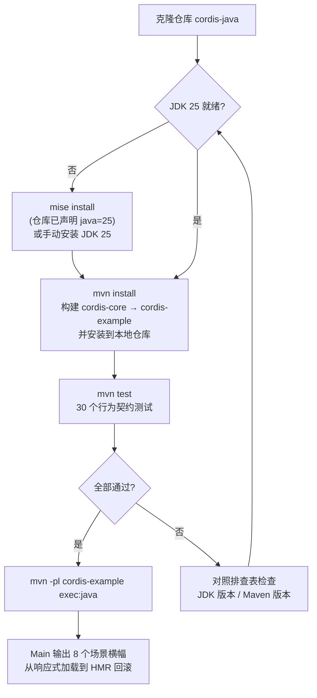
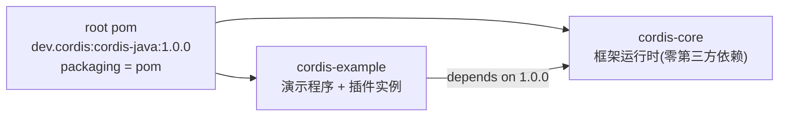

本文是入门路线的第二站，目标只有一个：**在一台全新的开发机上，用三条 Maven 命令走完"构建 → 测试 → 观看端到端演示"的完整闭环**。你不需要预先理解时空可组合性（spatiotemporal composability）的任何理论——那属于[项目概览](1-xiang-mu-gai-lan-shi-kong-ke-zu-he-xing-yuan-kuang-jia-de-java-25-shi-xian)与后续的深入解析章节。本文只回答三个问题：环境要什么、构建怎么跑、跑起来之后屏幕上会出现什么。全程约 10 分钟。

先给出整条路线的鸟瞰图。下图描述了从克隆仓库到看到演示输出的五个阶段，以及唯一的分支点——JDK 25 是否就绪：



## 一、前置条件：环境要求

项目对工具链的要求非常克制，但有一条**硬性红线：JDK 25**。根 POM 将 `maven.compiler.release` 锁定为 25，任何低于 25 的 JDK 都会在编译期直接报错，没有兼容降级路径。下表汇总全部环境要求：

| 组件 | 要求 | 约束来源 | 说明 |
|---|---|---|---|
| JDK | **25**（严格） | 根 POM `maven.compiler.release=25` | 低于 25 无法编译 |
| Maven | 3.9+（推荐） | 多模块构建 + exec-maven-plugin 3.2.0 | 标准 Maven 即可，无需额外扩展 |
| mise（可选） | 任意近期版本 | 仓库自带 `mise.toml` | 用于自动安装/锁定 JDK 25，非必需 |
| 操作系统 | 不限 | 纯 JVM 项目 | 无任何原生依赖 |

Sources: [pom.xml](pom.xml#L21-L25) · [mise.toml](mise.toml#L1-L3)

值得初学者注意的一个事实：`cordis-core` 的 `dependencies` 中**只有一条 JUnit 依赖，且 scope 为 test**——也就是说，框架本体在运行时**零第三方依赖**，编译产物只依赖 JDK 标准库。这意味着构建不会遭遇依赖冲突、网络仓库拉取失败等常见问题，环境准备的复杂度几乎全部集中在 JDK 版本这一件事上。

Sources: [cordis-core/pom.xml](cordis-core/pom.xml#L15-L20) · [pom.xml](pom.xml#L27-L36)

## 二、第一步：准备 JDK 25 环境

仓库根目录的 `mise.toml` 只有两行有效内容：声明 `java = "25"`。如果你已安装 [mise](https://mise.jdx.dev/)，在仓库根目录执行 `mise install` 即可自动下载并锁定 JDK 25，此后本目录内执行的 `java`/`mvn` 会经由 mise shim 自动路由到正确版本；若不想改变默认 shell 行为，也可以用 `mise exec -- mvn install` 的形式临时套用工具链。

```bash
cd cordis-java
mise install          # 下载 mise.toml 声明的 JDK 25
java -version         # 验证：应输出 openjdk version "25.x.x"
```

Sources: [mise.toml](mise.toml#L1-L3)

如果你不使用 mise，手动路径同样简单：从任意 JDK 发行版（Temurin、Oracle、Zulu 等）安装版本 25，并确保 `JAVA_HOME` 指向它。验证方式一致——`java -version` 的输出必须以 `25` 开头。这是进入下一步的唯一门槛。

## 三、第二步：构建与运行测试

### 先看清项目结构

根 POM 以 `packaging=pom` 聚合两个模块，形成一条单向依赖链：`cordis-example` 依赖 `cordis-core` 的 1.0.0 构件。下图描述了这条模块依赖关系：



`cordis-example` 是你即将运行的演示模块，其源码结构如下——一个入口类 `Main` 加六个插件类，总共七个文件：

```
cordis-example/src/main/java/dev/cordis/example/
├── Main.java                 # 演示入口：编排 8 个场景
└── plugins/
    ├── DatabasePlugin.java   # db 提供者：登记两个可回退效应
    ├── DbService.java        # db 服务（构造即 provide）
    ├── UserPlugin.java       # users 消费者：inject 声明 "db"
    ├── UsersService.java
    ├── GreetingPluginV1.java # HMR 演示用：v1 版本
    └── GreetingPluginV2.java # HMR 演示用："编辑后"的 v2 版本
```

Sources: [pom.xml](pom.xml#L16-L19) · [cordis-example/pom.xml](cordis-example/pom.xml#L15-L21)

### 执行构建

在仓库根目录执行：

```bash
mvn install
```

这条命令按聚合顺序构建 `cordis-core` 与 `cordis-example`，并把两者的 1.0.0 构件安装进本地 Maven 仓库。**这一步是运行演示的前置条件**：`cordis-example` 通过普通 Maven 坐标引用 `cordis-core:1.0.0`，当只构建单个模块（`-pl cordis-example`）时，Maven 需要从本地仓库中解析这个坐标——README 中的快速开始命令也明确标注了"先 `mvn install`"。构建成功时，末尾会看到两个模块的 `BUILD SUCCESS`。

Sources: [README.md](README.md#L52-L57) · [cordis-example/pom.xml](cordis-example/pom.xml#L16-L21)

### 运行测试

```bash
mvn test
```

测试集中在 `cordis-core`，恰好 **30 个 `@Test` 方法**，分布在 6 个测试类中，每个类对应框架的一组行为契约：

| 测试类 | 覆盖的行为契约 |
|---|---|
| `EffectTrackingTest` | LIFO 效应回滚、单次处置、多阶段效应 |
| `LifecycleTest` | PENDING→ACTIVE 反应式加载、消费者先卸载的 guard 顺序、restart/update |
| `ServiceAccessTest` | 未声明/未激活访问错误、重复 provide 拒绝 |
| `IsolationTest` | realm 隔离与通知不过界、同标签 Join、intercept 合并 |
| `LoaderTest` | 加载器逐字段调和、schema 校验失败路径 |
| `HmrTest` | 分类不动点、环默认拒绝、陈旧检测、事务回滚 |

看到 `Tests run: 30, Failures: 0, Errors: 0` 即代表环境与代码双双就绪。这 30 个用例的完整行为清单在[测试体系：30 个用例覆盖的行为契约清单](30-ce-shi-ti-xi-30-ge-yong-li-fu-gai-de-xing-wei-qi-yue-qing-dan)中逐一展开。

Sources: [EffectTrackingTest.java](cordis-core/src/test/java/dev/cordis/EffectTrackingTest.java#L16-L16) · [LifecycleTest.java](cordis-core/src/test/java/dev/cordis/LifecycleTest.java#L16-L16) · [README.md](README.md#L136-L141)

## 四、第三步：运行端到端演示

构建完成后，执行：

```bash
mvn -pl cordis-example exec:java
```

`-pl cordis-example` 把构建范围限定到演示模块；`exec:java` 由模块 POM 显式绑定的 exec-maven-plugin 3.2.0 驱动，主类锁定为 `dev.cordis.example.Main`。你也可以用 `mvn -pl cordis-example -am exec:java` 一条命令完成"增量构建依赖模块 + 运行"，效果等价于先 `install` 再运行。

Sources: [cordis-example/pom.xml](cordis-example/pom.xml#L23-L34)

### 演示程序在启动时做了什么

`Main` 的 `main` 方法只做了三件准备工作，值得在阅读输出前了解。第一，它用 `MODULES` 这个 `LinkedHashMap` 模拟了一个**模块注册表**——url（如 `"plugin-database"`）映射到"编译后模块"的插件工厂，这正是在 JVM 环境下替代 Node 式模块系统的宿主自定义解析边界。第二，通过 `Context.createRoot()` 创建根上下文。第三，订阅内部事件 `internal/status`，把每一条 fiber 的**生命周期状态迁移**实时打印到控制台——所以你会在演示全程持续看到形如 `状态: users#2 PENDING → LOADING` 的输出。

```java
MODULES.put("plugin-database", DatabasePlugin::new);   // 模拟模块注册表
Context root = Context.createRoot();                    // 根上下文
root.onGlobal("internal/status", st -> { ... });        // 状态迁移实时打印
```

Sources: [Main.java](cordis-example/src/main/java/dev/cordis/example/Main.java#L41-L57) · [Main.java](cordis-example/src/main/java/dev/cordis/example/Main.java#L164-L170)

### 你会看到八个场景

程序按 `==== ====` 横幅依次推进八个场景。下表是每个横幅的一行式预告——**具体逐行走读属于下一篇**，这里只需带着预期去看输出：

| # | 横幅标题 | 一句话预期 |
|---|---|---|
| 1 | 响应式余效应 | `users` 先以 PENDING 等待，`db` ACTIVE 后被通知并激活 |
| 2 | 时间可组合性 | 移除 database，其触碰过的一切按 LIFO 顺序被逆转 |
| 3 | 重新提供 | 新的提供者 fiber 出现，`users` 针对它重新激活 |
| 4 | 声明式加载器 | 按 entry id 调和：配置更新、禁用、移除三种变更 |
| 5 | 隔离 | 两个租户加载同一插件代码，但各自解析到独立的 db realm |
| 6 | 拦截 | 租户-b 的 db 被授予只读，写入被按设计拒绝 |
| 7 | HMR | "编辑" greeting 模块后，仅其 fiber 被替换 |
| 8 | HMR 回滚 | 损坏的模块导致重载失败，系统回滚到上一组件，绝不半重载 |

Sources: [Main.java](cordis-example/src/main/java/dev/cordis/example/Main.java#L61-L90) · [Main.java](cordis-example/src/main/java/dev/cordis/example/Main.java#L92-L120) · [Main.java](cordis-example/src/main/java/dev/cordis/example/Main.java#L122-L161)

观看输出时的一个小技巧：场景 1 加载 database 插件时，控制台会依次打印"正在打开连接 → [连接] 已建立 → [语句] 已预编译"；而到了场景 2 卸载时，你会看到**完全相反的顺序**——"[语句] 已关闭 → [连接] 已释放"。这正是 `DatabasePlugin.apply` 中两个 `ctx.effect` 登记的逆变换被 LIFO 折叠执行的直接证据，也是整个框架"作者无需编写卸载路径"这一核心承诺的肉眼可见版本。

Sources: [Main.java](cordis-example/src/main/java/dev/cordis/example/Main.java#L70-L77) · [DatabasePlugin.java](cordis-example/src/main/java/dev/cordis/example/plugins/DatabasePlugin.java#L21-L43)

## 五、命令速查表

| 命令 | 作用 | 前置条件 | 预期结果 |
|---|---|---|---|
| `mise install` | 安装 `mise.toml` 声明的 JDK 25 | 已安装 mise | `java -version` 显示 25 |
| `java -version` | 验证 JDK 版本 | — | 输出以 `25` 开头 |
| `mvn install` | 构建并安装全部模块 | JDK 25 | 两模块 `BUILD SUCCESS` |
| `mvn test` | 运行 cordis-core 测试 | JDK 25 | `Tests run: 30, Failures: 0` |
| `mvn -pl cordis-example exec:java` | 运行端到端演示 | 已 `mvn install` | 8 个场景横幅依次输出 |
| `mvn -pl cordis-example -am exec:java` | 一步到位（增量构建依赖 + 运行） | JDK 25 | 同上 |

## 六、常见问题排查

| 症状 | 根因 | 解决 |
|---|---|---|
| 编译报 `invalid target release: 25` 或 `不支持发行版本 25` | 当前 JDK 低于 25 | `mise install` 或手动安装 JDK 25，`java -version` 复核 |
| `Could not resolve dependencies ... cordis-core:1.0.0` | 跳过了 `mvn install` 直接运行演示 | 先在根目录执行 `mvn install`，或改用 `-am` 参数 |
| `mvn test` 阶段编译失败、报 compiler plugin 相关错误 | Maven 版本过旧，无法配合 release 25 | 升级到 Maven 3.9+ |
| `exec:java` 提示找不到主类 | 在错误目录执行或漏掉 `-pl` 参数 | 必须在仓库根目录并带 `-pl cordis-example` |
| 演示中途抛 `IllegalArgumentException: 模块未找到` | 修改 `Main` 时向 `MODULES` 注册了不存在的 url | 检查 `newLoader` 的解析逻辑与注册表键名 |

最后一条的判定逻辑来自 `newLoader`：解析器对注册表查不到的 url 直接抛出异常，这是模块解析边界的显式失败方式，而非静默返回空插件。

Sources: [Main.java](cordis-example/src/main/java/dev/cordis/example/Main.java#L164-L170)

## 七、运行之后：用五句话建立心智模型

演示跑通后，你已经亲眼见过框架的全部能力面。此刻最值得带走的是一个最小心智模型，它由五个动作构成闭环：`Context.createRoot()` 创建根上下文（入口在 `Context` 类的静态工厂）→ 插件通过 `apply` 声明自己**需要什么**（inject）与**提供什么**（provide）→ 需要的东西就绪前消费者处于 PENDING，就绪后被自动通知激活 → 一切登记过的效应在卸载时按 LIFO 自动逆转 → 拆除根上下文时整个 fiber 树级联释放（演示最后一屏的"级联贯穿每一个 fiber"即此）。如果你想在动手层面复刻这套流程，[编写第一个插件：inject 声明、provide 提供与自动回滚](4-bian-xie-di-ge-cha-jian-inject-sheng-ming-provide-ti-gong-yu-zi-dong-hui-gun)是为你准备的下一步；如果想先弄清"为什么这样设计"，则应转向[时空可组合性范式：可回退效应与响应式余效应的统一](5-shi-kong-ke-zu-he-xing-fan-shi-ke-hui-tui-xiao-ying-yu-xiang-ying-shi-yu-xiao-ying-de-tong)。

Sources: [Context.java](cordis-core/src/main/java/dev/cordis/core/runtime/Context.java#L54-L54) · [README.md](README.md#L59-L82)

## 下一步阅读

按入门指南的自然顺序推进：

- **[演示程序走读：八个场景覆盖框架全部能力](3-yan-shi-cheng-xu-zou-du-ba-ge-chang-jing-fu-gai-kuang-jia-quan-bu-neng-li)** —— 逐行走读你刚才在控制台看到的每一段输出，理解每个横幅背后的机制；
- **[编写第一个插件：inject 声明、provide 提供与自动回滚](4-bian-xie-di-ge-cha-jian-inject-sheng-ming-provide-ti-gong-yu-zi-dong-hui-gun)** —— 亲手实现一个 DatabasePlugin 的简化版；
- 若想先建立理论全景：**[时空可组合性范式：可回退效应与响应式余效应的统一](5-shi-kong-ke-zu-he-xing-fan-shi-ke-hui-tui-xiao-ying-yu-xiang-ying-shi-yu-xiao-ying-de-tong)**；
- 若想核对环境验证的深层依据：**[测试体系：30 个用例覆盖的行为契约清单](30-ce-shi-ti-xi-30-ge-yong-li-fu-gai-de-xing-wei-qi-yue-qing-dan)**。