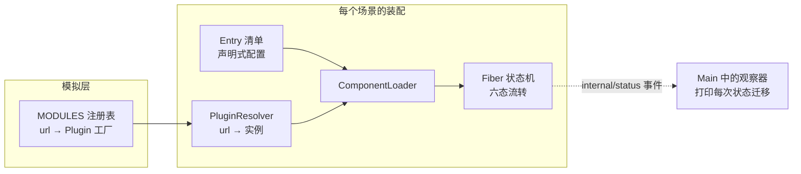
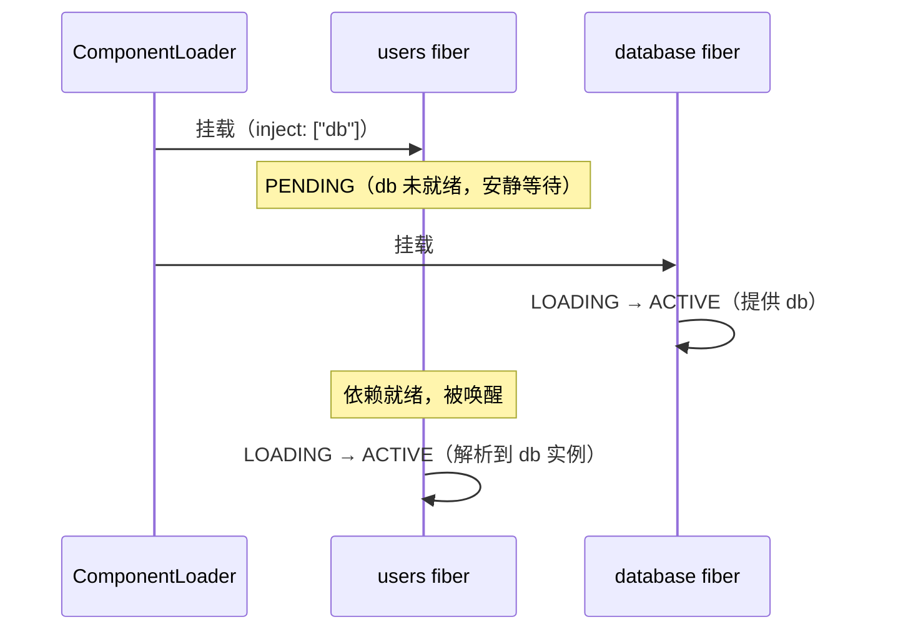
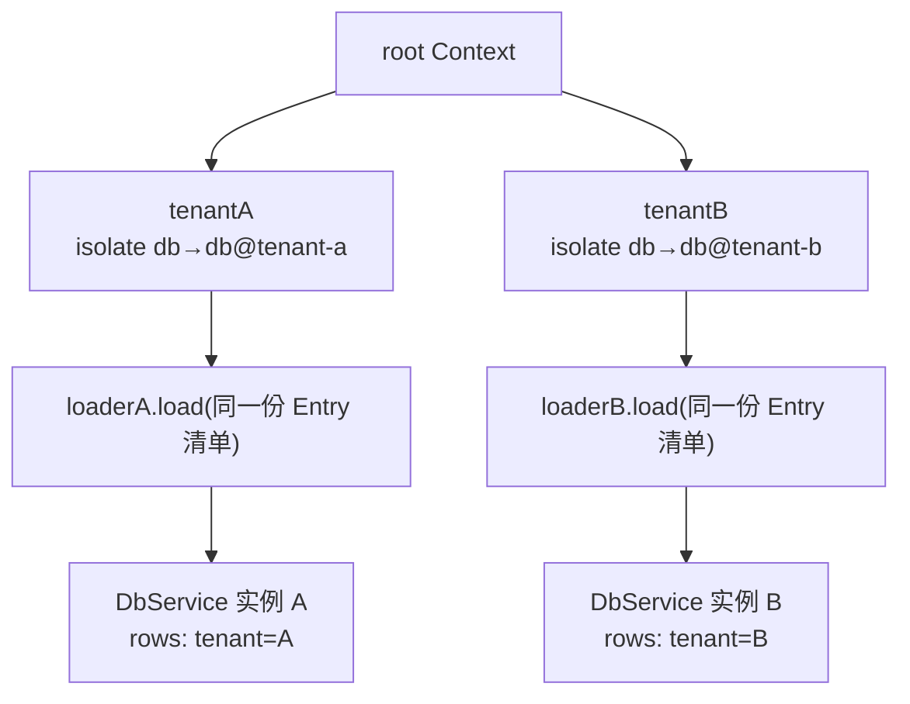
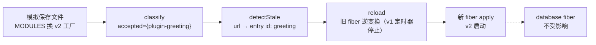

cordis-java 的端到端演示程序位于 `cordis-example` 模块，是一个约 190 行的编排脚本 [`Main.java`](cordis-example/src/main/java/dev/cordis/example/Main.java#L39-L187)。它用三个插件（database、users、greeting）在几分钟内依次走完**响应式余效应、时间可组合性、声明式调和、隔离、拦截、HMR 与事务回滚**这七类能力——正是框架的全部核心机制。本文逐场景走读这份脚本：每一步**代码做了什么、控制台会出现什么、这证明了框架的哪条性质**。运行方式参见 [快速开始：环境搭建、Maven 构建与运行端到端演示](2-kuai-su-kai-shi-huan-jing-da-jian-maven-gou-jian-yu-yun-xing-duan-dao-duan-yan-shi)，命令为 `mvn -pl cordis-example exec:java`（先 `mvn install`）。
Sources: [Main.java](cordis-example/src/main/java/dev/cordis/example/Main.java#L26-L44)、[README.md](README.md#L49-L56)

## 演示程序的全貌：三个插件，八个场景

演示模块只有六个源文件。三个插件类实现 `Plugin` 接口的 `apply(Context, config)` 方法，服务类继承 `Service` 基类，全部围绕"提供者—消费者"这一最小依赖关系展开：

```
cordis-example/src/main/java/dev/cordis/example/
├── Main.java                 ← 演示入口：八个场景的编排脚本
└── plugins/
    ├── DatabasePlugin.java   提供 db 服务；apply 中登记两个可逆效应
    ├── DbService.java        db 服务的内存键值实现，能感知拦截配置
    ├── UserPlugin.java       声明 inject: ["db"]，注册事件监听器
    ├── UsersService.java     users 服务：向 db 写数据的消费者
    ├── GreetingPluginV1.java greeting 插件"编辑前"的版本
    └── GreetingPluginV2.java greeting 插件"编辑后"的版本
```

八个场景与框架能力的对应关系如下表，可先建立整体印象再逐段细读：

| # | 场景标题 | 依赖的插件 | 展示的核心能力 |
|---|---------|-----------|---------------|
| 1 | 响应式余效应 | users + database | 声明 `inject db` 后处于 **PENDING** 等待，提供者 ACTIVE 后自动激活 |
| 2 | 时间可组合性 | users + database | 移除提供者，消费者先去激活，提供者效应按 **LIFO 逆序回滚** |
| 3 | 重新提供 | users + database | 新提供者 fiber 上线，消费者**重新激活**并恢复工作 |
| 4 | 声明式加载器 | 三者全部 | 按 entry **id 调和**：禁用 greeting 时仅其 fiber 被卸载 |
| 5 | 隔离 | users + database | 两个租户共用同一插件代码，`db` 解析到**不同 realm** 的独立实例 |
| 6 | 拦截 | users + database | 编排者通过 `intercept` 把租户-b 的 db 收缩为**只读**，双方代码零改动 |
| 7 | HMR | database + greeting | "编辑"模块后**仅 greeting fiber 被替换**，database 不受影响 |
| 8 | HMR 回滚 | greeting | 损坏模块的重载**事务性失败**，旧组件继续服务，无半重载状态 |

Sources: [Main.java](cordis-example/src/main/java/dev/cordis/example/Main.java#L26-L37)、[Main.java](cordis-example/src/main/java/dev/cordis/example/Main.java#L61-L161)

## 脚手架：模拟的模块注册表与状态观察器

正式场景开始前，[`Main.java`](cordis-example/src/main/java/dev/cordis/example/Main.java#L42-L59) 搭建了两个基础设施。第一是 `MODULES` 注册表——真实项目中插件来自远端模块或文件系统，这里用 `Map<String, Supplier<Plugin>>` 模拟"url → 返回编译后模块的工厂"，后续 HMR 场景通过替换工厂函数来模拟"开发者保存了编辑后的文件"。第二是订阅 `internal/status` 内部事件：每当任何 fiber 发生状态迁移（例如 `PENDING → LOADING`），就打印一行日志，这让所有生命周期变化全程可观察——初学者看控制台输出时，每一行"状态："日志都对应一次框架内部的状态机流转。

加载器由 `newLoader` 工厂创建，它把 `ComponentLoader` 与一个 `PluginResolver` 绑定：resolver 负责把 entry 里的 url 翻译成 `Plugin` 实例，找不到就抛出"模块未找到"。演示中每个 Context 派生域都配有独立的 loader 实例，但共享同一个 `MODULES` 注册表。


Sources: [Main.java](cordis-example/src/main/java/dev/cordis/example/Main.java#L41-L59)、[Main.java](cordis-example/src/main/java/dev/cordis/example/Main.java#L164-L170)

## 场景 1：响应式余效应——声明依赖，框架负责等待

场景 1 同时提交两条 entry：`users`（声明 `inject: ["db"]`）和 `database`（提供 `db`），**且 users 写在前面**。直觉上"先加载 users 会因为找不到 db 而失败"，但框架的反应是让 users 进入 **PENDING** 状态安静等待——等待不是错误，是正常状态。database 的 fiber 走完 `LOADING → ACTIVE` 后，框架检测到 users 声明的依赖在 realm 内已就绪，自动将其唤醒为 `LOADING → ACTIVE`。这就是**响应式余效应**：加载顺序无关紧要，依赖关系由声明驱动自动解析。

激活后的验证代码体现了插件间的协作：`root.getOrNull("users")` 取出 users 插件注册的 `UsersService`，调用 `users.create("bob")` 会同时写入内存集合与 db；随后的 `root.emit("user:create", "carol")` 触发 UserPlugin 在 apply 中通过 `ctx.on` 注册的事件监听器——注意这个监听器本身也是一个被追踪的效应，卸载时会自动移除。


Sources: [Main.java](cordis-example/src/main/java/dev/cordis/example/Main.java#L61-L68)、[UserPlugin.java](cordis-example/src/main/java/dev/cordis/example/plugins/UserPlugin.java#L20-L45)、[UsersService.java](cordis-example/src/main/java/dev/cordis/example/plugins/UsersService.java#L23-L28)

## 场景 2：时间可组合性——移除提供者，一切被逆序逆转

场景 2 只提交一条 `users` entry。调和器对比新旧清单发现 `database` 被移除，于是启动卸载流程——这是**时间可组合性**最直观的呈现：**卸载时效应按 LIFO（后进先出）顺序逆转**。控制台上你会看到精确的逆序日志：database 的 apply 先登记了"打开连接"再登记"预编译语句"，所以回滚时先执行"[语句] 已关闭"，再执行"[连接] 已释放"——DatabasePlugin 的作者从未编写任何卸载代码，运行时持有的逆变换自动完成了全部清理，这正是"关注点局部性"的体现。

同样重要的是卸载顺序：users 是 db 的消费者，它**先于**提供者被去激活（框架的 L-Unload guard 保证），因此 users 注册的事件监听器先被移除、`users` 服务先被注销，之后 database 才开始回滚。观察 `printStates` 的输出，此时 users 回到了 PENDING 状态，database 则走完 `UNLOADING → DISPOSED`。

| 观察点 | apply 时（登记） | 卸载时（LIFO 回滚） |
|-------|----------------|-------------------|
| 第 1 个效应 | `[连接] 已建立`（open-connection） | **第 2 个**执行：`[连接] 已释放` |
| 第 2 个效应 | `[语句] 已预编译`（prepare-statements） | **第 1 个**执行：`[语句] 已关闭` |
| 消费者（users） | 注册 user:create 监听器 | 先于提供者回退：监听器被移除 |

Sources: [Main.java](cordis-example/src/main/java/dev/cordis/example/Main.java#L70-L72)、[DatabasePlugin.java](cordis-example/src/main/java/dev/cordis/example/plugins/DatabasePlugin.java#L21-L43)

## 场景 3：重新提供——针对新 fiber 无缝重建

场景 3 重新提交 `users + database` 两条 entry。关键区别在于：新挂载的 database 是一个**全新的 fiber 实例**（拥有新的 uid），但 users 无需任何手工干预——框架检测到提供者变化，让 users **针对新的提供者 fiber 重新激活**，随后 `users.create("dave")` 直接写入新 db。三个场景连起来看：**提供者在场时消费者激活，撤场时回退，再进场时重建**——依赖关系的全部生命周期由框架托管，插件代码里没有任何"重连逻辑"。这个场景也为后续页面 [epoch 与 target 视图：提供者摘要驱动的重载判定](16-epoch-yu-target-shi-tu-ti-gong-zhe-zhai-yao-qu-dong-de-zhong-zai-pan-ding) 埋下伏笔：框架靠"提供者摘要"判定消费者该不该针对新 fiber 重新激活。
Sources: [Main.java](cordis-example/src/main/java/dev/cordis/example/Main.java#L74-L80)

## 场景 4：声明式加载器——按 id 调和，最小扰动

前三个场景已经多次用到 `loader.load(清单)`，场景 4 则刻意演示**调和（reconciliation）**语义：第一次提交三条 entry，greeting v1 上线；紧接着第二次提交几乎相同的清单，唯一变化是 greeting 加上了 `disabled(true)`。调和器按 entry 的 **id** 逐条对比：users 与 database 两条 entry 字段未变，**完全不被扰动**；greeting 的 id 仍存在但被禁用，于是其 fiber 被卸载、条目保留（区别于"被移除"）。这就是声明式加载的核心承诺：你描述"期望的世界"，加载器计算并执行最小变更集。

注意 `disabled` 是 [`Entry`](cordis-core/src/main/java/dev/cordis/loader/Entry.java#L36-L80) 构建器的一个选项——一条 Entry 完整描述一个 fiber 的命运：`id` 是身份（调和靠它区分"改了"还是"删了又加"）、`url` 选插件、`config` 给配置、`isolate/intercept` 调整上下文、`disabled` 决定装不装。

| 第二次 load 的变化 | 调和器的动作 |
|------------------|------------|
| users 条目字段未变 | 不扰动，fiber 保持 ACTIVE |
| database 条目字段未变 | 不扰动，fiber 保持 ACTIVE |
| greeting 条目 `disabled=true` | 卸载 greeting fiber，**条目保留** |
| 某条目彻底从清单消失 | 卸载 fiber 并删除条目（场景 2 已演示） |

Sources: [Main.java](cordis-example/src/main/java/dev/cordis/example/Main.java#L82-L90)、[Entry.java](cordis-core/src/main/java/dev/cordis/loader/Entry.java#L7-L25)

## 场景 5：隔离——同一份代码，两个平行的世界

场景 5 换一条主线：**多租户隔离**。脚本从 root 上下文派生出两个 Context——`tenantA` 通过 `.isolate("db", "db@tenant-a").isolate("users", "users@tenant-a")` 把两个服务名都重定向到租户-a 的 realm，`tenantB` 同理。随后**两个租户用完全相同的 Entry 清单、同一份插件代码**各自挂载。结果：`tenantA.get("db")` 与 `tenantB.get("db")` 返回**两个不同的 DbService 实例**（输出明确打印 `实例相互独立: true`），租户-a 写入的 `tenant=A` 对租户-b 完全不可见。



隔离的意义在对比中显现：插件代码（DatabasePlugin、UserPlugin）**一行未改**，部署形态（realm 划分）却由编排层用一条 `isolate` 声明自由组合。realm 的解析规则、共享标签（多个租户共用一个域）等深层机制详见 [RealmKey 隔离域：多租户隔离与共享标签 Join](11-realmkey-ge-chi-yu-duo-zu-hu-ge-chi-yu-gong-xiang-biao-qian-join)。
Sources: [Main.java](cordis-example/src/main/java/dev/cordis/example/Main.java#L92-L108)

## 场景 6：拦截——编排者收回写权限，双方零改动

场景 6 在隔离之上叠加**拦截（intercept）**。脚本先 `loaderB.disposeAll()` 释放租户-b 的 realm（每个 realm 内一个服务名只允许一个提供者，所以必须先释放再重建），然后从 tenantB 派生出 `tenantBPoliced = tenantB.intercept("db", Map.of("readOnly", true))`，在这个新上下文里重新加载同一份清单。

效果链路值得初学者细看：DatabasePlugin 的 apply 照常运行，但 DbService 构造时通过 [`interceptConfig()`](cordis-core/src/main/java/dev/cordis/core/coeffect/Service.java#L29-L32) 读到合并后的拦截配置 `readOnly=true`，于是这个实例变为只读——DatabasePlugin 甚至感知到只读并**自适应地跳过了 boot 初始化写入**（`db.put("boot", "ok")` 分支被绕过）。最后 `dbBP.put("hack", "nope")` 抛出 `IllegalStateException("db 为只读(已被编排者拦截)")`，演示结束。整个过程中**提供者与消费者的源码没有任何修改**——权限收缩纯粹是编排层的上下文操作。逐层合并的优先级规则详见 [intercept 拦截：配置逐层合并与权限收缩](12-intercept-lan-jie-pei-zhi-zhu-ceng-he-bing-yu-quan-xian-shou-suo)。

| 角色 | 在场景 6 中做了什么 | 改动量 |
|-----|-------------------|-------|
| 编排者（Main） | `intercept("db", {readOnly: true})` + 重建 | 一行声明 |
| 提供者（DatabasePlugin/DbService） | 构造时读 `interceptConfig`，自适应只读 | 零改动 |
| 消费者（UserPlugin） | 不参与此场景的加载 | 零改动 |

Sources: [Main.java](cordis-example/src/main/java/dev/cordis/example/Main.java#L110-L120)、[DbService.java](cordis-example/src/main/java/dev/cordis/example/plugins/DbService.java#L20-L41)、[DatabasePlugin.java](cordis-example/src/main/java/dev/cordis/example/plugins/DatabasePlugin.java#L35-L41)

## 场景 7：HMR——编辑模块，只替换一个 fiber

场景 7 模拟开发者的日常：**保存文件后，只有受影响的 fiber 被替换**。脚本先释放全局 db realm，用 hmrLoader 加载 database + greeting（v1，控制台打印"你好，来自 greeting v1"和"[greeting 定时器 v1] 已启动"）。随后三步走完 HMR 流水线：

1. **模拟编辑**：`MODULES.put("plugin-greeting", GreetingPluginV2::new)`——注册表现在产出 v2（同时准备一个 fresh map 装新实例）。
2. **分类**：`HmrEngine.classify(Set.of("plugin-greeting"), Set.of(), graph)` 判定该模块是 **accepted**（自己消化更新）还是 declined（必须交给宿主整页重载）。演示中 `graph` 返回空集（皆为叶子模块），结果是 `accepted={plugin-greeting}`。
3. **检测陈旧并重载**：`detectStale` 把 accepted 的 url 映射到已挂载 entry（得到 id `greeting`），`HmrEngine.reload` 执行替换：旧 fiber 的效应逆变换展开（日志"[greeting 定时器 v1] 已停止"），新实例的 apply 重新运行（"你好，来自 greeting v2（已编辑）"、"[greeting 定时器 v2] 已启动"）。

关键观察：**database fiber 全程未受影响**——这正是 HMR 的价值，改一个模块不必重启整个应用。GreetingPluginV1 与 V2 的唯一差异就是日志文案与定时器标签，刻意保持最小。


Sources: [Main.java](cordis-example/src/main/java/dev/cordis/example/Main.java#L122-L142)、[GreetingPluginV1.java](cordis-example/src/main/java/dev/cordis/example/plugins/GreetingPluginV1.java#L19-L29)、[GreetingPluginV2.java](cordis-example/src/main/java/dev/cordis/example/plugins/GreetingPluginV2.java#L17-L28)

## 场景 8：HMR 回滚——坏模块绝不污染系统

场景 8 是场景 7 的"失败版"：把注册表换成**一调用就抛 `RuntimeException("编辑后的 greeting.ts 存在语法错误")`** 的工厂，模拟开发者保存了一份编译不过的文件。`HmrEngine.reload` 按预期抛出异常，但事务性保证随之生效——**重载是原子操作，失败则完全回滚**：脚本最后打印 greeting fiber 的 uid，与场景 7 结束时一致，说明"上一组件仍在服务"，系统绝不会停留在"旧 fiber 已销毁、新 fiber 又起不来"的半重载状态。对于初学者，这条性质可以概括为一句话：**坏代码最多让一次保存失败，不会让正在运行的应用崩溃**。事务重载的内部机制详见 [陈旧 entry 检测与事务性重载的失败回滚](27-chen-jiu-entry-jian-ce-yu-shi-wu-xing-zhong-zai-de-shi-bai-hui-gun)。
Sources: [Main.java](cordis-example/src/main/java/dev/cordis/example/Main.java#L144-L155)

## 收尾与控制台观察指南

演示的最后一段依次对四个 loader（全局、租户-a、租户-b 拦截域、hmr）调用 `disposeAll()`，级联释放每一个 fiber——控制台会滚动输出一长串 `UNLOADING → DISPOSED` 状态日志与各效应的逆变换执行记录，作为整个演示的谢幕。看控制台时的两条定位技巧：**每个 `====` 横幅对应一个场景**，逐段对照本文阅读即可；**每行"状态: 名称 旧态 → 新态"日志**都是 fiber 状态机的流转（六态：`PENDING / LOADING / ACTIVE / FAILED / UNLOADING / DISPOSED`），出现顺序完全由框架驱动，初学者可以据此反向验证场景 1 的"PENDING 等待"与场景 2 的"LIFO 回滚"。
Sources: [Main.java](cordis-example/src/main/java/dev/cordis/example/Main.java#L157-L178)、[FiberState.java](cordis-core/src/main/java/dev/cordis/core/runtime/FiberState.java#L6-L22)

## 建议的下一步阅读

这八个场景每个都只掀开了对应机制的一角。按依赖关系，推荐如下阅读路径：先到 [编写第一个插件：inject 声明、provide 提供与自动回滚](4-bian-xie-di-ge-cha-jian-inject-sheng-ming-provide-ti-gong-yu-zi-dong-hui-gun) 亲手写一个插件；随后深入场景背后的原理——场景 1–3 对应 [Disposable 逆变换：LIFO 折叠、失败回滚与单次处置](7-disposable-ni-bian-huan-lifo-zhe-die-shi-bai-hui-gun-yu-dan-ci-chu-zhi) 与 [inject 能力检查：UNDECLARED_ACCESS 与 INACTIVE_ACCESS 的访问规则](9-inject-neng-li-jian-cha-undeclared_access-yu-inactive_access-de-fang-wen-gui-ze)；场景 4 对应 [ComponentLoader 按 id 调和：逐字段最小扰动分发](22-componentloader-an-id-tiao-he-zhu-zi-duan-zui-xiao-rao-dong-fen-fa)；场景 5–6 对应 [RealmKey 隔离域：多租户隔离与共享标签 Join](11-realmkey-ge-chi-yu-duo-zu-hu-ge-chi-yu-gong-xiang-biao-qian-join) 与 [intercept 拦截：配置逐层合并与权限收缩](12-intercept-lan-jie-pei-zhi-zhu-ceng-he-bing-yu-quan-xian-shou-suo)；场景 7–8 对应 [HMR 总览：三阶段流水线与 ModuleGraph 模块图抽象](25-hmr-zong-lan-san-jie-duan-liu-shui-xian-yu-modulegraph-mo-kuai-tu-chou-xiang)。