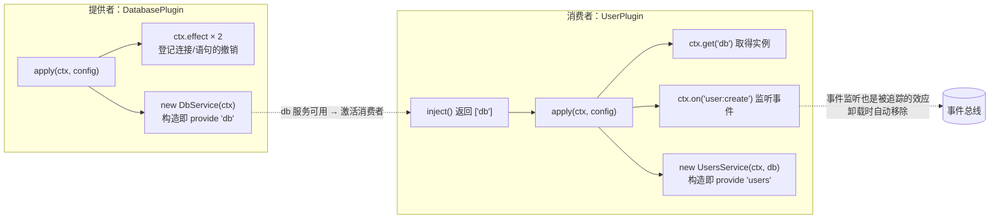
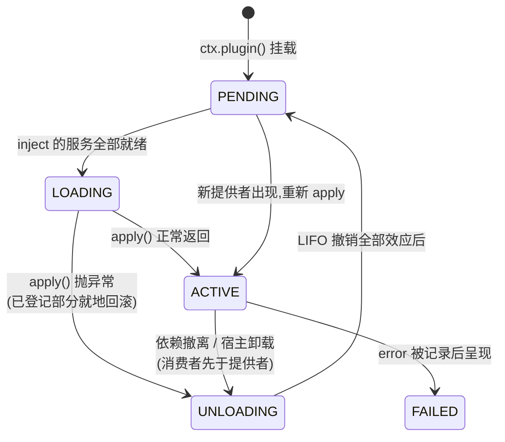
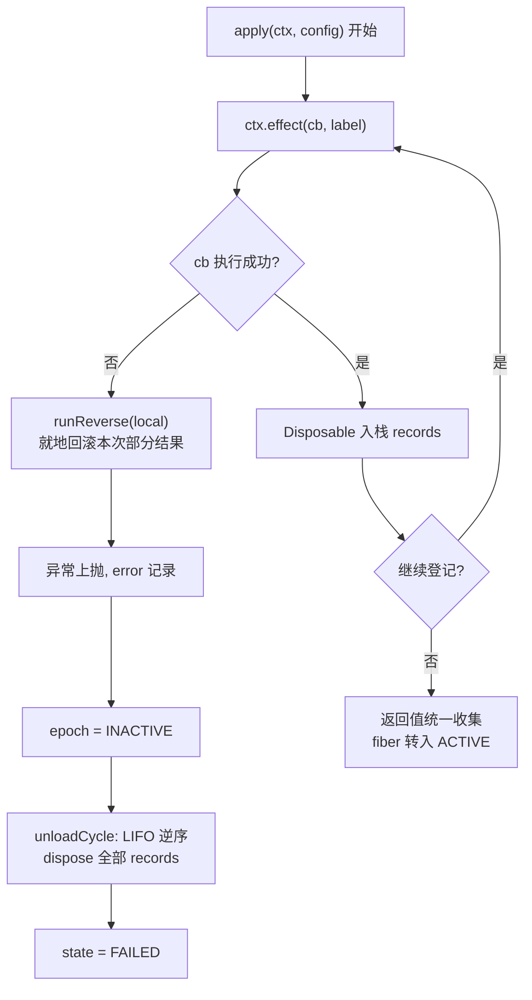

这篇教程带你从零写出一对真正能跑的插件：一个**提供者**（provider，对外提供 `db` 服务）和一个**消费者**（consumer，声明依赖 `db` 并使用它）。你会亲手实践 cordis 插件契约的全部三要素——用 `inject()` 声明需要什么、在 `apply()` 里用 `provide`/`Service` 提供什么、用 `ctx.effect` 登记可撤销的副作用，并观察框架如何在依赖缺失时让插件安静等待、在失败与卸载时按 LIFO（后进先出）顺序自动回滚一切。全部示例直接取自仓库中可编译运行的 `cordis-example` 模块，代码零虚构。

Sources: [Plugin.java](cordis-core/src/main/java/dev/cordis/core/Plugin.java#L7-L17), [Main.java](cordis-example/src/main/java/dev/cordis/example/Main.java#L26-L38)

## 心智模型：一个插件只说清三件事

在 cordis 中，插件（Plugin）是唯一的"组件"单位。它的接口刻意做得很小：`name()` 报名字（用于日志）、`inject()` 声明依赖的服务名列表、`schema()` 可选地校验配置、`apply(ctx, config)` 是主体逻辑。关键语义有三条， beginners 必须先记住：**依赖不全就不启动**——`inject()` 里声明的服务名缺任何一个，插件就一直停留在 PENDING 等待状态；**依赖更换会自动重跑**——提供者被撤销时插件先回滚再等待，新提供者出现时重新执行 `apply()`；**登记即追踪**——在 `apply()` 里通过 `ctx.effect` / `ctx.provide` / `ctx.on` 登记的任何东西，框架都会自动记录撤销方式，你不需要在返回值里重复声明。

Sources: [Plugin.java](cordis-core/src/main/java/dev/cordis/core/Plugin.java#L18-L46)

提供者与消费者的关系可以用下面这张图概括。左边是数据库插件：不声明任何依赖，通过 `Service` 子类构造时自动 `provide("db", ...)`；右边是用户插件：声明 `inject: ["db"]`，通过 `ctx.get("db")` 取用，同时它自己也提供 `users` 服务，形成链式依赖——这正是大型应用的典型形态。



这张图上的每个箭头都有运行时保证：`db` 变为可用那一刻，UserPlugin 从 PENDING 转入 LOADING 并执行 `apply()`；`db` 被撤销那一刻，UserPlugin 先于 DatabasePlugin 回滚自己的全部效应（消费者先于提供者收尾，这样收尾代码还能用到依赖）。

Sources: [DatabasePlugin.java](cordis-example/src/main/java/dev/cordis/example/plugins/DatabasePlugin.java#L7-L12), [UserPlugin.java](cordis-example/src/main/java/dev/cordis/example/plugins/UserPlugin.java#L9-L13), [Fiber.java](cordis-core/src/main/java/dev/cordis/core/runtime/Fiber.java#L38-L39)

## 第一步：写提供者插件（DatabasePlugin）

新建一个类实现 `Plugin` 接口，覆写 `name()` 和 `apply()`，不需要覆写 `inject()`（默认空列表，即无依赖、立即可启动）。下面是仓库中的完整实现，注意 `apply` 的写法：**它不返回任何东西，也不写任何清理代码**——打开连接、预编译语句这两个副作用分别通过 `ctx.effect` 登记，撤销方式由回调返回值（一个 `Disposable` 函数式接口）描述，运行时自动累加进撤销栈。

```java
public class DatabasePlugin implements Plugin {

    @Override
    public String name() {
        return "database";
    }

    @Override
    public Object apply(Context ctx, Object config) {
        Logger log = ctx.logger("database");
        log.info("正在打开连接");

        ctx.effect(cb -> {
            log.info("  [连接] 已建立");
            return (Disposable) () -> log.info("  [连接] 已释放");
        }, "open-connection");

        ctx.effect(cb -> {
            log.info("  [语句] 已预编译");
            return (Disposable) () -> log.info("  [语句] 已关闭");
        }, "prepare-statements");

        DbService db = new DbService(ctx);   // 构造即 provide("db", db)
        if (!db.isReadOnly()) {
            db.put("boot", "ok");
        }
        return null; // 一切需要撤销的都已登记在案
    }
}
```

`ctx.effect(callback, label)` 的行为是：回调**立即执行**，其返回值被收进当前 fiber 的撤销栈；若回调中途抛异常，已产生的部分结果会被就地逆序回滚（下一节详解）。`apply()` 的返回值与 `effect` 回调遵循同一契约：`null`（无额外撤销）、单个 `Disposable`（单阶段效果）、或 `Iterable<Disposable>`（多阶段效果）。参数含义汇总如下。

Sources: [DatabasePlugin.java](cordis-example/src/main/java/dev/cordis/example/plugins/DatabasePlugin.java#L13-L44)

| API | 参数 | 返回值 | 语义 |
|---|---|---|---|
| `ctx.effect(callback, label)` | `callback`：效果体，立即执行；`label`：诊断名 | `Disposable`，可手动撤销一次 | 回调返回 `Disposable`/`Iterable<Disposable>`/`null`，自动入栈 |
| `ctx.provide(name, value)` | 服务名、服务实例 | `Disposable` | 由当前 fiber 提供服务，fiber 卸载时自动注销 |
| `ctx.provide(name, value, check)` | 额外一个可用性谓词 | 同上 | 依赖方加载前先调 `check`，不通过视为不可用 |
| `ctx.logger(name)` | 日志器名 | `Logger` | 取日志门面，输出带前缀 |

Sources: [Context.java](cordis-core/src/main/java/dev/cordis/core/runtime/Context.java#L235-L255), [EffectCallback.java](cordis-core/src/main/java/dev/cordis/core/effect/EffectCallback.java#L6-L27)

服务本身怎么提供？有两种等价写法。写法一是直接调用 `ctx.provide("db", db)`；写法二（示例采用）是继承 `Service` 基类，在构造方法里调 `super(ctx, "db")`——基类构造器内部执行的就是 `ctx.provide(name, this, value -> isAvailable())`，也就是说 **provide 本身也是提供者 fiber 的一个效应**，fiber 卸载时自动注销，无需手写。`DbService` 还演示了 `interceptConfig()`：读取当前上下文合并后的拦截配置，据此决定自身是否只读。

Sources: [Service.java](cordis-core/src/main/java/dev/cordis/core/coeffect/Service.java#L11-L33), [DbService.java](cordis-example/src/main/java/dev/cordis/example/plugins/DbService.java#L15-L28)

## 第二步：写消费者插件（UserPlugin）

消费者与提供者的差别只在一处：覆写 `inject()`，返回依赖服务名的列表。`["db"]` 这一行声明就是整个依赖协商的全部——插件在自己的隔离域内没有 ACTIVE 的提供者解析出 `db` 时保持 PENDING；提供者出现时激活；提供者被撤销时回退。`apply()` 里用 `ctx.get("db")` 取得服务实例（**能 get 到什么，在声明 inject 的那一刻就定死了**，未声明的名字会抛 `UNDECLARED_ACCESS`，声明了但提供者未就绪会抛 `INACTIVE_ACCESS`）。

```java
public class UserPlugin implements Plugin {

    @Override
    public String name() {
        return "users";
    }

    @Override
    public List<String> inject() {
        return List.of("db");            // ← 全部核心：声明依赖
    }

    @Override
    public Object apply(Context ctx, Object config) {
        Logger log = ctx.logger("users");
        DbService db = ctx.get("db");    // ← 依赖已就绪，直接取
        log.info("已加载,解析到 db@{}", System.identityHashCode(db));

        ctx.on("user:create", args -> {  // ← 事件监听也是效应，卸载自动移除
            log.info("事件 user:create {}", args[0]);
            return null;
        });

        UsersService users = new UsersService(ctx, db); // 构造即 provide("users", ...)
        if (!db.isReadOnly()) {
            users.create("alice");
        }
        return null; // 监听器 + 服务注册都是被追踪的效应
    }
}
```

对比传统手写依赖注入，`inject` 声明带来的是**时序上的解耦**——你不再需要关心提供者何时出现、何时消失：

| 关注点 | 传统手动注入 | cordis `inject` 声明 |
|---|---|---|
| 依赖未就绪时 | 需自己写等待/重试/启动排序 | 插件停留 PENDING，框架自动驱动 |
| 依赖被替换时 | 旧引用悬空，手工刷新 | 旧 fiber 回滚 → 新提供者就绪后重新 `apply` |
| 清理时机 | try/finally 手动编写 | `effect`/`provide`/`on` 登记即追踪，LIFO 自动回滚 |
| 取值合法性 | 无约束 | `get` 做能力检查，越界即抛异常 |

Sources: [UserPlugin.java](cordis-example/src/main/java/dev/cordis/example/plugins/UserPlugin.java#L14-L46), [UsersService.java](cordis-example/src/main/java/dev/cordis/example/plugins/UsersService.java#L13-L21), [Context.java](cordis-core/src/main/java/dev/cordis/core/runtime/Context.java#L30-L33)

如果不想定义完整的类，`Plugin.of(name, inject, body)` 可以用 lambda 快速包出一个插件；`ctx.inject(deps, body)` 更进一步——等依赖齐了就执行回调，依赖换了自动重跑。这两种简写内部走的都是同一套 Fiber 生命周期，与完整插件无任何语义差异。

Sources: [Plugin.java](cordis-core/src/main/java/dev/cordis/core/Plugin.java#L48-L66), [Context.java](cordis-core/src/main/java/dev/cordis/core/runtime/Context.java#L267-L270), [RegistryService.java](cordis-core/src/main/java/dev/cordis/core/runtime/RegistryService.java#L86-L92)

## 第三步：挂载并观察生命周期

万事俱备，在 `main` 里创建根上下文并挂载插件。`ctx.plugin(plugin, config)` 返回新建的 `Fiber`（插件的一次运行实例），此后它的生命周期完全由依赖变化自动驱动，你不需要再碰它。演示程序刻意**先挂载消费者、后挂载提供者**，用来展示 PENDING 等待语义：

```java
Context root = Context.createRoot();
root.onGlobal("internal/status", st -> {           // 观察状态迁移
    Fiber fiber = (Fiber) st[0];
    root.logger("cordis").info("  状态: {} {} → {}",
        fiber.name(), st[1], fiber.state);
    return null;
});

root.plugin(new UserPlugin());      // db 还不存在 → users 停在 PENDING
root.plugin(new DatabasePlugin());  // db 就绪 → users 自动激活
```

完整的生命周期流转如下图。PENDING 状态下 fiber 不执行任何逻辑也不占用效果；依赖齐全时进入 LOADING、执行 `apply()`、转入 ACTIVE；`apply()` 抛异常则记录错误进入 FAILED；提供者撤离或宿主卸载时进入 UNLOADING，逆序执行全部撤销动作后回到 PENDING，等待下一次机会。



运行后控制台会先打印 `users` 的 `PENDING` 停留，随后是 `users ACTIVE`；你可以立即 `root.getOrNull("users")` 拿到服务并调用 `users.create("bob")`、`root.emit("user:create", "carol")` 触发事件——一切都在同一次挂载后自动就位。

Sources: [Main.java](cordis-example/src/main/java/dev/cordis/example/Main.java#L49-L68), [Fiber.java](cordis-core/src/main/java/dev/cordis/core/runtime/Fiber.java#L364-L375)

## 第四步：验证自动回滚（两条路径）

cordis 的回滚保证覆盖两条路径，写插件时**你一行清理代码都不用写**。

**路径一：`apply()` 中途失败。** `ctx.effect` 的回调如果抛出异常，`Fiber.effect` 会立刻对本次已产生的部分结果执行 `runReverse`（逆序 dispose）再原样重抛；`reloadCycle` 捕获后记录错误、把 epoch 置为 INACTIVE，随后链式触发 `unloadCycle` 回滚此前已成功登记的全部效应。也就是说：**一个插件要么完整启动，要么好像从未来过**。



**路径二：提供者被撤销。** 演示程序的场景 2 通过声明式加载器只保留 `users` 条目（等效于移除 database 插件），可观察到：`users` 先转入 UNLOADING 并按 LIFO 逆序回滚（事件监听器移除 → `users` 服务注销），**然后** `database` 才回滚自己的效应（`users` 服务注销时其内部仍可安全使用已提交视图里的 `db`），最终两者一起回到 PENDING。再次加载 database（场景 3）时，`users` 针对新的提供者 fiber 重新激活、重新执行 `apply()`。

Sources: [Fiber.java](cordis-core/src/main/java/dev/cordis/core/runtime/Fiber.java#L176-L206), [Fiber.java](cordis-core/src/main/java/dev/cordis/core/runtime/Fiber.java#L313-L369), [Main.java](cordis-example/src/main/java/dev/cordis/example/Main.java#L70-L81)

用 DatabasePlugin 的两个 `effect` 走一遍 LIFO：登记顺序是"打开连接 → 预编译语句"，回滚顺序必然是"关闭语句 → 关闭连接"——每个 `Disposable` 保证只被调用一次，重复调用无害。这正是论文中"可回退效应"（revertible effect）的工程含义：**打开的顺序的逆序就是关闭的顺序**，作者永远不用写卸载路径。

Sources: [Disposable.java](cordis-core/src/main/java/dev/cordis/core/effect/Disposable.java#L5-L19), [Fiber.java](cordis-core/src/main/java/dev/cordis/core/runtime/Fiber.java#L234-L238)

## 常见问题排查

初学者最容易踩的坑都对应框架的稳定错误码，先查表再调试：

| 症状 | 错误码 | 原因 | 修正方式 |
|---|---|---|---|
| `cannot get property ... without inject` | `UNDECLARED_ACCESS` | `ctx.get("x")` 但 `inject()` 未声明 `x` | 把名字加进 `inject()` 返回列表 |
| `cannot get required service ... in inactive context` | `INACTIVE_ACCESS` | 声明了依赖但提供者未 ACTIVE 就调用 `get` | 只在 `apply()` 内取用；检查提供者日志 |
| `cannot create effect on inactive context` | `INACTIVE_EFFECT` | 在已卸载/卸载中的 fiber 上继续 `effect`/`provide` | 不要缓存 `ctx` 到外部异步回调里使用 |
| `Invalid effect: expected Disposable, got ...` | `IllegalArgumentException` | effect 回调/apply 返回了不认识的类型 | 返回值只能是 `null`、`Disposable` 或 `Iterable<Disposable>` |
| 插件挂载后迟迟不启动 | （无异常） | 某个 inject 的服务名拼错或提供者被禁用 | 核对服务名字符串；查看 `internal/status` 日志 |
| 卸载时某个撤销动作抛异常 | （记入日志，不中断） | 撤销代码自身 bug | `unloadCycle` 对每条 dispose 单独捕获记录，其余照常执行 |

Sources: [CordisException.java](cordis-core/src/main/java/dev/cordis/core/CordisException.java#L9-L26), [Fiber.java](cordis-core/src/main/java/dev/cordis/core/runtime/Fiber.java#L352-L360), [Context.java](cordis-core/src/main/java/dev/cordis/core/runtime/Context.java#L196-L207)

## 收尾与下一步

至此你已完成 cordis 插件开发的完整闭环：声明 `inject` → 实现 `apply` → 通过 `Service`/`ctx.provide` 提供服务 → 通过 `ctx.effect` 登记副作用 → 框架在等待、激活、失败、卸载四个方向上全部自动处理。建议的进阶路线按目录顺序：

1. 深入理解回滚原语的数学结构 → [Disposable 逆变换：LIFO 折叠、失败回滚与单次处置](7-disposable-ni-bian-huan-lifo-zhe-die-shi-bai-hui-gun-yu-dan-ci-chu-zhi) 与 [多阶段效应：惰性 Iterable、检查点中断与部分回滚](8-duo-jie-duan-xiao-ying-duo-xing-iterable-jian-cha-dian-zhong-duan-yu-bu-fen-hui-gun)
2. 弄清 `get` 能力检查的精确规则 → [inject 能力检查：UNDECLARED_ACCESS 与 INACTIVE_ACCESS 的访问规则](9-inject-neng-li-jian-cha-undeclared_access-yu-inactive_access-de-fang-wen-gui-ze)
3. 掌握 `Service` 基类与提供者注销 → [Service 服务基类：构造即 provide、可用性检查与自动注销](13-service-fu-wu-ji-lei-gou-zao-ji-provide-ke-yong-xing-jian-cha-yu-zi-dong-zhu-xiao)
4. 回看驱动这一切的运行时内核 → [Fiber 生命周期状态机：六态流转与惰性链式转换](15-fiber-sheng-ming-zhou-qi-zhuang-tai-ji-liu-tai-liu-zhuan-yu-duo-xing-lian-shi-zhuan-huan)