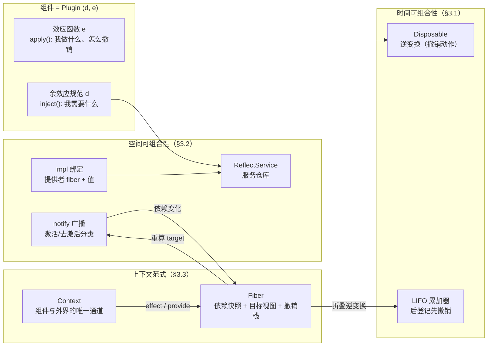
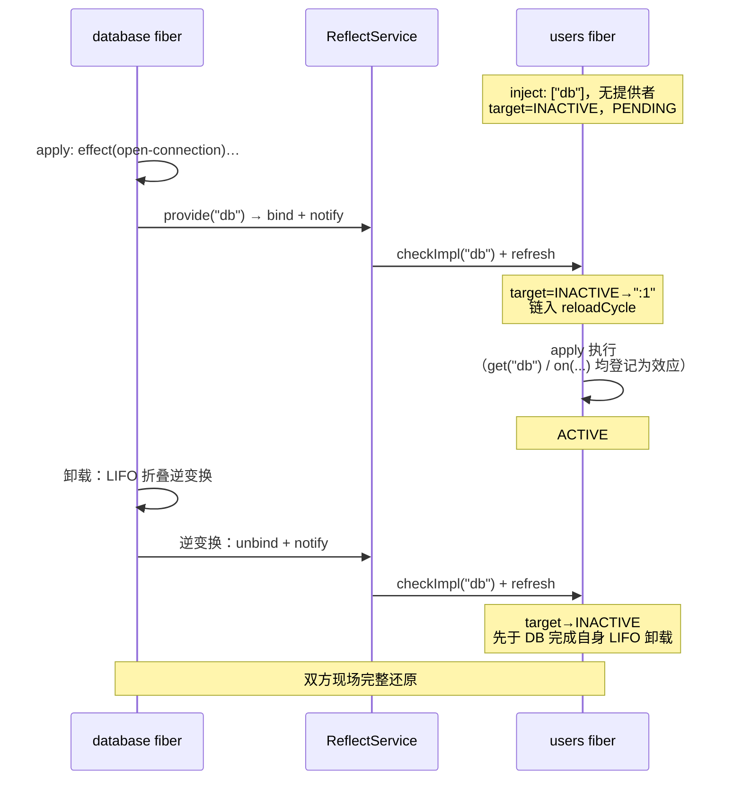

本页是"深入解析"部分的理论基石：解释 cordis-java 所实现的**时空可组合性（spatiotemporal composability）范式**——它源自论文 *A Programming Paradigm for Spatiotemporal Composability*（Shi, Zhang, Cui；北大 & DeepSeek-AI）第 3–5 章，并在此仓库中以 Java 25 落地为可运行的运行时模型。读完本页，你将理解两个核心机制——**时间维度的可回退效应**与**空间维度的响应式余效应**——如何经同一个上下文中介被统一为一台"会自己运转的机器"，以及后续所有专题页所共享的概念词汇表。

## 范式的出发点：为什么"组件"需要两个维度

传统插件系统只回答了一个问题："组件启动时做什么"。但现实中的组件还必须回答另外两个问题：**它做的改动将来怎么收回？它依赖的服务消失了怎么办？**前者是时间维度——组件的生命周期有开始就必有结束，结束后现场必须被完整还原；后者是空间维度——组件不是孤岛，它嵌入在一个由其他组件提供的服务构成的环境中，环境变化必须自动反映到组件上。传统框架把这两个问题的答案散落在销毁回调、依赖注入容器、事件监听器清理等各处，导致组件的"存在"无法被整体装卸。

本范式给出的解法是把组件定义为一对声明的组合：**余效应规范 d**（我需要哪些服务）+ **效应函数 e**（依赖就绪时我做什么、怎么撤销）。在代码中，这直接对应 `Plugin` 接口的 `inject()` 与 `apply()` 两个方法——`inject` 声明依赖的服务名，全部可用时 `apply` 才启动，缺一个就等待，依赖更换时先撤销旧的再重跑。README 中的维度对照表明确指出：时间可组合性对应论文 §3.1 的可回退效应机制，空间可组合性对应 §3.2 的响应式余效应机制，而两者的统一是 §3.3 的上下文范式。

Sources: [README.md](README.md#L3-L14)、[Plugin.java](cordis-core/src/main/java/dev/cordis/core/Plugin.java#L7-L46)

整个核心包按此理论切分为三个子包，这个结构本身就是范式的路线图：`dev.cordis.core.effect`（怎么登记、怎么撤销）、`dev.cordis.core.coeffect`（需要什么、由谁提供）、`dev.cordis.core.runtime`（把前两块粘成会自转的机器）。

Sources: [package-info.java](cordis-core/src/main/java/dev/cordis/core/package-info.java#L1-L15)

用一张概念关系图固定全貌（后文逐层展开）：

## 时间可组合性：可回退效应（§3.1）

**可回退效应的契约极简：组件对外界做的每个改动，登记时就要同时说清"以后怎么撤销"。**登记入口是 `Context.effect(cb)`，回调立即执行并返回一个 `Disposable`——效应的"逆变换"。例如"打开连接"必须当场配套一个"关闭连接"。卸载时框架按"后登记的先撤销"（LIFO）逆序执行所有逆变换，现场被完整还原。

`Disposable` 是单方法函数式接口，仅含 `dispose()`，并内建三个组合原语：`noop()`（组合的"零"）、`composeAfter(before)`（把新动作"垫"到最前面，从而自然形成 LIFO 序）、`sequence(first, second)`（顺序执行）。这种代数化的设计意味着逆变换本身可组合——这正是论文中"累加器按 LIFO 恢复"在类型层面的体现。

Sources: [effect/package-info.java](cordis-core/src/main/java/dev/cordis/core/effect/package-info.java#L1-L16)、[Disposable.java](cordis-core/src/main/java/dev/cordis/core/effect/Disposable.java#L10-L39)

效应体 `EffectCallback` 允许三种返回形态：单个 `Disposable`（单阶段）、`null`（无需撤销）、或**一组** `Disposable`（多阶段效应——每产生一个就登记一个，阶段之间是"检查点"，fiber 的目标变了可以在检查点停下，只回滚已完成部分）。`flatten` 静态方法负责把返回值统一整理为撤销动作列表。值得注意的是，插件 `apply` 的返回值同样遵守这个契约——插件主体本身就是一个效应。

Sources: [EffectCallback.java](cordis-core/src/main/java/dev/cordis/core/effect/EffectCallback.java#L7-L45)、[Plugin.java](cordis-core/src/main/java/dev/cordis/core/Plugin.java#L35-L46)

算法 1 的实现在 `Fiber.effect` 中：回调立即执行；返回的逆变换连同诊断信息（`EffectMeta`，构成效果树）收进本 fiber 的撤销栈；每个登记返回一个"disposer"，其 `armed` 标志保证**单次处置**（调两次无害）。关键的失败回滚语义在此处兑现——若回调中途抛出异常，框架立即对已收集的部分逆变换按逆序执行（`runReverse(local)`），再向上传播异常：**现场绝不停留在"改到一半"的中间状态**。多阶段的惰性 `Iterable` 则通过 `collectResult` 的 `guard` 参数实现：每取一个阶段前检查目标是否仍成立，不成立即停。

Sources: [Fiber.java](cordis-core/src/main/java/dev/cordis/core/runtime/Fiber.java#L163-L232)

示例插件 `DatabasePlugin` 演示了这一维度的实践价值：`apply` 体依次登记"打开连接"与"预编译语句"两个效应后返回 `null`——运行时自动累加逆变换，卸载时按 LIFO 执行（先关语句、再关连接），**作者无需编写任何卸载路径**。代码注释将此性质称为"关注点局部性"（论文 §5.3）：撤销逻辑紧跟在对应的正向逻辑旁，而非集中在一个遥远的 destroy 方法里。

Sources: [DatabasePlugin.java](cordis-example/src/main/java/dev/cordis/example/plugins/DatabasePlugin.java#L7-L43)

> LIFO 折叠的逐条推理、失败回滚与单次处置的细节展开，见 [Disposable 逆变换：LIFO 折叠、失败回滚与单次处置](7-disposable-ni-bian-huan-lifo-zhe-die-shi-bai-hui-gun-yu-dan-ci-chu-zhi)；多阶段效应与检查点中断，见 [多阶段效应：惰性 Iterable、检查点中断与部分回滚](8-duo-jie-duan-xiao-ying-duo-xing-iterable-jian-cha-dian-zhong-duan-yu-bu-fen-hui-gun)。

## 空间可组合性：响应式余效应（§3.2）

如果说效应回答"我对外界做了什么"，**余效应（coeffect）回答的则是"环境向我提供了什么"**。实现上是三件套：`ReflectService` 是挂在根上下文上的全局服务仓库，绑定表按 `RealmKey` 隔离域分 key 存放——同名服务在不同域各有一条绑定，多租户互不干扰；`Impl` 是一条绑定，包含服务名、**提供者 fiber**、当前值、可选的可用性检查谓词；`RealmKey` 是隔离域的"门牌号"，以对象身份判定是否同域，`fresh` 创建独享域、`shared(label)` 让相同标签进入共享域。

绑定与提供者的生命周期**同生共死**：`Impl` 的 javadoc 明确说"fiber 处于 ACTIVE 时，同隔离域里的依赖方才能看到它；fiber 一旦卸载，绑定随之消失"。这个耦合是响应式语义的根基——服务不是一个静态注册项，而是某个活着的组件实例的存在证明。

Sources: [coeffect/package-info.java](cordis-core/src/main/java/dev/cordis/core/coeffect/package-info.java#L1-L13)、[ReflectService.java](cordis-core/src/main/java/dev/cordis/core/coeffect/ReflectService.java#L14-L32)、[Impl.java](cordis-core/src/main/java/dev/cordis/core/coeffect/Impl.java#L7-L29)、[RealmKey.java](cordis-core/src/main/java/dev/cordis/core/coeffect/RealmKey.java#L5-L28)

**"响应式"的来源是 `ReflectService.notify` 广播机制。**绑定一有变化（提供或注销），`notify` 遍历所有声明了该服务、且与发起方在同一隔离域解析该服务的 fiber，对每个受影响者执行 `checkImpl`（重新核对提供者是否仍 ACTIVE 且通过可用性检查）再 `refresh`（重算目标视图）。论文 §3.2 把这种变化按组件规范分类为三态：**激活**（依赖由缺变齐 → 加载）、**去激活**（由齐变缺 → 卸载）、**中性**（无实质变化，重算无副作用）。依赖齐了自动启动、缺了自动回滚——组件对环境变化的响应不需要任何手写胶水代码。

Sources: [ReflectService.java](cordis-core/src/main/java/dev/cordis/core/coeffect/ReflectService.java#L87-L115)

每个 fiber 内部用**目标视图（target）**驱动这一切：`refresh` 遍历声明的每个依赖，拼接其提供者 fiber 的 uid 形成摘要（如 `":3:5"`）；任一依赖缺失则 target 为 `__INACTIVE__`。target 变化即触发 `setEpoch`——由缺变齐链入 `reloadCycle`（加载），反之链入 `unloadCycle`（卸载）。这个"提供者 uid 摘要"的精妙之处在于：它捕捉的是**提供者身份**而非服务值——同值的服务替换（覆写绑定）不触发重载，而提供者换人则必然重载。

Sources: [Fiber.java](cordis-core/src/main/java/dev/cordis/core/runtime/Fiber.java#L273-L302)

> 能力检查规则（UNDECLARED_ACCESS / INACTIVE_ACCESS）详见 [inject 能力检查](9-inject-neng-li-jian-cha-undeclared_access-yu-inactive_access-de-fang-wen-gui-ze)；仓库与广播机制详见 [ReflectService 服务仓库与 notify 变更广播机制](10-reflectservice-fu-wu-cang-ku-yu-notify-bian-geng-yan-bo-ji-zhi)；隔离域详见 [RealmKey 隔离域](11-realmkey-ge-chi-yu-duo-zu-hu-ge-chi-yu-gong-xiang-biao-qian-join)；target/epoch 的重载判定详见 [epoch 与 target 视图](16-epoch-yu-target-shi-tu-ti-gong-zhe-zhai-yao-qu-dong-de-zhong-zai-pan-ding)。

## 统一：上下文作为公共中介（§3.3）

两个维度之所以能统一，是因为它们被**同一个上下文**中介：`Context` 是组件与外界打交道的唯一通道，一切操作都经它——登记效果（`effect`）、提供/获取服务（`provide`/`get`）、加载插件（`plugin`）、派生隔离与拦截（`isolate`/`intercept`）。效应的登记口与余效应的查询口是同一扇门，这正是论文 §3.3 的论点在代码结构上的直译。

Sources: [Context.java](cordis-core/src/main/java/dev/cordis/core/runtime/Context.java#L18-L34)

统一的深层证据在于：**空间维度的每个操作都被实现为时间维度的效应。**看 `Fiber.provide` 的实现——提供服务时，"绑定 + 广播"这个空间动作被包装成一个登记在提供者 fiber 撤销栈上的效应，其逆变换是"解绑 + 广播"。于是提供者卸载时，绑定注销与依赖方通知**自动发生**，无需任何特设的清理逻辑。同理，`plugin()` 挂载本身也是父 fiber 上的一个效应（论文 Definition 52 的 O-Insert 原语，其逆为 O-Retire）——父级卸载时级联卸载所有子插件。**整个系统因此只有一种"存在"的记账方式：效应记账。**

Sources: [Fiber.java](cordis-core/src/main/java/dev/cordis/core/runtime/Fiber.java#L467-L488)、[Fiber.java](cordis-core/src/main/java/dev/cordis/core/runtime/Fiber.java#L107-L126)

承担统一执行的是 **`Fiber`**——插件的一次运行实例。它同时记录三样东西：**依赖快照**（store，启动那一刻各依赖分别由谁提供）、**目标视图**（target，"我的每个依赖现在由谁提供"的摘要）、**撤销动作栈**（所有已登记效应的逆变换）。前两者是空间维度的账本，第三者是时间维度的账本，三者在同一个对象上交汇。加载周期 `reloadCycle` 提交解析视图、校验配置、执行插件体，且执行期间以 `target == target0` 为 guard——若依赖在启动过程中就变了，结果被丢弃并链入卸载；卸载周期 `unloadCycle` 按逆序执行全部逆变换。转换一旦开始就一口气跑完（惰性 `inertia` 链），跑完再对比最新 target，不一致就接着跑下一个——系统永不停在中间状态。

Sources: [Fiber.java](cordis-core/src/main/java/dev/cordis/core/runtime/Fiber.java#L24-L40)、[Fiber.java](cordis-core/src/main/java/dev/cordis/core/runtime/Fiber.java#L313-L369)

两个维度的闭合回路可以完整走一遍（以 `UserPlugin` 声明 `inject: ["db"]` 为例）：`users` 先挂载但 db 无提供者 → target 为 INACTIVE → **PENDING**（等待是正常状态，不是错误）；`database` 挂载并在 `apply` 中 `ctx.provide("db", ...)` → 绑定写入仓库 + `notify` 广播 → `users` 被重新检查，`checkImpl` 找到 ACTIVE 提供者，target 变为 `":1"` → `reloadCycle` 执行其 `apply`（其中 `ctx.get("db")` 通过能力检查拿到服务，`ctx.on` 注册的事件监听器同样作为效应被登记）→ **ACTIVE**。反向：`database` 卸载 → 其撤销栈执行到"解绑 db + notify" → `users` 的 target 变回 INACTIVE → 先于提供者完成自己的 LIFO 卸载（消费者先于提供者的顺序保证）→ 双方现场完整还原。**空间的变化自动翻译为时间的折叠**——这就是两个维度统一的运行时含义。

Sources: [UserPlugin.java](cordis-example/src/main/java/dev/cordis/example/plugins/UserPlugin.java#L10-L44)、[Fiber.java](cordis-core/src/main/java/dev/cordis/core/runtime/Fiber.java#L377-L390)、[FiberState.java](cordis-core/src/main/java/dev/cordis/core/runtime/FiberState.java#L6-L13)

## 范式对照：概念到代码的完整映射

把论文概念、运行时机制与本仓库代码逐一对齐，形成后续所有专题页共用的参照表：

| 论文概念 | 论文章节 | 运行时机制 | 代码落点 |
|---|---|---|---|
| 组件 = (d, e) | §3 | inject 声明 + apply 效应函数 | `Plugin.inject()` / `Plugin.apply()` |
| 可回退效应 | §3.1 | 登记即配套逆变换，LIFO 累加器 | `Context.effect` / `Fiber.effect` |
| 逆变换 | §3.1 | 撤销动作，可组合、单次处置 | `Disposable` |
| 多阶段效应 | §3.1 | 惰性 Iterable，检查点可中断 | `EffectCallback` + `collectResult` |
| 响应式余效应 | §3.2 | 绑定变化分类为激活/去激活/中性 | `ReflectService.notify` + `Fiber.refresh` |
| 余效应规范 d | §3.2 (Def. 48) | 依赖服务名声明 | `Plugin.inject()` |
| 服务绑定 | §3.2 | 提供者 fiber + 值 + 可用性检查 | `Impl` |
| 隔离域 | §3.2 | 同名服务多域独立解析 | `RealmKey` |
| 上下文范式 | §3.3 | 效应与余效应经同一中介 | `Context` |
| 实例化原语 | §4/5 (Def. 52) | O-Insert / O-Retire（挂载即效应） | `Fiber` 构造器 / `RegistryService` |
| 目标视图 | §4 | 提供者 uid 摘要驱动重载判定 | `Fiber.target` / `Fiber.epoch` |
| 惰性链式转换 | §4/5 (Def. 23) | 转换必先完成，再链入下一个 | `Fiber.inertia` / `runChain` |

Sources: [README.md](README.md#L8-L14)、[README.md](README.md#L18-L50)、[Fiber.java](cordis-core/src/main/java/dev/cordis/core/runtime/Fiber.java#L41-L77)

与传统插件/依赖注入模型对比，可以看出范式 buys you what：

| 维度 | 传统 DI / 插件框架 | 本范式 |
|---|---|---|
| 卸载语义 | 通常缺失或手写 destroy 回调 | 每个改动登记时即声明逆变换，LIFO 自动折叠 |
| 依赖消失 | 静态注入，容器启动后不再感知 | notify 广播自动去激活，依赖方先于提供者卸载 |
| 半初始化状态 | 常见（部分 bean 建成） | 转换必先完成再响应新目标，无中间态 |
| 组件可逆装卸 | 需自建（OSGi 类系统的复杂性） | plugin() 挂载本身是效应，父卸载级联子卸载 |
| 撤销逻辑局部性 | 集中在远处的清理代码 | 紧贴正向逻辑（关注点局部性） |
| 多租户 | 需为每租户建独立容器 | `RealmKey` 隔离域在同一容器内分 key |

## 小结与阅读路线

本页确立的核心论断：**可回退效应提供"存在"的记账方式，响应式余效应提供"环境"的感知方式，上下文把两者焊接为一个自转的闭环**——空间变化（绑定增删）被翻译为时间折叠（加载/卸载周期），时间折叠的边界（ACTIVE 状态变化）又反过来驱动空间广播（`updateState` 只在 ACTIVE 与非 ACTIVE 的跨越时才触发 `reflect.notify`，即 §3.2 的三态分类）。后续专题页都是对这个闭环某一环节的放大镜。

Sources: [Fiber.java](cordis-core/src/main/java/dev/cordis/core/runtime/Fiber.java#L377-L390)

按目录结构，建议的下一步阅读路线：

1. **时间维度深入**：[Disposable 逆变换：LIFO 折叠、失败回滚与单次处置](7-disposable-ni-bian-huan-lifo-zhe-die-shi-bai-hui-gun-yu-dan-ci-chu-zhi) → [多阶段效应：惰性 Iterable、检查点中断与部分回滚](8-duo-jie-duan-xiao-ying-duo-xing-iterable-jian-cha-dian-zhong-duan-yu-bu-fen-hui-gun)；
2. **空间维度深入**：[inject 能力检查](9-inject-neng-li-jian-cha-undeclared_access-yu-inactive_access-de-fang-wen-gui-ze) → [ReflectService 服务仓库与 notify 变更广播机制](10-reflectservice-fu-wu-cang-ku-yu-notify-bian-geng-yan-bo-ji-zhi) → [RealmKey 隔离域](11-realmkey-ge-chi-yu-duo-zu-hu-ge-chi-yu-gong-xiang-biao-qian-join) → [intercept 拦截](12-intercept-lan-jie-pei-zhi-zhu-ceng-he-bing-yu-quan-xian-shou-suo) → [Service 服务基类](13-service-fu-wu-ji-lei-gou-zao-ji-provide-ke-yong-xing-jian-cha-yu-zi-dong-zhu-xiao)；
3. **运行时内核**：[Context 上下文范式](14-context-shang-xia-wen-fan-shi-parent-lian-extend-isolate-intercept-pai-sheng) → [Fiber 生命周期状态机](15-fiber-sheng-ming-zhou-qi-zhuang-tai-ji-liu-tai-liu-zhuan-yu-duo-xing-lian-shi-zhuan-huan) → [epoch 与 target 视图](16-epoch-yu-target-shi-tu-ti-gong-zhe-zhai-yao-qu-dong-de-zhong-zai-pan-ding)；
4. 若你关心 Java 版与 TypeScript 原版的理论语义差异，可先读 [与 cordis（TypeScript 版）的语义映射与同步化设计取舍](6-yu-cordis-typescript-ban-de-yu-yi-ying-she-yu-tong-bu-hua-she-ji-qu-she)。