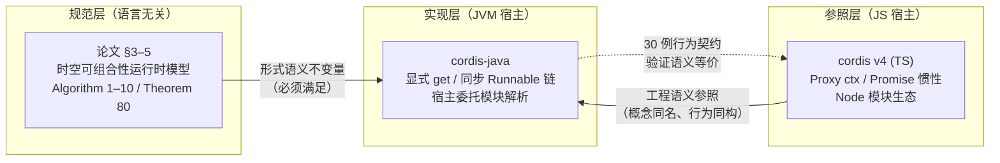
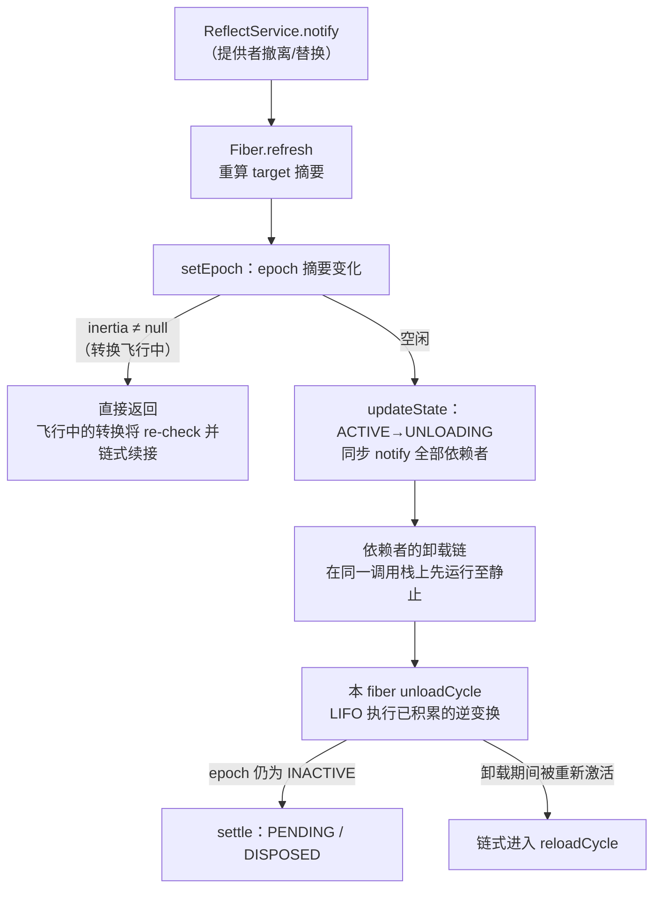

本页回答贯穿整个移植工程的核心问题：**cordis-java 与 TypeScript 版 cordis v4 之间，哪些语义必须原样保持，哪些形状允许随宿主语言重造？** 本页不展开各子系统的内部机制（那是后续专页的任务），而聚焦于映射策略本身：先确立"规范—参照—实现"的三方定位，再给出核心词汇的对照总表，最后逐项剖析代价最大的五处取舍——同步化、Proxy 缺席、模块系统外置、Symbol 相等性重建与生成器替代。

Sources: [README.md](README.md#L3-L6)

## 移植基准：规范层、参照层与实现层的三方定位

理解映射策略的第一步是分清两个"上游"。cordis-java 的语义来源有两条线：其一是论文 *A Programming Paradigm for Spatiotemporal Composability* 第 3–5 章的运行时模型（各 Algorithm 与 Definition），它是**规范层**——语言无关的形式化不变量，Java 实现必须逐条满足；其二是 vendored 的 cordis v4（TypeScript）源码，它是**参照层**——工程语义的参照物，提供"这个概念在真实系统里长什么样"的答案。Java 实现位于第三层：向规范层负责保真，向参照层借鉴形状，凡偏离都必须能归因于"JVM 没有对应语言原语"。README 开篇即明确这一三方关系，这也是全仓库注释里频繁出现 cordis 同名概念（如 `epoch`、`inertia`、`notify`）的原因。

下面的概念关系图展示三层之间的信息流向。阅读它需要知道：实线是"约束/参照"关系，虚线是"验证"关系——30 个单元测试构成的行为契约，正是 Java 实现向 TS 参照证明语义等价的手段。

这一分层直接给出了差异的判定标准：**凡规范层规定的转换不变量（转换一旦开始必然完成、依赖先于提供者完成卸载、终态只依赖最终配置），Java 版必须满足；凡 TS 版中由 JS 语言特性"顺便"实现的形状（Proxy 属性拦截、生成器、Promise 微任务），Java 版可以重造，但重造物必须能逐条对上原语义。** 后续五节将按"取舍从大到小"的顺序展开。

Sources: [README.md](README.md#L3-L6), [README.md](README.md#L138-L141)

## 核心词汇表：语义映射总表

下表是全仓库最浓缩的对照，与 README 的"与 cordis(TS)的对应"一节逐行对应，此处补充语义保真点与差异成因。左列是 cordis v4 的运行时概念，中列是 Java 对应物。后续各节将展开表中代价最大的几行。

| cordis v4 (TS) | cordis-java | 语义保真点 / 差异成因 |
|---|---|---|
| `ctx`（Proxy + prototype 链） | `Context`（parent 链 + 显式 isolate/intercept 表） | 派生上下文影子化父表而不改父表；Java 无属性拦截原语，读写走显式方法 |
| `ctx.effect(cb)` / 生成器效应 | `ctx.effect(EffectCallback)` | 惰性 `Iterable<Disposable>` 承接生成器多阶段语义，stage 边界即检查点 |
| `fiber.epoch` / `fiber.target` | `Fiber.epoch` / `Fiber.target` | 提供者 uid 摘要逐字符一致；覆写绑定（`set`）不触发重载 |
| `fiber.inertia`（Promise） | `Fiber.inertia`（同步 Runnable 链） | 惯性主机语义等价：转换必然完成、完成后才响应新目标；见"取舍一" |
| unload 前等待被通知的依赖 | ACTIVE→UNLOADING 状态变化同步通知 | 消费者先于提供者的逆变换完成卸载（L-Unload 守卫），由构造顺序保证 |
| `@cordisjs/loader` 按 id 调和 | `ComponentLoader.reconcile` | 差分与逐字段分发一致；终态只依赖最终配置（Theorem 80） |
| `@cordisjs/hmr`（Loader 内省） | `HmrEngine` + 宿主 `ModuleGraph`/`PluginResolver` | 三阶段算法一致；模块引入/撤出与依赖图外置给宿主 |
| `symbols.isolate`（JS Symbol） | `RealmKey`（对象身份 + intern） | 对象相等性镜像 Symbol 唯一性；字符串标签经 `shared` 全局 Join |

插件形状的映射同样遵循"语义优先"：TS 的 `Plugin` 携带余效应规范（`inject`，即论文的 *d*）、效应函数（`apply`，即论文的 *e*），提供物 *p* 在运行时经 `provide` 声明；"同一插件绑定不同 config 即为两个组件实例"这一组件定义在 Java 接口的 javadoc 中原样保留。`Plugin` 接口的 `apply` 返回值同时容纳单阶段（`Disposable`）与多阶段（`Iterable<Disposable>`）两种效应形状，对应 TS 版返回 disposer 与生成器两种写法。

Sources: [README.md](README.md#L112-L123), [Plugin.java](cordis-core/src/main/java/dev/cordis/core/Plugin.java#L7-L17)

## 取舍一：Promise 惯性到同步 Runnable 链——最根本的同步化决策

这是全部取舍中最根本的一项。TS 版的惯性主机（inertial host）建立在 JS 事件循环之上：`fiber.inertia` 是一个 Promise，转换经由微任务排队展开，卸载提供者之前还需要主动 `await` 被通知到的依赖者。Java 版没有事件循环的免费赠品，于是选择在**调用线程上同步抽干转换链**：`Fiber.inertia` 字段只是一个 `Runnable` 引用（与 `epoch` 并列的内部字段），转换的"排队"退化为写一个槽位，"事件循环"退化为一个 while 循环。

实现上的锚点是三个协作结构。`setEpoch` 是入口：当重算出的 epoch 与当前不同时，先判断 `inertia != null`——若已有转换在飞行中则直接返回（飞行中的转换完成后会 re-check 并链式续接新目标）；否则根据方向装配 `reloadCycle` 或 `unloadCycle` 到槽位并启动。`runChain` 是"事件循环"的替代物：循环取出当前任务、清空槽位、执行；任务执行期间若目标再次变化（`setEpoch` 被重入调用），新任务写回槽位，循环自动续跑，直到槽位为空、fiber 静止。`reloadCycle` 与 `unloadCycle` 是两个方向的转换体：前者提交依赖快照、解析配置、执行插件主体；后者逆序执行全部积累的逆变换。三者的衔接遵循同一条纪律——**每个 cycle 结束时对比 epoch 是否仍在飞行中变化，是则把下一个 cycle 写回 `inertia` 交给 `runChain` 续接**。

下面的流程图刻画一次典型的"提供者撤离"在同步实现中的完整调用路径。注意图中所有步骤发生在**同一个调用栈**上——这正是与 TS 版"微任务排队展开"的本质区别。

同步化带来的第二重收益是 **L-Unload 守卫从"运行时协议"降格为"构造顺序"**。TS 版必须在卸载提供者之前显式等待被通知的依赖；Java 版中，`updateState` 在状态从 ACTIVE 跨向非 ACTIVE 的瞬间同步发出 `reflect.notify`，所有消费者的卸载链在提供者执行自己的逆变换之前已在同一调用栈上跑完——`unloadCycle` 开头的注释明说了这一点："cordis awaits notified dependents here instead"。守卫顺序的完整机制见专页[卸载顺序保证：消费者先于提供者的 L-Unload guard](18-xie-zai-shun-xu-bao-zheng-xiao-fei-zhe-xian-yu-ti-gong-zhe-de-l-unload-guard)。

| 维度 | TS 版（Promise 惯性） | Java 版（同步 Runnable 链） |
|---|---|---|
| 转换何时完成 | 微任务队列抽干后 | `runChain` 返回时（栈上完成，更强） |
| 新目标的响应时机 | 飞行中 Promise re-check | `setEpoch` 的 `inertia != null` 早退 + 链式续接 |
| `await()` 的角色 | 等待 Promise 落定 | 纯错误传播：仅在 FAILED 时重抛启动错误 |
| 卸载等待协议 | unload 前 `await` 依赖 | ACTIVE→UNLOADING 同步 notify，构造顺序保证 |
| 代价 | 需要事件循环宿主 | 长依赖链占用调用栈；阻塞型效应需自行对接 `CompletableFuture` |

这一取舍的代价与边界同样明确。其一，`await()` 退化为纯错误传播：同步实现的转换在返回前已经静止，`await()` 只负责把 FAILED 状态下记录的启动错误按原类型重抛——它对应 TS 版 `await fiber` 的落点，但不再是等待原语。其二，长依赖链的卸载会形成深调用栈，插件数量极大时需留意栈深；其三，阻塞或异步副作用必须在 `Disposable` 内自行对接 `CompletableFuture` 等异步设施，框架不为效应体提供异步执行环境——README 的设计取舍一节对这三点均有明示。状态机六态流转与链式转换的完整细节见[Fiber 生命周期状态机：六态流转与惰性链式转换](15-fiber-sheng-ming-zhou-qi-zhuang-tai-ji-liu-tai-liu-zhuan-yu-duo-xing-lian-shi-zhuan-huan)与[epoch 与 target 视图：提供者摘要驱动的重载判定](16-epoch-yu-target-shi-tu-ti-gong-zhe-zhai-yao-qu-dong-de-zhong-zai-pan-ding)。

Sources: [Fiber.java](cordis-core/src/main/java/dev/cordis/core/runtime/Fiber.java#L66-L77), [Fiber.java](cordis-core/src/main/java/dev/cordis/core/runtime/Fiber.java#L289-L311), [Fiber.java](cordis-core/src/main/java/dev/cordis/core/runtime/Fiber.java#L313-L369), [Fiber.java](cordis-core/src/main/java/dev/cordis/core/runtime/Fiber.java#L417-L425), [README.md](README.md#L124-L128)

## 取舍二：Proxy 缺席下的能力纪律——属性拦截到显式 get 与错误码

TS 版的 `ctx` 是一个 Proxy：任意属性访问被拦截器接管，在拦截器内完成论文 Algorithm 6 的按需能力检查——声明的依赖在解析点直接返回，未声明的访问抛错。这层语言魔法让"能力纪律"（capability discipline）对用户几乎不可见：写 `ctx.db` 与写普通属性没有手感差别。Java 没有属性拦截原语，本实现的重建方式是把这层隐式检查**显式化为 `Context.get(name)` 的三段式 fiber 链算法，并把拒绝理由枚举为两个稳定错误码**。

`get` 的行走逻辑值得逐段拆解：自本 fiber 起，先查其已提交视图 `store`（启动那一刻的依赖快照，命中即返回——这是覆写绑定仍返回旧值、不触发重载的原因）；再查 `inject` 声明——已声明但不在 store 中，抛 `INACTIVE_ACCESS`（语义：上下文暂时不活跃，依赖尚未就绪或已撤离）；最后向父 fiber 上溯，但有两个终止条件：走到根（runtime 为 null）抛 `UNDECLARED_ACCESS`（从未声明），或跨越 realm 边界（父级解析出的隔离域与发起方不同）同样抛 `UNDECLARED_ACCESS`——隔离域边界即能力边界的直接体现。`Context` 类的 javadoc 把这条规则总结为一句话："你能用什么服务，在声明 inject 的那一刻就定死了"。

映射中还有一条刻意的豁免通道：根上下文（`fiber().runtime == null`）与 `getOrNull` 绕过 inject 要求直接查询存储。它们对应 TS 版中非插件代码直接访问 `ctx` 服务的场景——把"能力纪律只约束插件"这条边界做成了**显式 API 而非隐式约定**：宿主编排代码用 `getOrNull` 拿到 null 表示未就绪，而插件误用未声明服务得到的是可枚举、可诊断的异常。错误码体系的完整清单见[错误体系与诊断：错误码清单、EffectMeta 效果树与日志门面](29-cuo-wu-ti-xi-yu-zhen-duan-cuo-wu-ma-qing-dan-effectmeta-xiao-ying-shu-yu-ri-zhi-men-mian)，访问规则的专页展开见[inject 能力检查：UNDECLARED_ACCESS 与 INACTIVE_ACCESS 的访问规则](9-inject-neng-li-jian-cha-undeclared_access-yu-inactive_access-de-fang-wen-gui-ze)。

与 Proxy 对偶的另一半是**写路径**。TS 版 proxy 的 `set` 拦截器直写绑定值而不触发通知；Java 版的 `Context.set` 复刻了这一语义：校验"只有提供者 fiber 自己能改、改的名字必须 provide 过"（否则 `INVALID_SET`）之后，直接执行 `impl.value = value`——**直写不 notify**，依赖方不会因值替换而重载，只有提供者身份变化（epoch 变化）才触发转换。这保证了"覆写绑定不触发重载"这条摘要语义在两个实现中逐点一致。

Sources: [Context.java](cordis-core/src/main/java/dev/cordis/core/runtime/Context.java#L18-L34), [Context.java](cordis-core/src/main/java/dev/cordis/core/runtime/Context.java#L181-L216), [Context.java](cordis-core/src/main/java/dev/cordis/core/runtime/Context.java#L221-L233), [README.md](README.md#L129-L130)

## 取舍三：模块系统外置——Node 注册表到 PluginResolver 与 ModuleGraph

`@cordisjs/loader` 与 `@cordisjs/hmr` 在 TS 生态里近乎"白得"：`import()` 天然引入模块，模块依赖图可以从 Node 的解析记录内省。JVM 没有等价的动态模块注册表，本实现的处理方式不是在框架内造一个，而是**把模块边界的两个职责声明为宿主接口**：`PluginResolver`（`url → Plugin` 的函数式接口）承担"引入/撤出模块"，javadoc 明说宿主可以从注册表查、反射加载类、读外部文件；`ModuleGraph`（`url → 直接引用的模块集合`）承担"依赖图内省"，由宿主以构建索引、类引用扫描或手写映射提供。框架只依赖这两个抽象，Node 生态的特殊能力被压缩到两个函数签名里。

这一外置直接塑造了 HMR API 的形状。`HmrEngine.reload` 的 `fresh` 参数（`Map<String, Plugin>`，即 url → 重编译后的插件）就是"重编译模块"在无注册表环境下的等价物：命中则注入新实例，缺项回落到 loader 的 resolver 重新解析；事务性保证不变——任一模块失败即从备份整体回滚，系统不进入半重载状态。三阶段算法本身（分类不动点、陈旧 entry 检测、事务性重载）不依赖任何 Node 特性，得以原样移植。宿主集成边界的专页展开见[PluginResolver：JVM 环境下宿主自定义的模块解析边界](24-pluginresolver-jvm-huan-jing-xia-su-zhu-zi-ding-yi-de-mo-kuai-jie-xi-bian-jie)与[HMR 总览：三阶段流水线与 ModuleGraph 模块图抽象](25-hmr-zong-lan-san-jie-duan-liu-shui-xian-yu-modulegraph-mo-kuai-tu-chou-xiang)。

同属声明式加载的 `ComponentLoader.reconcile` 则未受模块外置影响：按 id 差分、逐字段最小扰动的调和逻辑与 `@cordisjs/loader` 同构，其正确性锚点（终态只依赖最终配置）同样来自论文 Theorem 80——类 javadoc 开宗明义引用了这一定理。调和机制的专页见[ComponentLoader 按 id 调和：逐字段最小扰动分发](22-componentloader-an-id-diao-he-zhu-zi-duan-zui-xiao-rao-dong-fen-fa)。

Sources: [PluginResolver.java](cordis-core/src/main/java/dev/cordis/loader/PluginResolver.java#L7-L21), [ModuleGraph.java](cordis-core/src/main/java/dev/cordis/hmr/ModuleGraph.java#L1-L15), [HmrEngine.java](cordis-core/src/main/java/dev/cordis/hmr/HmrEngine.java#L115-L149), [ComponentLoader.java](cordis-core/src/main/java/dev/cordis/loader/ComponentLoader.java#L14-L24), [README.md](README.md#L131-L132)

## 取舍四：Symbol 隔离标签的相等性重建——RealmKey

JS `Symbol` 为 `symbols.isolate` 提供了两条语义：全局唯一性（每次创建都是新身份）与按相等性 Join（持有同一 Symbol 引用的两个隔离上下文解析到同一 realm）。Java 版用 `RealmKey` 这一 final 类配合两条静态工厂重建之：`fresh(hint)` 每次分配新对象——**对象身份天然镜像 Symbol 的全局唯一性**，两个 `fresh` 产物即使 hint 相同也永不相等；`shared(label)` 经 synchronized 的 `computeIfAbsent` 在全局 `SHARED` 表中 intern——**相同标签进入同一共享域**，对应"持有同一 Symbol"的 Join 语义。`toString` 输出 `identityHashCode`，进一步强调身份即语义。

用户侧入口是 `Context.isolate(name, label)` 的三分支：传入已是 `RealmKey` 则直接采用（高级用户预建身份）；传 `null` 走 `fresh`（私有 realm，各隔离分支互不相通）；传任意其他对象走 `shared`（字符串标签即全局共享，同名 Join）。一个刻意的语义细节：**标签相等性从"引用相等"放宽为 Object 相等**（`equals`/`hashCode`），因此 `shared("tenant-a")` 在任意两处调用都 Join 到同一域——字符串比 Symbol 更适合配置驱动的多租户场景。默认域的兜底逻辑在 `ReflectService.globalRealm`：服务名首次 provide 时懒创建一个 fresh realm，未 isolate 的名字天然落在同一默认域。多租户与 Join 的专页展开见[RealmKey 隔离域：多租户隔离与共享标签 Join](11-realmkey-ge-chi-yu-duo-zu-hu-ge-chi-yu-gong-xiang-biao-qian-join)。

Sources: [RealmKey.java](cordis-core/src/main/java/dev/cordis/core/coeffect/RealmKey.java#L10-L34), [Context.java](cordis-core/src/main/java/dev/cordis/core/runtime/Context.java#L105-L123), [ReflectService.java](cordis-core/src/main/java/dev/cordis/core/coeffect/ReflectService.java#L34-L42), [README.md](README.md#L133-L134)

## 生成器到惰性 Iterable：中断点的显式化

TS 版效应函数可以写成生成器：每个 `yield` 落下一个阶段的逆变换，运行时可在阶段之间观察目标视图并中断。Java 缺生成器，本实现的重建方案是**惰性 `Iterable<Disposable>` 加稳定性守卫**：`EffectCallback.execute` 可返回单个 `Disposable`（单阶段）、`null` 或一个 `Iterable<Disposable>`（多阶段）；`Fiber.collectResult` 逐元素拉取 Iterable，每取一个前检查守卫（`armed` 或 `Objects.equals(target, target0)`）——守卫失败即停止拉取，已完成的部分照常登记，未开始的不再执行。TS 生成器的"每次 yield 是一个 `Maybe(ℑ)` 延续点"被翻译为"每次 `next()` 是一个检查点"，两者在"可中断、部分回滚"这一语义上等价。

与生成器相比，这套重建少了一样东西——**迭代体内的任意副作用**：生成器在 yield 之间可以执行任意代码，而 `Iterable` 只声明了产出物。这意味着"阶段间的前置工作"必须写在自定义 Iterator 的 `next()` 实现里（惰性求值恰好保证它在被拉取时才执行）。这是全部映射中唯一一处表达力上的净损失，也是框架把多阶段效应收敛为纯产出序列的刻意设计——副作用收进迭代器实现，语义保持可推理。多阶段机制的专页展开见[多阶段效应：惰性 Iterable、检查点中断与部分回滚](8-duo-jie-duan-xiao-ying-duo-xing-iterable-jian-cha-dian-zhong-duan-yu-bu-fen-hui-gun)。

Sources: [EffectCallback.java](cordis-core/src/main/java/dev/cordis/core/effect/EffectCallback.java#L7-L16), [Fiber.java](cordis-core/src/main/java/dev/cordis/core/runtime/Fiber.java#L208-L232), [README.md](README.md#L117)

## 保真度总评：语义不变量清单

下表以规范层规定的不变量为准绳做最终核对——每行的"Java 落位"是五处取舍交汇后仍成立的最小机制。结论：**所有不变量满足；全部偏离集中在形状层（同步、显式、外置），无一触及语义层**。

| 语义不变量 | cordis v4 机制 | cordis-java 机制 | 保真结论 |
|---|---|---|---|
| 转换一旦开始必然完成 | 事件循环抽干 Promise 链 | `runChain` 循环抽干 `inertia` | 等价（更强：栈上完成） |
| 新目标在转换静止后才被响应 | 飞行中 Promise re-check | `setEpoch` 的 `inertia != null` 早退 + 链式续接 | 等价 |
| 依赖先于提供者完成卸载（L-Unload） | unload 前 `await` 被通知依赖 | ACTIVE→UNLOADING 同步 notify，构造顺序保证 | 等价（顺序按构造成立） |
| 逆变换按 LIFO 折叠、单次处置 | 生成器 + 数组逆序 | `runReverse` 逆序遍历，`armed` 单次闸门 | 等价 |
| 未声明/未激活访问被拒 | Proxy 拦截器抛错 | `UNDECLARED_ACCESS` / `INACTIVE_ACCESS` 错误码 | 等价且可枚举 |
| 同标签隔离域 Join | Symbol 引用相等 | `RealmKey.shared` intern | 等价（标签语义放宽为 Object 相等） |
| 重载终态只依赖最终配置 | loader 按 id 差分 | `ComponentLoader.reconcile` 逐字段分发 | 等价（Theorem 80） |
| HMR 失败不产生半重载态 | Loader 内省 + 回滚 | `HmrEngine.reload` 备份重建 | 等价 |
| 覆写绑定（`set`）不触发重载 | proxy set 直写 | `Impl.value` 直写，不 notify | 等价 |

对对照阅读 TS 源码的读者的实操建议由此导出：**把搜索锚点放在语义名词（`epoch`、`target`、`inertia`、`checkImpl`、`notify`）上，而非 API 形状上**——语义名词在两个实现中同名（`Fiber.checkImpl` 对应 cordis 的 `_checkImpl`），API 形状则处处不同（Proxy 方法 vs 显式方法、Promise vs Runnable）。行为契约层面的等价证据沉淀在测试体系中：提供者撤离的 guard 顺序、同标签 Join、未声明访问错误等用例即上表各行的可执行证明，清单见[测试体系：30 个用例覆盖的行为契约清单](30-ce-shi-ti-xi-30-ge-yong-li-fu-gai-de-xing-wei-qi-yue-qing-dan)。

Sources: [README.md](README.md#L112-L134), [Fiber.java](cordis-core/src/main/java/dev/cordis/core/runtime/Fiber.java#L234-L311), [README.md](README.md#L136-L141)

## 延伸阅读

本页横向覆盖了全部映射面；纵深方向各有专页。回到规范层，论文范式的完整理论见[时空可组合性范式：可回退效应与响应式余效应的统一](5-shi-kong-ke-zu-he-xing-fan-shi-ke-hui-tui-xiao-ying-yu-xiang-ying-shi-yu-xiao-ying-de-tong)。时间维度上，效应折叠与单次处置见[Disposable 逆变换：LIFO 折叠、失败回滚与单次处置](7-disposable-ni-bian-huan-lifo-zhe-die-shi-bai-hui-gun-yu-dan-ci-chu-zhi)。空间维度上，广播机制见[ReflectService 服务仓库与 notify 变更广播机制](10-reflectservice-fu-wu-cang-ku-yu-notify-bian-geng-yan-bo-ji-zhi)，拦截合并见[intercept 拦截：配置逐层合并与权限收缩](12-intercept-lan-jie-pei-zhi-zhu-ceng-he-bing-yu-quan-xian-shou-suo)。上下文派生范式见[Context 上下文范式：parent 链、extend/isolate/intercept 派生](14-context-shang-xia-wen-fan-shi-parent-lian-extend-isolate-intercept-pai-sheng)。