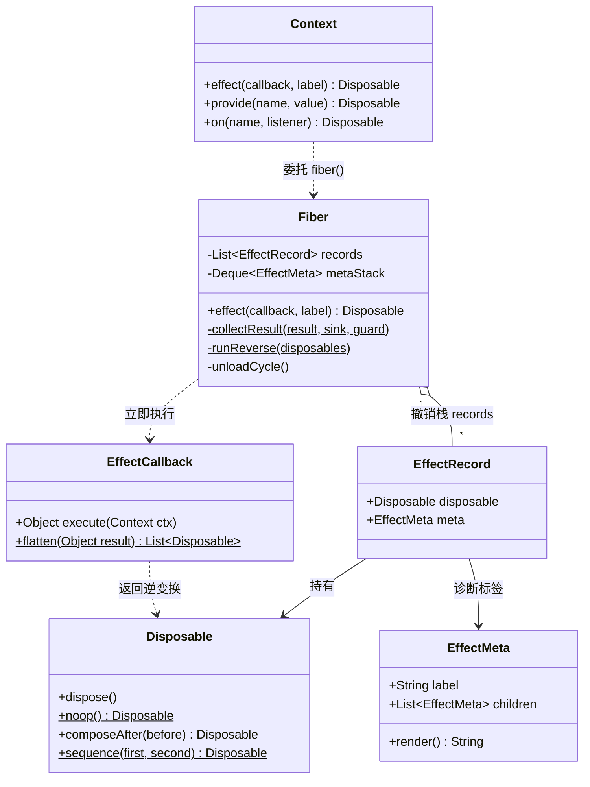
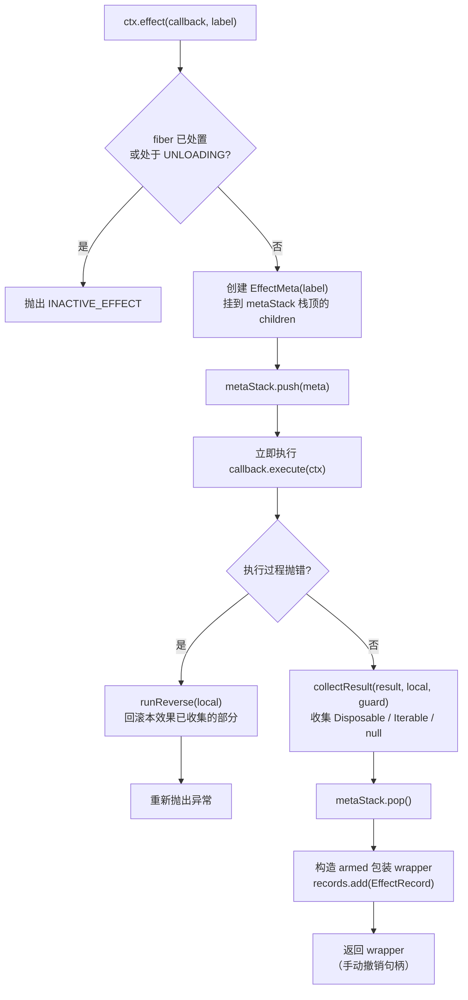

在 cordis 的时间可组合性体系中，插件对外界做的每一个"正向动作"（打开连接、注册服务、订阅事件），都必须在登记时同时声明它的**逆变换**——即"以后怎么撤销"。`Disposable` 就是这个逆变换的类型化表达，而 `Fiber` 内部的撤销栈则负责把这些逆变换按 LIFO 顺序折叠、在失败时部分回滚、并保证每个动作只执行一次。本文深入解析这套"撤销机器"的完整实现：正逆成对的接口设计、登记即执行的流水线、两级逆序展开、三层失败防护，以及幂等处置的 armed 守卫。
Sources: [package-info.java](cordis-core/src/main/java/dev/cordis/core/effect/package-info.java#L1-L15)

## 一、正逆成对：Disposable 是"逆变换"的类型化表达

`Disposable` 是一个 `@FunctionalInterface`，唯一的抽象方法 `dispose()` 描述"之前做的某件事怎么被收回"——例如"打开连接"要配套一个"关闭连接"。注释中明确引用了论文 §3.1 的"可回退效应"：组件卸载时，框架按"后登记的先执行"的顺序调用这些动作，保证现场被完整还原。除了核心的 `dispose()`，接口还提供了一组组合代数：`noop()` 是组合时的"零"（什么也不做的撤销动作）；`composeAfter(before)` 把一个新动作"垫"到当前动作之前执行，语义上形成 LIFO；`sequence(first, second)` 则按顺序依次执行两个动作。

Sources: [Disposable.java](cordis-core/src/main/java/dev/cordis/core/effect/Disposable.java#L10-L39)

| API | 语义 | 说明 |
|---|---|---|
| `void dispose()` | 执行撤销 | 框架保证只调用一次，实现方无需担心重复执行 |
| `static noop()` | 组合的"零元" | 空撤销动作，什么都不做 |
| `default composeAfter(before)` | 前置垫入 | 先执行 `before` 再执行自己，天然构成"后进先出" |
| `static sequence(first, second)` | 顺序拼接 | 先 `first` 后 `second` |

值得注意的是，这组组合代数是提供给插件作者的表达工具；框架运行时内部并没有用闭包组合来实现折叠（后文第八节会解释这个取舍），而是维护一个扁平的撤销记录列表，用显式的逆序迭代来执行。

Sources: [Disposable.java](cordis-core/src/main/java/dev/cordis/core/effect/Disposable.java#L21-L39)

## 二、协作模型：从 EffectCallback 到 Fiber 的撤销栈

理解这套机制需要先理清三个角色的分工。`EffectCallback` 是**效果体**——`ctx.effect(...)` 和插件 `apply` 里要执行的回调，它立即执行正向动作，并把"以后怎么撤销"作为返回值交还框架。它的返回值有三种合法形态：一个 `Disposable`（单阶段效果）、`null`（没有需要撤销的东西）、或一组 `Disposable`（`Iterable`，多阶段效果——这部分细节属于下一页的主题）。`Fiber.effect()` 则是登记入口：回调立即执行、返回值被收集进撤销栈、每条记录附带 `EffectMeta` 诊断信息。静态工具 `flatten` 负责把任意合法返回值整理成统一的撤销动作列表，遇到非 `Disposable`、非 `Iterable` 的类型会抛出 `IllegalArgumentException` 拒绝。

Sources: [EffectCallback.java](cordis-core/src/main/java/dev/cordis/core/effect/EffectCallback.java#L7-L45)

阅读下图前需要建立一个前提：撤销动作的**所有权**始终归属于某个 fiber——`Context.effect()` 只是委托给 `ctx.fiber().effect()`，因此同一份撤销栈完整地覆盖一个插件实例的整个生命周期。

`EffectRecord` 是撤销栈的基本单元：一个 `Disposable` 加上它的 `EffectMeta` 诊断信息。`Fiber` 内部用 `ArrayList<EffectRecord> records` 维护登记顺序，用 `ArrayDeque<EffectMeta> metaStack` 追踪嵌套登记的父子关系——外层 effect 执行期间通过 `ctx.effect` 登记的子效果，会被挂到外层的 `EffectMeta.children` 上，形成一棵可打印的效果树（诊断树的展开属于错误体系页面的话题，这里只需知道它随登记同步构建）。
Sources: [Fiber.java](cordis-core/src/main/java/dev/cordis/core/runtime/Fiber.java#L72-L88), [EffectMeta.java](cordis-core/src/main/java/dev/cordis/core/effect/EffectMeta.java#L9-L31)

## 三、登记即执行：effect() 正变换流水线

`Fiber.effect()` 是本框架最核心的机制，其关键语义是**回调立即执行**——不是注册一个待办，而是当场跑完正向动作、当场拿到逆变换。流程开始前有两道守卫：`assertActive()` 检查 fiber 未被处置（`uid != null`），否则抛出 `INACTIVE_EFFECT`；此外若 fiber 正处于 `UNLOADING` 状态同样拒绝登记——死去的 fiber 上不允许产生新的效果。

Sources: [Fiber.java](cordis-core/src/main/java/dev/cordis/core/runtime/Fiber.java#L155-L180), [CordisException.java](cordis-core/src/main/java/dev/cordis/core/CordisException.java#L11)

下图描绘一次 `effect()` 调用的完整流水线。需要先说明的背景：`armed` 是一个布尔数组充当的可变标志，它在流水线中承担双重职责——既是后面第六节单次处置的幂等开关，也是多阶段 `Iterable` 迭代时的中断检查点（guard）。

收集阶段由 `collectResult` 完成：单个 `Disposable` 直接收入 `local` 列表；`Iterable` 则逐个取出，每取一个前先检查 `guard.getAsBoolean()`（即 armed 标志），不成立就停下——已完成的部分照常登记，未开始的不执行。登记完成后的包装 `wrapper` 引用了整个 `local` 列表，并被包进一条 `EffectRecord` 加入 `records`。返回给调用者的正是这个 `wrapper`：插件可以保留它、在任意时刻手动撤销，也可以置之不理、等待卸载时框架统一执行。
Sources: [Fiber.java](cordis-core/src/main/java/dev/cordis/core/runtime/Fiber.java#L176-L232)

## 四、LIFO 折叠：两级逆序展开

LIFO 在本框架中是**两级嵌套**的。第一级在一个 effect 内部：`runReverse` 从列表末尾向前逐个调用 `dispose()`。多阶段效果的测试验证了这一点——三个阶段 `undo-1`、`undo-2`、`undo-3` 依序登记，卸载后日志恰好是 `undo-3, undo-2, undo-1`。第二级在一个 fiber 的整条撤销栈上：`unloadCycle` 先把 `records` 快照到局部列表并清空原栈，然后同样从末尾向前逆序执行每条记录的 `dispose()`——由于每个 effect 的 wrapper 内部又是逆序展开 local，两级叠加的结果是全局严格的后进先出。

Sources: [Fiber.java](cordis-core/src/main/java/dev/cordis/core/runtime/Fiber.java#L234-L238), [EffectTrackingTest.java](cordis-core/src/test/java/dev/cordis/EffectTrackingTest.java#L71-L86)

以示例工程中的 `DatabasePlugin` 为例可以直观看到折叠效果。它在 `apply` 体里通过 `ctx.effect` 登记了两个效应（打开连接、预编译语句）而不返回任何东西——运行时会自动累加它们的逆变换，作者无需编写卸载路径：

| 阶段 | 正向登记（apply 时） | 逆序展开（卸载时） |
|---|---|---|
| 1 | `open-connection` → 日志"连接已建立" | — |
| 2 | `prepare-statements` → 日志"语句已预编译" | — |
| 3 | — | `close-statements`："语句已关闭" |
| 4 | — | `close-connection`："连接已释放" |

测试 `effectsUnwindInLifoOrderOnFiberUnload` 用三个命名效果 `a`、`b`、`c` 锁定了这一契约：登记阶段日志为 `open:a, open:b, open:c`，`fiber.dispose()` 之后日志恰为 `close:c, close:b, close:a`，且 fiber 状态变为 `DISPOSED`。这是整个时间可组合性范式的基石性断言——撤销顺序与登记顺序严格镜像。
Sources: [DatabasePlugin.java](cordis-example/src/main/java/dev/cordis/example/plugins/DatabasePlugin.java#L7-L43), [EffectTrackingTest.java](cordis-core/src/test/java/dev/cordis/EffectTrackingTest.java#L39-L51)

`unloadCycle` 还有一个容易忽略的容错细节：逆序执行每条记录时都套着独立的 `try/catch`，某条撤销动作抛出的异常只会被记入日志，**不会中断其余撤销动作的执行**。这保证了即使一个组件的收尾代码出了问题，同一个 fiber 上其他已登记效果的现场还原仍然完整进行。

Sources: [Fiber.java](cordis-core/src/main/java/dev/cordis/core/runtime/Fiber.java#L347-L369)

## 五、失败回滚：三层防护网

"失败回滚"在实现中分布在三个层次上，分别覆盖不同的失败时机。**第一层：效果回调内部抛错**。`effect()` 的执行体被 `try/catch` 包裹，一旦 `callback.execute(ctx)` 抛出 `Throwable`，立即对 `local` 中已收集的部分调用 `runReverse` 回滚，然后把异常原样重新抛出——半个效果绝不留在撤销栈里。典型的触发场景是 `ctx.provide` 遇到重名服务抛出 `DUPLICATE_PROVIDE`：绑定失败发生在返回任何 `Disposable` 之前，已挂在 `local` 里的先前阶段（多阶段场景）会被先行撤销。

Sources: [Fiber.java](cordis-core/src/main/java/dev/cordis/core/runtime/Fiber.java#L186-L194), [Fiber.java](cordis-core/src/main/java/dev/cordis/core/runtime/Fiber.java#L467-L488)

**第二层：插件 apply 体抛错**。`reloadCycle` 运行 `plugin.apply(ctx, config)` 时，apply 期间通过 `ctx.effect` 登记的效果已经实时进入了 `records`（每条都有独立的 `EffectRecord`）；若 apply 后半段抛错，异常被 `reloadCycle` 捕获、记入 `error` 字段并打日志，同时 `epoch` 被置为 `INACTIVE`——这会驱动状态机转入 `UNLOADING` 并链式执行 `unloadCycle`，把 apply 已经登记的所有效果按 LIFO 全部撤销。也就是说，apply 的失败不是"半死不活"地挂着，而是走完整的卸载路径回到干净状态，fiber 最终进入 `FAILED`（`await()` 会把错误抛给调用方）。

Sources: [Fiber.java](cordis-core/src/main/java/dev/cordis/core/runtime/Fiber.java#L313-L345), [Fiber.java](cordis-core/src/main/java/dev/cordis/core/runtime/Fiber.java#L417-L425)

**第三层：卸载过程中的撤销动作抛错**，即上一节所述 `unloadCycle` 内的逐条 `try/catch` 容错。三层合起来构成完整的防护网：

| 防护层 | 失败时机 | 回滚范围 | 异常去向 |
|---|---|---|---|
| 效果回调级 | `callback.execute` 执行中抛错 | 本效果 `local` 已收集部分 | 原样重抛给调用方 |
| apply 级 | `plugin.apply` 执行中抛错 | 本 fiber `records` 全部（经 `unloadCycle`） | 记入 `error`、日志，`await()` 时抛出 |
| 撤销执行级 | 某条 `dispose()` 抛错 | 该条跳过，其余继续 | 仅记日志 |

此外还有一个跨 fiber 的顺序保障：提供者停止服务后，先让所有依赖它的 fiber 完整卸载，最后才跑提供者自己的撤销动作——测试断言日志顺序必为 `consumer-down` 在 `provider-down` 之前，保证依赖方的收尾代码还能正常用到依赖。这个 L-Unload guard 的完整机制属于[卸载顺序保证：消费者先于提供者的 L-Unload guard](18-xie-zai-shun-xu-bao-zheng-xiao-fei-zhe-xian-yu-ti-gong-zhe-de-l-unload-guard)页面的主题，此处仅指出它与回滚正确性的关联。
Sources: [LifecycleTest.java](cordis-core/src/test/java/dev/cordis/LifecycleTest.java#L82-L85)

## 六、单次处置：armed 标志与生命周期守卫

`effect()` 返回的 `wrapper` 内部持有 `armed` 标志：第一次调用 `dispose()` 时先检查标志，若已为 `false` 直接返回；否则置 `false`、把自己对应的 `EffectRecord` 从 `records` 中移除、再执行 `runReverse(local)`。这带来两个可验证的后果：**其一，双重处置无害**——测试 `explicitDisposeRunsOnce` 连续调用两次 `d.dispose()`，日志只有一次 `open`、一次 `close`；**其二，手动撤销即脱离 fiber**——已手动处置的效果不再属于撤销栈，随后 `ctx.fiber().dispose()` 时不会再产生任何动作，测试明确断言了这一点。`Disposable` 接口注释中"框架保证只调用一次"的承诺，正是由这个 armed 包装兑现的——插件作者写撤销逻辑时完全不必自行加幂等保护。

Sources: [Fiber.java](cordis-core/src/main/java/dev/cordis/core/runtime/Fiber.java#L196-L205), [EffectTrackingTest.java](cordis-core/src/test/java/dev/cordis/EffectTrackingTest.java#L53-L69)

与单次处置配套的是**登记守卫**：对已处置的 fiber 调用 `effect()` 会抛出携带 `INACTIVE_EFFECT` 错误码的 `CordisException`（`assertActive` 发现 `uid == null`），处于 `UNLOADING` 状态同样拒绝。测试 `effectOnDisposedFiberThrows` 锁定了该契约——防止在已死 fiber 上继续登记"永远无法被撤销"的效果。同样，`null` 返回值是被显式支持的合法形态：`flatten(null)` 返回空列表，`ctx.effect(cb -> null, "empty")` 不会抛错，语义是"这个效果没有需要撤销的东西"。
Sources: [Fiber.java](cordis-core/src/main/java/dev/cordis/core/runtime/Fiber.java#L155-L180), [EffectTrackingTest.java](cordis-core/src/test/java/dev/cordis/EffectTrackingTest.java#L88-L102)

## 七、内建的 Disposable 生产者：框架自身也用同一机制

`Disposable` 不只是插件作者的工具——框架把自身的每一类状态变更都建模为可回退效应，全部经由 `Fiber.effect()` 登记并纳入同一套 LIFO 折叠：

| 登记入口 | 正向动作 | 逆变换（Disposable） |
|---|---|---|
| `ctx.effect(cb, label)` | 回调执行任意正向动作 | 回调返回的撤销动作 |
| `ctx.provide(name, value)` | 向 `ReflectService` 绑定服务实现 | `unbind(key)` + `notify` + 清理 store |
| `ctx.on(name, listener)` | 向事件总线挂载监听器 | 从 hook 列表移除 |
| `ctx.plugin(p)`（挂载原语） | 子 fiber 加入 runtime（O-Insert） | 移除注册、级联卸载（O-Retire） |

`provide` 的实现最有代表性：它本身就是一个带标签 `ctx.provide("name")` 的 effect，回调里检查同名绑定冲突（冲突抛 `DUPLICATE_PROVIDE`）、执行 `reflect.bind(key, impl)`、必要时广播变更，返回的逆变换负责 `unbind` + `notify`——"注销绑定"因此天然参与 LIFO 折叠，卸载时自动生效。事件订阅 `ctx.on` 同理，返回的逆变换从 hook 列表中移除监听器。挂载原语的 O-Insert/O-Retire 对应关系在 `Fiber` 构造器中以 `retireHandle` 落地，其完整语义见[O-Insert 与 O-Retire：plugin() 挂载即实例化原语](17-o-insert-yu-o-retire-plugin-gua-zai-ji-shi-li-hua-yuan-yu)。
Sources: [Fiber.java](cordis-core/src/main/java/dev/cordis/core/runtime/Fiber.java#L467-L488), [EventsService.java](cordis-core/src/main/java/dev/cordis/core/runtime/EventsService.java#L43-L57), [Fiber.java](cordis-core/src/main/java/dev/cordis/core/runtime/Fiber.java#L107-L126)

这种"框架吃自己的狗粮"带来了一个重要性质：跨层次的撤销完全交织在同一个 `records` 列表里。插件 apply 中先 `provide`、再订阅事件、再登记自定义 effect，卸载时三者的逆变换严格按登记的相反次序执行——不需要任何显式的依赖排序，LIFO 本身就是正确的还原序。
Sources: [Fiber.java](cordis-core/src/main/java/dev/cordis/core/runtime/Fiber.java#L76-L88)

## 八、设计取舍：闭包组合为何让位于扁平记录

一个值得注意的架构事实：`Disposable` 接口提供了完整的组合代数（`noop` 零元、`composeAfter`/`sequence` 拼接），但运行时内部一次也没有使用它们——在整个 `cordis-core` 与 `cordis-example` 源码中检索不到任何对这三个方法的调用。运行时选择了另一条路线：把每次登记固化为一条 `EffectRecord`（撤销动作 + `EffectMeta` 标签），存进扁平的 `ArrayList`，用显式的逆序循环执行。

Sources: [Disposable.java](cordis-core/src/main/java/dev/cordis/core/effect/Disposable.java#L16-L39)

这个取舍的收益是三重的。**可诊断性**：闭包组合会把多个撤销动作熔成一个匿名 lambda，而扁平记录让 `getEffects()` 能逐条列出当前登记的所有效果，`EffectMeta` 树还能呈现嵌套登记的父子关系。**可容错**：`unloadCycle` 的逐条 `try/catch` 要求撤销动作在列表中逐个可见，熔合成闭包后就失去了"跳过失败条目继续其余"的粒度。**可移除**：手动处置需要从撤销栈中摘除单条记录（`records.remove(self[0])`），这对列表是 O(n) 一次操作，对已组合的闭包则根本无从下手。代价只是多了一层间接——但换来的是整个错误诊断体系（见[错误体系与诊断：错误码清单、EffectMeta 效果树与日志门面](29-cuo-wu-ti-xi-yu-zhen-duan-cuo-wu-ma-qing-dan-effectmeta-xiao-guo-shu-yu-ri-zhi-men-mian)）的地基。

Sources: [Fiber.java](cordis-core/src/main/java/dev/cordis/core/runtime/Fiber.java#L240-L245), [Fiber.java](cordis-core/src/main/java/dev/cordis/core/runtime/Fiber.java#L352-L360)

## 小结

`Disposable` 逆变换机制可以浓缩为四条契约：**正逆成对**——每个正向动作登记时必须声明逆变换，`null` 表示无需撤销；**LIFO 折叠**——effect 内部与 fiber 撤销栈两级严格逆序，测试 `close:c, close:b, close:a` 是其规范表述；**失败回滚**——回调级、apply 级、撤销执行级三层防护确保任何失败路径都回到干净状态；**单次处置**——armed 包装保证幂等，手动处置即脱离撤销栈，已死 fiber 拒绝新登记。这四条契约共同实现了"现场被完整还原"的核心承诺，也解释了为何插件作者永远不需要手写卸载路径。

继续深入时间可组合性，下一篇[多阶段效应：惰性 Iterable、检查点中断与部分回滚](8-duo-jie-duan-xiao-ying-duo-xing-iterable-jian-cha-dian-zhong-duan-yu-bu-fen-hui-gun)将展开本文数次点到即止的 `Iterable<Disposable>` 形态：guard 检查点如何让长任务在阶段之间被打断、只回滚已完成的部分。若想了解逆变换在服务提供与挂载原语中的具体应用，可分别阅读[Service 服务基类：构造即 provide、可用性检查与自动注销](13-service-fu-wu-ji-lei-gou-zao-ji-provide-ke-yong-xing-jian-cha-yu-zi-dong-zhu-xiao)与[卸载顺序保证：消费者先于提供者的 L-Unload guard](18-xie-zai-shun-xu-bao-zheng-xiao-fei-zhe-xian-yu-ti-gong-zhe-de-l-unload-guard)。