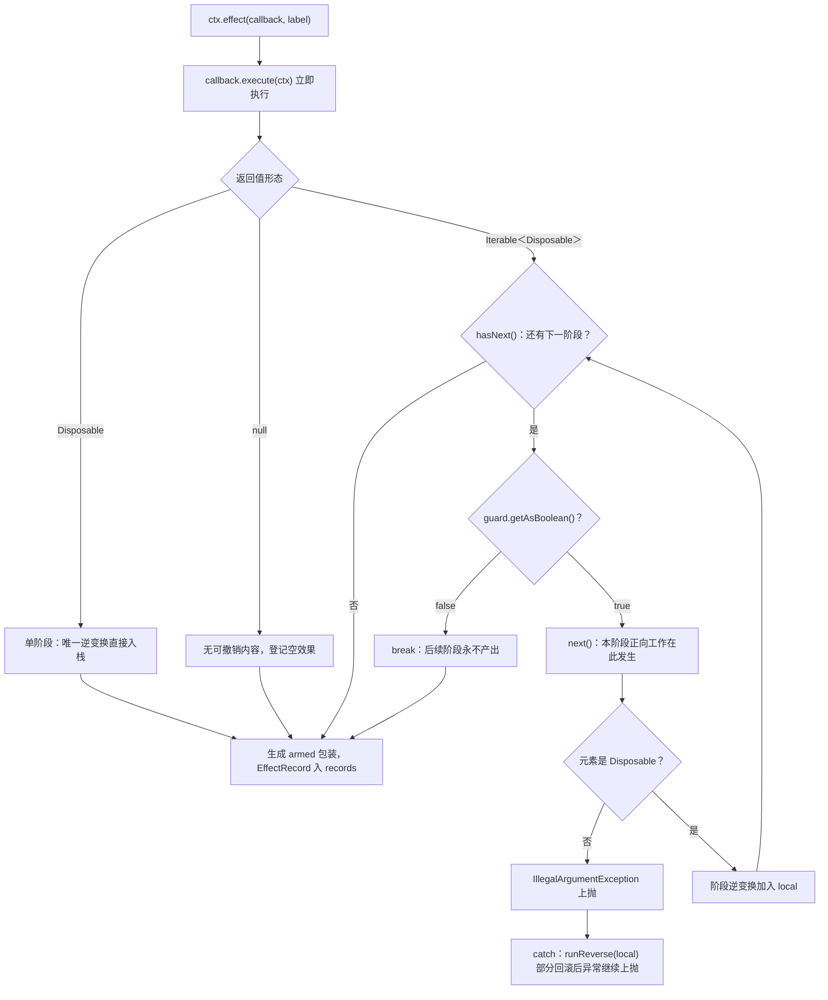
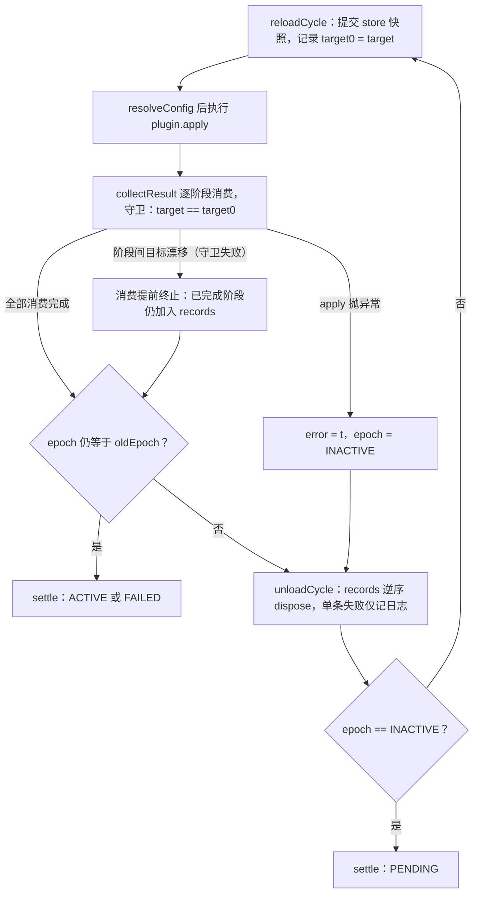

在 cordis-java 的时间可组合性模型中，最核心的撤销原语是单阶段 `Disposable`（详见 [Disposable 逆变换：LIFO 折叠、失败回滚与单次处置](7-disposable-ni-bian-huan-lifo-zhe-die-shi-bai-hui-gun-yu-dan-ci-chu-zhi)）。但现实中的副作用往往不是"一口气做完、一口气收回"——数据库迁移要逐条执行、监听器要逐个挂载、资源要分批申请。为此框架允许效果体返回一个 `Iterable<Disposable>`：**每个被产出的元素是一个"阶段"，框架在请求下一个元素之前检查一道守卫，守卫失败即停止消费，已完成阶段照常登记、未开始阶段永不执行**。本文精确剖析这一机制的三根支柱——惰性 Iterable 的返回值契约、`collectResult` 中参数化的检查点、以及三条部分回滚路径——并说明它与 fiber 链式转换（reload/unload）如何配合，保证系统永不停留在"改到一半"的中间状态。
Sources: [EffectCallback.java](cordis-core/src/main/java/dev/cordis/core/effect/EffectCallback.java#L7-L17), [Fiber.java](cordis-core/src/main/java/dev/cordis/core/runtime/Fiber.java#L163-L171)

## 返回值契约：三种形态，一级比一级可中断

`EffectCallback` 是唯一的效果体接口，其 `execute(Context)` 的返回值被框架按三种形态分派。这与 cordis（TypeScript 版）的生成器效应（generator effect）语义对应：TS 版用 `yield` 划分阶段，Java 版用惰性 `Iterable` 的元素产出划分阶段——README 的映射表中明确标注"stage 边界即 Maybe(ℑ) 延续"，即每个阶段边界都是框架可以决定"不再继续"的续体边界。

| 返回值形态 | 语义 | 撤销登记粒度 | 检查点 |
|---|---|---|---|
| `Disposable` | 单阶段效果 | 整体一个逆变换 | 无（不可中断） |
| `null` | 纯观察，无可撤销内容 | 无 | — |
| `Iterable<Disposable>` | 多阶段效果 | 每产出一个阶段登记一个 | 每次请求下一元素之前 |

值得注意的是，该契约同时作用于两个入口：`ctx.effect(...)` 的回调返回值，以及 `Plugin.apply` 本身的返回值——`Plugin` 的 Javadoc 明确写道"一组 Disposable（多阶段，中间可被打断）"。也就是说，插件主体天然就是一个多阶段效应：`apply` 里通过 `ctx.effect` / `ctx.provide` 登记的东西被框架自动追踪，而返回值则承载"需要撤销但未走登记通道"的部分。
Sources: [EffectCallback.java](cordis-core/src/main/java/dev/cordis/core/effect/EffectCallback.java#L18-L27), [Plugin.java](cordis-core/src/main/java/dev/cordis/core/Plugin.java#L35-L46), [README.md](README.md#L114-L122)

## collectResult：检查点的精确位置

`Fiber.collectResult(Object, List<Disposable>, BooleanSupplier)` 是整个机制的枢纽。它用 Java 21 的模式匹配对返回值分派：`null` 直接返回；`Disposable` 入栈即结束；`Iterable` 则进入惰性消费循环。循环体的结构决定了一切语义：

```java
for (Object object : it) {
    if (!guard.getAsBoolean()) break;   // 检查点：请求下一元素之前
    if (object == null) continue;
    if (!(object instanceof Disposable d)) {
        throw new IllegalArgumentException(...);
    }
    sink.add(d);                        // 阶段逆变换登记
}
```

增强 for 循环脱糖后是 `hasNext()` → 守卫 → `next()` 的顺序：**守卫在确认"还有阶段"之后、真正调用 `next()` 之前被检查**。这意味着守卫失败时，迭代器从未被请求下一个元素——该阶段的正向工作（通常写在 `next()` 的实现里）根本不会发生。这正是"未开始的不再执行"的实现根基。同时每个元素必须是 `Disposable`，否则抛 `IllegalArgumentException`（会被外层 catch 捕获并触发部分回滚）。

关键的设计洞察在于：**检查点不是硬编码的条件，而是一个 `BooleanSupplier guard` 策略参数**。同一个折叠循环被两个入口以不同的守卫谓词实例化，形成两种互补的中断语义。下节展开。

Sources: [Fiber.java](cordis-core/src/main/java/dev/cordis/core/runtime/Fiber.java#L208-L232)

## 两道守卫：手动处置中断与依赖漂移中断

下图概括了 `ctx.effect` 从回调执行到登记完成的完整折叠过程，其中守卫检查位于每次元素请求之前：



（阅读前提：`local` 是本次 effect 私有的逆变换列表；`armed` 是一次性处置标记；虚线之外的 `records` 是 fiber 级效果栈。）

| 维度 | `effect()` 入口的 armed 守卫 | `reloadCycle()` 入口的 target 守卫 |
|---|---|---|
| 谓词 | `() -> armed[0]` | `() -> Objects.equals(target, target0)` |
| 语义 | 本次效果的手动 disposer 尚未被调用 | 插件主体的依赖视图未发生漂移 |
| 中断源 | 重入路径中提前处置（如手动撤销） | `apply` 返回的 Iterable 在产出阶段期间，某依赖的提供者被撤换，触发 `notify` → `refresh` → `target` 重算 |
| 中断效果 | 已收集阶段由 wrapper 的 dispose 逆序回滚 | 已完成阶段仍加入 `records`，随后链式 `unloadCycle` 逆序回滚 |

`effect()` 中 `armed` 守卫与包装 Disposable 的配合体现了单次处置语义：wrapper 首次被调用时置 `armed = false`、从 `records` 移除自己的 `EffectRecord`、对 `local` 逆序执行——第二次调用因 `armed` 已为 false 而无害返回。而 `reloadCycle` 的守卫在执行 `apply` 之前先快照 `target0 = target`（提供者 uid 摘要的语义详见 [epoch 与 target 视图：提供者摘要驱动的重载判定](16-epoch-yu-target-shi-tu-ti-gong-zhe-zhai-yao-qu-dong-de-zhong-zai-pan-ding)），随后整个消费过程以 `target` 是否仍等于快照为中断条件。
Sources: [Fiber.java](cordis-core/src/main/java/dev/cordis/core/runtime/Fiber.java#L176-L206), [Fiber.java](cordis-core/src/main/java/dev/cordis/core/runtime/Fiber.java#L313-L330)

## 部分回滚的三条路径

"部分回滚"指只撤销已完成的阶段，且撤销动作本身按 LIFO 逆序执行（`runReverse` 从列表尾部向下遍历）。框架中存在三条触发路径，回滚范围各不相同：

| 路径 | 触发条件 | 回滚范围 | 后续走向 |
|---|---|---|---|
| 回调内异常 | `callback.execute` 或阶段产出抛出 `Throwable` | 仅本次 effect 已收集的 `local` 阶段 | `runReverse(local)` 后异常继续上抛；fiber 其他已登记效果不受影响 |
| 插件启动失败 | `reloadCycle` 捕获 apply 异常 | fiber 全部 `records`（经 `unloadCycle`） | `error = t`、`epoch = INACTIVE` → 链式卸载 → settle 为 FAILED |
| 阶段间目标漂移 | 守卫 `target != target0` 中断消费 | fiber 全部 `records` | 中断时已收集阶段仍 `records.add` 入栈 → 链式 `unloadCycle` → 若依赖重新齐备则再链 `reloadCycle` |

路径一最局部：`effect()` 的 catch 块中注释直书 `// rollback partial effects`——哪怕多阶段进行到第 N 个阶段时抛错，前 N-1 个阶段的逆变换立即逆序执行，异常原样上抛，不污染 fiber 的既有效果栈。路径二与路径三都汇入 `unloadCycle`：它先把 `records` 拷贝后清空，**逆序逐条 dispose，且每条单独捕获异常仅记日志**——保证某个撤销动作失败不会让其余撤销被跳过（现场还原优先于错误传播）。`unloadCycle` 结束时若 `epoch` 已非 INACTIVE，则再链一次 `reloadCycle`，这正是"提供者被替换"场景下"先卸旧、再装新"的自动化闭环。
Sources: [Fiber.java](cordis-core/src/main/java/dev/cordis/core/runtime/Fiber.java#L186-L206), [Fiber.java](cordis-core/src/main/java/dev/cordis/core/runtime/Fiber.java#L333-L369)

## 收敛保证：中断之后必然走完

检查点中断可能发生在 `apply` 消费到一半的时刻，此时 fiber 处于 LOADING 状态、已持有部分效果。框架的承诺是**转换一旦开始必然完成、完成后才响应新的目标变化**。下图展示 `reloadCycle` / `unloadCycle` 双环如何通过 `runChain` 的惯性链保证收敛：



（阅读前提：`epoch` 是当前生效的目标视图版本；`inertia` 是待执行的下一个转换任务；`runChain` 是 `while (inertia != null)` 的排空循环。）

任何一环结束时都会重新比对 `epoch` 与进入时的值：一致则 settle（状态机落入 ACTIVE / FAILED / PENDING，六态流转详见 [Fiber 生命周期状态机：六态流转与惰性链式转换](15-fiber-sheng-ming-zhou-qi-zhuang-tai-ji-liu-tai-liu-zhuan-yu-duo-xing-lian-shi-zhuan-huan)），不一致则把对侧转换挂为 `inertia` 继续执行。由于 `setEpoch` 在 `inertia != null` 时直接返回（"转换中的链会自行复查"），阶段间漂移触发的 `setEpoch` 不会另起一条链，而是被当前链在收尾时统一消化——这就是"不停在改到一半"的形式化保证。
Sources: [Fiber.java](cordis-core/src/main/java/dev/cordis/core/runtime/Fiber.java#L289-L311), [Fiber.java](cordis-core/src/main/java/dev/cordis/core/runtime/Fiber.java#L338-L368)

## 效果树中的多阶段：一个节点，一串阶段

诊断视角下，多阶段效应在 `EffectMeta` 树中呈现为**一个节点**：`effect()` 在调用回调前创建 `EffectMeta(label)` 并压入 `metaStack`，消费期间通过 `ctx.effect` 嵌套登记的子效果自动成为该节点的 children，finally 中弹栈保证嵌套层级精确。`reloadCycle` 同样以 `name() + ".apply"` 为根节点包裹整个 apply 主体及其返回值收集过程。因此无论一个多阶段效应被中断在第几阶段，诊断树中它始终是完整的单节点（标签 + 嵌套子树），阶段的数量不体现在树上——阶段是时间维度的切分，而 EffectMeta 是结构维度的切分（树渲染与错误码体系详见 [错误体系与诊断：错误码清单、EffectMeta 效果树与日志门面](29-cuo-ti-xi-yu-zhen-duan-cuo-ma-qing-dan-effectmeta-xiao-ying-shu-yu-ri-zhi-men-mian)）。
Sources: [Fiber.java](cordis-core/src/main/java/dev/cordis/core/runtime/Fiber.java#L181-L194), [Fiber.java](cordis-core/src/main/java/dev/cordis/core/runtime/Fiber.java#L321-L330), [EffectMeta.java](cordis-core/src/main/java/dev/cordis/core/effect/EffectMeta.java#L7-L30)

## 行为契约：测试佐证

`EffectTrackingTest` 用行为断言固化了上述语义，构成多阶段效应的机器可验证契约：

| 测试用例 | 验证的行为 | 关键断言 |
|---|---|---|
| `multiStageIterableCollectsEveryStage` | 多阶段全量收集 + LIFO 回滚 | 三个阶段 dispose 后日志为 `undo-3, undo-2, undo-1` |
| `effectsUnwindInLifoOrderOnFiberUnload` | fiber 卸载时多个 effect 整体逆序 | `open:a,b,c` → `close:c,b,a`，终态 DISPOSED |
| `explicitDisposeRunsOnce` | armed 单次处置 + 效果归属转移 | 二次 dispose 无操作；手动撤销后 fiber 卸载不再重复执行 |
| `effectOnDisposedFiberThrows` | 已卸载/卸载中拒绝登记 | `assertActive` 与 UNLOADING 检查抛 `INACTIVE_EFFECT` |
| `nullResultIsAnEffectWithNothingToUndo` | null 返回值的宽容性 | `flatten(null)` 与 `ctx.effect(cb -> null)` 均不抛异常 |

其中 `multiStageIterableCollectsEveryStage` 使用 `Arrays.asList(...)` 构造返回值——这揭示了一个重要的契约细节：**类型层面的 Iterable 契约不强制惰性实现**。`flatten` 这个静态工具则是有意为之的"急切版"对照：一次性把整个 Iterable 物化为列表，绕过检查点语义，主要服务于测试与宿主的诊断需求。
Sources: [EffectTrackingTest.java](cordis-core/src/test/java/dev/cordis/EffectTrackingTest.java#L39-L102), [EffectCallback.java](cordis-core/src/main/java/dev/cordis/core/effect/EffectCallback.java#L30-L45)

## 编写多阶段效应的实践要点

要让"检查点中断"真正具备中断能力，正向工作必须延迟到 `next()` 调用时才执行。Java 没有生成器语法，惯用法是匿名 `Iterable` + 匿名 `Iterator`：

```java
ctx.effect(cb -> (Iterable<Disposable>) () -> new Iterator<>() {
    int stage = 0;
    @Override public boolean hasNext() { return stage < MIGRATIONS.size(); }
    @Override public Disposable next() {
        Migration m = MIGRATIONS.get(stage++);
        m.up();        // 正向工作发生在 next() 内 —— 这才是检查点能拦住的位置
        return m::down; // 阶段逆变换交给框架登记
    }
}, "db-migrations");
```

若守卫在第 2、3 阶段之间失败：迁移 1、2 的 `down` 已在 `records` 中、将随链式卸载逆序回滚，迁移 3 的 `up` 从未执行。三条实践约束需要牢记：**其一**，检查点粒度是"阶段间"——单个阶段内的正向工作相对中断是原子的，需要更快中断响应就应切分更多阶段；**其二**，`Arrays.asList` / `List.of` 等急切集合虽满足类型契约，但所有逆变换在消费开始前已物化，失去中断意义；**其三**，元素必须是非 null 的 `Disposable`，`null` 元素被静默跳过（`continue`），非 Disposable 元素则直接抛异常并触发部分回滚。异步工作可在 Disposable 内自行对接 `CompletableFuture`，但框架的折叠循环本身是同步语义。
Sources: [Fiber.java](cordis-core/src/main/java/dev/cordis/core/runtime/Fiber.java#L217-L227), [Context.java](cordis-core/src/main/java/dev/cordis/core/runtime/Context.java#L246-L254), [README.md](README.md#L124-L128)

## 延伸阅读

多阶段效应是时间可组合性的第二块拼图：向回看，单阶段的 LIFO 折叠与失败回滚细节见 [Disposable 逆变换：LIFO 抽叠、失败回滚与单次处置](7-disposable-ni-bian-huan-lifo-zhe-die-shi-bai-hui-gun-yu-dan-ci-chu-zhi)；向前看，与 TS 版生成器效应的语义映射见 [与 cordis（TypeScript 版）的语义映射与同步化设计取舍](6-yu-cordis-typescript-ban-de-yu-yi-ying-she-yu-tong-bu-hua-she-ji-qu-she)，理论根基（可回退效应与 Maybe(ℑ) 延续）见 [时空可组合性范式：可回退效应与响应式余效应的统一](5-shi-kong-ke-zu-he-xing-fan-shi-ke-hui-tui-xiao-ying-yu-xiang-ying-shi-yu-xiao-ying-de-tong)。卸载时"消费者先于提供者回滚"的顺序保证——这正是目标漂移中断后链式卸载能安全执行的前提——由 [卸载顺序保证：消费者先于提供者的 L-Unload guard](18-xie-zai-shun-xu-bao-zheng-xiao-fei-zhe-xian-yu-ti-gong-zhe-de-l-unload-guard) 承接。