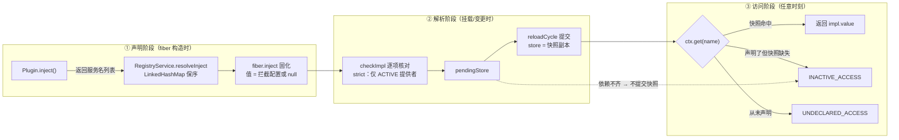
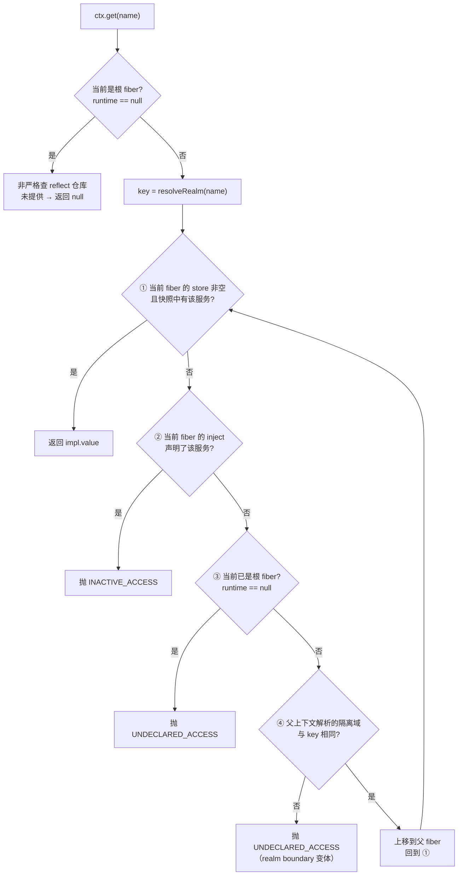

`ctx.get(name)` 不是普通的服务定位器——它是框架中唯一带**能力检查（capability check）**的读取原语。一个组件能读哪些服务，不取决于"这个服务现在存不存在"，而取决于它在 `Plugin.inject()` 里声明过什么、以及它当前是否处于已加载状态。声明了但没加载，抛 `INACTIVE_ACCESS`；压根没声明，抛 `UNDECLARED_ACCESS`。本文解释这套规则的定义、`Context.get()` 的判定算法、两类异常各自的触发场景，以及 root 与 `getOrNull` 两条特权通道的边界。

Sources: [Context.java](cordis-core/src/main/java/dev/cordis/core/runtime/Context.java#L18-L34), [CordisException.java](cordis-core/src/main/java/dev/cordis/core/CordisException.java#L9-L32)

## 一、能力模型：声明即授权

cordis 的读取规则遵循一条铁律：**"你能用什么服务，在声明 inject 的那一刻就定死了"**（Context 的 Javadoc 原话）。授权来自两个源头，缺一不可：

- **声明层**——`Plugin.inject()` 返回的服务名列表，在 fiber 构造时被固化成不可变的 `inject` 映射（服务名 → 拦截配置），这是"我有权读什么"的静态清单；
- **快照层**——fiber 加载成功那一刻，把每个依赖"由谁提供"的解析结果写入 `store`（依赖快照），这是"此刻我实际拿到了什么"的动态记录。

两层合起来构成完整的访问语义：`get` 只认快照，快照只来自声明，声明只来自 `inject()`。一个服务即便已经在全局服务仓库 `ReflectService` 里注册得妥妥当当，只要消费者没声明过它，读取就会被拒绝——测试用例的注释把这一点说得很直白："provider is a PLUGIN fiber: its binding is not ambient authority"（插件提供的绑定不构成环境权限）。

两个错误码在异常体系中各有固定位置，消息文本稳定，供程序按类型分支处理：

| 错误码 | 默认消息 | 语义 |
|---|---|---|
| `INACTIVE_ACCESS` | cannot get required service in inactive context | 访问了**声明过但尚未加载**的服务 |
| `UNDECLARED_ACCESS` | cannot get property without inject | 访问了**从未声明**的服务 |
| `INVALID_SET`（对照） | cannot set property without provide | `set` 写入未提供过的服务，属写入侧规则 |
| `INACTIVE_EFFECT`（对照） | cannot create effect on inactive context | 在已卸载 fiber 上登记效果 |

Sources: [Context.java](cordis-core/src/main/java/dev/cordis/core/runtime/Context.java#L30-L33), [Fiber.java](cordis-core/src/main/java/dev/cordis/core/runtime/Fiber.java#L90-L105), [CordisException.java](cordis-core/src/main/java/dev/cordis/core/CordisException.java#L10-L25)

## 二、get() 判定算法：fiber 链上的四步循环

`Context.get(name)` 的完整判定逻辑集中在不到 30 行代码里（[Context.java L181-L210](cordis-core/src/main/java/dev/cordis/core/runtime/Context.java#L181-L210)）。第一步先识别**根上下文特权**：如果当前 fiber 是根 fiber（`runtime == null`），直接对服务仓库做非严格查找，查不到返回 `null`，完全绕过声明检查——这就是测试 `rootAccessIsNonStrict` 验证的行为。插件 fiber 则进入主循环：先解析该服务名落在哪个隔离域（`resolveRealm`），然后沿 fiber 链逐层执行四步判定。

四步的含义值得逐一展开。**第①步**查 `store`：快照命中直接返回值，这是正常路径——fiber 加载时拿到的每个依赖都记录在案。**第②步**查 `inject`：声明了却不在快照里，说明 fiber 尚未加载（或已卸载），抛 `INACTIVE_ACCESS`。**第③步**判定链是否走完：走到了根 fiber 还没声明，抛 `UNDECLARED_ACCESS`。**第④步**是继承检查：若未到根，就上移到父 fiber 继续循环，但前提是父上下文对该服务名解析出的隔离域与当前一致——跨了 `isolate` 边界就视为权限断裂，同样抛 `UNDECLARED_ACCESS`（消息带 `(realm boundary)` 后缀）。第④步还隐含一个重要语义：**子 fiber 会继承祖先的可见服务**。在插件 A 的 `apply` 里再挂载插件 B，B 没有声明任何依赖时，仍能读到 A 快照里的服务——这是沿 fiber 链传递的"环境权限"，与 `Context` 的 parent 链派生机制相呼应。

Sources: [Context.java](cordis-core/src/main/java/dev/cordis/core/runtime/Context.java#L175-L210), [Context.java](cordis-core/src/main/java/dev/cordis/core/runtime/Context.java#L86-L90)

## 三、UNDECLARED_ACCESS：从未声明，一票否决

`UNDECLARED_ACCESS` 防御的是**越权读取**：组件试图读取自己 `inject()` 清单之外的服务。测试 `undeclaredAccessFromPluginContextThrows` 构造了最能说明问题的场景——provider 插件正常 provide 了 `svc`，consumer 插件（未声明任何依赖）随后调用 `fiber.ctx.get("svc")`，断言抛出 `UNDECLARED_ACCESS`。用四步循环回放一遍：consumer 已加载，store 为空快照；inject 里没有 `svc`；上移到根 fiber；根的 store 里也没有 `svc`（它由插件 fiber 提供，而非根 fiber），根的 inject 为空 → 抛 `UNDECLARED_ACCESS`。整个过程服务仓库里明明存在这条绑定，但框架拒绝暴露它。

这个设计把"存在性"和"可访问性"严格分离。全局视角下（ReflectService）所有绑定都可见；组件视角下（get）只有声明的才可达。对中间开发者最直接的推论是：**新增一个依赖就必须同步修改 `inject()` 返回值**，否则运行期 `get` 一定报错，而不是静默拿到旧值或 null。另一个变体是**隔离域边界拒绝**：当调用方与父上下文对同一服务名解析出不同的 `RealmKey`（典型如跨 `isolate` 分支继承），第④步的域一致性检查失败，同样归入 `UNDECLARED_ACCESS`，错误消息明确标注 `(realm boundary)`，提示问题出在域边界而非漏写声明。

Sources: [ServiceAccessTest.java](cordis-core/src/test/java/dev/cordis/ServiceAccessTest.java#L35-L60), [Context.java](cordis-core/src/main/java/dev/cordis/core/runtime/Context.java#L203-L208), [Plugin.java](cordis-core/src/main/java/dev/cordis/core/Plugin.java#L25-L28)

## 四、INACTIVE_ACCESS：声明了，但快照不存在

`INACTIVE_ACCESS` 的触发条件恰好相反：**声明在册，快照缺席**。回看 `store` 的生命周期即可精确定位所有触发时点。fiber 构造时 `store` 为 `null`（字段注释："未加载时为 null"）；挂载时 `checkImpl` 逐项核对每个声明的依赖——只在提供者 fiber 处于 `ACTIVE` 状态且通过可用性检查时才记入 `pendingStore`；依赖齐了 `reloadCycle` 提交快照 `store = new LinkedHashMap<>(pendingStore)`；此后一旦进入 `unloadCycle`，逆序执行完所有撤销动作后 `store` 被置回 `null`。启动失败（`apply` 抛异常）的路径同样终结于 `unloadCycle`（epoch 被强制置 INACTIVE 触发链式卸载），所以 `store` 的存在等价于 fiber 处于 `ACTIVE`。

由此可以推出 `INACTIVE_ACCESS` 的完整场景清单：

| fiber 状态 | store | `get` 已声明的服务 | 说明 |
|---|---|---|---|
| `PENDING` | `null` | **INACTIVE_ACCESS** | 依赖未齐，安静等待（正常状态，非错误） |
| `LOADING` | 旧值/提交中 | 短暂窗口 | 加载完成后稳定 |
| `ACTIVE` | 有快照 | 返回值 | 唯一正常读取路径 |
| `FAILED` | `null` | **INACTIVE_ACCESS** | apply 抛异常后已走卸载链 |
| `UNLOADING` / 已卸载 | `null` | **INACTIVE_ACCESS** | 快照随卸载清空 |
| `DISPOSED` | `null` | **INACTIVE_ACCESS** | 已从注册表移除 |

测试 `declaredAccessOnUnloadedFiberThrowsInactive` 验证了最典型的 `PENDING` 场景：插件声明了 `inject = List.of("svc")` 但没有提供者，`fiber.state` 断言为 `PENDING`，此时调用 `fiber.ctx.get("svc")` 抛 `INACTIVE_ACCESS`。这不是 bug 而是**框架契约的读取侧投影**：依赖不齐插件不启动（这是响应式加载的核心承诺），而未启动的组件自然不该假装自己拿到了依赖。值得注意的是，这条规则与外部持有的 `fiber.ctx` 引用无关——测试从外部抓住了 fiber 的上下文照样触法，因为检查基于 fiber 自身状态，不基于调用线程或调用位置。

Sources: [Fiber.java](cordis-core/src/main/java/dev/cordis/core/runtime/Fiber.java#L58-L59), [Fiber.java](cordis-core/src/main/java/dev/cordis/core/runtime/Fiber.java#L249-L287), [Fiber.java](cordis-core/src/main/java/dev/cordis/core/runtime/Fiber.java#L313-L361), [ServiceAccessTest.java](cordis-core/src/test/java/dev/cordis/ServiceAccessTest.java#L62-L84)

## 五、特权通道与写入侧对照

能力检查并非铁板一块，框架留出了三条边界通道，各自服务于不同场景，使用前务必理解代价：

| 通道 | 声明检查 | 未就绪行为 | 适用场景 |
|---|---|---|---|
| `ctx.get(name)`（插件 fiber） | **强制** | 抛异常 | 组件读取已声明的依赖 |
| `ctx.get(name)`（根上下文） | **豁免** | 返回 `null` | 宿主应用组装期/演示代码 |
| `ctx.getOrNull(name)` | **豁免** | 返回 `null` | 动态探测、可选依赖 |

根上下文的豁免有测试背书：`rootAccessIsNonStrict` 中根上 `provide("any", 42)` 后直接 `get` 得 42，`get("missing")` 得 null 而非异常。`getOrNull` 则是显式的逃生舱——直接对 reflect 仓库做非严格查找（不要求提供者 ACTIVE），文档注释言明"不做声明检查地读服务"。两条通道的共同代价是**放弃响应式保障**：它们绕过快照，读到的是仓库即时状态，框架不会因这次读取而建立任何依赖追踪。写入侧的对照规则是 `ctx.set`：只有当初的提供者 fiber 自己能改（校验 `impl.fiber == fiber()`），其他 fiber 或从未 provide 过的名字一律抛 `INVALID_SET`——这与读取侧"声明即授权"互为镜像，构成读写两端的完整权限模型。

Sources: [Context.java](cordis-core/src/main/java/dev/cordis/core/runtime/Context.java#L182-L188), [Context.java](cordis-core/src/main/java/dev/cordis/core/runtime/Context.java#L212-L216), [Context.java](cordis-core/src/main/java/dev/cordis/core/runtime/Context.java#L218-L233), [ServiceAccessTest.java](cordis-core/src/test/java/dev/cordis/ServiceAccessTest.java#L86-L111)

## 六、排查手册：异常定位速查

实际开发中遇到这两类异常，按下面的表对症排查：

| 症状 | 根因方向 | 排查动作 |
|---|---|---|
| `UNDECLARED_ACCESS`（普通变体） | 组件读了自己没声明的服务 | 检查 `Plugin.inject()` 是否包含该服务名；子插件是否依赖了父级未声明的服务 |
| `UNDECLARED_ACCESS`（realm boundary） | 跨 `isolate` 边界继承权限 | 检查挂载点上下文与父 fiber 是否处在同一隔离域 |
| `INACTIVE_ACCESS`（PENDING 期） | 依赖未齐，fiber 未启动 | 检查提供者是否 provide、是否 ACTIVE、可用性 check 是否通过 |
| `INACTIVE_ACCESS`（运行中期） | 提供者下线，消费方已卸载 | 检查是否在异步回调/timer 里持有旧 `ctx` 引用——fiber 卸载后 `store` 已清空 |

最后一个场景值得强调：`ctx.effect` 登记的效果在 fiber 卸载后可能仍有异步代码（如定时器回调）持有闭包里的 `ctx`，此时回调中的 `get` 必然抛 `INACTIVE_ACCESS`。正确做法是把依赖值捕获在闭包里，或在 `Disposable` 撤销动作中先停掉异步源——这正是"可回退效应"要求效果自净的动机之一。

Sources: [CordisException.java](cordis-core/src/main/java/dev/cordis/core/CordisException.java#L36-L49), [Fiber.java](cordis-core/src/main/java/dev/cordis/core/runtime/Fiber.java#L467-L488)

## 七、设计动机与延伸阅读

这套规则的本质是**能力安全（capability-based security）**思想在依赖注入里的落地：权限不来自位置（谁能摸到容器就谁能读），而来自显式声明（inject 清单即授权书）。收益有三层——依赖关系静态可审计（读 `inject()` 即知组件的全部外部契约）、故障隔离（越权访问在最近的调用点被拒绝而非污染数据）、以及与响应式生命周期的天然契合（快照随加载建立、随卸载销毁，读写两端自动同步）。

理解本页后，按依赖关系推荐继续阅读：想了解快照背后的仓库与广播机制，读 [ReflectService 服务仓库与 notify 变更广播机制](10-reflectservice-fu-wu-cang-ku-yu-notify-bian-bo-ji-zhi)；想弄清 realm boundary 变体的隔离原理，读 [RealmKey 隔离域：多租户隔离与共享标签 Join](11-realmkey-ge-chi-yu-duo-zu-hu-ge-chi-yu-gong-xiang-biao-qian-join)；想掌握 `store` 何时提交、何时清空的完整状态机，读 [Fiber 生命周期状态机：六态流转与惰性链式转换](15-fiber-sheng-ming-zhou-qi-zhuang-tai-ji-liu-tai-liu-zhuan-yu-duo-xing-lian-shi-zhuan-huan) 与 [epoch 与 target 视图：提供者摘要驱动的重载判定](16-epoch-yu-target-shi-tu-ti-gong-zhe-zhai-yao-qu-dong-de-zhong-zai-pan-ding)；关于 inject 声明如何携带拦截配置，读 [intercept 拦截：配置逐层合并与权限收缩](12-intercept-lan-jie-pei-zhi-zhu-ceng-he-bing-yu-quan-xian-shou-suo)；完整错误码体系见 [错误体系与诊断：错误码清单、EffectMeta 效果树与日志门面](29-cuo-ti-ti-xi-yu-zhen-duan-cuo-wu-ma-qing-dan-effectmeta-xiao-guo-shu-yu-ri-zhi-men-mian)。