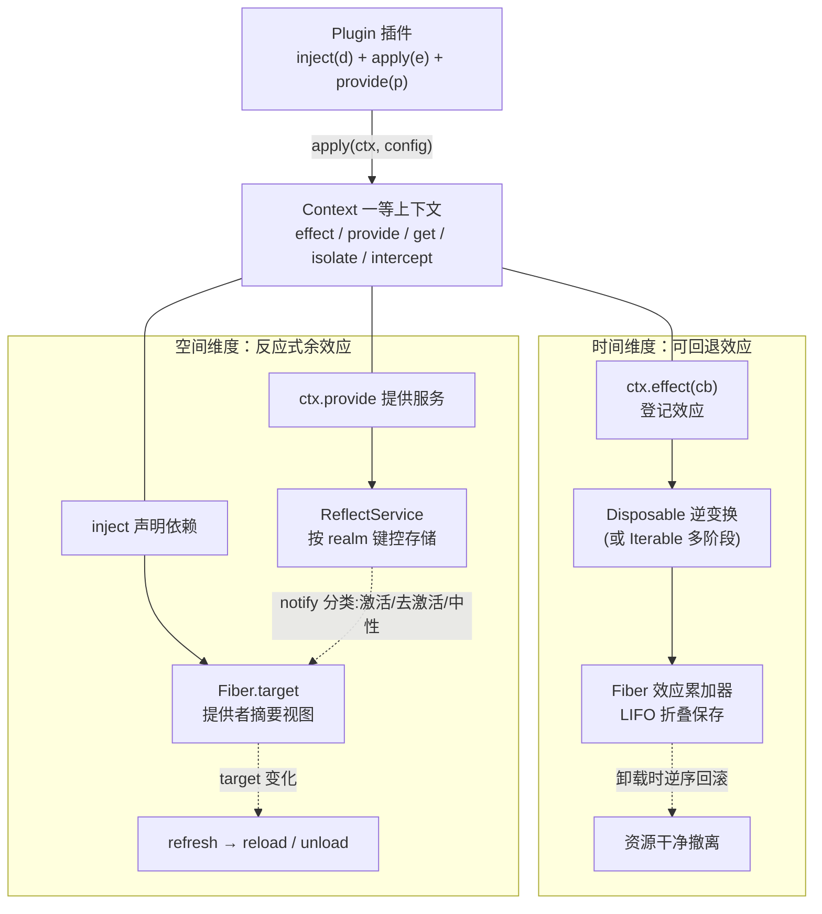
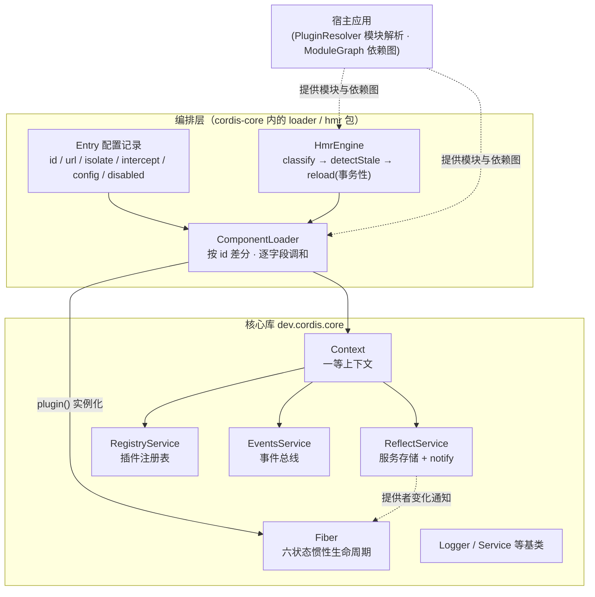

本页是 cordis-java 文档的入口。它回答三个问题：这个项目是什么、"时空可组合性"这个陌生的名字背后是哪两个真实问题、以及代码仓库如何组织来承载答案。本页只做鸟瞰，不深入任何单一机制的实现细节——每个机制的深挖都有独立的页面承接，文末给出完整阅读路线。

## 一句话定位：cordis-java 是什么

cordis-java 是论文 *A Programming Paradigm for Spatiotemporal Composability*（Shi, Zhang, Cui；北京大学 & DeepSeek-AI）第 3–5 章运行时模型在 **Java 25** 上的完整实现，并以 deepseek-harness 仓库中 vendor 的 cordis v4（TypeScript 版）源码作为语义参照。它自称"元框架"（meta-framework）：它不面向某个具体业务领域，而是提供一套让**任何组件都能被随时安装、卸载、替换、并存**的通用运行时骨架——机器人框架、插件化 IDE、多租户 SaaS 都可以在它之上生长。仓库由两个 Maven 模块组成：`cordis-core`（框架本体）与 `cordis-example`（插件实例与端到端演示），以 JUnit 5 承载 30 个行为契约测试。
Sources: [README.md](README.md#L1-L7), [pom.xml](pom.xml#L1-L37)

## 两个真实问题：为什么叫"时空可组合性"

"时空可组合性"听起来抽象，但它对应的两个工程问题你一定遇到过。**时间维度** 的问题是：插件装上时打开了数据库连接、注册了定时器、订阅了事件，卸载时谁来保证这些东西全部干净地消失？传统框架靠开发者自觉写清理代码，而 cordis 的答案是**可回退效应（revertible effects）** ——每一次上下文变换都必须携带一个运行时持有的逆变换（`Disposable`），卸载时按 LIFO（后进先出）顺序自动回滚。**空间维度** 的问题是：同一个程序里，多个组件组合方式要同时并存——多租户各自一套数据库、编排者要收缩下游插件的权限——传统框架靠全局单例 + 手工配置，而 cordis 的答案是**反应式余效应（reactive coeffects）** ——组件用 `inject` 声明依赖，提供者每次变化都被运行时分类为"激活/去激活/中性"，并自动驱动依赖者重载。

| 维度 | 真实问题 | 论文机制 | 本实现的代码载体 |
|---|---|---|---|
| 时间可组合性 | 卸载后资源残留、清理代码靠自觉 | 可回退效应：每个变换携带逆变换，LIFO 累加器恢复（§3.1） | `Disposable`（逆变换）+ `Fiber.effect`（折叠逆变换、自处置、父级组合） |
| 空间可组合性 | 同一服务的多种组合需并存且自动响应变化 | 响应式余效应：上下文变化按组件规范分类（§3.2） | `inject` 声明 + `ReflectService.notify` + `Fiber.refresh`（target 视图 = 提供者 uid 摘要） |
| 统一 | 两个维度各管一头，靠什么互通 | 上下文范式：效应与余效应经同一上下文中介（§3.3） | `Context`：`effect`/`get`/`set`/`provide`/`isolate`/`intercept`/`plugin` |

对初学者的直觉解释：**"时间"管生死**（装上的一切都能撤干净），**"空间"管布局**（不同的组合方式互不干扰地共存），而 `Context` 是两者共享的那张操作台。
Sources: [README.md](README.md#L9-L19)

## 核心心智模型：一个插件，两个维度，一个中介

cordis 的世界里只有三种一等公民，初学者记住它们就抓住了全部骨架。**Plugin（插件）** 是组件的声明形式：`inject()` 是它对环境的依赖清单（论文中的余效应规范 d），`apply(ctx, config)` 是它的主体（效应函数 e），它对外提供什么服务（p）则在运行时通过 `ctx.provide` 声明——同一个 Plugin 绑定两份不同 config，就是两个独立组件。**Context（上下文）** 是组件与环境的唯一中介：效应登记在它上面（`ctx.effect`，即回滚累加器），余效应也向它解析（`ctx.get`/`ctx.provide`，即依赖表 Σ）；`extend`/`isolate`/`intercept` 派生出的子上下文只"遮蔽"父级的表而不修改父级，因此派生本身不需要逆变换。**Fiber（纤维）** 是一次插件应用对应的运行时实例，它以六种状态生命周期机（PENDING → LOADING → ACTIVE，失败进 FAILED，卸载走 UNLOADING 到 DISPOSED）追踪自己的依赖视图、配置与全部效应。

阅读下面这张概念图前，只需要知道一个约定：实线箭头表示"调用/驱动"方向，虚线箭头表示"自动触发"方向。右半边是时间维度的闭环——`apply` 里的 `ctx.effect` 必须交出逆变换，运行时折叠保存，卸载时逆序执行；左半边是空间维度的闭环——`inject` 声明 + `provide` 提供被 `ReflectService` 记录，提供者变化触发 `notify`，`Fiber.refresh` 重算依赖摘要并驱动重载或去激活。两个闭环交汇于顶部的 `Context`。



这套模型带来的初学者最该体会的一点：**插件作者只负责"正变换 + 逆变换"成对书写，"何时回滚、以什么顺序回滚、回滚后依赖者怎么办"全部由运行时接管**。`Disposable` 的 Javadoc 明确了两个保证——逆处置按注册逆序执行（`composeAfter` 组合出 LIFO 恢复，对应论文 Algorithm 1 / Theorem 16），且框架保证每个处置器只被调用一次；`EffectCallback` 的返回值允许是单个 `Disposable`、`null`（无需撤销）或 `Iterable<Disposable>`（多阶段效应，阶段边界就是运行时可以中断转换的续体点）。
Sources: [Context.java](cordis-core/src/main/java/dev/cordis/core/Context.java#L10-L29), [Plugin.java](cordis-core/src/main/java/dev/cordis/core/Plugin.java#L7-L42), [Disposable.java](cordis-core/src/main/java/dev/cordis/core/Disposable.java#L4-L34), [EffectCallback.java](cordis-core/src/main/java/dev/cordis/core/EffectCallback.java#L6-L28), [Fiber.java](cordis-core/src/main/java/dev/cordis/core/Fiber.java#L10-L22), [FiberState.java](cordis-core/src/main/java/dev/cordis/core/FiberState.java#L6-L21)

## 整体架构：核心库、声明式加载器与 HMR 引擎的三层

从调用方向看，仓库呈清晰的三层。最底层是**核心库 `dev.cordis.core`**（论文 §5.1）：`Context` 做服务解析与派生上下文，`Fiber` 做惯性生命周期状态机，`ReflectService` 做按 realm 键控的服务存储，`RegistryService` 做插件注册表（`plugin()` 即 O-Insert，其逆即 O-Retire），`EventsService` 做事件总线（监听器本身也是可回退效应），外加 `Logger`/`Service` 基类。中间层是**声明式加载器 `dev.cordis.loader`**（§5.2.1）：编排者用一张 `Entry` 列表（id/url/isolate/intercept/config/disabled 六字段）声明期望组合，`ComponentLoader` 按 id 差分、逐字段分发出"最小扰动"的 fiber 操作——先挂载等待提供者的组件也是安全的。最上层是**热模块替换引擎 `dev.cordis.hmr`**（§5.2.2）：`HmrEngine` 把可回退效应模式应用到模块级别，三阶段（分类不动点 → 陈旧 entry 检测 → 事务性重载）完成进程内换模块，且失败时从上一组件整体回滚、系统不进入半重载状态——与 Webpack/Vite 不同，它不需要开发者手工标注接受边界，因为 fiber 本身已经圈定了组件的全部效应。

阅读下面的架构图前，请注意一个关键分工：**虚线以下是"库"，虚线以上是"编排策略"**。`ComponentLoader` 与 `HmrEngine` 都构建在核心库之上而非之内——这意味着宿主可以只用核心 API 手工编排，也可以走声明式路线，甚至自带模块注册表（`PluginResolver`）对接 HMR。



Sources: [README.md](README.md#L21-L45), [ComponentLoader.java](cordis-core/src/main/java/dev/cordis/loader/ComponentLoader.java#L11-L19), [Entry.java](cordis-core/src/main/java/dev/cordis/loader/Entry.java#L7-L28), [HmrEngine.java](cordis-core/src/main/java/dev/cordis/hmr/HmrEngine.java#L14-L31)

## 仓库结构一览

仓库非常小巧——核心库加上加载器与 HMR 引擎共 24 个 Java 文件，外加一个可直接运行的示例工程。目录结构如下（已过滤构建产物）：

```
cordis-java/
├── pom.xml                          # 父 POM：Java 25、JUnit 5.10.2、双模块聚合
├── README.md                        # 项目自述：两维度定义、快速开始、TS 对照
├── cordis-core/                     # 框架本体（唯一的库模块）
│   └── src/main/java/dev/cordis/
│       ├── core/                    # §5.1 核心库（20 个类）
│       │   ├── Context / Fiber / FiberState      # 上下文 + 生命周期状态机
│       │   ├── Plugin / PluginRuntime / Impl     # 插件抽象与运行时
│       │   ├── EffectCallback / Disposable / EffectMeta   # 可回退效应三件套
│       │   ├── ReflectService / RegistryService / Service # 服务存储与注册表
│       │   ├── EventsService / Logger / LoggerService     # 事件与日志
│       │   ├── RealmKey                        # 隔离域键（私有/共享标签）
│       │   └── ConfigSchema / ValidationException / CordisException  # 配置与错误
│       ├── loader/                  # §5.2.1 声明式加载器
│       │   ├── Entry / Entry.Builder            # 配置记录（Definition 81）
│       │   ├── ComponentLoader                  # 按 id 差分调和
│       │   └── PluginResolver                   # 宿主模块解析接口
│       └── hmr/                     # §5.2.2 热模块替换
│           ├── HmrEngine                        # 三阶段引擎（Algorithm 8–10）
│           └── ModuleGraph                      # 宿主提供的依赖图接口
└── cordis-example/                  # 端到端演示工程
    └── src/main/java/dev/cordis/example/
        ├── Main.java                # 八个场景的演示入口
        └── plugins/                 # DatabasePlugin / DbService /
                                     # UserPlugin / UsersService /
                                     # GreetingPluginV1 / GreetingPluginV2
```

构建环境方面，父 POM 设定 `maven.compiler.release=25`，聚合 `cordis-core` 与 `cordis-example` 两个模块，测试依赖为 JUnit Jupiter 5.10.2（test scope）；日常验证只需两条命令：`mvn test` 跑全部 30 个单元测试，`mvn -pl cordis-example exec:java`（先 `mvn install`）跑端到端演示。示例工程用一个内存中的 `MODULES` 注册表模拟"模块系统"，并在 `main` 里订阅 `internal/status` 内部事件，把每个 fiber 的状态迁移直接打印到控制台——这是观察框架行为最直观的窗口。
Sources: [pom.xml](pom.xml#L10-L37), [README.md](README.md#L47-L52), [Main.java](cordis-example/src/main/java/dev/cordis/example/Main.java#L43-L81)

## 五分钟尝一口：三段最小代码

理解本项目不需要先读论文。第一段感受**时间维度**——打开连接是效应，交出的 `Disposable` 就是逆变换，`apply` 返回后框架已自动登记回滚，插件作者无需再关心"什么时候关闭"：

```java
Plugin database = Plugin.of("database", List.of(), (ctx, cfg) -> {
    ctx.effect(cb -> {                    // 可回退效应：打开连接
        log.info("opened");
        return (Disposable) () -> log.info("closed");   // 逆变换
    }, "connection");
    ctx.provide("db", new DbService(ctx));               // 提供服务 p
    return null;
});
```

第二段感受**空间维度的反应性**——`users` 声明依赖 `db`，先于提供者挂载也是安全的：`root.plugin(users)` 返回的 fiber 停在 PENDING，等 `database` 到达 ACTIVE 时被自动通知、重载、进入 ACTIVE；反过来撤走 `database`，`users` 整段效应自动回滚：

```java
Fiber f = root.plugin(users);        // PENDING：db 尚未提供
root.plugin(database).await();       // db ACTIVE → users 被通知 → 重载 → ACTIVE
f.await();
```

第三段感受**声明式编排与隔离**——组合被声明为数据（`Entry` 列表），变更即差分调和；`isolate` 让同名服务在不同租户域独立解析，`intercept` 让编排者对下游收缩权限（如只读）：

```java
loader.load(List.of(
    Entry.of("users", "plugin-users").build(),          // 先挂载也安全：等待提供者
    Entry.of("database", "plugin-database").build()));
Context tenantA = root.isolate("db", "db@tenant-a");   // 独立服务域
Context policed  = tenantA.intercept("db", Map.of("readOnly", true));  // 收缩权限
```

常用 API 速览如下表（完整语义在后续页面展开）：

| API | 所属层 | 一句话作用 |
|---|---|---|
| `Context.createRoot()` | core | 创建根上下文，装配内置服务与根 fiber |
| `root.plugin(plugin)` / `root.plugin(plugin, config)` | core | 安装插件，返回其 `Fiber`（即 O-Insert） |
| `ctx.effect(cb, name)` | core | 登记可回退效应，cb 返回 `Disposable` 或多阶段 `Iterable` |
| `ctx.provide(key, service)` | core | 向当前 realm 提供服务（重复 provide 被拒绝） |
| `ctx.get(key)` / `ctx.getOrNull(key)` | core | 解析服务；未声明抛 `UNDECLARED_ACCESS`，未激活抛 `INACTIVE_ACCESS` |
| `ctx.isolate(name, label)` | core | 派生隔离上下文：同名服务换 realm 解析 |
| `ctx.intercept(name, config)` | core | 派生拦截上下文：对下游收缩该服务能力 |
| `Entry.of(id, url).build()` | loader | 声明一条组件配置（六字段记录） |
| `loader.load(entries)` | loader | 声明目标组合，按 id 差分做最小扰动调和 |
| `HmrEngine.classify / detectStale / reload` | hmr | 热替换三阶段：分类、陈旧检测、事务性重载 |
| `fiber.await()` | core | 阻塞等待 fiber 到达 ACTIVE/PENDING 稳态 |
| `root.emit(name, args)` / `root.onGlobal(...)` | core | 事件派发与全局监听（监听器也是可回退效应） |

Sources: [README.md](README.md#L54-L95), [Main.java](cordis-example/src/main/java/dev/cordis/example/Main.java#L60-L81)

## 与 TypeScript 版 cordis 的关系（一分钟版）

cordis-java 不是原创设计，而是 cordis v4（TypeScript）语义的 Java 移植与学术化锚定：`ctx`（Proxy + 原型链）对应 `Context`（parent 链 + 显式 isolate/intercept 表）；`fiber.epoch`/`target` 对应 `Fiber.epoch`/`target`；基于 Promise 的异步惯性对应**调用线程上的同步转换链**——语义等价（转换一旦开始必然完成），顺序更易推理，异步资源可在 `Disposable` 内自行对接 `CompletableFuture`。此外 Java 无 Proxy 原语，能力检查收敛到 `ctx.get(key)`；JVM 无 Node 式模块注册表，模块解析交给宿主的 `PluginResolver`。这些取舍的逐条展开见专门页面。
Sources: [README.md](README.md#L97-L121)

## 阅读路线图

按目录顺序推进即可，前四页为"快速上手"线（边读边跑代码），其后按主题深入：

| 顺序 | 页面 | 你将获得 |
|---|---|---|
| 1 | [项目概览：时空可组合性元框架是什么](1-xiang-mu-gai-lan-shi-kong-ke-zu-he-xing-yuan-kuang-jia-shi-shi-yao)（本页） | 全景心智模型 |
| 2 | [快速开始：Java 25 环境搭建、Maven 构建与运行演示](2-kuai-su-kai-shi-java-25-huan-jing-da-jian-maven-gou-jian-yu-yun-xing-yan-shi) | 本地跑通 30 个测试与端到端演示 |
| 3 | [编写第一个插件：Plugin、inject 声明与 provide 提供服务](3-bian-xie-di-ge-cha-jian-plugin-inject-sheng-ming-yu-provide-ti-gong-fu-wu) | 亲手写一个"声明依赖 + 提供服务"的插件 |
| 4 | [端到端演示走读：八个场景理解框架全部能力](4-duan-dao-duan-yan-shi-zou-du-ba-ge-chang-jing-li-jie-kuang-jia-quan-bu-neng-li) | 对照控制台输出理解反应式加载、回退、HMR |
| 5 | [整体架构：核心库、声明式加载器与 HMR 引擎的三层分层](5-zheng-ti-jia-gou-he-xin-ku-sheng-ming-shi-jia-zai-qi-yu-hmr-yin-qing-de-san-ceng-fen-ceng) | 本页架构图的逐层展开 |
| 6 | [上下文范式：Context 作为效应与余效应的统一中介](6-shang-xia-wen-fan-shi-context-zuo-wei-xiao-ying-yu-yu-xiao-ying-de-tong-zhong-jie) | 两大维度如何在代码上真正统一 |
| 7+ | [与 TypeScript 版 cordis 的语义映射与同步化设计取舍](7-yu-typescript-ban-cordis-de-yu-yi-ying-she-yu-tong-bu-hua-she-ji-qu-she) 及后续专题 | 时间维度、Fiber 生命周期、空间维度、HMR、事件配置诊断、工程化 |

如果你只有十分钟：读第 2 页跑通演示，再回到本页重看概念图——两条维度闭环在输出日志里的每一次 `status: PENDING → ACTIVE` 中都是可观测的。