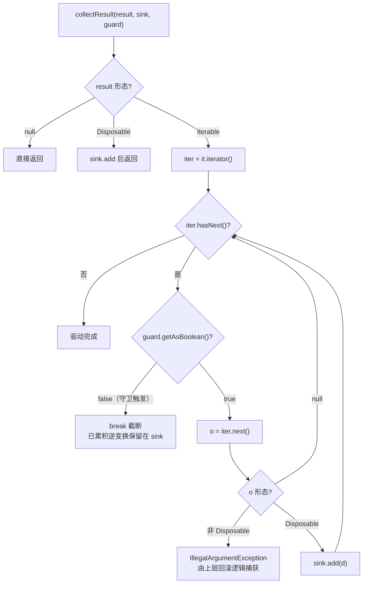
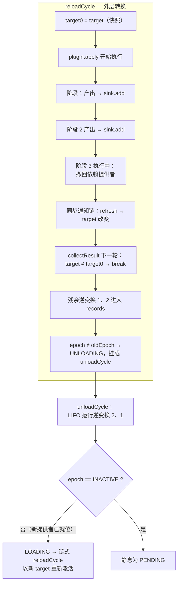

本页是"时间维度：可回退效应"三部曲的收官之作。前两页建立了效应的**声明契约**（`EffectCallback` 回调在执行点交出逆变换）与**折叠语义**（LIFO 逆变换累加器保证按注册逆序回收）。本页聚焦第三个、也是最微妙的一个自由度：当效应体交出的不是一个 `Disposable`，而是一个**惰性 `Iterable<Disposable>`** 时，运行时如何逐阶段驱动它、在阶段边界查询**稳定性守卫**（stability guard），以及守卫触发后如何在不抛异常的前提下截断生产、保留已累积的逆变换。这是同步 Java 端口对论文 Section 4.2.2"步边界中断"（step-boundary interruption）的直接实现——理解它，就理解了为什么一个长时间运行的插件体能够在依赖世界坍塌的瞬间"悬崖勒马"。

## 从单阶段到多阶段：返回形态的完整契约

`EffectCallback` 与 `Plugin.apply` 的返回值共享同一套形态约定，运行时接受三种结果：单个 `Disposable`（单阶段效应，一次注册一次撤销）、`null`（无事可撤销的空效应），以及 `Iterable<Disposable>`（**多阶段效应**——每产出一个 disposer 即被收集，而阶段边界正是运行时可以中断转换的间隙，对应论文 Definition 17 的 `Maybe(ℑ)` 延续语义）。这套约定在 [Plugin.java](cordis-core/src/main/java/dev/cordis/core/Plugin.java#L36-L45) 的 `apply` Javadoc 中被明确表述为："返回 Iterable of disposables（阶段）——当 target 视图转向时，运行时可以在阶段之间停止"。

三种形态的对比如下：

| 返回形态 | 语义 | 阶段数 | 可中断点 | 典型场景 |
|---|---|---|---|---|
| `Disposable` | 单阶段效应 | 1 | 无 | 打开一个连接 |
| `null` | 空效应 | 0 | 无 | 纯粹的日志/通知 |
| `Iterable<Disposable>` | 多阶段效应 | 0..N | 每两个阶段之间 | 逐张初始化一批资源、流式装配 |

规范化的职责分裂在两条路径上：公开的静态工具 `EffectCallback.flatten` 将任意结果**一次性物化**为 `List<Disposable>`（校验每个元素非 null 且类型正确，否则抛 `IllegalArgumentException`），主要服务于外部调用者与测试断言；而运行时内部真正的驱动路径是 `Fiber.collectResult`——它不物化，而是**边生产边消费**，这正是"惰性"的全部含义。两条路径对类型纪律的要求一致：混入任何非 `Disposable` 元素都会在产出点立即失败。

Sources: [EffectCallback.java](cordis-core/src/main/java/dev/cordis/core/EffectCallback.java#L13-L48), [Plugin.java](cordis-core/src/main/java/dev/cordis/core/Plugin.java#L36-L45)

## 惰性阶段驱动：collectResult 算法解剖

`Fiber.collectResult` 是整个机制的心脏，只有二十行，却同时实现了**增量收集**与**守卫检查的精确位置**：

```java
private static void collectResult(Object result, List<Disposable> sink, BooleanSupplier guard) {
    if (result == null) return;
    if (result instanceof Disposable d) { sink.add(d); return; }
    if (result instanceof Iterable<?> it) {
        Iterator<?> iter = it.iterator();
        while (iter.hasNext()) {
            if (!guard.getAsBoolean()) break;   // ← 拉取下一阶段之前，先确认世界没变
            Object o = iter.next();
            if (o == null) continue;
            if (!(o instanceof Disposable d))
                throw new IllegalArgumentException(...);
            sink.add(d);
        }
        return;
    }
    throw new IllegalArgumentException("Invalid effect: " + result.getClass());
}
```

三处细节值得逐条审视。**第一**，守卫调用位于 `iter.next()` **之前**而非之后——语义是"在消耗下一个阶段的生产成本之前，先确认这个阶段还有意义"。守卫返回 `false` 时执行 `break` 而非抛异常：已累积的逆变换原封不动地留在 `sink` 中，等待后续的回收流程接管。**第二**，`null` 元素被静默跳过（`continue`），允许迭代器表达"此阶段无副作用"的空阶段；但非 null 且非 `Disposable` 的元素是硬错误，因为累加器的类型不变量不容破坏。**第三**，整个循环是**单线程同步**的：迭代器体内的任何副作用（包括撤回服务、处置 fiber）都会在 `next()` 返回前同步传播完毕——这正是守卫必须在下一轮拉取前重新求值的原因。

下面的流程图刻画了完整的驱动循环：



注意一个关键区别：守卫截断（`break`）与类型错误（`throw`）走的是**完全不同的失败通道**。后者属于效应体的编程错误，由 `Fiber.effect` 的 `catch` 块以 `runReverse(local)` 回滚部分效应后原样重抛；前者是世界的合法变化，静默收尾，不污染调用栈。

Sources: [Fiber.java](cordis-core/src/main/java/dev/cordis/core/Fiber.java#L200-L220), [Fiber.java](cordis-core/src/main/java/dev/cordis/core/Fiber.java#L179-L187)

## 稳定性守卫：两种来源，同一个谓词接口

`collectResult` 的 `guard` 参数是一个 `BooleanSupplier`，而它在整个代码库中恰好只有两处注入点，对应两类截然不同却相互补足的稳定性威胁。

**第一处**在 `Fiber.effect()` 内部（用户显式调用 `ctx.effect(...)` 的路径）：

```java
collectResult(result, local, armed[0] ? () -> armed[0] : () -> false);
```

此处 `armed` 是一个单元素布尔数组——`effect` 为返回的 wrapper 处置器设置的武装标志。闭包 `() -> armed[0]` 捕获的是可变数组而非快照值，于是守卫成为一个**动态谓词**：如果迭代器体内触发了 fiber 卸载（例如某个阶段撤回了关键依赖，导致本效应的 wrapper 被 `unloadCycle` 从 `records` 中取出并处置），`armed[0]` 翻转为 `false`，下一轮拉取立即截断。这个**重入守卫**（reentrancy guard）防住的是"效应正在生产中，自己却已被拆除"的病态续跑。

**第二处**在 `Fiber.reloadCycle()` 中（插件 `apply` 体返回值的路径）：

```java
String target0 = target;                          // apply 执行前快照
...
Object result = plugin.apply(ctx, config);
collectResult(result, local, () -> Objects.equals(target, target0));
```

这就是名副其实的**稳定性守卫**：`target` 是本 fiber 所有 inject 键的提供者 uid 摘要（依赖视图的身份指纹）。`apply` 执行前先拍快照 `target0`，之后每拉取一个新阶段前比较 `target` 是否仍等于快照。同步端口下，迭代器体内任何一个阶段撤回或替换了提供者，`ReflectService` 的通知链会同步传播到本 fiber 的 `refresh`/`setEpoch`，`target` 随之改变——守卫在下一个阶段边界捕获这一变化并截断。

| 维度 | `effect()` 路径的 armed 守卫 | `reloadCycle()` 路径的 target 守卫 |
|---|---|---|
| 守卫谓词 | `() -> armed[0]` | `() -> Objects.equals(target, target0)` |
| 防御的威胁 | 效应自身被重入拆除 | 依赖提供者身份改变 |
| 触发源 | wrapper 被调用（如 fiber 卸载） | 迭代器体内的副作用改变了依赖视图 |
| 截断后的去向 | 残余逆变换已被 wrapper 的 `runReverse` 回收 | 残余逆变换进入 `records`，由 `unloadCycle` 回收 |
| 对应论文概念 | 单次处置不变量 | Section 4.2.2 步边界中断 |

两条路径共享同一个 `collectResult` 驱动循环，意味着**阶段边界的语义是统一的**：无论威胁来自内部拆除还是外部世界变化，生产者都以同样的方式被叫停——不抛异常、不留半成品状态、已生产的逆变换全部进入待回收队列。

Sources: [Fiber.java](cordis-core/src/main/java/dev/cordis/core/Fiber.java#L174-L198), [Fiber.java](cordis-core/src/main/java/dev/cordis/core/Fiber.java#L301-L333)

## 中断之后：残余逆变换的归宿

守卫截断只是故事的前半段。`reloadCycle` 中一个容易被忽略的细节决定了残余逆变换的命运：

```java
List<Disposable> local = new ArrayList<>();
collectResult(result, local, () -> Objects.equals(target, target0));
for (Disposable d : local) records.add(new EffectRecord(d, bodyMeta));  // 无论是否被截断
```

即使守卫触发，**被截断前已产出的局部逆变换依然全部进入 `records`**。随后 `reloadCycle` 检查 `Objects.equals(epoch, oldEpoch)`——守卫触发意味着 target 已变，epoch 大概率同步变化——于是走 `updateState(UNLOADING)` 分支，把 `unloadCycle` 挂上惯性链。`unloadCycle` 快照并清空 `records`，按 **LIFO 逆序**逐个运行处置器（单个处置失败仅记日志不中断），然后依据 epoch 决定静息为 PENDING 还是以新视图链式重载。

换言之，守卫截断**没有丢弃任何已做的工作的逆变换**——这正是可回退效应模型的纪律：生产了多少阶段，就必须能回收多少阶段，哪怕生产过程被中途叫停。下面的时序图给出一次典型中断的全景（迭代器第 3 阶段撤回了本 fiber 的依赖提供者）：



这里与惯性主机的链式转换（epoch 驱动的 reload/unload 链）发生了交接。本页只强调交接点的语义：**守卫截断保证进入交接的效应集合是自洽的**——每个已执行的正变换都有对应的逆变换在 `records` 中排队，`unloadCycle` 的 LIFO 回收因此总能覆盖到最早的正变换。链式重载如何驱动、半重载状态如何回滚，属于[惯性主机：epoch、target 视图与链式 reload/unload 转换](12-guan-xing-zhu-ji-epoch-target-shi-tu-yu-lian-shi-reload-unload-zhuan-huan)的领地。

Sources: [Fiber.java](cordis-core/src/main/java/dev/cordis/core/Fiber.java#L313-L331), [Fiber.java](cordis-core/src/main/java/dev/cordis/core/Fiber.java#L335-L357)

## 行为契约的测试验证

测试套件将上述机制固化为四条可执行契约。最直接对应本页主题的是 `multiStageIterableCollectsEveryStage`：插件 `apply` 返回三个 disposer 组成的 `Iterable`，fiber 卸载后日志严格为 `undo-3, undo-2, undo-1`——证明惰性收集的每个阶段都被记住且回收顺序遵守 LIFO，与单阶段效应多次注册的折叠结果完全一致。配套的 `effectsUnwindInLifoOrderOnFiberUnload`（三个独立 `ctx.effect` 注册、卸载逆序回放）与 `explicitDisposeRunsOnce`（wrapper 的 `armed` 幂等：二次调用为 no-op，已处置的效应不再属于 fiber）共同覆盖了 armed 守卫赖以成立的单次处置不变量；而 `nullResultIsAnEffectWithNothingToUndo` 同时穿过 `flatten(null)` 与 `ctx.effect(cb -> null)` 两条路径，锁定空效应契约。

值得注意的边界测试 `effectOnDisposedFiberThrows`：对已 DISPOSED 的 fiber 调用 `effect` 抛出 `INACTIVE_EFFECT`。这与 `effect()` 入口处的双重前置检查（`assertActive()` 加 `state == UNLOADING` 拒绝）相呼应——**守卫管的是生产过程中的截断，入口检查管的是生产开始前的资格**，两层防线共同保证效应注册不会污染一个正在拆除或已拆除的 fiber。

Sources: [EffectTrackingTest.java](cordis-core/src/test/java/dev/cordis/EffectTrackingTest.java#L39-L103), [Fiber.java](cordis-core/src/main/java/dev/cordis/core/Fiber.java#L169-L173)

## 设计审视：同步端口为何需要显式阶段边界

把视线拉回 TypeScript 原版 cordis：其异步模型中，效应体的 `await` 点天然构成中断边界——宿主在微任务间隙可以观察世界变化并取消延续。Java 端口选择了同步原地转换（[Fiber.java](cordis-core/src/main/java/dev/cordis/core/Fiber.java#L27-L30) 类 Javadoc 所述的"imperative host 的 in-place 选择"），没有运行时级的挂起点，于是**阶段边界必须由数据结构显式提供**——`Iterator` 的 `hasNext`/`next` 协议恰好就是这个边界。用户把长事务写成返回 `Iterable<Disposable>` 的生成器式代码，就等于向运行时声明："我愿意在每个阶段之间接受稳定性检查"。这是一种把协作式取消的粒度交还给效应作者的设计：阶段划分越细，守卫截断的及时性越高；不需要中断的短效应则继续用单 `Disposable` 或 `null`，零额外成本。

工程侧的实际收益在示例插件中可见一斑。[DatabasePlugin.java](cordis-example/src/main/java/dev/cordis/example/plugins/DatabasePlugin.java#L23-L46) 的 `apply` 注册两个命名效应（`open-connection`、`prepare-statements`），卸载时自动逆序回放（先关语句、后关连接）而作者无需书写任何卸载路径——"关注点局部化"的直接体现。若该初始化序列增长为逐张建表的十几个步骤，将其改写为一个惰性 `Iterable` 即可免费获得"任意步骤间依赖坍塌可截断"的保障。诊断层面，每个效应经 `EffectMeta` 树挂接标签（嵌套注册自动成为子节点），`getEffects()` 随时可渲染当前存活效应的层级清单——截断发生时，运维能精确看到哪些阶段已产出、哪些尚未开始。

Sources: [Fiber.java](cordis-core/src/main/java/dev/cordis/core/Fiber.java#L26-L31), [DatabasePlugin.java](cordis-example/src/main/java/dev/cordis/example/plugins/DatabasePlugin.java#L23-L46), [EffectMeta.java](cordis-core/src/main/java/dev/cordis/core/EffectMeta.java#L8-L32)

## 延伸阅读

至此，效应三部曲的语义闭环完成：**声明契约**见[可回退效应模型：EffectCallback、Disposable 与多阶段延续](8-ke-hui-tui-xiao-ying-mo-xing-effectcallback-disposable-yu-duo-jie-duan-yan-xu)，**折叠与回收语义**见[LIFO 逆变换累加器：效应折叠、单次处置与失败回滚](9-lifo-ni-bian-huan-lei-jia-qi-xiao-ying-zhe-die-dan-ci-chu-zhi-yu-shi-bai-hui-gun)。守卫截断后交棒的链式转换机制，推荐紧接着阅读[生命周期状态机：PENDING 到 DISPOSED 的六状态与转换规则](11-sheng-ming-zhou-qi-zhuang-tai-ji-pending-dao-disposed-de-liu-zhuang-tai-yu-zhuan-huan-gui-ze)与[惯性主机：epoch、target 视图与链式 reload/unload 转换](12-guan-xing-zhu-ji-epoch-target-shi-tu-yu-lian-shi-reload-unload-zhuan-huan)；若想理解 target 摘要为何因提供者身份而变，[inject 声明与 ReflectService 通知：提供者变化的反应式分类](14-inject-sheng-ming-yu-reflectservice-tong-zhi-ti-gong-zhe-bian-hua-de-fan-ying-shi-fen-lei)提供了通知链的完整解剖。