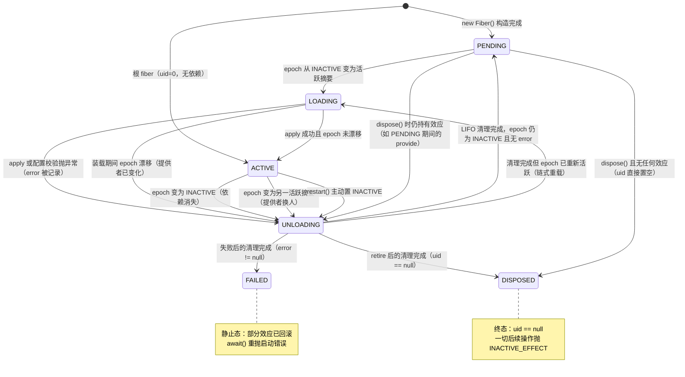
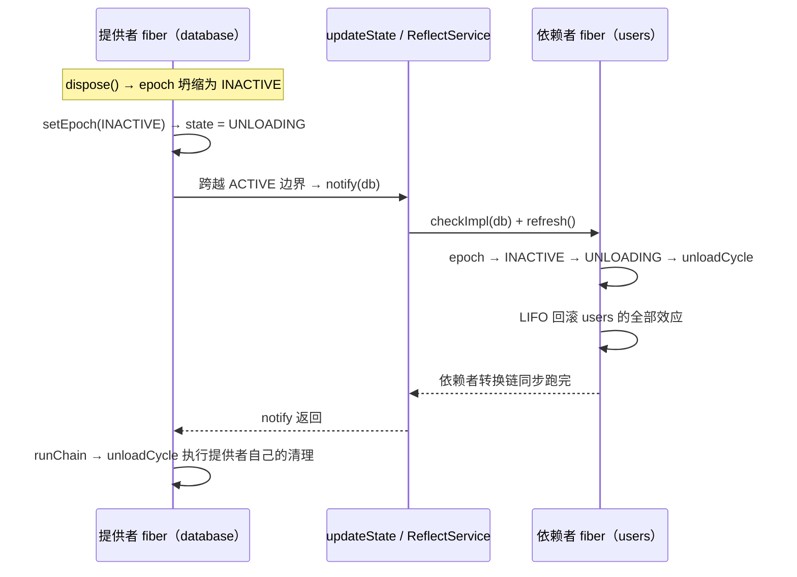

每一个被加载的插件在运行期都对应一个 `Fiber`——插件的一次"应用实例"。它不是被宿主显式 start/stop 的被动对象，而是一台**反应式状态机**：声明了 `inject` 的插件会因依赖满足而自动激活，因依赖消失而自动回退，因自身抛错而落入失败态，因被 retire 而进入不可逆的终态。本页系统解析 `FiberState` 枚举定义的六种状态、它们之间的全部合法转换、驱动转换的内部机制（`refresh → setEpoch → runChain`），以及每条转换规则背后由测试固化的行为契约。状态机如何被 epoch/target 视图驱动的完整惯性语义，将在 [惯性主机：epoch、target 视图与链式 reload/unload 转换](12-guan-xing-zhu-ji-epoch-target-shi-tu-yu-lian-shi-reload-unload-zhuan-huan) 深入展开。

## 一、状态机在框架中的位置

`Fiber` 在其类文档中自我定位为"论文 Definition 49 的 fiber"，并明确声明生命周期就是"论文 4.4 节 / Algorithm 5 的惯性状态机"：`refresh` 从余效应存储重算目标视图，目标的变化驱动 `reload` 或 `unload`；一旦转换开始，它会（通过链式接管任何中途重定目标）完整跑完，fiber 才重新静止在 PENDING 或 ACTIVE。这个 Java 移植选择了**同步实现**（命令式宿主的就地选择）：当提供者离开 ACTIVE 时，状态变化会通知依赖者，依赖者自己的卸载链在提供者的清理器运行之前同步跑完——这就是 L-Unload 上的守卫，"由构造保证有序"。

Sources: [Fiber.java](cordis-core/src/main/java/dev/cordis/core/Fiber.java#L16-L31)

状态本身存放在 `Fiber` 的公开字段 `state` 中，初始值为 `PENDING`；与之配套的还有目标摘要 `target`（所有声明键的提供者 uid 拼接，或哨兵值 `INACTIVE`）和三个内部字段：`epoch`（已提交的摘要）、`inertia`（在途转换的任务引用）、`error`（失败时捕获的异常）。理解这组字段的分工是理解全部转换规则的前提——`state` 是对外展示的窗口，而 `epoch`/`inertia`/`error` 才是真正决定状态如何流转的引擎。

Sources: [Fiber.java](cordis-core/src/main/java/dev/cordis/core/Fiber.java#L49-L68)

## 二、六状态语义

`FiberState` 枚举的 Javadoc 对六个状态给出了精确定义。下表将其展开为可操作的语义描述：

| 状态 | 含义 | 进入时机 | 期间的框架行为 | 离开去向 |
|---|---|---|---|---|
| **PENDING** | 等待必需服务（Inactive，target 视图 ⊥） | 构造完成时；卸载完成且依赖仍缺失时 | fiber 存活但 `plugin.apply` 未运行；`store` 为 null | LOADING（依赖满足）或 UNLOADING（被 dispose 且持有效应） |
| **LOADING** | 插件回调正在运行（Reloading） | epoch 从 INACTIVE 变为活跃摘要；或卸载后链式重载 | 提交 `store`、校验配置、执行 `apply`、收集 Disposable | ACTIVE / UNLOADING |
| **ACTIVE** | 已加载并在提供服务 | apply 成功返回且 epoch 未漂移 | 效应生效、服务可被严格解析、`inject` 满足 | UNLOADING（依赖消失/换人/restart） |
| **FAILED** | 回调或配置校验抛出异常（失败结局） | 失败后的清理完成时静止 | 部分效应已被 LIFO 回滚；`await()` 重抛错误 | LOADING（`update()` 清除 error 后重试） |
| **UNLOADING** | 清理器正在运行（Unloading） | epoch 变为 INACTIVE 或漂移到新活跃值；retire 遗留效应 | LIFO 逆序执行全部累积逆变换 | PENDING / FAILED / DISPOSED / LOADING |
| **DISPOSED** | fiber 已被移除，**无法重启** | retire 之后清理完成（`uid == null`） | 终态；`assertActive()`、`effect()`、`restart()` 均抛 `INACTIVE_EFFECT` | 无（终态） |

Sources: [FiberState.java](cordis-core/src/main/java/dev/cordis/core/FiberState.java#L4-L22)

一个关键的分类视角：**LOADING 与 UNLOADING 是瞬态（transient），其余四个是静止态（rest state）**。瞬态只在转换例程执行期间短暂存在，由代码用显式覆盖值写入；静止态则不是直接赋值的，而是由 `computeState()` 从 fiber 的内部事实派生出来。例外是根 fiber——它在构造时直接以 `uid = 0`、`state = ACTIVE`、空摘要出生，绕过了依赖检查。

Sources: [Fiber.java](cordis-core/src/main/java/dev/cordis/core/Fiber.java#L125-L133)

## 三、状态机全景图

在读图之前需要明确三个前提：其一，所有转换都由 `epoch`（目标视图摘要）的变化触发，"依赖满足/消失/换人"最终都归结为 epoch 的三种变化——从 INACTIVE 变活跃、从活跃变 INACTIVE、从一活跃值变另一活跃值；其二，虚线之外的 `[*]` 表示构造函数返回的瞬间，普通 fiber 从 PENDING 出生，根 fiber 从 ACTIVE 出生；其三，FAILED 与 DISPOSED 都是"清理完成之后"的静止态，即失败和退役同样要经历完整的 LIFO 回滚，而不是跳过清理直接跳变。

Sources: [FiberState.java](cordis-core/src/main/java/dev/cordis/core/FiberState.java#L15-L22), [Fiber.java](cordis-core/src/main/java/dev/cordis/core/Fiber.java#L277-L357)

注意图中 ACTIVE 上的三条出边最终都是同一条路径：`setEpoch` 的 else 分支统一置 UNLOADING。也就是说，**框架中不存在"ACTIVE 直接变 ACTIVE"的 reload 捷径**——一次重载严格等价于"完整卸载 + 重新装载"的链式执行，这保证了每次激活都在干净的基础上进行。

Sources: [Fiber.java](cordis-core/src/main/java/dev/cordis/core/Fiber.java#L277-L290)

## 四、静止态是派生的：computeState 三级优先

瞬态结束后，fiber 并不手工指定去哪个静止态，而是调用 `updateState(null)` 让 `computeState()` 按三级优先级裁决：`uid == null` → **DISPOSED**；`error != null` → **FAILED**；否则按 epoch 判断——`INACTIVE` → **PENDING**，非 `INACTIVE` → **ACTIVE**。这个优先级设计蕴含两条重要语义：退役（uid 置空）压倒一切，即使 fiber 因失败带着 error 被 retire，终态也是 DISPOSED；失败压倒依赖满足，一个 FAILED fiber 即使依赖仍然齐备也不会自动重试，必须由外部（如 `update()`）清除 error 才有机会复活。

Sources: [Fiber.java](cordis-core/src/main/java/dev/cordis/core/Fiber.java#L359-L363)

`updateState` 在写入新状态后做两件事：无条件发出 `internal/status` 事件（携带旧状态，供观测）；随后执行**ACTIVE 边界检查**——`if ((old == ACTIVE) == (next == ACTIVE)) return;`——只有跨越"ACTIVE ↔ 非 ACTIVE"边界时，才收集该 fiber 在全局反射存储中拥有的全部服务名并调用 `reflect.notify` 触发依赖者重估。这意味着 LOADING→UNLOADING 这类瞬态之间的跳变不会惊动任何依赖者，状态机的反应式涟漪只在 ACTIVE 边界上扩散。

Sources: [Fiber.java](cordis-core/src/main/java/dev/cordis/core/Fiber.java#L365-L378)

## 五、转换触发器：refresh → setEpoch → runChain

状态机的输入端是一条三段式管线。第一段 `refresh()` 遍历 `inject` 声明的每个键，从 `pendingStore` 取实现并拼接其提供者 uid 构成摘要；任何一个键缺失则 `target` 立即坍缩为 `INACTIVE`。第二段 `setEpoch(newEpoch)` 是真正的转换判定点：若 `inertia != null`（已有在途转换）则直接返回——在途转换结束后会自行重查并链式接管；否则按"INACTIVE→活跃"判定进入 LOADING 并装载 `reloadCycle`，其余一切变化（活跃→INACTIVE、活跃→另一活跃）统一进入 UNLOADING 并装载 `unloadCycle`。第三段 `runChain()` 是一个简单的排空循环：反复取出并执行 `inertia`，直到转换链自然静止。

Sources: [Fiber.java](cordis-core/src/main/java/dev/cordis/core/Fiber.java#L262-L299)

这条管线的入口在两处：构造函数末尾对新 fiber 做一次初始 `checkImpl + refresh`（若依赖本已满足，则 PENDING→LOADING→ACTIVE 在 `ctx.plugin()` 调用内同步完成，这正是 `.await()` 能立即返回的原因）；以及 `ReflectService.notify` 在任何服务绑定变化后对声明了该键的 fiber 重新 `checkImpl + refresh`。转换链如何在中途重定目标时保持一致性（"半重载"的接管），属于惯性主机的核心议题，详见 [惯性主机：epoch、target 视图与链式 reload/unload 转换](12-guan-xing-zhu-ji-epoch-target-shi-tu-yu-lian-shi-reload-unload-zhuan-huan)。

Sources: [Fiber.java](cordis-core/src/main/java/dev/cordis/core/Fiber.java#L121-L124), [ReflectService.java](cordis-core/src/main/java/dev/cordis/core/ReflectService.java#L71-L87), [Context.java](cordis-core/src/main/java/dev/cordis/core/Context.java#L257-L264)

## 六、两条转换例程

### reloadCycle：LOADING 期间的装载

装载例程分四步：先把 `pendingStore` 提交为正式视图 `store`；通过 `resolveConfig` 解析配置（先走 `internal/config` waterfall，再用插件 schema 校验）；以 `name() + ".apply"` 为标签执行 `plugin.apply(ctx, config)` 并收集其返回的 Disposable（惰性 Iterable 由"target 未漂移"守卫逐段驱动）；成功则清除 `error`。收尾判定只有两种：epoch 与进入时一致 → `updateState(null)` 静止（派生出 ACTIVE）；不一致（自身抛错时 epoch 已被置回 INACTIVE，或装载中途提供者变化）→ 置 UNLOADING 并链式装载 `unloadCycle`。注意**失败路径的精妙之处**：catch 块记录 `error` 并把 `epoch` 置回 INACTIVE，这让随后的收尾判定自然走向卸载——失败 fiber 的部分效应同样会被 LIFO 回滚，FAILED 是"清理完毕后的失败"。

Sources: [Fiber.java](cordis-core/src/main/java/dev/cordis/core/Fiber.java#L302-L333), [Fiber.java](cordis-core/src/main/java/dev/cordis/core/Fiber.java#L382-L391)

### unloadCycle：UNLOADING 期间的卸载

卸载例程开头有一段关键的构造性注释："依赖者已被排空——ACTIVE→UNLOADING 的状态变化已通知它们，它们的卸载链已同步跑完（L-Unload 上的守卫）"。随后把 `records` 快照清空，**逆序**逐个执行清理器，单个清理器抛出的异常被捕获并记入日志而不中断整体；最后置 `store = null`。收尾同样两分：epoch 仍为 INACTIVE → `updateState(null)` 静止（派生出 PENDING、FAILED 或 DISPOSED，取决于 error 与 uid）；epoch 已重新活跃 → 置 LOADING 并链式装载 `reloadCycle`，即"卸载完成后立即按新视图重载"。效应逆序折叠与单次处置的完整语义见 [LIFO 逆变换累加器：效应折叠、单次处置与失败回滚](9-lifo-ni-bian-huan-lei-jia-qi-xiao-ying-zhe-die-dan-ci-chu-zhi-yu-shi-bai-hui-gun)。

Sources: [Fiber.java](cordis-core/src/main/java/dev/cordis/core/Fiber.java#L336-L357)

| 维度 | reloadCycle | unloadCycle |
|---|---|---|
| 对应瞬态 | LOADING | UNLOADING |
| 前置动作 | 提交 `store = pendingStore` | 依赖者链已被同步排空（守卫） |
| 核心工作 | 解析配置 + 执行 `apply` + 收集正变换 | LIFO 逆序执行全部累积逆变换 |
| 异常处理 | 捕获 → 记录 `error` → epoch 置 INACTIVE → 链入卸载 | 逐个捕获 → 记日志 → 继续下一个清理器 |
| 干净收尾 | `error = null`，派生静止（通常 ACTIVE） | `store = null`，派生静止（PENDING/FAILED/DISPOSED） |
| 链式去向 | UNLOADING（失败或 epoch 漂移） | LOADING（epoch 已重新活跃） |

## 七、ACTIVE 边界的反应式语义

ACTIVE 状态在整套机制中具有双重特权。第一重是**可见性特权**：`ReflectService.getImpl` 的 strict 模式规定，只有提供者 fiber 处于 ACTIVE 时其绑定才对严格解析可见——一个还在 LOADING 的提供者等于不存在，这正是依赖者会等待而非读到"半成品服务"的保证。第二重是**通知特权**：`provide` 在注册绑定后仅在 `state == ACTIVE` 时立即通知；若注册发生在 LOADING 期间（即 `apply` 体内），通知被推迟到装载完成、状态跨越进入 ACTIVE 的那一刻，由 `updateState` 的边界检查一次性批量发出——框架借此把"装载中的提供"合并为一次原子可见的状态翻转。

Sources: [ReflectService.java](cordis-core/src/main/java/dev/cordis/core/ReflectService.java#L43-L56), [Fiber.java](cordis-core/src/main/java/dev/cordis/core/Fiber.java#L459-L479), [Fiber.java](cordis-core/src/main/java/dev/cordis/core/Fiber.java#L365-L378)

ACTIVE 边界离开时的守卫排序值得用一张交互图固化。前提说明：当提供者 fiber 的 epoch 坍缩为 INACTIVE 时，`setEpoch` 先置 UNLOADING（此刻 `updateState` 跨越了 ACTIVE 边界、同步通知依赖者），之后才装载自己的 `unloadCycle`——于是依赖者的完整卸载链嵌套发生在提供者清理器执行之前：

这条顺序由 `LifecycleTest.withdrawingProviderDeactivatesThenReprovideReactivates` 固化为断言：撤走提供者后日志严格为 `["consumer-down", "provider-down"]`，且消费者回到 PENDING；重新提供后消费者再次 ACTIVE。

Sources: [Fiber.java](cordis-core/src/main/java/dev/cordis/core/Fiber.java#L277-L299), [Fiber.java](cordis-core/src/main/java/dev/cordis/core/Fiber.java#L336-L345), [LifecycleTest.java](cordis-core/src/test/java/dev/cordis/LifecycleTest.java#L73-L91)

## 八、DISPOSED：终态契约

进入 DISPOSED 的唯一入口是构造函数中注册在父 fiber 上的 O-Insert 效应之逆（O-Retire）：它将 `uid` 置为 null、发出 `internal/plugin` 事件、把 fiber 从运行时记录中移除（运行时清空则连同注销）、`setEpoch(INACTIVE)` 并排空转换链；此外还有一段专门处理——**PENDING 的 fiber 也可能持有效应**（例如在等待依赖期间通过 `ctx.provide` 注册了服务），若 `inertia == null && !records.isEmpty()`，则显式置 UNLOADING、装载卸载例程并排空。清理完成后 `computeState` 因 `uid == null` 派生出 DISPOSED。

Sources: [Fiber.java](cordis-core/src/main/java/dev/cordis/core/Fiber.java#L98-L117)

终态的契约由 `assertActive()` 强制执行：`uid == null` 即抛 `CordisException.Code.INACTIVE_EFFECT`，因此对已退役 fiber 调用 `effect()`、`restart()`、`update()` 都会立即失败，fiber 无法重启。一个值得注意的实现细节：`state` 字段与派生语义存在一处微小错位——无任何效应的 PENDING fiber 被 retire 后，`state` 字段仍停留在 PENDING（没有任何 `updateState` 调用发生），但判定活性的一切权威路径（`assertActive`、`computeState`）都以 `uid` 为准；严谨的代码应把 `uid == null` 而非 `state == DISPOSED` 作为终态判据。级联退役（卸载父 fiber 自动卸载子 fiber）的完整机制见 [O-Insert 与 O-Retire：插件实例化的效应化与级联卸载](13-o-insert-yu-o-retire-cha-jian-shi-li-hua-de-xiao-ying-hua-yu-ji-lian-xie-zai)。

Sources: [Fiber.java](cordis-core/src/main/java/dev/cordis/core/Fiber.java#L146-L150), [Fiber.java](cordis-core/src/main/java/dev/cordis/core/Fiber.java#L169-L173), [Fiber.java](cordis-core/src/main/java/dev/cordis/core/Fiber.java#L417-L422)

## 九、守卫规则汇总

状态机在三个位置部署了显式守卫，防止非法窗口内的操作破坏转换不变量：

| 守卫 | 位置 | 触发条件 | 行为 |
|---|---|---|---|
| 卸载窗口禁注效应 | `effect()` 入口 | `state == UNLOADING` 时注册新效应 | 抛 `INACTIVE_EFFECT`——清理器正被排空，迟到的效应会泄漏 |
| 终态禁操作 | `assertActive()` | `uid == null` 时调用 effect/restart/update | 抛 `INACTIVE_EFFECT`——终态不可逆 |
| 拆卸期禁挂载 | 构造函数 | 父 fiber 处于 UNLOADING 时构造子 fiber | 跳过依赖检查与初始 refresh——新 fiber 反正即将被级联退役 |

Sources: [Fiber.java](cordis-core/src/main/java/dev/cordis/core/Fiber.java#L169-L173), [Fiber.java](cordis-core/src/main/java/dev/cordis/core/Fiber.java#L146-L150), [Fiber.java](cordis-core/src/main/java/dev/cordis/core/Fiber.java#L121-L124)

公开操作面则提供了三个手动驱动转换的入口：`restart()` 通过 `setEpoch(INACTIVE) + refresh()` 实现"卸载后立即用当前配置重载"；`await()` 在同步移植中不等待（转换早已排空），只负责把 FAILED 的 `error` 重抛给调用方；`update(newConfig)` 先走 `internal/update` waterfall（HMR 等钩子可否决或替换重启），对非 ACTIVE 的 fiber 则延迟到激活时再生效配置，并顺手清除 `error`——这使 `update` 兼任 FAILED 状态的恢复通道。

Sources: [Fiber.java](cordis-core/src/main/java/dev/cordis/core/Fiber.java#L409-L446)

## 十、由测试固化的行为契约

状态机的每条转换规则都有对应的测试锚点，下表给出契约到断言的映射，可作为回归阅读的索引：

| 行为契约 | 验证测试 | 关键断言 |
|---|---|---|
| 依赖未满足时静止于 PENDING，apply 不运行 | `consumerWaitsThenActivatesOnProvide` | 消费者创建后 `state == PENDING` 且日志为空 |
| 提供者进入 ACTIVE 后依赖者被唤醒 | 同上 | 提供者 `.await()` 后消费者 `state == ACTIVE`，日志为 `[provider-up, consumer-up:v1]` |
| 撤走提供者 → 依赖者先卸载、提供者后清理（守卫排序） | `withdrawingProviderDeactivatesThenReprovideReactivates` | 日志严格为 `[consumer-down, provider-down]`，消费者回到 PENDING |
| 提供者换人（fiber 身份变化）触发依赖者重载 | `providerReplacementReloadsConsumerAgainstNewFiber` | 日志为 `[consumer-up:v1, consumer-down, consumer-up:v2]`——摘要由 uid 构成，新 fiber 必然改变 target |
| restart = 完整卸载 + 同配置重载 | `restartUnloadsAndReloadsWithSameConfig` | 日志 `[up:cfg-1, down, up:cfg-1]`，终态 ACTIVE |
| update 经 waterfall 应用新配置并重启 | `updateAppliesNewConfigBehindTheWaterfall` | 日志 `[up:old, down, up:new]`，`getEffectiveConfig()` 返回新值 |
| 无效初始配置落入 FAILED 且 `await()` 重抛 | LoaderTest 配置校验用例 | `state == FAILED`；`await()` 抛 `ValidationException`；无效更新被前置拒绝、旧配置继续运行 |

Sources: [LifecycleTest.java](cordis-core/src/test/java/dev/cordis/LifecycleTest.java#L60-L71), [LifecycleTest.java](cordis-core/src/test/java/dev/cordis/LifecycleTest.java#L73-L103), [LifecycleTest.java](cordis-core/src/test/java/dev/cordis/LifecycleTest.java#L112-L153), [LoaderTest.java](cordis-core/src/test/java/dev/cordis/LoaderTest.java#L152-L162)

## 十一、观测状态机：internal/status 事件

每一次状态跳变都会向根事件总线发出 `internal/status` 事件，载荷为 `[fiber, 旧状态]`——新状态可直接读 `fiber.state`。端到端演示用它把全部转换实时打印到控制台（`status: users PENDING → LOADING` 风格的日志），是调试生命周期问题最直接的探针。事件的完整协议语义（与 `internal/config`、`internal/update` 的协作）见 [内部事件协议：internal/status、config 与 update 的观测和编排钩子](24-nei-bu-shi-jian-xie-yi-internal-status-config-yu-update-de-guan-ce-he-bian-pai-gou-zi)。

Sources: [Fiber.java](cordis-core/src/main/java/dev/cordis/core/Fiber.java#L365-L371), [Main.java](cordis-example/src/main/java/dev/cordis/example/Main.java#L54-L61)

## 结语与延伸阅读

归纳为一句话：**cordis-java 的插件生命周期是一台以 epoch 摘要为输入、以 ACTIVE 边界为反应式闸门、以 LIFO 清理为不变量的六状态惯性机**——静止态全部派生（DISPOSED > FAILED > PENDING/ACTIVE），瞬态严格成对（LOADING/UNLOADING）且必经完整排空，终态以 `uid == null` 为唯一权威判据。理解本页之后，三条自然的深入路径：转换链在提供者身份漂移下的接管语义（[惯性主机：epoch、target 视图与链式 reload/unload 转换](12-guan-xing-zhu-ji-epoch-target-shi-tu-yu-lian-shi-tu-yu-lian-shi-reload-unload-zhuan-huan)）；DISPOSED 背后的实例化原语（[O-Insert 与 O-Retire：插件实例化的效应化与级联卸载](13-o-insert-yu-o-retire-cha-jian-shi-li-hua-de-xiao-ying-hua-yu-ji-lian-xie-zai)）；以及驱动本状态机的输入端——服务绑定的反应式分类（[inject 声明与 ReflectService 通知：提供者变化的反应式分类](14-inject-sheng-ming-yu-reflectservice-tong-zhi-ti-gong-zhe-bian-hua-de-fan-ying-shi-fen-lei)）。HMR 引擎则在转换链之上叠加事务性重载（[HMR 阶段三：事务性重载与半重载状态的回滚保证](22-hmr-jie-duan-san-shi-wu-xing-zhong-zai-yu-ban-zhong-zai-zhuang-tai-de-hui-gun-bao-zheng)）。