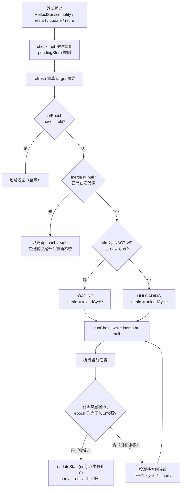
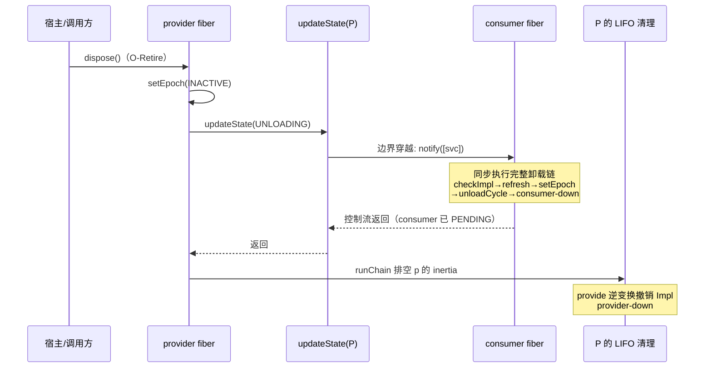

上一页我们清点了 `FiberState` 的六种状态与全部合法转换；本页回答一个更根本的问题：**是谁、依据什么、以何种方式驱动这些转换？** 答案是"惯性主机"（inertial host，论文 4.4 节 / Algorithm 5）：一个 fiber 平时静止在 PENDING 或 ACTIVE，任何扰动都会让它进入在途转换，而转换一旦开始就必须完整跑完——途中若目标再次变化，不会被丢弃，而是被**链接**到当前转换的尾部继续执行，直到 fiber 重新静止。本页将逐层拆解这套机制：`target`/`epoch` 两个摘要的语义分工、`inertia` 字段与 `runChain` 排空循环构成的转换引擎、`reloadCycle`/`unloadCycle` 的尾部检查点如何实现链式接管，以及依赖级联为何在同步移植中"由构造保证有序"。

Sources: [Fiber.java](cordis-core/src/main/java/dev/cordis/core/Fiber.java#L16-L31)

## 一、三份视图：pendingStore、store 与摘要对

理解惯性主机的前提是分清 fiber 内部维护的三份依赖视图。`Fiber` 的类文档自述：fiber 追踪自己的依赖状态——**已提交视图 `store`** 与**目标摘要 `target`**——外加已校验配置、生命周期效应和清理记录。落到字段上是一套四元组：

| 字段 | 可见性 | 语义 | 论文符号 | 更新时机 |
|---|---|---|---|---|
| `pendingStore` | 包私有 | 暂存的解析结果：每个声明键当前可见的 `Impl` | — | `checkImpl` 逐键重查时增删 |
| `store` | public | 已提交视图：装载时从 `pendingStore` 快照而来，`ctx.get` 沿 fiber 链行走时读取 | ω | `reloadCycle` 提交；`unloadCycle` 置 null |
| `target` | public | 目标摘要：所有声明键的提供者 uid 拼接，或哨兵 `INACTIVE` | target 视图 | 每次 `refresh` 重算 |
| `epoch` | 包私有 | 承诺摘要：fiber 正在收敛到（或已提交）的视图标识 | — | 仅经 `setEpoch` 变更 |

Sources: [Fiber.java](cordis-core/src/main/java/dev/cordis/core/Fiber.java#L49-L68)

`refresh`（Algorithm 5 的同名步骤）是重算 target 的唯一入口：它按 `inject` 的**声明顺序**遍历每个键，从 `pendingStore` 取出暂存的 `Impl`，把其提供者 fiber 的 uid 拼成 `:uid:uid…` 形式的摘要；只要有一个键缺失，就立即把 `target` 置为 `INACTIVE`（哨兵值 `"__INACTIVE__"`）并调用 `setEpoch(INACTIVE)` 提前返回。注意摘要里放的是 **`impl.fiber.uid` 而非服务值**——绑定以提供者身份标识，而非以值内容标识。这直接决定了后面的关键行为：同一个服务换了提供者 fiber（即便值完全相同），摘要也会变化，依赖者必须重载。

Sources: [Fiber.java](cordis-core/src/main/java/dev/cordis/core/Fiber.java#L34-L58), [Fiber.java](cordis-core/src/main/java/dev/cordis/core/Fiber.java#L261-L275)

`refresh` 的调用方是 `ReflectService.notify`（Algorithm 3）：任何绑定变化（provide 的注册与撤销）都会推送给声明了该键、且 realm 匹配的 fiber，先 `checkImpl` 逐键重查（含 `check` 谓词校验，失败视为不可见），再 `refresh`。类文档点明其幂等性设计——"refresh 的幂等性使中性变化无害"：若重算出的摘要与当前 epoch 相同，`setEpoch` 直接短路返回，不产生任何转换。值的更新走 `Context.set` 时甚至不触发 notify，因此**纯值变化不会引发重载，只有身份变化才会**。

Sources: [ReflectService.java](cordis-core/src/main/java/dev/cordis/core/ReflectService.java#L64-L93), [Context.java](cordis-core/src/main/java/dev/cordis/core/Context.java#L217-L233)

## 二、epoch 与 target 的分工：承诺值、期望值与静止态真值

初学者最容易混淆的两个字段是 `target` 与 `epoch`。可以这么锚定：**`target` 是"世界此刻应该是什么样"（期望值，每次 refresh 都会重写，包括转换进行中），`epoch` 是"fiber 已承诺收敛到什么"（承诺值，只在 `setEpoch` 中变更，且一旦确定就是静止态推导的真值来源）**。`computeState` 印证了后者的地位：`uid == null` 判 DISPOSED，`error != null` 判 FAILED，否则 `epoch` 为 INACTIVE 判 PENDING、否则判 ACTIVE——静止态完全不依赖 `state` 的历史，而是从 epoch/error/uid 三个事实**派生**出来。

Sources: [Fiber.java](cordis-core/src/main/java/dev/cordis/core/Fiber.java#L359-L363)

`setEpoch` 是整个状态机的调度核心，其决策逻辑可以完整列表化：

| old epoch | new epoch | `inertia` 状态 | 动作 |
|---|---|---|---|
| 任意 | 与 old 相等 | — | 短路返回（幂等） |
| 任意 | 任意 | **非 null（在途）** | 只更新 epoch 后返回——在途转换的尾部检查会重新比对并链接 |
| `INACTIVE` | 活跃摘要 | null | `state = LOADING`，`inertia = reloadCycle`，启动链 |
| 活跃摘要 | `INACTIVE` **或另一活跃摘要** | null | `state = UNLOADING`，`inertia = unloadCycle`，启动链 |

注意第三、四行的关键合并：**"依赖消失"（活跃→INACTIVE）与"提供者换人"（活跃→另一活跃）走同一条卸载路径**——先完整卸载旧视图，再由尾部检查决定是否链式重载到新视图。根 fiber 是特例：无 inject 的插件摘要为空字符串 `""`，它是"活跃"而非 INACTIVE，所以根 fiber 构造时直接以 `epoch = ""`、`state = ACTIVE` 出生，永远不需要转换。

Sources: [Fiber.java](cordis-core/src/main/java/dev/cordis/core/Fiber.java#L277-L290), [Fiber.java](cordis-core/src/main/java/dev/cordis/core/Fiber.java#L125-L133)

## 三、惯性引擎：inertia 与 runChain 的排空循环

字段 `Runnable inertia = null` 的命名直接取自论文的"惯性"隐喻：它持有 fiber 当前未被消化完的"动量"。`runChain` 的实现只有五行——**一个 while 排空循环**：取出 `inertia`、立即置 null、执行任务；任务执行中若又设置了新的 `inertia`（通过尾部检查或被 re-entrant 的 notify 触发 `setEpoch`），循环便继续，直到 `inertia` 归 null、fiber 静止。类文档对这套机制的描述是："一旦转换开始，它会（通过链式接管任何中途重定目标）完整跑完，fiber 才重新静止在 PENDING 或 ACTIVE"。

读图前提：图中的"入口快照"指每个 cycle 开始时捕获的 `oldEpoch`；"目标漂移"涵盖三种来源——cycle 执行期间 notify 重算了 target、失败路径主动把 epoch 置回 INACTIVE、以及 restart/update 这类外部连续触发。这个设计替代了递归或外部队列：re-entrant 的 `setEpoch` 只改 epoch 不启动新链（第二行决策表），把接力棒留给正在跑的 cycle 的尾部检查，从而保证任意时刻每个 fiber 至多有一条在途转换链，且链的推进严格串行。

Sources: [Fiber.java](cordis-core/src/main/java/dev/cordis/core/Fiber.java#L64-L68), [Fiber.java](cordis-core/src/main/java/dev/cordis/core/Fiber.java#L292-L299)

## 四、reloadCycle：装载事务的三个检查点

`reloadCycle`（Algorithm 5 的 reload 步骤）是一个自校验的装载事务，入口处先做两件事：**提交视图**——`store = new LinkedHashMap<>(pendingStore)` 把暂存解析快照为已提交视图 ω；**捕获快照**——`oldEpoch`（入口时的承诺摘要）与 `target0`（入口时的目标摘要）。随后在 `epoch` 仍等于 `oldEpoch` 的前提下解析配置（先过 `internal/config` waterfall，再过插件 schema 校验）、执行 `plugin.apply`，并把返回的 Disposable（或惰性 Iterable 的各阶段产物）收集进 records；全部成功则清空 `error`。

Sources: [Fiber.java](cordis-core/src/main/java/dev/cordis/core/Fiber.java#L301-L320)

装载期间有两个彼此独立但常被混淆的守卫。其一是**惰性迭代稳定性守卫**：`collectResult` 收到的守卫谓词是 `() -> Objects.equals(target, target0)`——比对的是 *target*（期望值），在惰性 Iterable 的每个阶段边界被咨询，一旦 target 漂移就停止迭代、把已积累的逆变换留在原地（这正是 [惰性 Iterable 多阶段效应与稳定性守卫中断](10-duo-xing-iterable-duo-jie-duan-xiao-ying-yu-wen-ding-xing-shou-wei-zhong-duan) 详述的步边界中断）。其二是**尾部提交检查**：apply 返回后比对的是 *epoch*（承诺值）与入口快照 `oldEpoch`——相等才允许静止（派生 ACTIVE），不等则进入 `UNLOADING` 并把 `unloadCycle` 挂到 inertia 上，由 runChain 继续排空。一个比对期望、一个比对承诺，分工精确。

Sources: [Fiber.java](cordis-core/src/main/java/dev/cordis/core/Fiber.java#L311-L333)

失败路径同样汇入链式结构：apply 或配置校验抛出的异常被捕获、记入 `error`、打日志，然后**主动把 `epoch` 置为 INACTIVE**——这个赋值使得尾部检查必然发现 epoch ≠ oldEpoch，于是卸载链被挂起执行，部分产生的效应被 LIFO 回滚；卸载尾部再发现 epoch 已是 INACTIVE，便静止，而 `computeState` 因 `error != null` 派生出 FAILED。换言之，**失败不是跳过清理直接跳变，而是被编码成一次"目标变为 INACTIVE"的普通转换**。附带的可观测推论：若清理期间依赖恰好恢复使 epoch 重新活跃，卸载尾部会链式重载并重试 apply，成功时 `error = null` 被清空，瞬态失败可自愈；`await()` 则只在转换静止后把 FAILED 的错误同步抛给调用方（"在这个同步移植中转换已经静止"）。

Sources: [Fiber.java](cordis-core/src/main/java/dev/cordis/core/Fiber.java#L321-L333), [Fiber.java](cordis-core/src/main/java/dev/cordis/core/Fiber.java#L405-L414)

## 五、unloadCycle：LIFO 清理与链式重载

`unloadCycle`（Algorithm 5 的 unload 步骤）开头是一段重要的注释：**依赖者已被排空**——ACTIVE→UNLOADING 的状态变化已经通知过它们，它们的卸载链已同步跑完，这就是 L-Unload 上的守卫。随后的清理本体：把 records 复制后清空，逆序逐个执行 disposer，每个 disposer 的异常都被单独捕获记日志（**单个清理器的失败不会中断其余清理**），最后 `store = null` 撤销已提交视图。尾部检查与 reloadCycle 对称：epoch 为 INACTIVE 则静止（派生 PENDING/FAILED/DISPOSED），否则置 LOADING 并把 `reloadCycle` 挂到 inertia——**换提供者场景下的"先卸后装"就发生在这里**。

Sources: [Fiber.java](cordis-core/src/main/java/dev/cordis/core/Fiber.java#L335-L357)

用 `LifecycleTest.providerReplacementReloadsConsumerAgainstNewFiber` 做一次全链路推演，可以同时验证级联顺序与身份语义。该测试断言日志恰为 `["consumer-up:v1", "consumer-down", "consumer-up:v2"]`，并注释道："consumer 重载恰恰因为提供者 fiber 身份变了"：

| 步骤 | 触发 | 惯性主机内部动作 |
|---|---|---|
| 1 | `root.plugin(provider v1)` | p1 的 apply 注册 Impl → notify → consumer `checkImpl` + `refresh` → target `":2"` → setEpoch：INACTIVE→活跃 → reloadCycle → consumer ACTIVE |
| 2 | `p1.dispose()`（O-Retire 逆变换） | p1 `setEpoch(INACTIVE)` → p1 进入 UNLOADING；**边界穿越通知**先让 consumer 完整卸载（consumer-down），随后 p1 自己的 LIFO 清理才运行（provider-down） |
| 3 | `root.plugin(provider v2)` | 新 fiber p2（新 uid）注册 → notify → consumer target `":3"` ≠ INACTIVE 旧值 → INACTIVE→活跃 → reloadCycle → consumer-up:v2 |

Sources: [LifecycleTest.java](cordis-core/src/test/java/dev/cordis/LifecycleTest.java#L93-L103)

## 六、ACTIVE 边界穿越：级联为何"由构造保证有序"

第五节反复出现的"依赖者先排空"并非卸载例程里的显式等待，而是同步通知时序的自然结果，机制藏在 `updateState` 中。该方法先无条件在状态变化时发出 `internal/status` 事件，然后做一个精确的过滤：**只有"是否 ACTIVE"这个布尔值发生翻转时**（`old == ACTIVE` 与 `next == ACTIVE` 不一致），才收集本 fiber 提供的全部服务名并调用 `reflect.notify`。由于 `setEpoch` 在启动卸载链之前就把 state 覆写为 UNLOADING 并触发这次 notify，依赖者的完整卸载链会在 notify 内部同步执行完毕，控制流返回后提供者自己的 LIFO 清理才开始——类文档称之为"命令式宿主的就地选择"（论文 Definition 23），"L-Unload 上的守卫，由构造保证有序"。

Sources: [Fiber.java](cordis-core/src/main/java/dev/cordis/core/Fiber.java#L27-L31), [Fiber.java](cordis-core/src/main/java/dev/cordis/core/Fiber.java#L365-L378)

读图前提：图中"consumer 的完整卸载链"本身就是一次嵌套的 runChain 排空——惯性机制是可重入的，外层链的每一步都可能嵌套内层链。支撑这一切的还有严格解析规则：`ReflectService.getImpl` 在 `strict` 模式下只返回提供者 fiber 处于 ACTIVE 的实现，因此正在离开的提供者对依赖者的 `checkImpl` 而言等同于"不存在"，两个机制共同保证了依赖者永远基于**已静止或正在进入静止**的提供者做决策。`LifecycleTest.withdrawingProviderDeactivatesThenReprovideReactivates` 断言的 `["consumer-down", "provider-down"]` 顺序正是这条时序的测试固化。

Sources: [ReflectService.java](cordis-core/src/main/java/dev/cordis/core/ReflectService.java#L43-L56), [LifecycleTest.java](cordis-core/src/test/java/dev/cordis/LifecycleTest.java#L73-L91)

## 七、外部触发面：构造、restart、update 与 remount

惯性主机的全部入口可以收敛为四类，它们的共同点是**从不直接操纵 state，只通过 target/epoch 说话**：

| 入口 | 位置 | 驱动方式 | 典型链形态 |
|---|---|---|---|
| 构造函数初始求值 | `new Fiber(...)` 尾部 | 逐键 `checkImpl` + `refresh`；父 fiber 正在 UNLOADING 时跳过（fiber 以 INACTIVE 待命） | 无链（PENDING）或单段 reload |
| retire 逆变换 | O-Retire disposer | `setEpoch(INACTIVE)` + `runChain`；PENDING 期已持有效应者补一段显式 unloadCycle | unload（可能嵌套依赖者整链） |
| `restart()` | 公开 API | `setEpoch(INACTIVE)` 跑完卸载，再 `refresh()` 依 pendingStore 重算 → 激活 | **unload → reload 两段链** |
| `update(cfg)` | 公开 API | ACTIVE 时走 `internal/update` waterfall（钩子可否决）后 restart；非 ACTIVE 时清 `error`、置 INACTIVE 后 refresh（配置解析需注入服务，故推迟到激活时） | waterfall + unload → reload |
| HMR `remount` | `ComponentLoader` | `dispose()` 旧 fiber + `ctx.plugin(...)` 建新 fiber，依赖者被动经 notify 重载 | 依赖者的 reactive reload |

Sources: [Fiber.java](cordis-core/src/main/java/dev/cordis/core/Fiber.java#L98-L124), [Fiber.java](cordis-core/src/main/java/dev/cordis/core/Fiber.java#L416-L446), [ComponentLoader.java](cordis-core/src/main/java/dev/cordis/loader/ComponentLoader.java#L196-L214)

`restartUnloadsAndReloadsWithSameConfig` 与 `updateAppliesNewConfigBehindTheWaterfall` 两个测试分别固化了后两类入口的行为契约：前者断言 `["up:cfg-1", "down", "up:cfg-1"]` 且终态 ACTIVE——证明 restart 保留 rawConfig、用同一配置完整走一遍卸载与重载；后者断言 `["up:old", "down", "up:new"]` 且 `getEffectiveConfig()` 返回新值——证明 update 先落 rawConfig 再经 waterfall 触发 restart。HMR 侧的 `HmrTest` 则展示惯性的外部观测：`HmrEngine.reload` 对陈旧 entry 做 dispose + 重实例化后，consumer 的加载计数 ≥ 2，注释明确写道"consumer 也重载了——它的依赖现在由一个新 fiber 提供（cordis 以提供者身份而非值标识绑定）"——这正是第一节摘要按 uid 计算的直接后果（HMR 事务与回滚的完整机制见 [HMR 阶段三：事务性重载与半重载状态的回滚保证](22-hmr-jie-duan-san-shi-wu-xing-zhong-zai-yu-ban-zhong-zai-zhuang-tai-de-hui-gun-bao-zheng)）。

Sources: [LifecycleTest.java](cordis-core/src/test/java/dev/cordis/LifecycleTest.java#L112-L153), [HmrTest.java](cordis-core/src/test/java/dev/cordis/HmrTest.java#L122-L136)

## 八、设计要义与延展阅读

回顾全页，惯性主机的三个设计决策值得高级读者反复咀嚼。**其一，承诺值与期望值分离**：epoch 承诺、target 期望，使转换中段的 re-entrant 扰动可以被安全吸收（setEpoch 提前返回）而非丢失（尾部检查链接）。**其二，失败与漂移统一编码为 epoch 变化**：失败置 INACTIVE、漂移改摘要，二者与正常的依赖消失共用同一条卸载管线，不存在特例分支。**其三，级联有序性靠构造而非靠等待**：边界穿越通知 + 严格解析 + 同步执行，三者合力让"依赖者先于提供者清理"成为时序上的必然，而非运行时的检查。这套机制的上游（谁在 retire 时调用 `setEpoch(INACTIVE)`）属于 [O-Insert 与 O-Retire：插件实例化的效应化与级联卸载](13-o-insert-yu-o-retire-cha-jian-shi-li-hua-de-xiao-ying-hua-yu-ji-lian-xie-zai) 的主题；扰动分类（add/update/remove 如何映射到 checkImpl）见 [inject 声明与 ReflectService 通知：提供者变化的反应式分类](14-inject-sheng-ming-yu-reflectservice-tong-zhi-ti-gong-zhe-bian-hua-de-fan-ying-shi-fen-lei)；而六个状态的完整转换表可回看 [生命周期状态机：PENDING 到 DISPOSED 的六状态与转换规则](11-sheng-ming-zhou-qi-zhuang-tai-ji-pending-dao-disposed-de-liu-zhuang-tai-yu-zhuan-huan-gui-ze)。