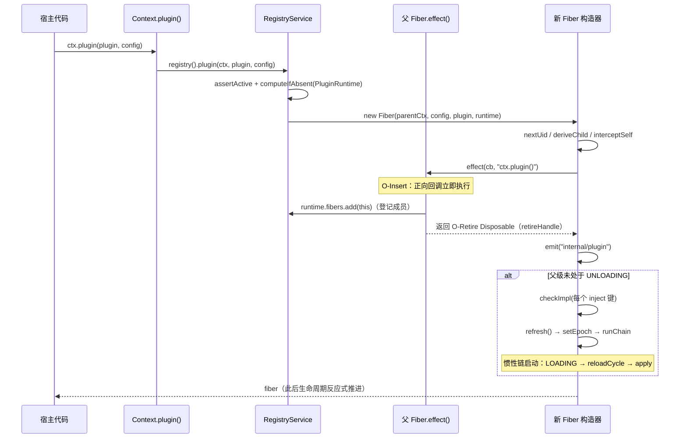
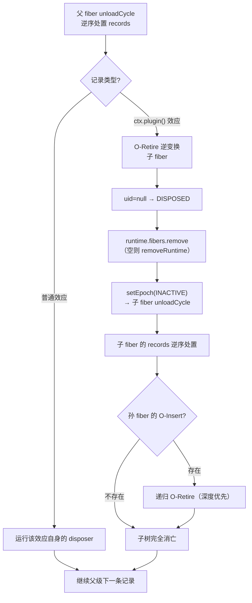

本文解释 cordis-java 中最核心的一条设计决策：**插件实例化本身被建模为父 fiber 上的一次可回退效应（O-Insert），其逆变换（O-Retire）天然构成子插件生命周期的上界**。我们将逐一走读 `ctx.plugin()` 背后的构造序列、O-Retire 逆过程的五阶段协议、LIFO 折叠下级联卸载的传播路径，以及注册表 `PluginRuntime` 的共享与回收簿记。本文聚焦"实例化原语及其逆"，fiber 状态机的完整转换规则与惯性链式转换机制分别在[生命周期状态机：PENDING 到 DISPOSED 的六状态与转换规则](11-sheng-ming-zhou-qi-zhuang-tai-ji-pending-dao-disposed-de-liu-zhuang-tai-yu-zhuan-huan-gui-ze)与[惯性主机：epoch、target 视图与链式 reload/unload 转换](12-guan-xing-zhu-ji-epoch-target-shi-tu-yu-lian-shi-reload-unload-zhuan-huan)中展开。

Sources: [Fiber.java](cordis-core/src/main/java/dev/cordis/core/Fiber.java#L15-L31)

## 一、核心命题：实例化是父 fiber 上的一次效应

在大多数插件框架中，"加载子插件"是一个游离于资源管理之外的过程：框架维护一张显式的父子表，卸载时需要遍历它。cordis-java 拒绝了这条路线。`RegistryService.plugin` 的 Javadoc 直接点明：`ctx.plugin()` **在当前上下文（即父 fiber）上注册一个效应，这是演算中的 O-Insert；其逆（返回的 disposer，由父 fiber 持有）就是 O-Retire**。换言之，子 fiber 的存在性不是注册表里的一条孤立记录，而是父 fiber 效应累加器（`records`）中的一条 `EffectRecord`——效应记录列表本身就是所有权树。

这一选择的结构性收益在于：**级联卸载不需要任何专门机制**。父 fiber 卸载时按 LIFO 逆序处置全部效应记录，命中某个 `ctx.plugin()` 效应时，其逆变换（O-Retire）同步、完整地卸载对应子 fiber；子 fiber 的卸载又递归触发孙 fiber 的 O-Retire。子生命周期 ⊆ 父生命周期这一性质是**由构造保证的**（by construction），而非由某个卸载遍历器的实现正确性保证。代码注释以"论文 Definition 52"标注这一实例化原语：效应回调体执行"正向簿记"（`runtime.fibers.add(this)`），返回的 `Disposable` 承载全部逆向逻辑。

Sources: [RegistryService.java](cordis-core/src/main/java/dev/cordis/core/RegistryService.java#L12-L15), [Fiber.java](cordis-core/src/main/java/dev/cordis/core/Fiber.java#L98-L117)

## 二、O-Insert：从 `ctx.plugin()` 到首个惯性转换的构造序列

O-Insert 的入口极薄：`Context.plugin(plugin, config)` 委托给根上下文的 `RegistryService`，后者仅做三件事——空指针检查（抛 `INVALID_PLUGIN`）、对父 fiber 调用 `assertActive()`（已处置的上下文拒绝再插入）、以 `Plugin` 对象身份为键 `computeIfAbsent` 出共享的 `PluginRuntime` 记录，然后直接进入 `Fiber` 构造器。**所有实质工作都发生在构造器内部**，这使得"实例化"在时间上是一个原子的同步动作。

下表给出构造器（非根 fiber 分支）的完整执行序列：

| 步骤 | 操作 | 语义 |
|---|---|---|
| 1 | `root.registry().nextUid()` | 分配单调递增的 fiber uid（synchronized 计数器） |
| 2 | `parentCtx.deriveChild(this)` | 派生子上下文；子 fiber 拥有自己的 ctx，服务解析沿 fiber 链向上 |
| 3 | `ctx.interceptSelf(name, config)` | 将 `inject` 声明中的逐服务 intercept 配置安装到该派生上下文 |
| 4 | `parentCtx.fiber().effect(cb, "ctx.plugin()")` | **O-Insert 本体**：在父 fiber 上注册带标签效应；回调立即执行 `runtime.fibers.add(this)` |
| 5 | `events().emit(null, "internal/plugin", this)` | 全局广播"新 fiber 已插入"，供观测与编排钩子消费 |
| 6 | 守卫：`uid != null && parentCtx.fiber().state != UNLOADING` | 父级正处于卸载中则跳过初始激活（与 `effect()` 的 UNLOADING 拒绝构成双保险） |
| 7 | 逐个 `checkImpl(name)` | 对每个 `inject` 声明的键做严格解析（含 `check` 谓词），结果写入 `pendingStore` |
| 8 | `refresh()` | 由 `pendingStore` 计算 target 摘要 → `setEpoch` → 首个惯性转换（LOADING → reloadCycle） |

值得强调两个细节。其一，**效应回调在注册瞬间即执行**：`runtime.fibers.add(this)` 发生在 `effect()` 调用内部，而非延迟到某个后续 tick——O-Insert 的正向簿记与 `new Fiber` 表达式同步完成。其二，步骤 6 的守卫与 `effect()` 方法自身的检查（`state == FiberState.UNLOADING` 时抛 `INACTIVE_EFFECT`）在当前同步端口中形成防御性分层：即使未来引入异步宿主，插入也不会在一个正在消亡的父级下启动生命周期。若父 fiber 状态正常，构造器末尾立即对每个声明键做 `checkImpl` 并 `refresh()`——由满足度驱动的激活就此接手，这就是[上下文范式](6-shang-xia-wen-fan-shi-context-zuo-wei-xiao-ying-yu-yu-xiao-ying-de-tong-zhong-jie)中"效应与余效应统一"在实例化时刻的体现。

Sources: [Context.java](cordis-core/src/main/java/dev/cordis/core/Context.java#L257-L270), [RegistryService.java](cordis-core/src/main/java/dev/cordis/core/RegistryService.java#L71-L81), [Fiber.java](cordis-core/src/main/java/dev/cordis/core/Fiber.java#L81-L134), [Fiber.java](cordis-core/src/main/java/dev/cordis/core/Fiber.java#L169-L173), [Context.java](cordis-core/src/main/java/dev/cordis/core/Context.java#L81-L90)

## 三、O-Retire：逆过程协议的五个阶段

O-Retire 的全部逻辑浓缩在 O-Insert 效应回调返回的那个 lambda 中。当父 fiber 的效应折叠器逆序调用它（或用户显式调用 `fiber.dispose()`）时，五个阶段依次执行：

| 阶段 | 代码 | 效果 |
|---|---|---|
| ① 失活标记 | `this.uid = null` | `computeState()` 据此返回 `DISPOSED`；后续对该 fiber 的 `effect()`/`assertActive()` 抛 `INACTIVE_EFFECT` |
| ② 退役广播 | `emit("internal/plugin", this)` | 与插入时的广播同通道，观测方据 fiber 状态区分插/退 |
| ③ 成员移除与回收 | `runtime.fibers.remove(this)`；空则 `removeRuntime` | 从共享运行时记录注销；最后一个 fiber 退役时整条 `PluginRuntime` 记录从注册表删除 |
| ④ 惯性排空 | `setEpoch(INACTIVE)` → `runChain()` | epoch 归 INACTIVE 触发 UNLOADING + `unloadCycle` 惯性并同步跑完链；若存在在途转换则由链式重检接管 |
| ⑤ PENDING 兜底 | `inertia == null && !records.isEmpty()` → 显式 `unloadCycle` | 清理"从未成功加载却已持有效应"的 fiber（见下文） |

阶段 ⑤ 是最容易被忽视的分支，其存在性由 `reloadCycle` 的失败语义决定：插件 `apply` 体内通过 `ctx.effect(...)` 注册的效应**立即进入该 fiber 的 `records`**；若 `apply` 在注册了若干效应之后抛出异常，`reloadCycle` 捕获错误并将 `epoch` 置回 `INACTIVE`（fiber 报告 FAILED），但这些已登记的效应不会随失败自动回滚。此时 O-Retire 的 `setEpoch(INACTIVE)` 因新旧 epoch 相等而成为无操作、`runChain()` 也无事可做——兜底分支检测到 `records` 非空，显式将状态置为 `UNLOADING` 并追加一次 `unloadCycle`，保证**退役语义在"已加载"与"加载失败"两条路径上都完整清理效应**。

对外入口 `dispose()` 的分流同样值得注意：插件 fiber 走 `retireHandle.dispose()`；根 fiber 则委托 `registry().deleteAll()` 卸载整个应用（这解释了示例程序结尾"disposing root cascades through every fiber"的全局清扫）。由于 `retireHandle` 是 `effect()` 返回的包装 disposer，其内部的 `armed` 标志保证**重复调用 `dispose()` 是幂等无操作**。

Sources: [Fiber.java](cordis-core/src/main/java/dev/cordis/core/Fiber.java#L101-L117), [Fiber.java](cordis-core/src/main/java/dev/cordis/core/Fiber.java#L448-L456), [Fiber.java](cordis-core/src/main/java/dev/cordis/core/Fiber.java#L188-L198), [Fiber.java](cordis-core/src/main/java/dev/cordis/core/Fiber.java#L302-L333), [Fiber.java](cordis-core/src/main/java/dev/cordis/core/Fiber.java#L359-L363), [Main.java](cordis-example/src/main/java/dev/cordis/example/Main.java#L161-L165)

## 四、级联卸载：LIFO 顺序下的所有权传播

级联的第一通道是**结构性通道**：父 fiber 的 `unloadCycle` 把 `records` 拷贝后清空，并**逆序**处置每条记录——这正是[LIFO 逆变换累加器](9-lifo-ni-bian-huan-lei-jia-qi-xiao-ying-zhe-die-dan-ci-chu-zhi-yu-shi-bai-hui-gun)的折叠规则。当逆序游标命中某个 `"ctx.plugin()"` 标签的记录时，其 O-Retire 逆变换被调用，子 fiber 在**当前调用栈内、同步地**完成阶段①–⑤的全部工作，包括其自身 `unloadCycle` 对孙 fiber 的递归退役。整个级联因此是深度优先且同步收敛的：父 fiber 的 `unloadCycle` 循环推进到下一条记录之前，子树已经完全消亡。

级联的第二通道是**余效应通道**：当 fiber 跨越 ACTIVE 边界时，`updateState` 对其提供的每个服务名调用 `reflect().notify`，依赖该服务的 fiber 的卸载链同步先跑完——这就是 `unloadCycle` 注释中"guard on L-Unload, ordered by construction"的落实，也是生命周期测试断言 `consumer-down` 先于 `provider-down` 出现的机制根源。两条通道分工明确：结构性通道沿**上下文派生链**（谁在谁的 ctx 下被实例化）传播退役，余效应通道沿**服务依赖边**（谁 inject 了谁 provide 的键）传播失活，二者最终都汇入同一个 `unloadCycle` 折叠器。

LIFO 顺序还隐含一条工程上有用的时序性质：若父插件在 `apply` 中先 `ctx.plugin(child)`、后注册其他效应，那么父级卸载时**其他效应先于子插件退役**（后注册者先处置）。需要子插件存活到清理最后一刻的宿主，应把 `ctx.plugin()` 尽早放在 `apply` 的前部。

Sources: [Fiber.java](cordis-core/src/main/java/dev/cordis/core/Fiber.java#L335-L357), [Fiber.java](cordis-core/src/main/java/dev/cordis/core/Fiber.java#L365-L378), [LifecycleTest.java](cordis-core/src/test/java/dev/cordis/LifecycleTest.java#L73-L91)

## 五、注册表簿记：PluginRuntime 的共享与回收

O-Insert 的"正向簿记"落在 `PluginRuntime` 上：它以 `Plugin` 对象身份为键（`LinkedHashMap`，保留插入序），记录可执行组件、展示名与**全部存活 fiber 列表**。这直接支持了"同一 Plugin、多份实例化"的配置语义——`Plugin` 的 Javadoc 明确：一个插件绑定两份 payload 表现为两个组件，它们共享同一条 runtime 记录却各自拥有独立的 fiber、独立的目标视图与独立的效应集。`RegistryService` 提供三条退役入口与之配套：`delete(plugin)` 逐个 dispose 该插件的所有 fiber 并删除记录；`deleteAll()` 服务于根 fiber 退役的全应用清扫；而**常规路径的记录回收是自动的**——O-Retire 阶段③在移除最后一个 fiber 时即调用 `removeRuntime`，无需宿主显式注销。

`inject(deps, body)` 是 O-Insert 的匿名变体：`RegistryService.inject` 用 `Plugin.of(null, deps, body)` 把回调包装成无名插件再走标准 `plugin()` 流程。因此"等待服务可用后执行一次回调"并非轻量语法糖，而是**一个完整的 fiber**——它同样经历 PENDING → ACTIVE 的反应式推进、同样在依赖身份变化时重跑、同样以 O-Retire 退役。这让临时回调与常驻插件共享同一套生命周期纪律与观测通道。

Sources: [PluginRuntime.java](cordis-core/src/main/java/dev/cordis/core/PluginRuntime.java#L7-L24), [Plugin.java](cordis-core/src/main/java/dev/cordis/core/Plugin.java#L9-L13), [RegistryService.java](cordis-core/src/main/java/dev/cordis/core/RegistryService.java#L47-L69), [RegistryService.java](cordis-core/src/main/java/dev/cordis/core/RegistryService.java#L83-L97)

## 六、触发 O-Retire 的全部路径（宿主视角）

声明式加载器 `ComponentLoader` 是 O-Retire 的高频驱动者。下表归纳宿主侧所有触发点及其语义（retire-now / retire-and-reinsert）：

| 触发点 | 调用 | 语义 |
|---|---|---|
| 用户直调 | `fiber.dispose()` | 立即退役该 fiber（幂等） |
| Entry 被 disable | `m.fiber.dispose()`，记录保留空 fiber | **纯退役**：记录留存，`disabled` 翻回时再重建 |
| Entry 的 url/isolate/intercept 变化 | `rebuild`：先 `dispose` 再 `mount` | **退役 + 重新实例化**（组件身份或派生 ctx 变更） |
| Entry 从配置中消失 | `unmount`：`dispose` 并删除记录 | 纯退役 |
| HMR 热替换 | `remount`：`dispose` 旧 fiber 后 `ctx.plugin` 新 fiber | 退役 + 新实例（HMR 阶段三的事务语义见[专题页](22-hmr-jie-duan-san-shi-wu-xing-zhong-zai-yu-ban-zhong-zai-zhuang-tai-de-hui-gun-bao-zheng)） |
| 加载器清扫 | `disposeAll` → 逐 entry `unmount` | 批量纯退役 |
| 注册表操作 | `registry.delete(plugin)` / `deleteAll()` | 按插件 / 全应用退役 |
| 父 fiber 卸载 | LIFO 折叠命中 `ctx.plugin()` 记录 | **隐式级联**（第四节的结构性通道） |

这张表同时揭示了[组件调和](19-zu-jian-diao-he-an-id-chai-fen-yu-zhu-zi-duan-fen-fa-de-zui-xiao-rao-dong-ce-lue)的最小扰动策略如何落到 O-Insert/O-Retire 原语上：配置字段变化走 `fiber.update`（不退役），身份性字段变化才触发 rebuild——退役被保留给"组件实例确实应当换人"的场合。

Sources: [ComponentLoader.java](cordis-core/src/main/java/dev/cordis/loader/ComponentLoader.java#L108-L115), [ComponentLoader.java](cordis-core/src/main/java/dev/cordis/loader/ComponentLoader.java#L158-L173), [ComponentLoader.java](cordis-core/src/main/java/dev/cordis/loader/ComponentLoader.java#L202-L221)

## 七、行为契约与边界

测试体系将 O-Insert/O-Retire 的关键时序固化为可执行契约：

| 契约 | 测试 | 断言要点 |
|---|---|---|
| 卫兵顺序 | `withdrawingProviderDeactivatesThenReprovideReactivates` | provider `dispose()` 后，consumer 完整卸载**先于** provider 自身 teardown（`consumer-down` → `provider-down`） |
| 身份敏感重载 | `providerReplacementReloadsConsumerAgainstNewFiber` | 退役旧 provider、插入新 provider，consumer 因 provider fiber 身份变化而精确重载 |
| LIFO 折叠 | `effectsUnwindInLifoOrderOnFiberUnload` | fiber 卸载时其效应记录逆序展开 |
| 退役后拒绝效应 | `effectOnDisposedFiberThrows` | 对已退役 fiber 调 `effect()` 抛 `INACTIVE_EFFECT` |
| 幂等退役 | `Disposable` 的 `armed` 语义 | 重复 `dispose()` 为无操作，卸载不再重复计数 |

边界行为清单：向处于 UNLOADING 的父级插入子插件会在 `parentCtx.fiber().effect(...)` 处抛 `INACTIVE_EFFECT`（构造器第二道守卫进一步跳过初始 `refresh`，防御异步宿主下的竞态窗口）；`plugin == null` 抛 `INVALID_PLUGIN`；退役中的 fiber 状态由 `computeState` 依 `uid == null` 判定为 `DISPOSED`，与[状态机页](11-sheng-ming-zhou-qi-zhuang-tai-ji-pending-dao-disposed-de-liu-zhuang-tai-yu-zhuan-huan-gui-ze)的终态定义一致；插/退两次 `internal/plugin` 广播为[内部事件协议](24-nei-bu-shi-jian-xie-yi-internal-status-config-yu-update-de-guan-ce-he-bian-pai-gou-zi)提供了 fiber 级的观测原语。

Sources: [LifecycleTest.java](cordis-core/src/test/java/dev/cordis/LifecycleTest.java#L73-L103), [EffectTrackingTest.java](cordis-core/src/test/java/dev/cordis/EffectTrackingTest.java#L40-L94), [Fiber.java](cordis-core/src/main/java/dev/cordis/core/Fiber.java#L147-L173), [Fiber.java](cordis-core/src/main/java/dev/cordis/core/Fiber.java#L359-L363)

## 八、小结

O-Insert/O-Retire 的本质是一次漂亮的**正交化归并**：插件实例化没有被赋予特权路径，而是复用了效应累加器的登记、LIFO 折叠与幂等处置机制；由此，所有权层级、级联卸载与退役的时序保证全部从"LIFO 逆序处置"这一条规则中推导出来。掌握这一原语后，建议按以下顺序继续深入：先读[惯性主机：epoch、target 视图与链式 reload/unload 转换](12-guan-xing-zhu-ji-epoch-target-shi-tu-yu-lian-shi-reload-unload-zhuan-huan)理解 O-Retire 排空的 `runChain` 循环，再读[可回退效应模型：EffectCallback、Disposable 与多阶段延续](8-ke-hui-tui-xiao-ying-mo-xing-effectcallback-disposable-yu-duo-jie-duan-yan-xu)补齐 `effect()` 的完整语义，最后在[组件调和](19-zu-jian-diao-he-an-id-chai-fen-yu-zhu-zi-duan-fen-fa-de-zui-xiao-rao-dong-ce-lue)与[HMR 阶段三](22-hmr-jie-duan-san-shi-wu-xing-zhong-zai-yu-ban-zhong-zai-zhuang-tai-de-hui-gun-bao-zheng)中观察宿主如何编排这对原语实现差分更新与事务性热替换。