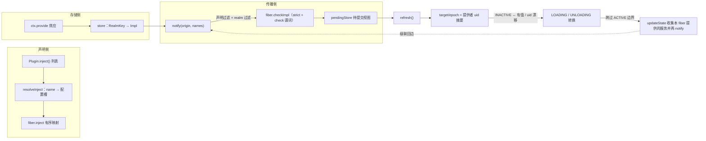
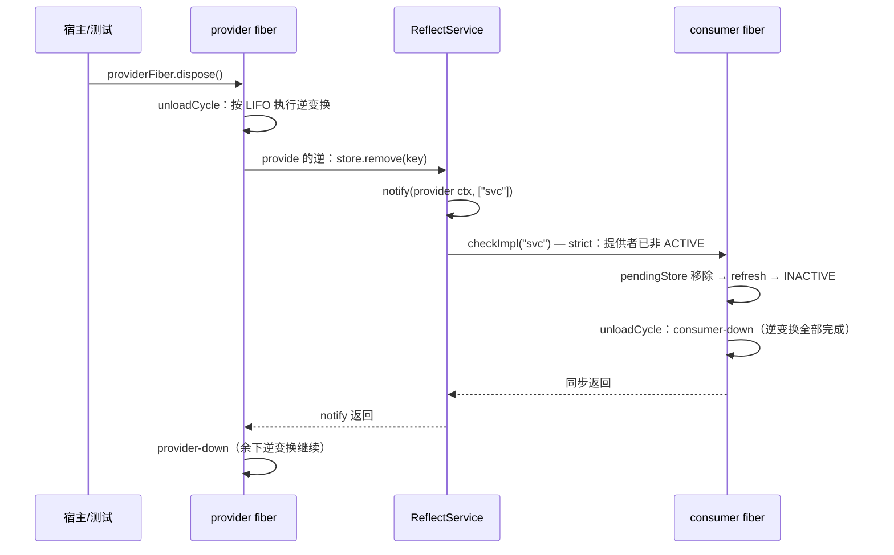

在 cordis-java 的空间维度上，一个插件对世界的依赖（"我需要什么"）与它对世界的贡献（"我提供什么"）被建模为一份**双向契约**：声明侧的 `inject` 列出所需服务名，贡献侧的 `provide` 将实现写入全局存储。本页解释连接这两侧的传播与决策机制——`ReflectService.notify` 如何把一次提供者变化推送给所有声明了该键的 fiber，以及 fiber 如何通过 `refresh` 将变化**分类**为激活、去激活、重载或中性四类生命周期决策。本页聚焦"分类"这一反应式核心；解析时的 fiber 链行走与能力纪律属于[服务解析算法：fiber 链行走、realm 边界与能力纪律](15-fu-wu-jie-xi-suan-fa-fiber-lian-xing-zou-realm-bian-jie-yu-neng-li-ji-lu)，realm 的派生与多租户细节属于[隔离域：RealmKey、isolate 派生上下文与多租户实践](16-ge-chi-yu-realmkey-isolate-pai-sheng-shang-xia-wen-yu-duo-zu-hu-shi-jian)。

## 声明侧：inject 作为余效应规范

`Plugin` 接口将插件定义为三要素的配对：余效应规范 `inject()`（论文中的 **d**）、效应函数 `apply`（**e**）、以及运行期通过 `ctx.provide` 声明的提供物（**p**）。`inject()` 返回服务名列表，其契约非常明确——**插件只在所有声明键均可解析时才会加载**；`apply` 则在"inject 解析结果的同一性发生变化"时被重新执行。除了接口形式，`Context.inject(deps, body)` 提供了轻量语法糖：它把回调包装成一个匿名的 `Plugin.of(null, deps, body)` 再交给注册表，因此一次性回调和完整插件走的是完全相同的反应式管道。

Sources: [Plugin.java](cordis-core/src/main/java/dev/cordis/core/Plugin.java#L9-L42), [Context.java](cordis-core/src/main/java/dev/cordis/core/Context.java#L267-L270), [RegistryService.java](cordis-core/src/main/java/dev/cordis/core/RegistryService.java#L83-L90)

声明在 fiber 实例化时被物化为一个**有序映射**：`RegistryService.resolveInject` 把服务名列表转成 `Map<String, Object>`（值为 `null`），保持声明顺序。这个值槽是为**逐键 intercept 配置**预留的——fiber 构造器会把非空值安装到自身派生上下文上（`interceptSelf`），使该 fiber 解析此服务时读到合并后的配置。当前 `resolveInject` 一律填 `null`，注入级的配置裁剪仍由编排者在加载路径上通过 `ctx.intercept` 完成，右偏合并的完整语义见[拦截：intercept 配置右偏合并与编排者权限收缩](17-lan-jie-intercept-pei-zhi-you-pian-he-bing-yu-bian-pai-zhe-quan-xian-shou-suo)。

Sources: [RegistryService.java](cordis-core/src/main/java/dev/cordis/core/RegistryService.java#L92-L97), [Fiber.java](cordis-core/src/main/java/dev/cordis/core/Fiber.java#L86-L96), [Context.java](cordis-core/src/main/java/dev/cordis/core/Context.java#L87-L90)

| 维度 | inject（余效应规范 d） | provide（提供物 p） |
|---|---|---|
| 声明位置 | `Plugin.inject()` 静态列表，或 `ctx.inject(deps, body)` | `apply` 运行期 `ctx.provide(name, value[, check])` |
| 数据形态 | fiber 上的有序 `Map<服务名, 配置槽>` | 根存储中 `RealmKey → Impl` 记录 |
| 生命周期 | 与 fiber 同生灭，实例化后不可变 | **效应化**：安装与撤销都是 effect，经逆变换累加器追踪 |
| 重复语义 | 重复键在 `resolveInject` 中自然去重 | 同 realm 重名抛 `DUPLICATE_PROVIDE` |
| 读取纪律 | 已声明但未加载 → `INACTIVE_ACCESS` | 从未声明 → `UNDECLARED_ACCESS` |

示例工程中 `UserPlugin` 是标准范本：它声明 `inject: ["db"]`，在 `apply` 里用 `ctx.get("db")` 取用——当 realm 内没有 ACTIVE 的 `db` 提供者时它保持 PENDING，提供者出现时激活，被撤销时回退。示例 `Main` 的第 1–3 幕完整走读了这条反应：先加载 users（挂起）、再加载 database（users 激活）、移除 database（users 回退）、重新加载（users 对着**新的提供者 fiber** 再次激活）。

Sources: [UserPlugin.java](cordis-example/src/main/java/dev/cordis/example/plugins/UserPlugin.java#L9-L45), [Main.java](cordis-example/src/main/java/dev/cordis/example/Main.java#L65-L84)

## 存储侧：RealmKey 键控的实现表与 Impl 记录

`ReflectService` 安装在根上下文上，是全部服务绑定的唯一权威存储。其结构体现了论文定义 24/25 的**两层解析** `k → ρ(k) → σ(ρ(k))`：先由隔离表把服务名映射到 `RealmKey`，再由实现表把 realm 映射到 `Impl`——因此**每个 realm 每个服务名至多一条绑定**。`globalRealms` 为每个服务名惰性维护默认（共享）realm，首次 `provide` 时创建（对应 cordis 的 `root[isolate][name] ??= Symbol`）。`Impl` 记录本身持有四个字段：服务名、**拥有该绑定生命周期的提供者 fiber**、可被 `ctx.set` 替换的当前值，以及可选的可用性谓词 `check`——"绑定可见"的判据正是提供者 fiber 处于 `ACTIVE`。

Sources: [ReflectService.java](cordis-core/src/main/java/dev/cordis/core/ReflectService.java#L20-L41), [Impl.java](cordis-core/src/main/java/dev/cordis/core/Impl.java#L9-L30)

读取入口 `getImpl(from, name, strict)` 展示了**视角相关性**：realm 通过发起上下文 `from.resolveRealm(name)` 解析，因此同一个服务名在不同作用域下解析到不同实现。`strict` 参数是反应式的关键开关——严格模式下仅当提供者 fiber 为 `ACTIVE` 才返回实现，这正是依赖者视角下"服务存在"的定义。可用性谓词把判据进一步细化：`check.test(value)` 为假（或抛异常，记日志后按拒绝处理）时，即便提供者 ACTIVE，绑定对依赖者也不可解析。

Sources: [ReflectService.java](cordis-core/src/main/java/dev/cordis/core/ReflectService.java#L43-L56), [Context.java](cordis-core/src/main/java/dev/cordis/core/Context.java#L162-L169)

## 传播侧：notify 的行走、过滤与观测事件

`notify(origin, names)`（论文算法 3）是变更的唯一传播路径。它先构造 **realm 过滤器**：`filter.test(ctx, name)` 要求目标 fiber 从自身上下文解析 `name` 得到的 realm 与变更源 `origin` 的 realm 一致——这保证 tenant-a 的 `db` 变化绝不会唤醒 tenant-b 的依赖者，隔离域因此成为通知的一等边界。随后它对注册表中**每个 runtime 的每个 fiber** 做两步筛选：fiber 的 `inject` 必须声明了变更名，且通过 realm 过滤；命中的键逐一交给 `fiber.checkImpl` 重估，只要有一个键更新，就调用 `fiber.refresh()` 驱动生命周期（refresh 的幂等性使无实质影响的变化无害化）。最后，对每个变更名发出 `internal/service` 事件，携带根视角非严格解析到的当前值（或 `null`）——这是宿主观测服务增删的统一钩子，其协议细节见[内部事件协议：internal/status、config 与 update 的观测和编排钩子](24-nei-bu-shi-jian-xie-yi-internal-status-config-yu-update-de-guan-ce-he-bian-pai-gou-zi)。

Sources: [ReflectService.java](cordis-core/src/main/java/dev/cordis/core/ReflectService.java#L58-L93)

下图用流程图（节点为数据/步骤，箭头为数据流）呈现从声明到决策再到反馈的完整反应式回路——注意右下角的虚线回边：生命周期转换跨过 ACTIVE 边界时会**再次触发 notify**，使提供者的激活/去激活沿依赖图级联传播。

Sources: [ReflectService.java](cordis-core/src/main/java/dev/cordis/core/ReflectService.java#L71-L93), [Fiber.java](cordis-core/src/main/java/dev/cordis/core/Fiber.java#L365-L378), [Fiber.java](cordis-core/src/main/java/dev/cordis/core/Fiber.java#L458-L479)

`notify` 有四个风格各异的触发点，理解它们各自的守卫条件是判断"依赖者会不会被唤醒"的实操关键：

| 调用点 | 时机 | 条件与范围 |
|---|---|---|
| `Fiber.provide` 安装路径 | 实现写入 store 之后 | **仅当**提供者 fiber 已是 ACTIVE（如 `root.provide`，或运行中插件经 effect 追加服务）才立即通知 |
| `Fiber.provide` 的逆变换 | `store.remove` 之后 | **无条件**通知——撤销总是传播 |
| `Fiber.updateState` | 状态跨过 ACTIVE ↔ 非 ACTIVE 边界 | 扫描 store 收集本 fiber 提供的全部服务名，从其自身 ctx 发出；初次激活时的 provide 即经此路径传播 |
| `Fiber` 构造器 | fiber 首次实例化 | 不经 notify：直接对每个声明键 `checkImpl` 后 `refresh`，完成初始评估 |

值得注意的是初次激活的传播路径：`apply` 体内的 `provide` 执行时提供者自身尚处 LOADING，安装路径的 `state == ACTIVE` 守卫不触发；真正唤醒依赖者的是 `reloadCycle` 结束时 `updateState` 计算出 ACTIVE 状态、跨过边界后的那次 notify。这条"状态边界即传播点"的设计保证了级联的时序确定性。

Sources: [Fiber.java](cordis-core/src/main/java/dev/cordis/core/Fiber.java#L458-L479), [Fiber.java](cordis-core/src/main/java/dev/cordis/core/Fiber.java#L365-L378), [Fiber.java](cordis-core/src/main/java/dev/cordis/core/Fiber.java#L121-L124)

## 分类核心：checkImpl、refresh 与提供者身份摘要

反应式分类由两个协作的原语完成。`checkImpl(name)` 是**单键重估**：以 strict 模式向 store 查询（提供者必须 ACTIVE），再过可用性谓词，结果写入 `pendingStore`（待提交视图）——可解析则放入对应 `Impl`，否则移除该键。`refresh()` 是**摘要与裁决**：按声明顺序遍历 `inject` 的每个键，任一键缺失即令 `target = INACTIVE` 并触发去激活；全部满足则把各键提供者 fiber 的 `uid` 用 `":"` 拼接成目标摘要（如 `":3:7"`），写入 `target` 并 `setEpoch(摘要)`。**摘要以提供者 fiber 的 uid 为粒度，而非服务值**——这带来一个关键区分：`ctx.set` 替换 `Impl.value` 不改变摘要、不触发重载（值是可变数据）；而提供者身份的更替（旧 fiber 卸载、新 fiber 顶上）必然改变摘要、必然触发重载。`setEpoch` 则在摘要未变时直接短路，这就是"中性变化无害化"的实现面。

Sources: [Fiber.java](cordis-core/src/main/java/dev/cordis/core/Fiber.java#L237-L290), [Fiber.java](cordis-core/src/main/java/dev/cordis/core/Fiber.java#L42-L58)

据此，一次 `notify` 之后每个命中 fiber 的命运可被精确地归入四类：

| 分类 | 触发条件（重估结果） | 摘要变化 | 状态轨迹 | 可观测结果 |
|---|---|---|---|---|
| **激活** | 原缺任一声明键，现全部可解析 | `INACTIVE → ":uid…"` | PENDING → LOADING → ACTIVE | `apply` 执行，`internal/status` 发出 |
| **去激活** | 任一声明键失去解析（撤销 / 非 ACTIVE / check 拒绝） | `":uid…" → INACTIVE` | ACTIVE → UNLOADING → PENDING | 累积逆变换按 LIFO 全部执行 |
| **重载** | 仍满足，但某键换绑到不同提供者 fiber | `":uidA" → ":uidB"` | UNLOADING → LOADING（链式衔接） | 先完整卸载，再以新视图重跑 `apply` |
| **中性** | 提供者 uid 集合不变（如重复通知、无关 realm 变更被过滤） | 不变 | `setEpoch` 短路，无转换 | 仅 `internal/service` 观测事件 |

`LifecycleTest` 为四类中的前三类提供了行为契约证据。`consumerWaitsThenActivatesOnProvide` 验证激活：consumer 先创建即 PENDING 且 `apply` 未执行，provider 加载后日志严格为 `[provider-up, consumer-up:v1]`。`withdrawingProviderDeactivatesThenReprovideReactivates` 验证去激活与再激活：撤销 provider 后 consumer 回到 PENDING，重新 provide 后 consumer 以新值 `v2` 激活。`providerReplacementReloadsConsumerAgainstNewFiber` 则是重载类的直接证明——测试注释明言"consumer 之所以重载，恰因提供者 fiber 的**身份**变了"，日志 `[consumer-up:v1, consumer-down, consumer-up:v2]` 展示了完整的卸载-重载链。

Sources: [Fiber.java](cordis-core/src/main/java/dev/cordis/core/Fiber.java#L261-L290), [LifecycleTest.java](cordis-core/src/test/java/dev/cordis/LifecycleTest.java#L60-L103)

## 守卫次序：依赖者先于提供者完成卸载

本移植以同步方式实现转换（论文定义 23 的就地选择），这使通知的**深度优先展开**天然满足 L-Unload 守卫：提供者离开 ACTIVE 时，其状态变化通知依赖者，依赖者自身的卸载链**同步运行至完成**之后，提供者自己的 disposers 才继续执行。时序上，这一切发生在提供者 `unloadCycle` 的 LIFO 逆变换序列**中途**——当序列轮到 provide 的逆变换时，`store.remove` 后的 notify 同步展开依赖者的完整卸载，然后才返回继续执行提供者余下的逆变换。`withdrawingProviderDeactivatesThenReprovideReactivates` 断言的日志顺序 `[consumer-down, provider-down]` 正是这一守卫的直接观测（对照 TypeScript 版 cordis 在此处的 `await` 依赖者排空，本移植以构造性顺序取而代之）。

下图用时序图（纵向为时间，横向为参与者间的消息传递）呈现撤销场景下的同步展开与守卫次序：

Sources: [Fiber.java](cordis-core/src/main/java/dev/cordis/core/Fiber.java#L28-L30), [Fiber.java](cordis-core/src/main/java/dev/cordis/core/Fiber.java#L335-L357), [Fiber.java](cordis-core/src/main/java/dev/cordis/core/Fiber.java#L458-L479), [LifecycleTest.java](cordis-core/src/test/java/dev/cordis/LifecycleTest.java#L74-L91)

## 读取侧的失败分类：INACTIVE 与 UNDECLARED 的分野

分类机制也在读取端留下纪律印记，构成两个互补的失败码。`ctx.get` 沿 fiber 链行走时：声明了该键但自身未加载的 fiber 抛 `INACTIVE_ACCESS`（"声明的依赖尚未就绪"——这是反应式系统的暂时性状态）；走到根或跨过 realm 边界仍未声明则抛 `UNDECLARED_ACCESS`（"从未获得该能力"——这是能力纪律的永久性拒绝）。换言之，**inject 声明既是加载条件，也是访问凭证**：未声明的服务即便已被提供，也无法被读取。完整的链行走算法与边界判定归[服务解析算法：fiber 链行走、realm 边界与能力纪律](15-fu-wu-jie-xi-suan-fa-fiber-lian-xing-zou-realm-bian-jie-yu-neng-li-ji-lu)详解。

Sources: [Context.java](cordis-core/src/main/java/dev/cordis/core/Context.java#L173-L209), [CordisException.java](cordis-core/src/main/java/dev/cordis/core/CordisException.java#L15)

## 与相邻机制的分界与延伸阅读

本页刻画的三块拼图——**声明（inject 映射）、传播（notify 行走与 realm 过滤）、裁决（checkImpl + uid 摘要分类）**——各自向外衔接更深的机制：裁决产生的 LOADING/UNLOADING 转换如何经惯性主机链式完成，见[生命周期状态机：PENDING 到 DISPOSED 的六状态与转换规则](11-sheng-ming-zhou-qi-zhuang-tai-ji-pending-dao-disposed-de-liu-zhuang-tai-yu-zhuan-huan-gui-ze)与[惯性主机：epoch、target 视图与链式 reload/unload 转换](12-guan-xing-zhu-ji-epoch-target-shi-tu-yu-lian-shi-reload-unload-zhuan-huan)；重载类决策执行的 LIFO 逆变换折叠，见[LIFO 逆变换累加器：效应折叠、单次处置与失败回滚](9-lifo-ni-bian-huan-lei-jia-qi-xiao-ying-zhe-die-dan-ci-chu-zhi-yu-shi-bai-hui-gun)；通知传播的 realm 判定所依赖的派生上下文，见[隔离域：RealmKey、isolate 派生上下文与多租户实践](16-ge-chi-yu-realmkey-isolate-pai-sheng-shang-xia-wen-yu-duo-zu-hu-shi-jian)；而 `internal/service` 事件所在的观测协议，见[内部事件协议：internal/status、config 与 update 的观测和编排钩子](24-nei-bu-shi-jian-xie-yi-internal-status-config-yu-update-de-guan-ce-he-bian-pai-gou-zi)。理解本页后，读者已握有反应式余效应的完整因果链：一次 `provide` 或一次状态边界跨越，如何最终变成某个依赖插件 `apply` 的执行或回退。