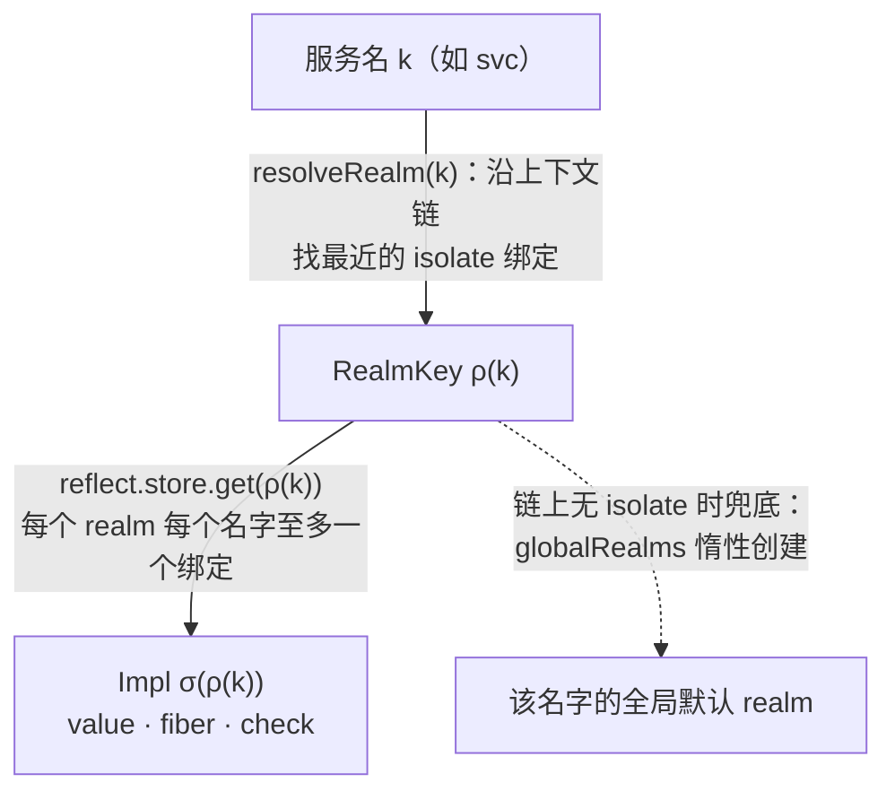
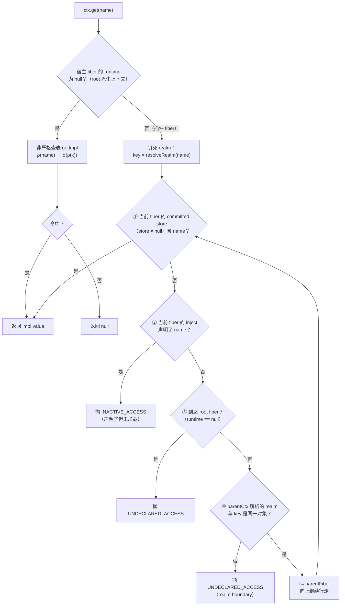

当你在一个插件的 `ctx` 上调用 `ctx.get("database")` 时，框架执行的并不是一次简单的哈希查表，而是一套精密的**三重纪律**：沿 fiber 父链逐跳行走的解析、被 realm 边界钉死的可见范围、以及"声明即权限"的能力审查。本页拆解 [Context.java](cordis-core/src/main/java/dev/cordis/core/Context.java) 中被称为 Algorithm 6（代理解析）的完整算法——它是 cordis 论文中余效应系统在运行时的落地形式，也是理解后续 [隔离域实践](16-ge-chi-yu-realmkey-isolate-pai-sheng-shang-xia-wen-yu-duo-zu-hu-shi-jian) 与 [反应式通知机制](14-inject-sheng-ming-yu-reflectservice-tong-zhi-ti-gong-zhe-bian-hua-de-fan-ying-shi-fen-lei) 的前置基础。

Sources: [Context.java](cordis-core/src/main/java/dev/cordis/core/Context.java#L173-L209)

## 解析的三个输入：调用上下文、宿主 fiber 与 realm 键

一次 `get` 调用在进入主循环之前，必须先确定三个输入，它们分别回答"谁在问""问的是哪个实例""在哪个隔离域里问"。

第一个输入是**宿主 fiber**。`Context` 本身可以任意派生（`extend`、`isolate`、`intercept` 都会产生子上下文），但 fiber 只挂在特定层级的上下文上。`fiber()` 方法沿上下文父链向上找到第一个直接持有 fiber 的上下文——插件自身的 `ctx` 持有自己的 fiber，而插件体内派生出的上下文则委托给插件 fiber。这决定了：**派生上下文不改变解析主体，只改变解析的 realm 视角**。

Sources: [Context.java](cordis-core/src/main/java/dev/cordis/core/Context.java#L69-L98)

第二个输入是 **realm 键**。`resolveRealm(name)` 执行两步解析：先沿上下文链向上寻找最近的 `isolate` 绑定（子绑定遮蔽父绑定）；若整条链都没有隔离声明，则回退到 ReflectService 中该服务名的**全局默认 realm**——它在首次 `provide` 时被惰性创建。这就是论文中的两层解析 `k → ρ(k) → σ(ρ(k))`：服务名先映射到隔离域，隔离域再映射到唯一绑定。

Sources: [Context.java](cordis-core/src/main/java/dev/cordis/core/Context.java#L100-L115), [Context.java](cordis-core/src/main/java/dev/cordis/core/Context.java#L162-L169), [ReflectService.java](cordis-core/src/main/java/dev/cordis/core/ReflectService.java#L13-L41)

第三个输入隐含在 `Impl` 记录中：每条绑定记录了**提供者 fiber**（绑定生命周期的所有者）与可选的 `check` 谓词。绑定只在提供者处于 `ACTIVE` 状态时对依赖方可见，提供者卸载时绑定随之撤回。realm 键的同一性完全依赖对象身份（不重写 `equals`，等价于 JS `Symbol`），字符串标签通过静态驻留表 `RealmKey.shared` 实现相等标签共享同一域。

Sources: [Impl.java](cordis-core/src/main/java/dev/cordis/core/Impl.java#L9-L23), [RealmKey.java](cordis-core/src/main/java/dev/cordis/core/RealmKey.java#L1-L29)

## 主算法：Context.get 的链式行走

`get` 的完整逻辑分为一条捷径和一个循环。**捷径针对 root 派生上下文**：若调用者的宿主 fiber 就是根 fiber（`runtime == null`），则直接执行非严格的 `getImpl` 查表——按 realm 解析后读全局 store，**不要求 inject 声明**，未命中返回 `null` 而非抛错。宿主在根上下文上拥有环境级的完整读取权限。

**循环针对插件 fiber**，即算法的核心。进入循环前有一个关键动作：realm 键被**一次性解析并钉死**（`RealmKey key = resolveRealm(name)`），此后每一跳都用这同一个键做边界复核。循环体的每轮迭代按固定顺序执行四步检查：

Sources: [Context.java](cordis-core/src/main/java/dev/cordis/core/Context.java#L180-L209)

四步检查的语义值得逐条澄清。**第①步读 committed view**：`store` 是 fiber 加载时提交的依赖快照（仅包含其 inject 声明的键），卸载后被置为 `null`，因此 `f.store != null` 的守卫天然跳过未加载的 fiber。**第②步是精确失败**：如果一个 fiber 在 inject 中声明了该键，但快照尚未提交（fiber 处于 PENDING，依赖未满足），算法立即抛出 `INACTIVE_ACCESS` 而**不会**继续向上寻找祖先的副本——声明者自己就是该键的权威，等待生命周期把值送来即可。**第③步是终点终止**：行走到根 fiber 仍未命中则抛 `UNDECLARED_ACCESS`。**第④步是边界复核**，下一节详述。

三个出口的对照如下：

| 出口 | 触发条件 | 语义 |
|---|---|---|
| 返回值 | 某祖先 fiber 的 committed store 绑定了该键 | 声明链上的能力被满足 |
| `INACTIVE_ACCESS` | 某 fiber 声明了该键但未加载 | "你声明了它，等生命周期激活" |
| `UNDECLARED_ACCESS` | 到达 root fiber，或跨 realm 边界 | 整条声明链上无人持有该能力 |

Sources: [Context.java](cordis-core/src/main/java/dev/cordis/core/Context.java#L189-L208), [Fiber.java](cordis-core/src/main/java/dev/cordis/core/Fiber.java#L49-L58), [Fiber.java](cordis-core/src/main/java/dev/cordis/core/Fiber.java#L301-L349)

注意一个关键的顺序细节：第①步（committed store 命中）发生在第③步（root 终止）**之前**，且根 fiber 的 `store` 在构造时即初始化为非空 map、`root.provide` 会把绑定写入其中。这意味着**根 fiber 的 store 是行走的最后一站环境层**——宿主在根上下文提供的服务，对同 realm 内任意 fiber 可见，无需声明；而插件 fiber 提供的服务只写入提供者自己的快照，不构成环境权威。测试 `undeclaredAccessFromPluginContextThrows` 精确验证了后半句：即使 `"svc"` 已被某插件提供，未声明它的兄弟插件调用 `get` 仍抛 `UNDECLARED_ACCESS`。

Sources: [Fiber.java](cordis-core/src/main/java/dev/cordis/core/Fiber.java#L125-L133), [Fiber.java](cordis-core/src/main/java/dev/cordis/core/Fiber.java#L458-L479), [ServiceAccessTest.java](cordis-core/src/test/java/dev/cordis/ServiceAccessTest.java#L35-L60)

## realm 边界：一次钉死、逐跳复核

realm 边界的实现浓缩在第④步的一行判断里：`f.parentCtx.resolveRealm(name) != key`。它用**引用不等**（RealmKey 不重写 equals）比较"父上下文视角下该名字的 realm"与"调用开始时钉死的 realm"。这条判断确立了一条不变量：**行走中途不允许换域**。如果插件体内派生了 `ctx.isolate("svc", ...)` 这类子上下文，调用发生在新域中，而父级上下文看到的仍是旧域——两个不同的 RealmKey 对象，边界立即触发，行走终止于 `UNDECLARED_ACCESS`。要在新域中读到服务，必须在新域内重新装载提供者，这正是 [隔离域多租户实践](16-ge-chi-yu-realmkey-isolate-pai-sheng-shang-xia-wen-yu-duo-zu-hu-shi-jian) 的算法基础。

一个必须澄清的细节是：**realm 复核只约束"未声明键的向上行走"**。第①步的 committed store 命中并不重新比对 realm——因为声明键的快照是在该 fiber 自己的域中、加载时由严格检查提交的，派生子上下文的 isolate 不追溯改变已提交视图。两条纪律由此正交：committed view 对声明键是权威；realm 钉死只守卫跨 fiber 的能力继承路径。

Sources: [Context.java](cordis-core/src/main/java/dev/cordis/core/Context.java#L189-L206)

realm 边界在反应式一侧有精确的对应物。`ReflectService.notify` 通知依赖方之前，先用 `realmFilter` 过滤：只有解析 realm 与变更源**为同一 RealmKey 对象**的 fiber 才会被刷新。测试 `notifyDoesNotCrossRealms` 验证了这一点——scope-a 中新装载提供者，只有 scope-a 的消费者被激活，scope-b 纹丝不动。静态行走与反应式通知共享同一条边界规则，这保证了"读到的"与"被通知的"永远一致。

Sources: [ReflectService.java](cordis-core/src/main/java/dev/cordis/core/ReflectService.java#L43-L93), [IsolationTest.java](cordis-core/src/test/java/dev/cordis/IsolationTest.java#L38-L70)

RealmKey 的两种构造方式决定了域的共享语义，`IsolationTest` 对两者都有覆盖：

| 构造方式 | 语义 | 测试验证 |
|---|---|---|
| `RealmKey.fresh(hint)`（`isolate(name)` 默认） | 全新私有域，永不与其他域相等 | `defaultIsolateCreatesFreshScopes`：两个默认 isolate 各自独立解析 |
| `RealmKey.shared(label)`（传入相同标签） | 驻留表按标签 intern，相等标签合流为同一域 | `sameLabelJoinsScopes`：一个提供者同时满足两个上下文 |

Sources: [RealmKey.java](cordis-core/src/main/java/dev/cordis/core/RealmKey.java#L21-L29), [IsolationTest.java](cordis-core/src/test/java/dev/cordis/IsolationTest.java#L72-L95)

## 能力纪律：声明即权限的完整规则

把整条算法读完后，可以提炼出框架的能力模型——它不是访问控制列表，而是一条**声明链证明**：`get` 成功当且仅当"从调用者的宿主 fiber 沿父链向上，存在某个 fiber 的 committed view 绑定了该键，且路径上每一跳都未跨越 realm 边界"。

规则一：**inject 声明是能力令牌**。纤维只有声明了键，其 committed store 才可能在加载时被填充。测试 `declaredAccessOnUnloadedFiberThrowsInactive` 展示了声明但未满足的中间态：fiber 处于 PENDING，`ctx.get("svc")` 抛出 `INACTIVE_ACCESS` 而非继续向上——这条错误码的存在让"依赖尚未就绪"与"根本无权访问"成为可区分的诊断信号。

Sources: [ServiceAccessTest.java](cordis-core/src/test/java/dev/cordis/ServiceAccessTest.java#L62-L84), [CordisException.java](cordis-core/src/main/java/dev/cordis/core/CordisException.java#L9-L25)

规则二：**提供不等于授权**。`provide` 把绑定写入"提供者 fiber 自己的快照 + 按 realm 索引的全局 store"两处，但行走只会命中祖先链上 fiber 的快照——兄弟 fiber 之间不存在隐式授权。写入侧同样从紧：`set` 要求调用者恰好是绑定的提供者 fiber（否则 `INVALID_SET`），同一 realm 内重复 `provide` 直接抛 `DUPLICATE_PROVIDE`。

Sources: [Fiber.java](cordis-core/src/main/java/dev/cordis/core/Fiber.java#L458-L479), [Context.java](cordis-core/src/main/java/dev/cordis/core/Context.java#L217-L233), [ServiceAccessTest.java](cordis-core/src/test/java/dev/cordis/ServiceAccessTest.java#L94-L111)

规则三：**root 是环境权威层**。如前节所述，根 fiber 的 store 参与行走且在根派生上下文上走非严格捷径。此外框架保留了一个显式的观察通道 `getOrNull`：它对任意上下文执行非严格查表，跳过 inject 要求，未命中返回 `null`。这是为宿主观测、调试工具预留的**能力纪律旁路**——生产代码中读服务应始终走 `get`。

Sources: [Context.java](cordis-core/src/main/java/dev/cordis/core/Context.java#L211-L215), [ServiceAccessTest.java](cordis-core/src/test/java/dev/cordis/ServiceAccessTest.java#L86-L92)

## 可见性与性能：committed view 的快照语义

行走读到的值之所以可信，源于加载路径上的**双重可见性闸门**。`checkImpl` 在依赖评估时调用 `getImpl(ctx, name, strict=true)`：严格模式下，提供者非 `ACTIVE` 的绑定不可见；通过后还要过 `Impl.check` 谓词（谓词抛异常按不满足处理并记录错误日志）。只有两道闸门全过的 `Impl` 才进入 `pendingStore`，进而在 `reloadCycle` 提交为 committed view。提供者卸载时，`unloadCycle` 把 `store` 置 `null`，快照整体失效——依赖方在此前已被同步通知并完成级联卸载。

Sources: [Fiber.java](cordis-core/src/main/java/dev/cordis/core/Fiber.java#L237-L303), [Fiber.java](cordis-core/src/main/java/dev/cordis/core/Fiber.java#L335-L349)

这套设计的性能账本很清晰。热路径上每跳只需一次 `LinkedHashMap` 的 O(1) 查找，总代价为 O(fiber 深度)；`resolveRealm` 的 O(上下文深度) 遍历只在进入循环时执行一次（第④步的复核也是单次链上查询）。与朴素的"每次 get 都查全局 store + 权限表"相比：

| 维度 | fiber 链行走 + committed view | 每次全局查表 + 显式 ACL |
|---|---|---|
| 热路径开销 | O(depth) 次哈希查找，无锁竞争点集中于 root store | 每次 get 都要解析 realm 并查全局表 |
| 权限表达 | 声明链隐式证明（inject 即权限） | 需要独立维护授权数据结构 |
| 失败语义 | 三种出口精确区分（值 / 未就绪 / 无权限） | 通常只能返回 null 或笼统异常 |
| 一致性 | 快照在加载时严格提交，卸载即失效 | 读取瞬间状态，与生命周期解耦 |

代价是快照语义本身：committed view 是加载时刻的冻结视图，提供者 `ctx.set` 替换值后依赖方读到的是新值（`Impl.value` 字段被原地更新），但**提供者身份的变化**（换 fiber 提供同一名字）则要走 `notify → checkImpl → refresh → reload` 的完整反应式链路——那是 [inject 声明与 ReflectService 通知](14-inject-sheng-ming-yu-reflectservice-tong-zhi-ti-gong-zhe-bian-hua-de-fan-ying-shi-fen-lei) 一页的主题。

Sources: [Fiber.java](cordis-core/src/main/java/dev/cordis/core/Fiber.java#L259-L303), [Context.java](cordis-core/src/main/java/dev/cordis/core/Context.java#L236-L243)

## 小结与延伸阅读

`Context.get` 用不到三十行代码同时实现了三件事：**链式行走**让能力沿 fiber 树继承且以 committed view 为权威答案；**realm 边界**通过"一次钉死、逐跳复核引用同一性"把可见性锁死在调用时的隔离域内，并与反应式通知的 `realmFilter` 共享同一规则；**能力纪律**则以 inject 声明链为权限证明，用 `INACTIVE_ACCESS` / `UNDECLARED_ACCESS` / `INVALID_SET` / `DUPLICATE_PROVIDE` 四个错误码把"未就绪""无权限""越权写""重复提供"变成可编程区分的信号。理解了这套算法，接下来的阅读路径是：[隔离域：RealmKey、isolate 派生上下文与多租户实践](16-ge-chi-yu-realmkey-isolate-pai-sheng-shang-xia-wen-yu-duo-zu-hu-shi-jian) 展示 realm 边界的工程化用法；[inject 声明与 ReflectService 通知](14-inject-sheng-ming-yu-reflectservice-tong-zhi-ti-gong-zhe-bian-hua-de-fan-ying-shi-fen-lei) 补全行走之外的反应式半边；若想追查快照何时提交与失效，参见[生命周期状态机：PENDING 到 DISPOSED 的六状态与转换规则](11-sheng-ming-zhou-qi-zhuang-tai-ji-pending-dao-disposed-de-liu-zhuang-tai-yu-zhuan-huan-gui-ze)。