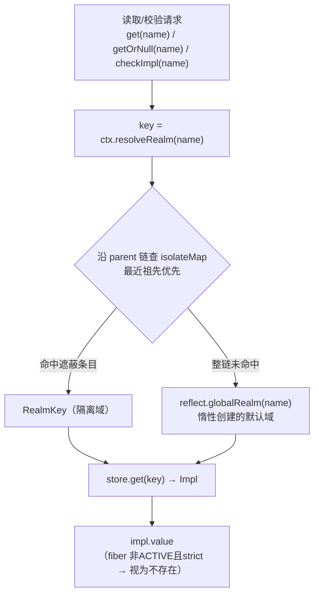
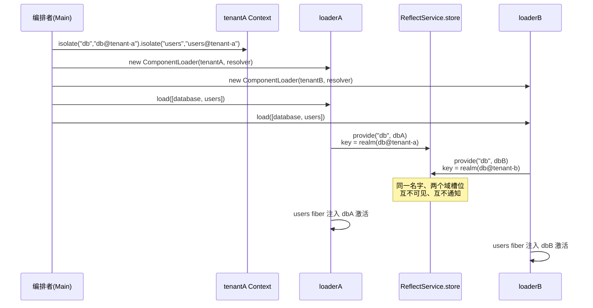

本文解释 cordis-java 的空间隔离机制：当多个编排单元希望复用同一份插件代码、却各自持有独立的服务实例时，框架如何在不修改任何插件源码的前提下，让同一个服务名字解析到不同的实现。全文围绕三个核心构件展开——**RealmKey**（域标签的身份语义）、**Context.isolate 派生上下文**（不可变的域表遮蔽层）与 **ReflectService 的两层存储**（名字 → realm → 实现的解析链条），并以示例工程中"两个租户、两个 db realm"的端到端场景作为实践走读。读者应已理解 [Context 作为效应与余效应的统一中介](6-shang-xia-wen-fan-shi-context-zuo-wei-xiao-ying-yu-yu-xiao-ying-de-tong-zhong-jie) 的基本分工：效应（effect）经上下文登记、由 fiber 累加器回退；余效应（服务解析）经上下文查表——隔离域正是作用于后者的坐标系变换。
Sources: [Context.java](cordis-core/src/main/java/dev/cordis/core/Context.java#L10-L28)

## 问题起点：一个名字，默认只有一个绑定

在未引入隔离时，服务的绑定空间是扁平的：`ReflectService.store` 里每个服务名至多对应一个 `Impl`（实现记录，含提供者 fiber、当前值与可用性谓词）。第二次对同一名字 provide 会立即抛出 `DUPLICATE_PROVIDE`，这保证了"一个名字一个提供者"的简单纪律，但也意味着只要两个单元都想提供或消费 `db`，就必须在名字层面做区分（比如 `db-a`、`db-b`），插件代码随之被名字耦合污染。

隔离域的解法是把绑定空间从"名字"升级为"名字 × 域"：解析服务时先由当前上下文算出一个 **RealmKey**（记号 ρ(k)，即名字 k 所属的域），再以该 key 查 store（记号 σ(ρ(k))）。于是同一个 `db` 名字，在租户 A 的上下文里解析到 `realm(db@tenant-a)` 下的实例，在租户 B 的上下文里解析到 `realm(db@tenant-b)` 下的实例，互不干扰、也互不可见——插件代码对名字的引用原封不动。
Sources: [ReflectService.java](cordis-core/src/main/java/dev/cordis/core/ReflectService.java#L10-L27), [Impl.java](cordis-core/src/main/java/dev/cordis/core/Impl.java#L8-L13)

## RealmKey：对象身份即域身份

RealmKey 是一个极小的 final 类：私有构造器、一个诊断用 hint 字符串、没有任何业务方法。它的全部语义浓缩为一句话——**realm 的相等性就是对象的同一性**（`==`），刻意镜像 JavaScript 的 `Symbol` 设计。因此它既不重写 `equals`/`hashCode`，也不暴露 hint 的比较；两个 `RealmKey` 是否指向同一个域，只取决于它们是不是同一个对象。

获取 RealmKey 有两条工厂路径，对应两种共享策略。`RealmKey.fresh(hint)` 每次调用都返回全新对象，制造一个**私有域**——除持有该引用者外无人能加入；`RealmKey.shared(label)` 通过进程级的同步 `HashMap` 做**驻留（interning）**，相等 label 返回同一个对象，从而使字符串命名的多个上下文汇入同一个域。`toString` 输出 `realm(hint@identityHashCode)`，让日志与异常信息能区分同名的不同域实例。

| 获取方式 | API | 共享语义 | 谁能加入该域 | 典型场景 |
|---|---|---|---|---|
| 私有新域 | `RealmKey.fresh(hint)` | 每次全新对象，永不汇合 | 仅持有该引用的上下文链 | 一次性沙箱、entry 局部隔离 |
| 共享驻留域 | `RealmKey.shared(label)` | 相等 label 驻留为同一对象 | 所有以相同 label（或同一 RealmKey 实例）隔离的上下文 | 多租户按租户名汇入 |
| 直接传递 | 已有 `RealmKey` 实例 | 同一性即同域 | 持有该实例的任意 `isolate` 调用方 | 编排者程序化构造域后分发 |

值得强调一个推论：`fresh` 的"私有"并非访问控制，而是**命名空间上的不可枚举**——别的模块拿不到这个引用，自然解析不进这个域；而 `shared("tenant-a")` 与 `shared("tenant-a")` 在不同类加载路径、不同编排代码里调用，仍会因驻留而汇合。这套身份语义是后面所有派生、提供与通知机制的基石。
Sources: [RealmKey.java](cordis-core/src/main/java/dev/cordis/core/RealmKey.java#L11-L35)

## isolate 派生：遮蔽式域表与"无需逆变换"的恢复

`Context.isolate(name, label)` 是构造派生上下文的核心操作。它按 label 的运行时类型分派三种域来源：label 已是 `RealmKey` 则直接采用；label 为 `null` 则 `RealmKey.fresh(name)` 造一个私有域；其余对象一律 `RealmKey.shared(label)` 驻留汇合。随后创建一个子上下文，把 `name → key` 写入子上下文自己的 `isolateMap`——**父上下文的域表从未被触碰**。

这个"只遮蔽、不修改"的性质有深远的恢复含义。对比效应侧：`ctx.effect` 登记的每个效应都必须配套逆变换（Disposable），因为宿主状态被真实改变了；而 `isolate`、`extend`、`intercept` 产出的派生上下文只是父表的一个覆盖视图，丢弃派生上下文（fiber 卸载、编排者放弃）即完成全部撤销，**天然无需逆变换**。这正是源码注释所指的 derived form 语义（论文 Definition 23/24/26）：恢复过程直接丢弃派生层。

域的解析遵循"最近祖先优先"：`resolveRealm(name)` 从当前上下文出发沿 parent 链上行，第一个在 `isolateMap` 中登记了该名字的上下文给出答案；若整条链都没有，则回落到 `ReflectService.globalRealm(name)`——它为每个服务名**惰性创建**一个默认域（对应 cordis 源码语义 `root[isolate][name] ??= Symbol`），保证未隔离的常规用法与隔离用法共用同一套两层查表逻辑。下面的概念图展示了示例工程中租户上下文的实际派生链——注意 `isolate("db", …)` 与 `isolate("users", …)` 是两次链式派生，域表分别落在两层子上下文上：

```mermaid
graph TD
    ROOT["root Context<br/>isolateMap: ∅<br/>（未隔离名字 → globalRealm 兜底）"]
    C1["Context #1<br/>isolateMap: { db → realm(db@tenant-a) }"]
    C2["tenantA = Context #2<br/>isolateMap: { users → realm(users@tenant-a) }"]
    D1["Context #3<br/>isolateMap: { db → realm(db@tenant-b) }"]
    D2["tenantB = Context #4<br/>isolateMap: { users → realm(users@tenant-b) }"]
    ROOT -->|isolate("db","db@tenant-a")| C1
    C1 -->|isolate("users","users@tenant-a")| C2
    ROOT -.同构的另一条链.-> D1
    D1 -.-> D2
```

这张图的前提说明：图中每个节点都是不可变链上的一个独立 `Context` 对象，箭头是 parent 指针；`resolveRealm` 的行走方向与箭头相反（自下而上，首个命中即返回）。两条租户链完全同构，差异只在域表里驻留的 RealmKey 身份不同。
Sources: [Context.java](cordis-core/src/main/java/dev/cordis/core/Context.java#L30-L41), [Context.java](cordis-core/src/main/java/dev/cordis/core/Context.java#L96-L120), [Context.java](cordis-core/src/main/java/dev/cordis/core/Context.java#L162-L169), [ReflectService.java](cordis-core/src/main/java/dev/cordis/core/ReflectService.java#L33-L41)

## 两层解析与写入：store 以 RealmKey 为键

解析侧的全貌可以概括为一条固定流水线：调用方上下文先算出 `key = resolveRealm(name)`，随后 `ReflectService.getImpl(from, name, strict)` 用这个 key 直查 `store: Map<RealmKey, Impl>`。同一张表、同一个名字，因 key 不同而呈现多个平行槽位。读取入口有三个变体，全部共享这条流水线：`get` 走 fiber 链并强制 inject 声明（能力纪律）；`getOrNull` 绕过 inject 直查；fiber 内部的 `checkImpl` 以 strict 模式查表（仅当提供者处于 ACTIVE 才算满足），驱动反应式激活。

写入侧同样以域为坐标系。`Fiber.provide(from, name, value, check)` 首先确保该名字的默认全局域存在（供未隔离的解析方使用），然后**以 `from`（调用 provide 的那个上下文）解析出的 key** 落表；若该 key 已有绑定，抛出 `DUPLICATE_PROVIDE`——"一个域内一个名字一个提供者"。注意 provide 本身被实现为一个效应：它的 Disposable 从 store 撤除绑定并触发通知，因此域内绑定的生命周期严格隶属于提供者 fiber。`Context.set` 同样先 `resolveRealm` 再校验"仅提供者 fiber 可改值"（`INVALID_SET`），域身份贯穿读、写、注册三个环节。



这张流程图的关键约束：`resolveRealm` 的结果在单次解析内只计算一次，且**以发起解析的上下文为准**——不是以提供者的上下文为准。这决定了域是"解析方视角"的属性：同一个 `Impl`，从租户 A 的上下文永远查不到（A 的域表指向另一个 key），无论提供者如何声明自己。
Sources: [ReflectService.java](cordis-core/src/main/java/dev/cordis/core/ReflectService.java#L43-L61), [Context.java](cordis-core/src/main/java/dev/cordis/core/Context.java#L180-L215), [Context.java](cordis-core/src/main/java/dev/cordis/core/Context.java#L217-L233), [Fiber.java](cordis-core/src/main/java/dev/cordis/core/Fiber.java#L458-L479), [Fiber.java](cordis-core/src/main/java/dev/cordis/core/Fiber.java#L237-L259)

## 反应式的域边界：通知不越界

隔离不只是读取时的分流，还规定了**反应式通知的传播半径**。`ReflectService.notify(origin, names)` 在遍历所有 fiber 决定谁需要重估依赖时，套用 `realmFilter(origin)`：只有"fiber 自己的上下文对 name 解析出的 RealmKey 与变更发起方一致"的声明者才被刷新。用测试用例的语言说——`scope-a` 里挂上新的 `svc` 提供者，只有 `scope-a` 的消费者被激活并看到 `see:A2`，`scope-b` 的消费者日志保持为空；反之亦然。变更的影响被精确限制在同一个域内，跨域消费者既看不到新提供者，也不会被它的撤离误伤。

组合前文的解析规则，可以推出一个对多租户至关重要的性质：**一个域内的一次 provide/撤除，恰好等价于该租户世界内的一次全局服务变更**。租户 B 的 `db` 提供者崩溃，只引起租户 B 的 `users` fiber 去激活并回退效应；租户 A 的运行纹丝不动。这是"平行宇宙"在时间维度的完整形态。需要辨析的是作用范围：域过滤目前只存在于余效应解析与 `notify` 的过滤器这两处——事件总线与插件注册表本身不感知 RealmKey（两者源码中无任何 realm 引用），跨域广播事件仍走事件总线的常规派发路径，相关语义见 [inject 声明与 ReflectService 通知：提供者变化的反应式分类](14-inject-sheng-ming-yu-reflectservice-tong-zhi-ti-gong-zhe-bian-hua-de-fan-ying-shi-fen-lei) 与 [事件总线：emit、parallel、bail 与 waterfall 派发语义](23-shi-jian-zong-xian-emit-parallel-bail-yu-waterfall-pai-fa-yu-yi)。
Sources: [ReflectService.java](cordis-core/src/main/java/dev/cordis/core/ReflectService.java#L58-L93), [IsolationTest.java](cordis-core/src/test/java/dev/cordis/IsolationTest.java#L51-L70)

## Entry 声明式隔离：局部域随 entry 旅行

编程式 API（`ctx.isolate`）之上，声明式加载器提供了配置层的隔离注记。`Entry.Builder` 提供两个方法：`isolate(name)` 向 entry 写入 `Boolean.TRUE`，语义是**局部域**；`isolateShared(name, label)` 写入共享标签，语义是**汇入命名域**。加载器在挂载时于 `derive(entry)` 中将其翻译为上下文派生：`TRUE` 分支调用 `RealmKey.fresh(name + "#" + entry.id)` 造一个提示名带 entry id 的全新域，其余值调用 `RealmKey.shared(label)`。derive 的顺序是先全部应用 isolate 注记、再应用 intercept 注记，形成"父上下文 → 域遮蔽层 → 拦截遮蔽层"的派生栈。

"局部域随 entry 旅行"的准确含义值得展开：由于 `fresh` 每次调用必产新对象，且 `derive` 在每次 mount/remount 时都重新执行，entry 级局部域的**身份与该次挂载同寿**——重建（rebuild/remount）得到的是全新域，旧域内的绑定已随旧 fiber 的 dispose 撤除，因此不会触发 `DUPLICATE_PROVIDE`。相比之下，共享标签跨加载器驻留：两个不同 `ComponentLoader` 挂载的 entry 只要写了相同 label，就汇入同一个服务作用域——这是把多租户从编程式样板提升为纯配置的关键一步。

调和阶段对 isolate 变化的处理体现了最小扰动原则之外的例外：`url`、`disabled`、`isolate`、`intercept` 的变更都走 `rebuild`（dispose 旧 fiber 后重新挂载），而 `config` 变更可以原位走 `fiber.update`。原因在注释里点明——realm 重指派经由定理 80 的收敛性保证：**重建到达的终态恰好等于"从零加载修改后配置"会到达的终态**，因此粗粒度的重建是安全的。完整的逐字段分发表与最小扰动分析见 [组件调和：按 id 差分与逐字段分发的最小扰动策略](19-zu-jian-diao-he-an-id-chai-fen-yu-zhu-zi-duan-fen-fa-de-zui-xiao-rao-dong-ce-lue)，Entry 各字段的全景见 [Entry 配置模型：id、url、isolate、intercept、config 与 disabled](18-entry-pei-zhi-mo-xing-id-url-isolate-intercept-config-yu-disabled)。
Sources: [Entry.java](cordis-core/src/main/java/dev/cordis/loader/Entry.java#L21-L22), [Entry.java](cordis-core/src/main/java/dev/cordis/loader/Entry.java#L56-L65), [ComponentLoader.java](cordis-core/src/main/java/dev/cordis/loader/ComponentLoader.java#L118-L125), [ComponentLoader.java](cordis-core/src/main/java/dev/cordis/loader/ComponentLoader.java#L175-L193), [ComponentLoader.java](cordis-core/src/main/java/dev/cordis/loader/ComponentLoader.java#L16-L27)

## 多租户实践走读：两个租户、同一插件、两个 realm

示例工程的场景五把上述机制组装成一次完整的多租户编排。第一步由编排者构造两条派生链：`tenantA = root.isolate("db", "db@tenant-a").isolate("users", "users@tenant-a")`，tenantB 同构。第二步**为每个租户各建一个 `ComponentLoader`**，父上下文分别是 tenantA 与 tenantB——加载器把父上下文作为所有 entry 派生的起点，这是租户隔离进入声明式世界的唯一接缝。第三步向两个加载器喂**完全相同的 entry 列表**（database 与 users 两个插件），插件代码零修改。

挂载过程的时序如下：database 插件在 tenantA 的派生上下文里 `provide("db", dbA)`，key 解析为 `realm(db@tenant-a)`（Service 基类在构造器内自动完成 provide 注册）；users 插件的 fiber 声明 inject `db`，其 `checkImpl` 从自己的上下文解析出同一个 key，于是被 tenantA 域内的 dbA 满足而激活。tenantB 侧镜像地发生一遍，落表 key 为 `realm(db@tenant-b)`。最终断言 `dbA != dbB` 且两实例的数据互不可见：租户 A 写入 `tenant=A`，租户 B 读到的仍是自己的 `tenant=B`。



为什么 `users` 也要隔离而不只隔离 `db`？看 `UsersService` 的构造即可明白：它把用户集合缓存在自身字段里，并透过构造期捕获的 `db` 引用持久化。只隔离 `db` 时，两个租户会共享**同一个** `UsersService` 实例（其内部 users 集合混装两个租户的数据）；把 `users` 一并隔离后，每个租户的 users 服务实例与其 db 引用在同一域系内配对，读写路径全程落在自己的平行宇宙里。这个细节示范了隔离设计的通用判断法：**凡持有跨调用可变状态的中间层服务，都应与它依赖的底层服务同域派生**。

场景六紧接着演示隔离与拦截的正交组合：先 `loaderB.disposeAll()` 释放租户 B 的域，再派生 `tenantBPoliced = tenantB.intercept("db", Map.of("readOnly", true))`，在其上重建加载器并重载相同 entries。注意 `disposeAll` 不是可有可无的清理美学——`realm(db@tenant-b)` 这个 key 上仍挂着旧 fiber 的绑定，不撤除就直接重载会命中 `DUPLICATE_PROVIDE`（"一个域一个名字一个提供者"）；撤除后，新 db 实例在构造期读到拦截配置进入只读模式，`dbBP.put("hack", …)` 被拒绝。拦截配置的合并规则与编排者权限收缩的完整讨论属于 [拦截：intercept 配置右偏合并与编排者权限收缩](17-lan-jie-intercept-pei-zhi-you-pian-he-bing-yu-bian-pai-zhe-quan-xian-shou-suo)；此处只需记住组合公式：**isolate 决定"看见哪个实例"，intercept 决定"以何种配置使用它"，两者作用在同一棵派生上下文链上**。
Sources: [Main.java](cordis-example/src/main/java/dev/cordis/example/Main.java#L93-L121), [Main.java](cordis-example/src/main/java/dev/cordis/example/Main.java#L165-L171), [ComponentLoader.java](cordis-core/src/main/java/dev/cordis/loader/ComponentLoader.java#L55-L59), [Service.java](cordis-core/src/main/java/dev/cordis/core/Service.java#L18-L32), [UsersService.java](cordis-example/src/main/java/dev/cordis/example/plugins/UsersService.java#L15-L31), [DbService.java](cordis-example/src/main/java/dev/cordis/example/plugins/DbService.java#L15-L35), [ComponentLoader.java](cordis-core/src/main/java/dev/cordis/loader/ComponentLoader.java#L216-L221)

## 测试契约：四条可执行的行为定义

`IsolationTest` 把隔离域的核心契约固化为四个用例，可作为实现方的验收清单。`isolatedScopesResolveIndependently` 验证三个作用域（scope-a、scope-b、root 的默认域）各自 provide 后各自读到自己的值——root 侧提供者与隔离侧互不覆盖。`notifyDoesNotCrossRealms` 验证通知半径：scope-a 的新提供者只激活 scope-a 的消费者。`defaultIsolateCreatesFreshScopes` 验证无标签 isolate 的两次调用产生两个独立私有域，且 root 的 `getOrNull("svc")` 为 null——私有域对默认解析完全隐身。`sameLabelJoinsScopes` 验证驻留汇合：两个上下文以同一个 `RealmKey.shared("tenant-1")` 隔离后，`resolveRealm` 返回同一对象，B 侧的一个提供者即可满足 A 侧消费者的激活条件。这四条合起来精确圈定了 RealmKey 三种获取方式的行为边界，任何重写或移植都应原样满足。
Sources: [IsolationTest.java](cordis-core/src/test/java/dev/cordis/IsolationTest.java#L38-L95)

## 机制对照与边界纪律

把全文机制收拢为一张对照表，供选型与排障时快速定位：

| 维度 | 编程式私有域 | 编程式/配置式共享域 | entry 局部域 | 默认全局域 |
|---|---|---|---|---|
| 创建入口 | `ctx.isolate(name)` | `ctx.isolate(name, label)` / `Entry.isolateShared` | `Entry.Builder.isolate(name)` | 首次 provide 时惰性创建 |
| RealmKey 来源 | `fresh(name)` | `shared(label)` 驻留 | `fresh(name + "#" + entryId)` | `globalRealm(name)` |
| 重建后的身份 | 每次派生全新 | 驻留不变，重新汇入 | 每次挂载全新 | 始终同一 |
| 典型用途 | 一次性沙箱 | 多租户、命名作用域 | 声明式局部隔离 | 未隔离的常规服务 |
| 相关错误码 | `DUPLICATE_PROVIDE`（域内重复提供） | 同左 | 同左 | `UNDECLARED_ACCESS`、`INVALID_SET` |

排障时另有三条边界纪律值得默记。其一，解析行走 fiber 链跨入父级 fiber 时会复核父上下文的域解析结果，域不匹配则以 `UNDECLARED_ACCESS (realm boundary)` 拒绝——这是防止服务沿 fiber 继承链"泄漏"出域的能力纪律，完整算法在 [服务解析算法：fiber 链行走、realm 边界与能力纪律](15-fu-wu-jie-xi-suan-fa-fiber-lian-xing-zou-realm-bian-jie-yu-neng-li-ji-lu)。其二，域内旧绑定未撤除就重新提供，必然 `DUPLICATE_PROVIDE`——多租户编排中"先 dispose 再重载"不是建议而是硬约束。其三，域表遮蔽是**最近祖先优先**的静态覆盖，不存在按时间或按优先级的动态仲裁；若需要同一域内换提供者，那是 fiber 替换（provide 效应的撤除与重登记）的职责，而非域机制的职责。

### 延伸阅读

- 想了解通知过滤如何驱动 fiber 激活/去激活：[inject 声明与 ReflectService 通知：提供者变化的反应式分类](14-inject-sheng-ming-yu-reflectservice-tong-zhi-ti-gong-zhe-bian-hua-de-fan-ying-shi-fen-lei)
- 想深入 `get` 的完整行走与错误码判据：[服务解析算法：fiber 链行走、realm 边界与能力纪律](15-fu-wu-jie-xi-suan-fa-fiber-lian-xing-zou-realm-bian-jie-yu-neng-li-ji-lu)
- 想掌握与隔离正交的权限收缩机制：[拦截：intercept 配置右偏合并与编排者权限收缩](17-lan-jie-intercept-pei-zhi-you-pian-he-bing-yu-bian-pai-zhe-quan-xian-shou-suo)
- 想在宿主集成中批量运用隔离注记：[宿主集成指南：PluginResolver、ModuleGraph 与模块注册策略](28-su-zhu-ji-cheng-zhi-nan-pluginresolver-modulegraph-yu-mo-kuai-zhu-ce-ce-lue)
- 想看隔离场景在八个演示中的位置：[端到端演示走读：八个场景理解框架全部能力](4-duan-dao-duan-yan-shi-zou-du-ba-ge-chang-jing-li-jie-kuang-jia-quan-bu-neng-li)