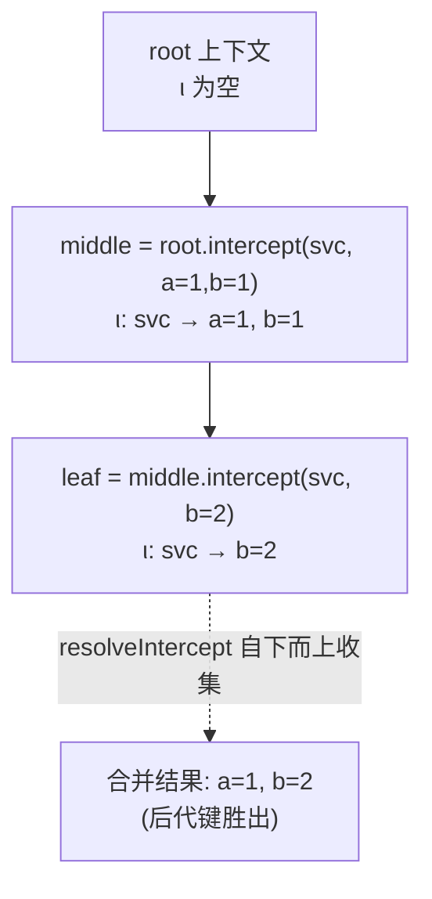
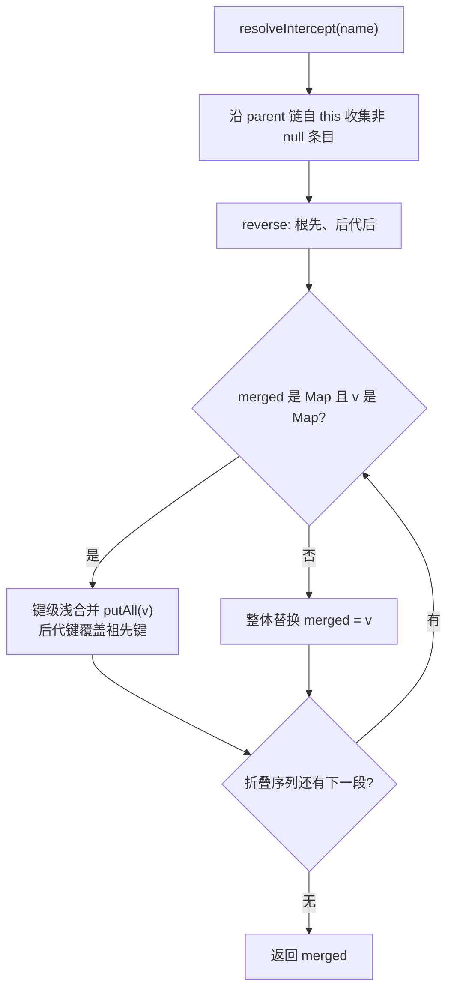
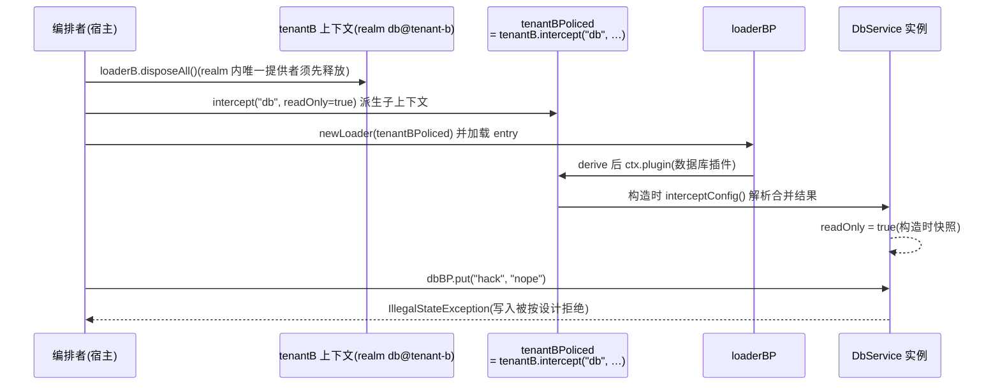

在 cordis-java 的空间维度设计中，`isolate` 改变服务"从哪里解析"，而 `intercept` 回答另一个正交问题：**服务"看到什么配置"**。本页解析拦截机制的两个核心面向——其一，拦截配置如何在上下文链上以**右偏合并**（right-biased merge，后代键覆盖祖先键）的方式折叠成最终视图；其二，编排者如何仅凭一条 `ctx.intercept(name, config)` 声明，在不修改提供者与消费者任何代码的前提下，将整棵子树的权限面收缩（如把租户-b 的数据库变为只读）。全文基于 `Context.resolveIntercept`、`Service.interceptConfig` 与声明式 `Entry.intercept` 三条代码路径展开。

## 为什么需要拦截：策略与实现的分离

设想一个典型困境：数据库插件提供了完整的读写能力，但某个租户的部署策略要求"该租户的所有组件只能读"。传统解法要么在提供者内部塞入租户判断，要么为该租户写一个代理包装器再注入消费者——两者都把策略耦合进了实现。cordis 的做法是把策略提升为**上下文的一等注解**：编排者（负责组合上下文的宿主代码）在派生上下文时声明 `intercept("db", Map.of("readOnly", true))`，提供者侧的服务基类在构造时通过 `interceptConfig()` 读取合并后的策略，自行决定收缩哪些操作。演示工程中的 `DbService` 正是这一契约的落地：构造函数解析拦截配置中的 `readOnly` 标志，`put` 操作在只读模式下直接抛出异常，错误消息明确写着"已被编排者拦截"。这是一种**合作式拦截**——框架不做代理包装，而是把合并后的策略交给服务自己去执行，代价是提供者必须主动查询，收益是策略注入点完全无侵入。

Sources: [DbService.java](cordis-example/src/main/java/dev/cordis/example/plugins/DbService.java#L9-L40)
Sources: [README.md](README.md#L84-L89)

## 影子而非变更：派生上下文上的 ι 表

`Context` 内部维护两张与派生相关的表：`isolateMap`（realm 表 ρ，服务名 → `RealmKey`）与 `interceptMap`（拦截表 ι，服务名 → 配置对象），每个上下文实例持有自己的私有副本。调用 `ctx.intercept(name, config)` 时，框架创建一个子上下文，仅在**子上下文**的 `interceptMap` 中写入该条目，父上下文的原表绝不被动过——这正是类注释所说的"影子（shadow）而非变更（mutate）"。这个设计有一个深远的推论：与需要逆效应的 `effect` 不同，派生上下文操作**不需要逆操作**，因为恢复（recovery）只需丢弃派生上下文本身，祖先的世界从未被污染。拦截表因此成为纯函数式的叠加层：链上每一层的 ι 条目在下读时才被合并消费。

Sources: [Context.java](cordis-core/src/main/java/dev/cordis/core/Context.java#L19-L34)
Sources: [Context.java](cordis-core/src/main/java/dev/cordis/core/Context.java#L122-L131)

## 右偏合并：resolveIntercept 的三步折叠

`resolveIntercept(name)` 是整个机制的计算核心，实现仅二十余行却精确编码了"后代胜出"语义。算法分三步：**收集**——从当前上下文沿 `parent` 链走到根，收集每层 `interceptMap` 中该服务名的非 null 条目（此时顺序是后代在前、祖先在后）；**反转**——`Collections.reverse` 后变为根先、后代后；**折叠**——从左到右（即从祖先到后代）逐一合并，每一步的结果作为下一步的输入。折叠规则只有两条：当已合并结果与新段**都是 Map** 时做键级浅合并（`putAll`），后到者的键覆盖先到者；否则新段**整体替换**旧结果。由于折叠序列中"右边的"总是更深的后代，这种偏向被命名为右偏合并——类注释中的表述是"merged root-first so descendants win"。

| 已合并结果 | 新段 v | 折叠结果 |
|---|---|---|
| `Map` | `Map` | 键级浅合并，v 的键覆盖（右偏点） |
| `Map` | 非 Map | 整体替换为 v |
| 非 Map | `Map` | 整体替换为 v |
| `null`（仅首步） | 任意 | v |

两条隐含语义值得注意：其一，**null 会被收集阶段跳过**，因此后代无法用显式 null "清除"祖先的拦截条目，只能覆盖；其二，**非 Map 值是全量替换的逃生门**——若祖先配置是复杂 Map 而后代想彻底换掉它，传入一个非 Map 标量（如 `true`）即可让合并短路为替换。测试用例 `interceptMergesWithDescendantsWinning` 精确锁定了这两条边界：`middle` 声明 `{a:1, b:1}`，`leaf` 声明 `{b:2}`，叶子解析得到 `{a:1, b:2}`（b 被后代覆盖、a 从祖先继承），而 root 上解析为 null（无任何层声明）。

一个来自实现的精确性注记：折叠代码在遇到 `LinkedHashMap` 时会经 `castMap` **就地复用并扩展该对象**（第一次折叠时，被复用的正是某层 `interceptMap` 里存着的原始配置引用），这意味着若编排者直接用可变的 `LinkedHashMap` 作为拦截载荷，合并结果会反向污染祖先层存储的条目。规避方式很简单——如演示代码那样使用 `Map.of` 等不可变映射作为载荷，每次折叠都会新建结果 Map，彻底切断别名共享。

Sources: [Context.java](cordis-core/src/main/java/dev/cordis/core/Context.java#L133-L160)
Sources: [IsolationTest.java](cordis-core/src/test/java/dev/cordis/IsolationTest.java#L97-L104)

## 读取端：Service.interceptConfig 与构造时快照

合并结果的消费入口是 `Service` 基类的 `interceptConfig()` 方法——它以服务自己的注册名调用 `ctx.resolveIntercept(name)`，返回**读取上下文处**的合并视图（类注释援引论文 §3.2.3）。注意两个"读取"细节：第一，`ctx` 是服务构造时收到的上下文，也就是承载它的 fiber 的运行上下文——该上下文位于编排者所有 `intercept` 派生层的**下方**，因此向上行走必然经过全部拦截层；第二，`DbService` 在构造函数里一次性读取并固化 `readOnly` 标志，拦截配置是**实例化时刻的快照**而非实时视图——这正是后文"变更拦截需要 rebuild"的根因：策略改变无法原地传播到已构造的服务，只能销毁 fiber 后在新的派生上下文中重建。拦截也完全不参与服务解析算法：`ctx.get` 走 fiber 链、查 realm、做能力检查的全过程中，ι 表一次都不会被咨询——它只通过 `interceptConfig` 这一个显式读取点生效。

Sources: [Service.java](cordis-core/src/main/java/dev/cordis/core/Service.java#L11-L33)
Sources: [DbService.java](cordis-example/src/main/java/dev/cordis/example/plugins/DbService.java#L20-L35)
Sources: [Context.java](cordis-core/src/main/java/dev/cordis/core/Context.java#L181-L209)

## 编排者权限收缩走读：租户-b 只读化

端到端演示的场景 6 完整展示了权限收缩的编排手法。前置状态来自场景 5：租户-a 与租户-b 各自经 `isolate` 拿到独立的 `db` realm（不了解 realm 机制可先读[隔离域：RealmKey、isolate 派生上下文与多租户实践](16-ge-chi-yu-realmkey-isolate-pai-sheng-shang-xia-wen-yu-duo-zu-hu-shi-jian)）。场景 6 的第一步是 `loaderB.disposeAll()`——这不是可选的清理，而是硬约束：**每个 realm 内一个 key 只能有一个提供者**，`db@tenant-b` 已被占用，不先释放就无法在新上下文中重新实例化数据库插件。随后编排者调用 `tenantB.intercept("db", Map.of("readOnly", true))` 派生出 `tenantBPoliced` 上下文，用它创建新的 `ComponentLoader` 并加载同一组 entry。数据库插件在新派生上下文中构造 `DbService` 时，`interceptConfig()` 沿链合并得到 `{readOnly: true}`，服务自此只读；最后宿主尝试 `dbBP.put("hack", "nope")`，得到按设计抛出的 `IllegalStateException`。整个过程提供者插件与消费者插件的代码零改动——策略完全活在编排层的上下文组合里。

Sources: [Main.java](cordis-example/src/main/java/dev/cordis/example/Main.java#L93-L121)

## 声明式路线：Entry.intercept 与调和语义

命令式 `ctx.intercept` 之外，拦截还有一条声明式通道：`Entry` 配置模型携带 `intercept` 字段（服务名 → 配置的有序 Map，经 Builder 的 `intercept(name, config)` 填充，构建时 `Map.copyOf` 冻结）。`ComponentLoader.derive` 在实例化 entry 时按固定顺序推导上下文——**先应用 isolate 注解、再应用 intercept 注解**，每个注解各自派生一层子上下文，最终把这条链作为 fiber 的 `parentCtx`。当调和（reconciliation）发现同一 id 的 entry 拦截配置发生变化时，走的是 `rebuild(e, m.plugin)` 路线：销毁旧 fiber、以**同一个插件对象**在新派生上下文中重新挂载——代码注释一语道破原因："interception lives on the derived context"（拦截活在派生上下文上），而服务对策略的读取又是构造时快照，二者叠加决定了拦截变更只能整体重建。这与 `config` 字段变化走 `fiber.update` 原地更新形成鲜明对照，也解释了四种字段变化为何被分派到三种不同强度的操作（调和机制的完整差分算法见[组件调和：按 id 差分与逐字段分发的最小扰动策略](19-zu-jian-diao-he-an-id-chai-fen-yu-zhu-zi-duan-fen-fa-de-zui-xiao-rao-dong-ce-lue)，Entry 字段全景见[Entry 配置模型](18-entry-pei-zhi-mo-xing-id-url-isolate-intercept-config-yu-disabled)）。

| 字段变化 | 调和动作 | 与拦截的关系 |
|---|---|---|
| `url` | `rebuild(e, null)` 重新解析组件 | 强度最高的重建 |
| `disabled` | `dispose` 或 `rebuild` 复活 | 退役/复活 |
| `isolate` | `rebuild(e, m.plugin)` | 同为派生层变更，同路线 |
| **`intercept`** | **`rebuild(e, m.plugin)`** | **拦截在派生上下文上，须重建 fiber** |
| `config` | `fiber.update(e.config)` | 原地更新，不重建 |

Sources: [Entry.java](cordis-core/src/main/java/dev/cordis/loader/Entry.java#L23-L24)
Sources: [Entry.java](cordis-core/src/main/java/dev/cordis/loader/Entry.java#L67-L70)
Sources: [ComponentLoader.java](cordis-core/src/main/java/dev/cordis/loader/ComponentLoader.java#L118-L125)
Sources: [ComponentLoader.java](cordis-core/src/main/java/dev/cordis/loader/ComponentLoader.java#L158-L165)
Sources: [ComponentLoader.java](cordis-core/src/main/java/dev/cordis/loader/ComponentLoader.java#L175-L193)

## 边界与精确性说明

三条边界帮助避免对拦截机制的过度推断。**第一，inject 声明中的配置路径当前是结构性钩子**：`Fiber.inject` 字段在类注释中被定义为"声明的余效应规范（论文的 d）：服务名 → 拦截配置"，构造函数会对非 null 值调用包私有的 `ctx.interceptSelf` 直接安装到 fiber 自身上下文——但插件入口 `Plugin.inject()` 只返回服务名列表，`RegistryService.resolveInject` 把每个名字统一填成 null，因此这条安装点在现有实现中不产生任何条目，全部拦截配置实际经由编排者上下文或 `Entry.intercept` 流入（inject 声明的反应式语义见[inject 声明与 ReflectService 通知](14-inject-sheng-ming-yu-reflectservice-tong-zhi-ti-gong-zhe-bian-hua-de-fan-ying-shi-fen-lei)）。**第二，拦截配置不经校验**：与插件 `config` 必须通过 `ConfigSchema` 校验（见[配置系统](25-pei-zhi-xi-tong-configschema-xiao-yan-validationexception-yu-update-liu-cheng)）不同，`intercept` 载荷是裸 `Object`，类型正确性完全由读取端（如 `DbService` 里的 `instanceof Map` 判断）自行保证。**第三，ι 表按键控而非按 realm 键控**：`interceptMap` 以服务名为键，不感知 realm 边界——同一个服务名在派生子树内的所有 realm 中共享同一套拦截合并视图。

Sources: [Fiber.java](cordis-core/src/main/java/dev/cordis/core/Fiber.java#L42-L96)
Sources: [RegistryService.java](cordis-core/src/main/java/dev/cordis/core/RegistryService.java#L92-L97)

## 与相邻机制的对比

把拦截放回派生注解的坐标系中，三种"配置注入"机制的分野一目了然：

| 维度 | `intercept`（ι 表） | `isolate`（ρ 表） | 插件 `config` |
|---|---|---|---|
| 改变什么 | 服务**看到**的配置（策略） | 服务**从哪里**解析（realm） | 插件 `apply` 的入参（业务参数） |
| 键控粒度 | 服务名 | 服务名 → `RealmKey` | 整个 fiber |
| 链上语义 | 右偏键级合并，后代覆盖 | 最近祖先单值胜出 | 不合并，实例化时绑定 |
| 变更的反应 | loader 侧 `rebuild` | loader 侧 `rebuild` | `fiber.update` 原地更新 |
| 校验 | 无（裸 `Object`） | 无（label 对象） | `ConfigSchema` 强校验 |
| 读取点 | `Service.interceptConfig()` | 解析算法隐式使用 | `apply` 第二参数 |
| 典型场景 | 权限/策略收缩 | 多租户隔离 | 业务参数调优 |

Sources: [Context.java](cordis-core/src/main/java/dev/cordis/core/Context.java#L108-L131)
Sources: [Context.java](cordis-core/src/main/java/dev/cordis/core/Context.java#L162-L169)

## 小结与延伸阅读

拦截机制的核心承诺可以压缩为一句话：**策略声明在编排层、执行在提供者、合并规则由框架保证**。`intercept` 派生影子上下文而不变更祖先，`resolveIntercept` 以根先后代后的右偏折叠让最贴近消费者的层拥有最终话语权，`Service.interceptConfig` 在构造时刻固化策略快照，而声明式 `Entry.intercept` 的变更经调和触发 fiber 重建以保证快照与声明一致。想继续深入，建议按此顺序阅读：先看[端到端演示走读](4-duan-dao-duan-yan-shi-zou-du-ba-ge-chang-jing-li-jie-kuang-jia-quan-bu-neng-li)中的场景 6 与本页走读互相印证，再到[隔离域：RealmKey、isolate 派生上下文与多租户实践](16-ge-chi-yu-realmkey-isolate-pai-sheng-shang-xia-wen-yu-duo-zu-hu-shi-jian)理解与拦截同构的 ρ 表设计，最后到[组件调和](19-zu-jian-diao-he-an-id-chai-fen-yu-zhu-zi-duan-fen-fa-de-zui-xiao-rao-dong-ce-lue)与[Entry 配置模型](18-entry-pei-zhi-mo-xing-id-url-isolate-intercept-config-yu-disabled)看拦截变更如何嵌入完整的差分调和流程。