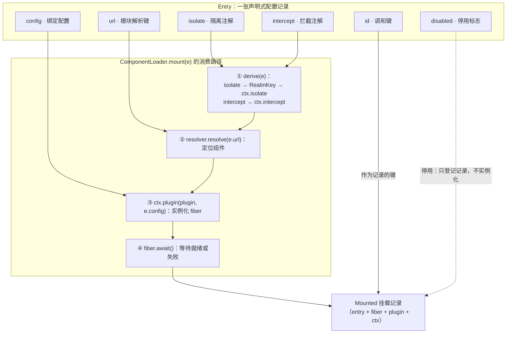
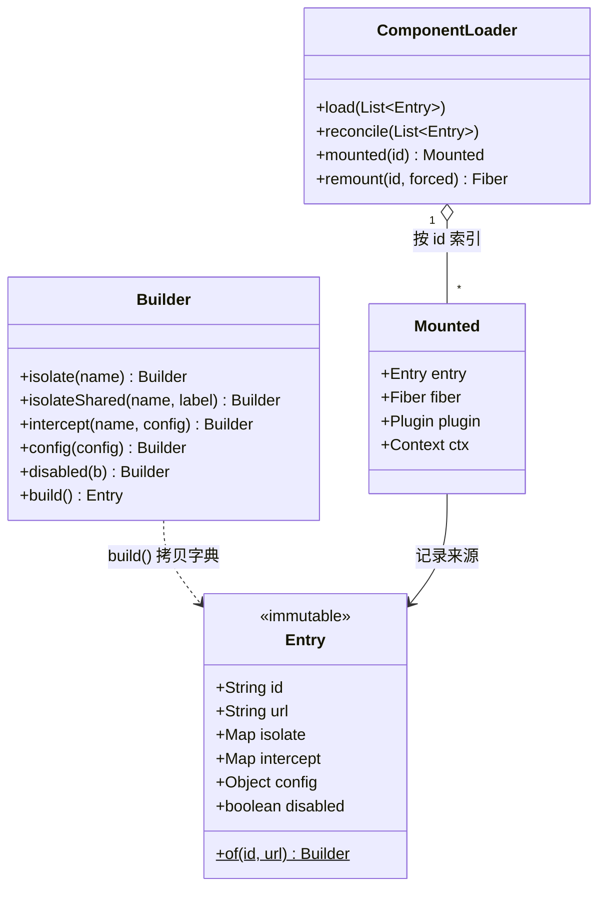

在 cordis-java 中，**Entry 是编排者写给加载器的"愿望清单"条目**：它不包含任何运行逻辑，只是一份持久化的配置记录，声明"我希望系统里存在这样一个插件实例"。`ComponentLoader` 读取这份清单，把它翻译成真实运行的 fiber（插件实例），并在后续每次提交新清单时，让运行状态与清单保持一致。本页聚焦 Entry 这条配置记录本身的六个字段——`id`、`url`、`isolate`、`intercept`、`config`、`disabled`——逐一说清它们的类型、语义、缺省值，以及加载器如何消费它们。调和算法的完整推导属于下一页，隔离与拦截的深层机制另有专页，这里只讲"Entry 上的一个字段写了什么、会被翻译成什么"。

Sources: [Entry.java](cordis-core/src/main/java/dev/cordis/loader/Entry.java#L6-L14)

## 一、Entry 在框架中的位置：声明与实现的分界线

整个 cordis-java 分为三层：核心库（Context/Fiber/Plugin）负责效应执行，声明式加载器负责"把配置变成现实"，HMR 引擎负责热更新（见[整体架构：核心库、声明式加载器与 HMR 引擎的三层分层](5-zheng-ti-jia-gou-he-xin-ku-sheng-ming-shi-jia-zai-qi-yu-hmr-yin-qing-de-san-ceng-fen-ceng)）。**Entry 正是声明层的最小单元**：一个 Entry 对应一个 fiber，编排者只需要维护一个 `List<Entry>`，提交给 `loader.load(...)`，其余交给加载器。类注释把它概括为"the loader realizes and keeps in step with"（加载器将其实现并持续保持同步）的持久记录：`disabled` 给出退位标志，条目在列表中的位置给出实例化次序，`url` 选出声明 inject/provide 的那个组件。对初学者而言，最直观的理解是：**Entry 回答了"装什么、怎么隔离、怎么拦、带什么配置、开不开"这五个问题，id 则回答"你是谁"**。

下面这张图展示六个字段从 Entry 流向运行实例的完整消费路径。理解它的前提：`mount` 是加载器把一个 Entry 变成 fiber 的过程，其中 `derive(e)` 先根据 isolate/intercept 注解从父上下文派生出该条目专属的 Context，再用 `url` 解析组件、用 `config` 实例化。



Sources: [Entry.java](cordis-core/src/main/java/dev/cordis/loader/Entry.java#L15-L28), [ComponentLoader.java](cordis-core/src/main/java/dev/cordis/loader/ComponentLoader.java#L140-L156), [ComponentLoader.java](cordis-core/src/main/java/dev/cordis/loader/ComponentLoader.java#L175-L193)

## 二、六个字段速查表

六个字段全部声明为 `public final`，构成一个纯粹的不可变数据记录。下表是本页的导航地图，后续小节逐一展开。

| 字段 | 类型 | 缺省值 | 一句话语义 | 谁消费它 |
|---|---|---|---|---|
| `id` | `String` | 必填 | 调和键：跨多次 load 识别"同一个条目" | `ComponentLoader.mounted` 字典的键 |
| `url` | `String` | 必填 | 模块解析键：定位要实例化的组件 | `PluginResolver.resolve(url)` |
| `isolate` | `Map<String, Object>` | 空 Map | 隔离注解：服务名 → realm 标记 | `derive()` → `ctx.isolate(name, key)` |
| `intercept` | `Map<String, Object>` | 空 Map | 拦截注解：服务名 → 该服务的拦截配置 | `derive()` → `ctx.intercept(name, config)` |
| `config` | `Object` | `null` | 绑定进组件、构成其 apply 函数的配置 | `ctx.plugin(plugin, config)` 与 `fiber.update` |
| `disabled` | `boolean` | `false` | 行政性停用标志：条目保留但 fiber 不存在 | `apply()` 的分支判断 |

值得注意的是字段类型的"宽窄差异"：`id`/`url` 是必填字符串，而 `isolate`/`intercept` 是键值字典、`config` 是任意对象——前者回答"装哪个"，后者回答"装成什么样"。构造函数用 `Map.copyOf` 对两个字典做防御性拷贝，保证 Entry 一经构建便无法被外部修改。

Sources: [Entry.java](cordis-core/src/main/java/dev/cordis/loader/Entry.java#L17-L37), [ComponentLoader.java](cordis-core/src/main/java/dev/cordis/loader/ComponentLoader.java#L52-L53)

## 三、逐字段精读

### id：跨多次 load 的稳定身份

`id` 是 Entry 唯一的稳定标识，注释称之为"used as the reconciliation key"（调和键）。它的作用场景是**增量调和**：加载器内部维护一个 `Map<String, Mounted>` 字典，每次提交新清单时，先按 id 找出旧清单里已消失的条目予以卸载，再对幸存条目逐字段比对更新。也就是说，**fiber 的生死存亡完全由 id 追踪——id 从清单中消失，对应 fiber 就被 dispose；id 保留，加载器才会进一步比较其余五个字段决定处置方式**。日志输出也以 id 为主语（`mounted users`、`rebuild m`、`unmount users`）。如果两个 Entry 使用相同 id，后挂载者会覆盖字典中的前者，因此编排者必须保证清单内 id 唯一。

Sources: [Entry.java](cordis-core/src/main/java/dev/cordis/loader/Entry.java#L17-L18), [ComponentLoader.java](cordis-core/src/main/java/dev/cordis/loader/ComponentLoader.java#L62-L91), [ComponentLoader.java](cordis-core/src/main/java/dev/cordis/loader/ComponentLoader.java#L151-L153)

### url：交给 PluginResolver 的模块定位符

`url` 是"resolver key"——交给宿主注入的 `PluginResolver` 去解析出一个 `Plugin` 组件。框架本身不规定 url 的格式：示例工程里它是注册表中的逻辑名（`"plugin-database"`、`"plugin-greeting"`），在真实宿主中它可以是文件路径或模块标识。**url 与组件的对应关系由 `PluginResolver` 单方面决定**，这正是热替换的支点：HMR 引擎重新编译模块后，同一个 url 再次 resolve 会产出新版本组件（见[宿主集成指南：PluginResolver、ModuleGraph 与模块注册策略](28-su-zhu-ji-cheng-zhi-nan-pluginresolver-modulegraph-yu-mo-kuai-zhu-ce-ce-lue)）。解析失败不会抛出异常炸掉整个 load：`mount` 捕获后记录错误日志，并登记一条 `fiber = null` 的挂载记录，让该条目处于"已声明但未实现"状态——测试 `mountUnderMissingModuleIsReportedNotThrown` 验证了这一契约。url 变更（如 `v1` → `v2`）被加载器视为身份级变化，触发 dispose 旧 fiber、挂载新 fiber 的重建，两个版本各只加载一次。

Sources: [Entry.java](cordis-core/src/main/java/dev/cordis/loader/Entry.java#L19-L20), [ComponentLoader.java](cordis-core/src/main/java/dev/cordis/loader/ComponentLoader.java#L152-L155), [ComponentLoader.java](cordis-core/src/main/java/dev/cordis/loader/ComponentLoader.java#L202-L213), [LoaderTest.java](cordis-core/src/test/java/dev/cordis/LoaderTest.java#L115-L117), [LoaderTest.java](cordis-core/src/test/java/dev/cordis/LoaderTest.java#L170-L172)

### isolate：一条注解三种语义

`isolate` 是"服务名 → realm 标记"的字典，声明该条目在哪些服务上要看到独立的提供者。**它的精妙之处在于字典值的多态性**：`derive()` 在翻译时对值做三分支判断，一个字段的写法直接决定隔离的粒度——

| `isolate` 字典中的值 | Builder 写法 | derive 翻译为 | 隔离效果 |
|---|---|---|---|
| `Boolean.TRUE` | `.isolate("db")` | `RealmKey.fresh(name + "#" + id)` | **私有 realm**：每次派生都生成全新 key，仅本条目可见，不同条目互不可见 |
| 任意标签对象（如字符串） | `.isolateShared("db", "tenant-a")` | `RealmKey.shared(label)` | **共享 realm**：intern 过的 key，所有填同一标签的条目加入同一个作用域 |
| `RealmKey` 实例 | 无便捷写法，需直接构造 Map | 原样透传 | 由调用方完全掌控 key 的同一性 |

这套设计的底层机制是 `RealmKey` 以**对象身份**作为 realm 同一性（模仿 JS 的 `Symbol`），而 `shared(label)` 通过静态字典做驻留——相等标签换回同一个 key，于是"命名相同即同域"；`fresh` 则每次都新建，天然互不相通。翻译顺序也有讲究：`derive()` 按字典迭代顺序逐条对 Context 做 `ctx.isolate(name, key)` 派生，多个服务可以叠加注解。关于 realm 如何影响服务解析，见[隔离域：RealmKey、isolate 派生上下文与多租户实践](16-ge-chi-yu-realmkey-isolate-pai-sheng-shang-xia-wen-yu-duo-zu-hu-shi-jian)。

Sources: [Entry.java](cordis-core/src/main/java/dev/cordis/loader/Entry.java#L21-L22), [Entry.java](cordis-core/src/main/java/dev/cordis/loader/Entry.java#L56-L65), [ComponentLoader.java](cordis-core/src/main/java/dev/cordis/loader/ComponentLoader.java#L175-L193), [RealmKey.java](cordis-core/src/main/java/dev/cordis/core/RealmKey.java#L4-L29)

### intercept：写在 entry 上的服务级拦截注解

`intercept` 是"服务名 → 拦截配置"的字典，声明该条目消费某服务时要套上的拦截策略。`derive()` 在 isolate 注解全部落地之后，逐条执行 `ctx.intercept(name, value)`——注释明确"interception lives on the derived context"（拦截存在于派生上下文之上），即拦截注解与隔离注解一样，都是 Entry 的**上下文派生参数**而非组件内部状态。这也解释了为什么 intercept 变更会触发重建：旧 fiber 持有的是未拦截的旧上下文，必须重新派生并重新实例化。示例工程的场景 6 演示了等价能力——对租户上下文直接调用 `ctx.intercept("db", Map.of("readOnly", true))` 后加载相同清单，租户的 db 服务立即变为只读。拦截配置如何与服务端注册的拦截器右偏合并、编排者权限如何被收缩，见[拦截：intercept 配置右偏合并与编排者权限收缩](17-lan-jie-intercept-pei-zhi-you-pian-he-bing-yu-bian-pai-zhe-quan-xian-shou-suo)。

Sources: [Entry.java](cordis-core/src/main/java/dev/cordis/loader/Entry.java#L23-L24), [Entry.java](cordis-core/src/main/java/dev/cordis/loader/Entry.java#L67-L70), [ComponentLoader.java](cordis-core/src/main/java/dev/cordis/loader/ComponentLoader.java#L122-L125), [ComponentLoader.java](cordis-core/src/main/java/dev/cordis/loader/ComponentLoader.java#L189-L192), [Main.java](cordis-example/src/main/java/dev/cordis/example/Main.java#L111-L116)

### config：进入 Plugin.apply 的有效负载

`config` 是绑定进组件的配置对象——注释原话是"the configuration bound into the component to form its effect function apply"，即它与组件代码一起共同决定插件的行为。消费路径有两处：**首次挂载**时作为 `ctx.plugin(plugin, e.config)` 的参数进入 `Plugin.apply(ctx, config)`；**调和更新**时经 `fiber.update(e.config)` 走校验后热更新。校验由组件声明的 `ConfigSchema` 承担，两种失败场景的行为截然不同——

| 场景 | 行为 |
|---|---|
| 挂载时初始 config 非法 | fiber 落入 `FAILED` 状态，`await()` 抛 `ValidationException` |
| 调和时更新 config 被拒绝 | 加载器捕获并记错误日志；fiber 保持 `ACTIVE`，继续以旧配置运行；**挂载记录仍保留新 config 负载** |

这个"记录保留新负载"的细节值得初学者留意：它意味着配置愿望与运行现实可以短暂背离，下次重建会以记录中的新值为准。schema 校验与 update 流程的完整机制见[配置系统：ConfigSchema 校验、ValidationException 与 update 流程](25-pei-zhi-xi-tong-configschema-xiao-yan-validationexception-yu-update-liu-cheng)。

Sources: [Entry.java](cordis-core/src/main/java/dev/cordis/loader/Entry.java#L25-L26), [ComponentLoader.java](cordis-core/src/main/java/dev/cordis/loader/ComponentLoader.java#L126-L137), [ComponentLoader.java](cordis-core/src/main/java/dev/cordis/loader/ComponentLoader.java#L144-L149), [LoaderTest.java](cordis-core/src/test/java/dev/cordis/LoaderTest.java#L149-L162)

### disabled：行政性停用与 ctx 的保留

`disabled` 是一个布尔开关，注释称"administratively turned off"——**关掉的不是配置，而是实例**。禁用条目时加载器做三件事：`dispose` 现有 fiber、登记一条 `fiber = null, plugin = null` 但 **`ctx` 保留**的挂载记录；重新启用时则走重建路线，在同一名字上实例化全新 fiber。这个"ctx 保留"的细节有其用意：派生上下文承载着该条目的 realm 与拦截注解，保留它使停用/启用循环不必丢失派生信息。新条目天生就是 disabled 时更简单——直接登记空记录，连解析都不发生。测试 `disabledKeepsEntryUnmounted` 三段验证：禁用后 `mounted("m").fiber` 为 null，重新启用后 fiber 回来，再禁用又归 null。示例工程场景 4 用一行 `.disabled(true)` 演示了从三插件清单中"拔掉" greeting 而不影响其余两个的全过程。

Sources: [Entry.java](cordis-core/src/main/java/dev/cordis/loader/Entry.java#L27-L28), [ComponentLoader.java](cordis-core/src/main/java/dev/cordis/loader/ComponentLoader.java#L93-L117), [LoaderTest.java](cordis-core/src/test/java/dev/cordis/LoaderTest.java#L85-L101), [Main.java](cordis-example/src/main/java/dev/cordis/example/Main.java#L83-L91)

## 四、不可变记录与 Builder：安全的构造方式

Entry 采用**不可变值对象 + 流式 Builder** 的经典组合。`Entry.of(id, url)` 是唯一入口，两个必填字段在 Builder 构造时锁定，其余四项用链式调用可选设置，最终 `build()` 触发私有构造。类图如下，可对照理解各部件职责：



两个工程细节对初学者最有教育意义。其一，构造函数中 `Map.copyOf(b.isolate)` 做了不可变拷贝——即使 Builder 的字典在 build 之后被改动，已生成的 Entry 也不受影响，这消除了"配置清单被意外篡改"这类最难排查的 bug。其二，Entry **没有重写 `equals`/`hashCode`**，它用的是 Java 默认的对象同一性比较；加载器调和时并不比较 Entry 整体，而是用 `Objects.equals` 逐字段比较新旧记录的 `url`、`isolate`、`intercept`、`config`。这使字段级的相等性判断完全显式、可预测。`toString` 输出形如 `Entry(users → plugin-users)`（禁用时追加 `, disabled`），便于日志排查。

Sources: [Entry.java](cordis-core/src/main/java/dev/cordis/loader/Entry.java#L30-L41), [Entry.java](cordis-core/src/main/java/dev/cordis/loader/Entry.java#L82-L90), [ComponentLoader.java](cordis-core/src/main/java/dev/cordis/loader/ComponentLoader.java#L103-L127)

## 五、字段的可变性等级：变更一个字段的代价预览

六个字段并非同等"便宜"。加载器在 `apply()` 中按固定顺序逐字段检查，一旦命中就分派到**扰动最小**的操作并返回——这是 Entry 字段语义的直接延伸，也为下一页的调和算法做铺垫：

| 变更字段 | 加载器动作 | 对运行系统的扰动 |
|---|---|---|
| `id`（条目消失） | `unmount`：dispose fiber 并移除记录 | 卸载 |
| `url` | `rebuild`：dispose 旧 fiber，重新解析挂载 | 重建 |
| `disabled` 翻转 | 禁用：dispose fiber、保留 ctx；启用：rebuild | 停用/重建 |
| `isolate` | `rebuild`（携带原 plugin）：realm 重派生 | 重建 |
| `intercept` | `rebuild`（携带原 plugin）：拦截重派生 | 重建 |
| `config` | **原位 update**：fiber 不销毁，走 `fiber.update` | 最小扰动 |

规律一目了然：**`config` 是唯一支持原位热更新的字段**，因为它只影响 apply 函数的输入；其余四个字段都参与了 fiber 的身份构成（组件、上下文派生、存活状态），改动它们等于改变"这个 fiber 是什么"，只能重建。值得注意的是 isolate/intercept 重建时传入 `m.plugin` 复用已解析的组件——变更的是上下文，不必重新走 resolver。完整的差分算法、卸载次序与重建保证，见[组件调和：按 id 差分与逐字段分发的最小扰动策略](19-zu-jian-tiao-he-an-id-chai-fen-yu-zhu-zi-duan-fen-fa-de-zui-xiao-rao-dong-ce-lue)。

Sources: [ComponentLoader.java](cordis-core/src/main/java/dev/cordis/loader/ComponentLoader.java#L93-L138), [ComponentLoader.java](cordis-core/src/main/java/dev/cordis/loader/ComponentLoader.java#L158-L165)

## 六、从示例与测试看 Entry 的典型用法

示例工程 `Main.java` 提供了最贴近实战的写法模板。场景 1 展示最小配置——两条 Entry，各只填 id 和 url：

```java
loader.load(List.of(
        Entry.of("users", "plugin-users").build(),
        Entry.of("plugin-database".startsWith("p") ? "database" : "db", "plugin-database").build()));
```

（实际代码为 `Entry.of("database", "plugin-database").build()`。）注意此时无须关心加载顺序：`users` 声明依赖 `db` 而清单里 `database` 排在后面，框架会让前者在激活点等待——这是声明式加载的核心红利。场景 4 展示禁用的一行式写法：`Entry.of("greeting", "plugin-greeting").disabled(true).build()`。场景 5 展示多租户：两份**完全相同**的 Entry 清单分别交给绑定在不同隔离上下文上的两个 loader，得到互不干扰的 db 实例——那里隔离注解写在父 Context 上而非 Entry 上，两种粒度可以自由组合。场景 7 则是 HMR 的起点：清单不变，模块注册表换血后由 HMR 引擎接管。

测试用例将 Entry 的行为契约固化下来，可当作语义规格阅读：`reconcileAddsRemovesAndUpdates` 验证 `config(1)` → `config(2)` 的原位更新不触发重新加载（loads 计数不增）；`disabledKeepsEntryUnmounted` 三段验证禁用循环；`urlChangeRebuilds` 验证 url 变更的重建语义；`configSchemaFailureLeavesFiberFailed` 验证两种校验失败路径；`mountUnderMissingModuleIsReportedNotThrown` 验证 url 解析失败的温和降级。

Sources: [Main.java](cordis-example/src/main/java/dev/cordis/example/Main.java#L60-L65), [Main.java](cordis-example/src/main/java/dev/cordis/example/Main.java#L83-L91), [Main.java](cordis-example/src/main/java/dev/cordis/example/Main.java#L93-L102), [Main.java](cordis-example/src/main/java/dev/cordis/example/Main.java#L123-L133), [LoaderTest.java](cordis-core/src/test/java/dev/cordis/LoaderTest.java#L64-L73), [LoaderTest.java](cordis-core/src/test/java/dev/cordis/LoaderTest.java#L85-L101)

## 七、Entry 与 HMR 的衔接：记录不动，实现换血

Entry 在 HMR 体系中扮演"稳定锚点"的角色。HMR 引擎的陈旧检测以 **url** 为输入——收集所有已挂载条目的 url，与本次接受的变更模块集求交，即得陈旧 url；再借助 loader 的挂载记录把陈旧 url 映射回 entry id。事务性重载阶段对每个陈旧条目执行 `ComponentLoader.remount(id, freshPlugin)`：dispose 旧 fiber，用重新 resolve 的组件在同一 Entry 记录上重新实例化——**id、isolate、intercept、config、disabled 全部原样保留，只有实现换血**。这意味着开发者编辑代码触发热更新时，不必重新声明任何配置。三个 HMR 阶段的完整机制分别见[HMR 阶段二：依赖树遍历与陈旧 entry 检测](21-hmr-jie-duan-er-yi-lai-shu-bian-li-yu-chen-jiu-entry-jian-ce)与[HMR 阶段三：事务性重载与半重载状态的回滚保证](22-hmr-jie-duan-san-shi-wu-xing-zhong-zai-yu-ban-zhong-zai-zhuang-tai-de-hui-gun-bao-zheng)。

Sources: [HmrEngine.java](cordis-core/src/main/java/dev/cordis/hmr/HmrEngine.java#L97-L104), [HmrEngine.java](cordis-core/src/main/java/dev/cordis/hmr/HmrEngine.java#L169-L174), [ComponentLoader.java](cordis-core/src/main/java/dev/cordis/loader/ComponentLoader.java#L195-L214)

## 延伸阅读

- 想看清单提交后加载器如何逐字段差分，进入下一页：[组件调和：按 id 差分与逐字段分发的最小扰动策略](19-zu-jian-tiao-he-an-id-chai-fen-yu-zhu-zi-duan-fen-fa-de-zui-xiao-rao-dong-ce-lue)
- 深入 isolate 背后的 realm 机制：[隔离域：RealmKey、isolate 派生上下文与多租户实践](16-ge-chi-yu-realmkey-isolate-pai-sheng-shang-xia-wen-yu-duo-zu-hu-shi-jian)
- 深入 intercept 的合并语义：[拦截：intercept 配置右偏合并与编排者权限收缩](17-lan-jie-intercept-pei-zhi-you-pian-he-bing-yu-bian-pai-zhe-quan-xian-shou-suo)
- 深入 config 的校验链路：[配置系统：ConfigSchema 校验、ValidationException 与 update 流程](25-pei-zhi-xi-tong-configschema-xiao-yan-validationexception-yu-update-liu-cheng)
- 回顾 Entry 所实例化的 Plugin 长什么样：[编写第一个插件：Plugin、inject 声明与 provide 提供服务](3-bian-xie-di-ge-cha-jian-plugin-inject-sheng-ming-yu-provide-ti-gong-fu-wu)
- 在自己的宿主中提供 url 解析：[宿主集成指南：PluginResolver、ModuleGraph 与模块注册策略](28-su-zhu-ji-cheng-zhi-nan-pluginresolver-modulegraph-yu-mo-kuai-zhu-ce-ce-lue)