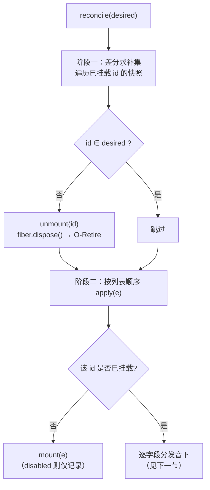
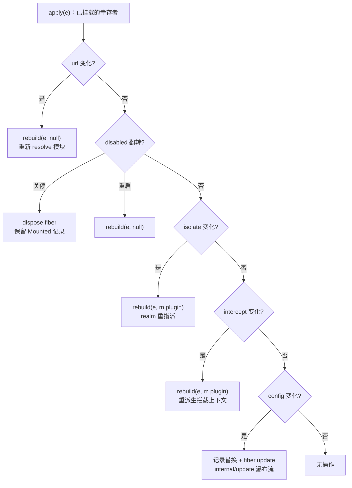

声明式加载的核心承诺是：编排者只描述"我希望系统长什么样"（一份 Entry 列表），而不必描述"如何从现状走到那里"。`ComponentLoader` 就是兑现这个承诺的翻译器——它把配置列表的**每次变更**差分为最小的 fiber 操作集合：该卸载的卸载、该换血的重挂、能热更新的绝不重启。本文剖析这条调和管线的两级结构：**按 id 差分**（谁留下了、谁消失了）与**逐字段分发**（幸存者的每个字段变化映射到扰动最小的操作），并解释为什么"重建"这条看似粗暴的兜底路由在元理论上是无害的。

Sources: [ComponentLoader.java](cordis-core/src/main/java/dev/cordis/loader/ComponentLoader.java#L16-L28)

## 调和的两阶段骨架：先求补集，再按序应用

`reconcile(List<Entry> desired)` 的结构刻意保持简单：第一个循环遍历**当前已挂载**的 id 快照（复制 `keySet()` 以避免卸载时的并发修改），凡是不出现在期望列表中的 id 立即 `unmount`——即调用 `fiber.dispose()` 触发 O-Retire 级联卸载；第二个循环按**列表顺序**对每个期望 Entry 调用 `apply(e)`，由后者决定挂载还是逐字段更新。整个方法与所有公开操作一样是 `synchronized` 的，保证差分计算的原子性。

这个"先移除、后应用"的顺序并非任意：先释放消失的条目，可以让它们占用的隔离 realm（如本地 realm 的服务提供槽位）在后续挂载前腾出空间——示例程序的第四个场景后特意调用 `disposeAll()` 释放全局 db realm，正是同一逻辑的显式版本。同时，新条目按列表顺序挂载并不隐含依赖顺序：**Theorem 70 保证无需加载顺序**——声明了尚未提供的 inject 键的 fiber 会在激活点等待，因此 `[users, database]` 与 `[database, users]` 两种写法收敛到同一静默状态。

上图对应 `reconcile` 的控制流：两个循环分别处理"消失者"与"幸存者和新来者"，而 `apply` 内部的字段分发音树是下一节的主题。值得注意的是 `load(desired)` 只是 `reconcile` 的别名——首次加载与后续调和走的是**同一条代码路径**，这正是声明式模型的自洽之处：不存在特殊的"初始化"逻辑。

Sources: [ComponentLoader.java](cordis-core/src/main/java/dev/cordis/loader/ComponentLoader.java#L71-L91) [ComponentLoader.java](cordis-core/src/main/java/dev/cordis/loader/ComponentLoader.java#L62-L69) [Main.java](cordis-example/src/main/java/dev/cordis/example/Main.java#L83-L91)

## 逐字段分发：一条短路决策链

`apply(e)` 的主体是一串**首差即返**的字段比较：按 `url → disabled → isolate → intercept → config` 的固定优先级，第一个检测到变化的字段决定路由并立即返回。这个顺序本身就是设计声明——`url` 是组件身份，身份变了其它一切字段的变化都失去意义，所以它排在最前；`config` 是唯一不需要重建上下文就能生效的字段，所以排最后、作为最小扰动的幸存路径。

下表汇总了完整的字段-路由映射，是本文的核心契约：

| 变化维度 | 检测方式 | 分发路由 | 对 fiber 的影响 | 扰动等级 |
|---|---|---|---|---|
| id 从期望列表消失 | 补集计算 | `unmount(id)` | `fiber.dispose()`，Mounted 记录删除 | 移除 |
| 新 id（非 disabled） | `mounted.get(id) == null` | `mount(e, null)` | 解析模块并实例化新 fiber | 新建 |
| 新 id（disabled） | 同上 + `e.disabled` | 仅写入 `Mounted(e, null, null, null)` | 不创建 fiber | 零 |
| `url` 变化 | `Objects.equals` 比较 | `rebuild(e, null)` | dispose 旧 fiber，**重新 resolve**，全新派生上下文 | 重建 |
| `disabled` false→true | 布尔不等 | 就地降级 | `fiber.dispose()`，但 **Mounted 记录保留**，ctx 保留 | 停用 |
| `disabled` true→false | 同上 | `rebuild(e, null)` | 在同名位置实例化新 fiber | 重建 |
| `isolate` 变化 | Map 相等比较 | `rebuild(e, m.plugin)` | dispose 旧 fiber，**复用同一 Plugin 实例**，重新派生 realm 上下文 | 重建 |
| `intercept` 变化 | Map 相等比较 | `rebuild(e, m.plugin)` | 同上——拦截注解存活于派生上下文 | 重建 |
| `config` 变化 | `Objects.equals` 比较 | 记录替换 + `fiber.update(e.config)` | **同一个 fiber 对象**，epoch 翻转重跑 apply | 热更新 |

三个细节值得展开。其一，`disabled` 的关闭路径是唯一**不删除记录**的移除：`Mounted` 以 `(e, null, null, m.ctx)` 的形态留在映射中，使 `ids()` 仍能看到这个条目——"管理性关停"与"从未存在"在观测上是可区分的。其二，`isolate` 与 `intercept` 变化时传入 `rebuild(e, m.plugin)` 复用插件实例，因为这两个字段只影响 `derive(e)` 派生的上下文形状，组件代码本身无需重新解析；这与 `url` 变化走 `rebuild(e, null)` 强制重新 resolve 形成对照。其三，所有重建路由最终都从**新 Entry** `e` 出发实例化，因此即便多个字段同时变化（如 url 和 config 一起改），首差即返的决策链不会丢失任何变更——分发顺序只决定"走哪条路"，而每条路的终点都完整反映期望配置。

决策树的五个判断节点与 `apply` 源码中的五个 `if` 一一对应，任何路径都不会穿透到下一个比较——这是"最小扰动"的形式化体现：每个字段只在必要时触发它能触发的最弱操作。

Sources: [ComponentLoader.java](cordis-core/src/main/java/dev/cordis/loader/ComponentLoader.java#L93-L138) [Entry.java](cordis-core/src/main/java/dev/cordis/loader/Entry.java#L17-L28)

## 四条路由的实现语义

`mount` 是所有"创建"路径的汇聚点：`derive(e)` 从父上下文逐条应用 isolate 注解（`Boolean.TRUE` 生成以 `服务名#entryId` 命名的**本地新鲜 realm**，使其随条目旅行；RealmKey 实例直接采用；其余值视为共享标签）再叠加 intercept 注解，然后在派生上下文上 `ctx.plugin(plugin, e.config)` 实例化 fiber 并同步 `await()`。两个失败出口都被驯化为**记录而非异常**：模块解析失败时写入 `Mounted(e, null, null, null)` 并记日志，fiber 启动失败时记录 fiber（状态为 FAILED）——调和过程永不因单个条目中断，这与测试断言 `mountUnderMissingModuleIsReportedNotThrown` 的契约一致。

`rebuild` 则是"销毁-重建"的最薄封装：dispose 旧 fiber（若有），转交 `mount`。`unmount` 与 `disposeAll` 同构，只是前者同时删除映射记录。真正有独立语义的是 **config 路由**：`Mounted` 记录先替换为新 Entry（即使后续更新失败，记录也保留新载荷——这是刻意选择，见下节），然后 `fiber.update(e.config)` 走 `Fiber` 内部的完整更新协议：解析校验配置 → 触发 `internal/update` 瀑布流（允许更新钩子否决或替换重启）→ `restart()` 翻转 epoch 重跑插件。关键区别在于 **fiber 对象的身份不变**：测试 `reconcileAddsRemovesAndUpdates` 验证了 config 更新后插件 apply 计数加一（确实重跑了），但未触碰的兄弟条目计数不变（`bLoads` 保持 1）——扰动被精确限定在单个条目内。

| 路由 | fiber 身份 | Plugin 实例 | 派生上下文 | Mounted 记录 |
|---|---|---|---|---|
| `mount` | 新建 | 新 resolve | 新派生 | 新建 |
| `rebuild(url)` | 新建 | 新 resolve | 新派生 | 原地替换 |
| `rebuild(isolate/intercept)` | 新建 | **复用** | 新派生 | 原地替换 |
| `disable` | dispose 后为 null | null | 保留旧 ctx | 原地替换 |
| `update(config)` | **不变**（epoch 翻转） | 不变 | 不变 | 原地替换 |
| `unmount` | dispose | — | — | 删除 |

Sources: [ComponentLoader.java](cordis-core/src/main/java/dev/cordis/loader/ComponentLoader.java#L140-L165) [ComponentLoader.java](cordis-core/src/main/java/dev/cordis/loader/ComponentLoader.java#L175-L193) [Fiber.java](cordis-core/src/main/java/dev/cordis/core/Fiber.java#L424-L446) [LoaderTest.java](cordis-core/src/test/java/dev/cordis/LoaderTest.java#L51-L82)

## 失败语义：记录保留新载荷，运行保持旧配置

config 路径的异常处理揭示了调和器对"期望状态"与"运行状态"的精细区分。当新配置无法通过插件的 ConfigSchema 校验时，`fiber.update` 抛出的 `ValidationException` 被 `apply` 捕获记日志，**Mounted 记录已经先一步替换为新 Entry**——所以记录中保存的是被拒绝的新配置，而 fiber 仍在旧配置下运行。测试 `configSchemaFailureLeavesFiberFailed` 精确锁定了这一契约：更新非法配置 99 后 fiber 保持 ACTIVE、`getEffectiveConfig()` 仍是 3。这形成了一个不对称但自洽的语义：配置声明是编排者的意愿（记录它），运行是组件的现实（保护它），两者的偏差通过命名日志 `"entry ... rejected new config"` 暴露给运维。

与之对照，**初次挂载**携带非法配置则直接落入 FAILED 状态（fiber 记录保留，`await()` 会抛出校验异常）——初次没有"旧配置"可退守，失败即是终态。这两种失败模式的差异提醒使用者：调和器区分了"变更被拒"（系统继续以旧状态服务）与"创建即败"（该条目以 FAILED 形态留驻）。

Sources: [ComponentLoader.java](cordis-core/src/main/java/dev/cordis/loader/ComponentLoader.java#L126-L137) [LoaderTest.java](cordis-core/src/test/java/dev/cordis/LoaderTest.java#L122-L163) [LoaderTest.java](cordis-core/src/test/java/dev/cordis/LoaderTest.java#L165-L172)

## 正确性根基：为什么重建是无害的通用兜底

决策链中四个字段里有三条都以 `rebuild` 收场，看起来"最小扰动"名不副实。支撑这一设计的是元理论的保证——**Theorem 80 使静默状态成为最终配置的函数**：无论通过何种操作序列到达，只要配置相同，静默状态相同。因此 `rebuild`（dispose 后按新 Entry 重挂）到达的状态，与从头加载修订后配置得到的状态**逐位一致**；重建丢掉的只是过程中的连续性（fiber uid、运行中状态），而系统级语义毫无损失。

这个定理把工程上的谨慎问题转化成了组合学事实：分发链不需要为每种字段组合证明收敛性，只需保证每条路由的终点是"按新 Entry 实例化"——这一点由所有路由共享 `mount(e, ...)` 的结构保证。逐字段分发的价值因此不在正确性（重建已足够正确），而在**性能与体验**：config 变化避免重新解析模块、重建派生上下文、重新走 fiber 状态机的完整生命周期，且 `internal/update` 钩子有机会以更聪明的方式响应（HMR 引擎正是借此插手重启决策）。disturbance 最小化是优化，soundness 由定理兜底——两层保证各司其职。

Sources: [ComponentLoader.java](cordis-core/src/main/java/dev/cordis/loader/ComponentLoader.java#L22-L28) [Fiber.java](cordis-core/src/main/java/dev/cordis/core/Fiber.java#L424-L446)

## remount：绕过差分的 HMR 旁路

除调和管线外，`ComponentLoader` 还暴露 `remount(id, forced)` 作为**单条目强制热替换**入口：不经过任何字段比较，直接 dispose 该 id 的 fiber，用 `forced` 插件（或重新 resolve）在重新派生的上下文上实例化，返回新 fiber。它的调用方是 `HmrEngine.reload`——后者为每个陈旧 entry 取出新编译的插件调用 `remount`，失败时用备份的旧插件逐条回滚。这条旁路与 `rebuild` 共享"销毁-重挂"结构，但跳过了 Entry 比较（因为变更源是**模块代码**而非配置声明），是 HMR 三阶段事务的执行末端，其细节属于后续三页的主题。

| 维度 | `reconcile` 路由 | `remount` 旁路 |
|---|---|---|
| 触发源 | 配置声明变化 | 模块代码变更（HMR） |
| 决策依据 | Entry 字段差分 | 显式的 id 列表 |
| 插件来源 | 按路由规则（resolve 或复用） | `forced` 参数或重新 resolve |
| 返回值 | void | 新 fiber |
| 失败处理 | 记录、不中断 | 抛出，交由 HMR 回滚 |

Sources: [ComponentLoader.java](cordis-core/src/main/java/dev/cordis/loader/ComponentLoader.java#L195-L214) [HmrEngine.java](cordis-core/src/main/java/dev/cordis/hmr/HmrEngine.java#L130-L150)

## 小结与延伸阅读

调和器的全部智慧浓缩在一个 50 行的 `apply` 方法里：以 id 为稳定键求差集，以字段优先级短路分发，以"按新 Entry 实例化"统一所有重建路由的终点，以 `fiber.update` 保护唯一可热更新的维度。理解这一页后，建议沿两条线继续：向前看 [Entry 配置模型：id、url、isolate、intercept、config 与 disabled](18-entry-pei-zhi-mo-xing-id-url-isolate-intercept-config-yu-disabled) 了解差分所比较的每个字段的完整语义；向后进入 HMR 三部曲——[HMR 阶段一：模块分类不动点与依赖环默认拒绝](20-hmr-jie-duan-mo-kuai-fen-lei-bu-dong-dian-yu-yi-lai-huan-mo-ren-ju-jue) 起——看 `remount` 旁路如何被事务化包装。若想深挖 config 路由终点的更新协议，[配置系统：ConfigSchema 校验、ValidationException 与 update 流程](25-pei-zhi-xi-tong-configschema-xiao-yan-validationexception-yu-update-liu-cheng) 是直接后续；而 `rebuild` 触发的 dispose 级联则由 [O-Insert 与 O-Retire：插件实例化的效应化与级联卸载](13-o-insert-yu-o-retire-cha-jian-shi-li-hua-de-xiao-ying-hua-yu-ji-lian-xie-zai) 展开。