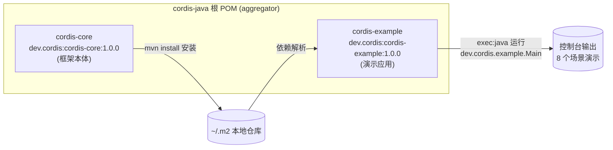
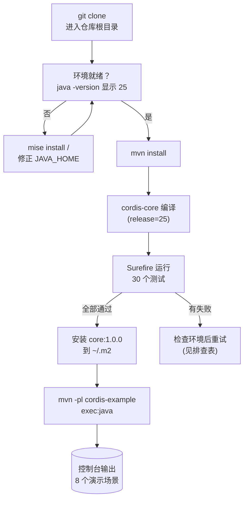

本页是 cordis-java 的入门向导，目标是在 10 分钟内带你完成三件事：搭建 **Java 25** 开发环境、用 **Maven** 构建项目并跑通 30 个单元测试、最后运行一个覆盖框架全部能力的端到端演示程序。本页只关注"把项目跑起来"这一件事——代码背后的设计原理属于[项目概览](1-xiang-mu-gai-lan-shi-kong-ke-zu-he-xing-yuan-kuang-jia-shi-shi-yao)，演示场景的逐行走读属于[端到端演示走读](4-duan-dao-duan-yan-shi-zou-du-ba-ge-chang-jing-li-jie-kuang-jia-quan-bu-neng-li)。

Sources: [pom.xml](pom.xml#L1-L55)

## 项目全貌：构建前先建立认知地图

在敲下第一条命令之前，先花一分钟理解项目的模块布局。cordis-java 是一个 **Maven 多模块工程**：根 POM 以 `packaging=pom` 聚合两个子模块——`cordis-core` 是框架本体（核心库、声明式加载器、HMR 引擎三个包），`cordis-example` 是依赖前者的示例应用，也是我们要运行的演示程序所在。仓库中没有 Maven Wrapper（`mvnw`），因此你需要自行安装 Maven；Java 版本则由根 POM 的 `maven.compiler.release=25` 属性统一强制，子模块无需各自声明。

```text
cordis-java/
├── pom.xml                  # 聚合 POM：Java 25 编译目标、JUnit 依赖管理
├── mise.toml                # 工具链锁定：java = "25"
├── cordis-core/             # 框架本体（被依赖方）
│   └── src/
│       ├── main/java/       #   dev.cordis.core / loader / hmr 三个包
│       └── test/java/       #   6 个测试类，共 30 个用例
└── cordis-example/          # 示例应用（依赖方，可执行）
    └── src/main/java/
        └── dev/cordis/example/
            ├── Main.java          # 演示入口（8 个场景）
            └── plugins/           # database / users / greeting 插件
```

两个模块的依赖关系与构建产物流向如下所示——这张图是理解后续所有命令的钥匙：`mvn install` 把 `cordis-core` 装入本地仓库，`cordis-example` 才能解析到它；`exec:java` 则只在 example 模块上有意义，因为可执行的 `Main` 类在那里。



Sources: [pom.xml](pom.xml#L16-L25)

## 第一步：搭建 Java 25 环境

项目的 Java 版本要求有两处交叉锁定：根 POM 声明 `maven.compiler.release=25`，仓库根目录的 `mise.toml` 则将工具链固定为 `java = "25"`。这意味着无论采用哪种安装方式，最终你的 JDK 都必须是 25（JDK 21、17 等旧版本会在编译期直接报错）。下面表格对比两条安装路径，选其一即可。

| 安装路径 | 适用人群 | 操作 | 说明 |
|---|---|---|---|
| **A. mise（推荐）** | 已使用或愿意使用工具链管理器 | 仓库根目录执行 `mise install`，然后 `mise shell`（或让 shell 插件自动激活） | 仓库自带 `mise.toml`，版本由 `java = "25"` 声明锁定，团队成员环境天然一致 |
| **B. 手动安装 JDK** | 偏好直接管理系统 | 任选发行版（Oracle JDK / OpenJDK / Temurin / Zulu 等）安装 25，配置 `JAVA_HOME` | 无版本锁定，需自行确认版本号 |

安装完成后，务必先验证再进入下一步：

```bash
java -version    # 期望输出包含 "25"（如 openjdk version "25"）
mvn -version     # 期望输出 Java version: 25 与 Maven 3.9+ 
```

若 `mvn -version` 显示的 Java 版本不是 25，通常是 `JAVA_HOME` 指向了旧的 JDK——修正环境变量或改用路径 A 即可。

Sources: [mise.toml](mise.toml#L1-L3)

Sources: [pom.xml](pom.xml#L21-L25)

## 第二步：构建项目并运行测试

进入仓库根目录，第一条命令是完整构建。**注意必须用 `mvn install` 而非 `mvn package`**：`cordis-example` 通过 `dev.cordis:cordis-core:1.0.0` 坐标依赖核心库，只有 `install` 才会把 core 安装进本地仓库供其解析（这也是 README 中"先 mvn install"提示的含义）：

```bash
mvn install      # 编译两个模块 → 运行测试 → 安装 cordis-core 到本地仓库
```

构建成功后，单独跑测试套件验证行为契约。测试全部位于 `cordis-core/src/test`，共 6 个测试类、**30 个用例**，覆盖从 LIFO 效应回滚到 HMR 事务回滚的全部核心行为：

```bash
mvn test         # Tests run: 30, Failures: 0, Errors: 0
```

| 测试类（dev.cordis 包下） | 用例数 | 验证内容 |
|---|---|---|
| `EffectTrackingTest` | 5 | LIFO 效应回滚、单次处置、多阶段效应 |
| `LifecycleTest` | 6 | PENDING→ACTIVE 反应式加载、guard 顺序、重载与 restart/update |
| `ServiceAccessTest` | 4 | 未声明访问（`UNDECLARED_ACCESS`）与未激活访问（`INACTIVE_ACCESS`） |
| `IsolationTest` | 5 | realm 隔离、通知不过界、同标签 Join、intercept 合并 |
| `LoaderTest` | 5 | 加载器按 id 调和、逐字段分发、schema 校验失败路径 |
| `HmrTest` | 5 | 分类不动点、环默认拒绝、陈旧检测、事务回滚 |

整个构建流水线可以用下面的流程图概括，虚线框标注了每一步对应的 Maven 生命周期阶段与关键插件（编译器插件 3.14.1 与 Surefire 3.2.5 由根 POM 的 `pluginManagement` 统一管理版本）：



Sources: [README.md](README.md#L41-L46)

Sources: [cordis-example/pom.xml](cordis-example/pom.xml#L15-L21)

## 第三步：运行端到端演示

构建通过后，用一条命令启动演示程序。`-pl cordis-example` 告诉 Maven 只在 example 模块上执行目标，`exec:java` 则运行其 POM 中配置的主类 `dev.cordis.example.Main`：

```bash
mvn -pl cordis-example exec:java
```

这个程序是理解框架价值的最快途径：它在 `main` 方法中注册一个模拟模块注册表（url → 插件工厂的映射），创建根上下文并挂上 `internal/status` 生命周期监听器把每次状态迁移打印到控制台，然后依次驱动 **8 个场景**。下表给出每个场景的动作与观察要点——初学者第一次运行时，建议对照此表逐段阅读输出：

| # | 场景横幅 | 代码动作 | 观察要点 |
|---|---|---|---|
| 1 | reactive coeffects | 先挂载 `users`（声明 `inject: ["db"]`）再挂载 `database` | `users` 先处于 PENDING，`db` ACTIVE 后被通知并激活 |
| 2 | temporal composability | 从 entry 列表移除 `database` | 连接与语句的逆变换按 LIFO 逆序执行（先 close statements 再 close connection） |
| 3 | re-provide | 重新加回 `database` | `users` 针对新的提供者 fiber 重新激活 |
| 4 | declarative loader | 两轮 `loader.load` 做 id 差分调和 | config 更新、`disabled(true)` 触发卸载等逐字段分发 |
| 5 | isolation | 对 `db`、`users` 各 isolate 两个租户 | 同一份插件代码，租户 A/B 解析到不同 DbService 实例 |
| 6 | interception | 租户 B 上下文 `intercept("db", readOnly=true)` | 写操作被拒绝，且提供者与消费者代码零改动 |
| 7 | HMR | 把 greeting 模块"编辑"为 V2 并触发 `HmrEngine.reload` | 仅 greeting 的 fiber 被替换，database 不重启 |
| 8 | HMR rollback | 注入一个抛异常的"损坏模块" | 重载失败后从上一组件回滚，系统无半重载状态 |

输出中你会反复看到两类行：`==== 场景标题 ====` 横幅行来自 `Main` 的 `banner` 辅助方法，而 `status: users PENDING → ACTIVE` 这类行来自 `internal/status` 全局监听器——它们是跟踪 Fiber 生命周期状态机的实时窗口。运行结束时程序会依次 `disposeAll` 四个加载器，根上下文的级联卸载把所有 fiber 送入 DISPOSED，演示闭环结束。

Sources: [Main.java](cordis-example/src/main/java/dev/cordis/example/Main.java#L48-L69)

Sources: [Main.java](cordis-example/src/main/java/dev/cordis/example/Main.java#L126-L165)

## 命令速查表

将本页所有命令汇总备查：

| 命令 | 作用 | 前置条件 |
|---|---|---|
| `mise install && mise shell` | 按 `mise.toml` 激活 Java 25 | 已安装 mise |
| `java -version` / `mvn -version` | 验证环境 | — |
| `mvn install` | 编译 + 测试 + 安装 core 到本地仓库 | Java 25、Maven 3.9+ |
| `mvn test` | 单独运行 30 个单元测试 | `mvn install` 已执行过（或至少 core 已在本地仓库） |
| `mvn -pl cordis-example exec:java` | 运行 8 场景端到端演示 | `mvn install` 已执行 |

Sources: [README.md](README.md#L41-L46)

## 常见问题排查

初学者最常遇到的问题集中在版本与依赖解析两类，对照下表定位：

| 症状 | 原因 | 解决方案 |
|---|---|---|
| `mvn install` 报 `error: invalid source release: 25` 或 `invalid target release: 25` | Maven 运行在低于 25 的 JDK 上 | 检查 `mvn -version` 显示的 Java 版本；修正 `JAVA_HOME` 或使用 mise |
| `Could not resolve dependencies ... dev.cordis:cordis-core:jar:1.0.0 was not found` | 跳过了 `mvn install`，本地仓库没有 core 构件 | 先在根目录执行 `mvn install`，再运行 example |
| `UnsupportedClassVersionError ... class file version ... 69`（运行期） | 用低版本 JRE 运行了 release=25 编译的字节码 | 保证运行时 JDK 同样是 25 |
| mise 未生效，`java -version` 仍是旧版本 | shell 未激活 mise 环境 | 执行 `mise shell`，或在 shell 配置中启用 mise 钩子 |
| `mvn test` 中 HMR/Loader 用例失败但源码未改动 | 环境异常（编码或并发资源）而非代码缺陷 | 确认 `project.build.sourceEncoding=UTF-8` 生效（根 POM 已声明），重试构建 |

Sources: [pom.xml](pom.xml#L21-L25)

## 下一步阅读

环境已就绪、演示已跑通，接下来的阅读路径按认知递进排列：若尚未理解"时空可组合性"这一定位，先读[项目概览：时空可组合性元框架是什么](1-xiang-mu-gai-lan-shi-kong-ke-zu-he-xing-yuan-kuang-jia-shi-shi-yao)建立概念地图；随后动手改代码——[编写第一个插件：Plugin、inject 声明与 provide 提供服务](3-bian-xie-di-ge-cha-jian-plugin-inject-sheng-ming-yu-provide-ti-gong-fu-wu)将带你像 `DatabasePlugin` 那样写出自己的插件；想彻底看懂刚才控制台上 8 个场景的每一行输出，[端到端演示走读：八个场景理解框架全部能力](4-duan-dao-duan-yan-shi-zou-du-ba-ge-chang-jing-li-jie-kuang-jia-quan-bu-neng-li)是本页的天然续篇；最后进入深入解析层，从[整体架构：核心库、声明式加载器与 HMR 引擎的三层分层](5-zheng-ti-jia-gou-he-xin-ku-sheng-ming-shi-jia-zai-qi-yu-hmr-yin-qing-de-san-ceng-fen-ceng)开始系统性地拆解框架。