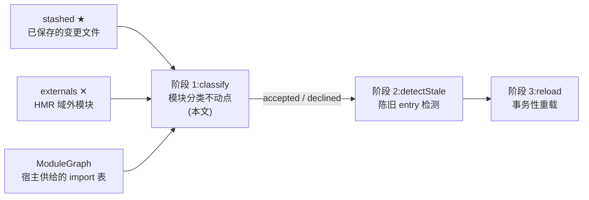
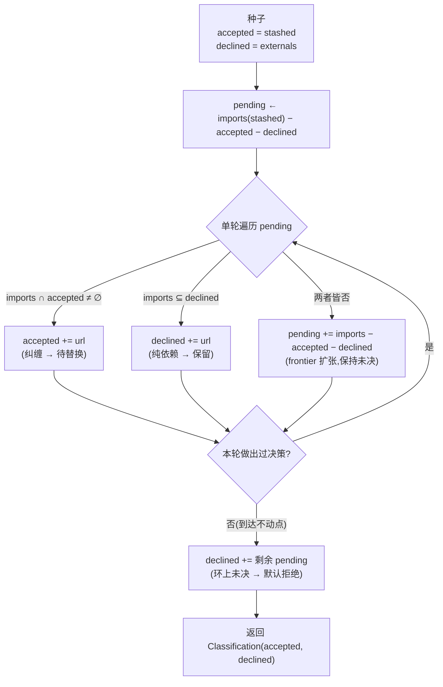
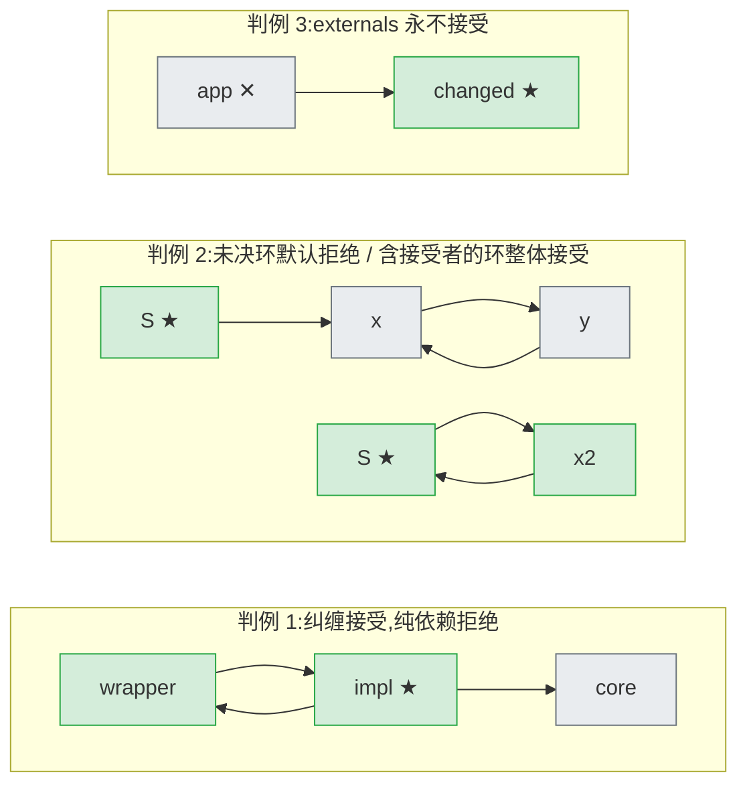

当开发者保存了一个源文件，HMR 引擎面对的第一个问题不是"如何替换"，而是"替换谁"。cordis-java 将这个问题交给一个纯函数式的分类算法（论文 §5.2.2，Algorithm 8）：在变更文件的依赖子图上运行一个不动点迭代，把每个模块划入 **accepted**（必须就地替换）或 **declined**（原样保留、由重载路径重新引入）两个互斥集合，而在迭代中始终无法判定的模块——典型形态是导入环——一律默认划入 declined。本文解析该算法的输入模型、不动点构造、默认拒绝的健全性论证，以及测试固化的三条行为判例；阶段二的陈旧 entry 检测与阶段三的事务性重载仅在接口边界处被提及。

Sources: [HmrEngine.java](cordis-core/src/main/java/dev/cordis/hmr/HmrEngine.java#L18-L30)

## 一、为什么需要分类：替换集的最小化问题

HMR 的朴素做法有两种极端：要么整页刷新（丢失全部运行时状态），要么只替换被编辑的那个文件（产生悬垂引用）。后者的问题在于模块间的**纠缠**（entanglement）：若模块 A 导入了被替换的模块 B，A 内部持有的可能是旧 B 实例的绑定，新旧实例并存会让程序进入不可推理的混合状态。因此正确的替换集必须满足两个方向上的约束——**健全性**（所有引用被替换代码的模块都要被替换）与**最小性**（未被影响的模块不应被无谓地重启）。

传统打包器把这条边界交给开发者手工标注：Webpack 的 `module.hot.accept`、Vite 的 `import.meta.hot.accept` 本质上是在声明"我是接受边界，更新到此为止，不要向上冒泡"。cordis-java 不需要这类标注，其类注释明确指出：由于 fiber 已经界定了组件的全部效应，一个本身是组件的模块仅凭 fiber 操作即可完成替换，无需开发者注解的接受边界。换句话说，cordis 把"哪里可以安全停止"从运行时人工声明转化为依赖图上的一个可计算闭包，而阶段一的 `classify` 正是这个闭包的计算器。

| 维度 | Webpack / Vite HMR | cordis-java `classify` |
|---|---|---|
| 接受边界的来源 | 开发者手动标注（`import.meta.hot.accept`） | 无需标注：fiber 效应边界即替换边界 |
| 判定依据 | 沿 importer 链向上冒泡 + 人工边界 | 变更文件依赖子图上的不动点闭包 |
| 无法判定时的行为 | 上抛至入口，通常退化为整页刷新 | 未决模块默认 declined（保守保留） |
| 引擎状态 | 与打包器/watcher 深度耦合 | 纯静态函数，图由宿主供给 |

Sources: [HmrEngine.java](cordis-core/src/main/java/dev/cordis/hmr/HmrEngine.java#L18-L30)

## 二、输入模型：stashed、externals 与 ModuleGraph

`classify` 的签名是 `classify(Set<String> stashed, Set<String> externals, ModuleGraph graph)`，三个输入各司其职。**stashed** 是"已暂存"的模块集合——即源码已发生变更、必须被重新求值的文件（对应 TS 版 cordis 中文件监视器捕获的保存事件）；它们被直接播种为 accepted。**externals** 是 HMR 作用域之外的模块——宿主应用自身、框架类库等不应也不能被热替换的部分；它们被播种为 declined，并且这个种子身份是终身的：后续迭代永远不会把一个 external 提升为 accepted。**graph** 则是一个函数式接口 `ModuleGraph`，只暴露一个查询 `imports(url)`——返回某模块直接导入的模块集合，叶子模块返回空集；由于 JVM 没有 Node 式模块注册表，这张图由宿主从构建索引、类引用扫描或手工维护的映射中提供。

先解释一下下面这张图的记法：实线箭头表示数据流，`★` 标记 stashed 种子，`✕` 标记 externals 种子。阶段一在整个三阶段流水线中的位置如下：

值得注意的是分类的**作用域**：`pending` 工作集只用 stashed 文件的 imports 播种，即算法只在"变更文件的依赖子图"内部分类。那些 merely 导入了变更代码的上游模块（例如 entry 根）根本不进入阶段一的视野——它们是阶段二陈旧检测的对象。这个分工避免了在没有反向边（importer 查询）的 `ModuleGraph` 上强行做反向遍历。

Sources: [HmrEngine.java](cordis-core/src/main/java/dev/cordis/hmr/HmrEngine.java#L47-L59) | [ModuleGraph.java](cordis-core/src/main/java/dev/cordis/hmr/ModuleGraph.java#L1-L16)

## 三、算法解析：种子、不动点迭代与默认拒绝

核心方法只有不到 30 行，结构上分为三段。第一段是播种（L54–L59）：`accepted` 从 stashed 拷贝而来，`declined` 从 externals 拷贝而来（注意是对入参的防御性拷贝，调用者的集合不会被污染），`pending` 初始化为 stashed 的 imports 减去已决集合——这些是首批待分类者。第二段是不动点循环（L60–L78）：反复扫描 `pending`，对每个模块施加两条判定规则，任一规则命中即做出不可逆的决策并标记本轮有进展；两条都不命中时，把该模块的未决 imports 并入 `pending`（frontier 扩张），模块保持未决。第三段是收尾（L79）：循环因无进展而退出后，仍然留在 `pending` 里的模块全部并入 `declined`——这就是标题中的**依赖环默认拒绝**。

| 判定规则 | 谓词 | 语义 | 效果 |
|---|---|---|---|
| 接受 | `imports ∩ accepted ≠ ∅` | 与被替换代码纠缠（持有其传递活绑定） | 并入 accepted，等待替换 |
| 拒绝 | `declined ⊇ imports` | 纯依赖链：所有导入均已被拒绝 | 并入 declined，原样保留 |
| 未决 | 两者皆否 | 依赖中仍有未定模块（典型：环） | 扩张 pending，留待下一轮 |
| 默认拒绝 | 循环终止时仍 ∈ pending | 不动点上的不可判定者 | 并入 declined |

下图是循环的控制流（菱形为判定，圆角矩形为集合操作）：

几个实现细节值得高级读者注意。其一，`progress` 标志**只由"做出决策"置位**，frontier 扩张本身不算进展——这不是缺陷而是优化：两条判定谓词只依赖 accepted/declined 的内容而不依赖 pending 的内容，若某一轮零决策，则集合内容不变，后续轮次必然继续零决策，提前退出是安全的。其二，`pending` 使用 `LinkedHashSet` 而非 `HashSet`：LinkedHashSet 的迭代器会看到遍历期间追加的元素（单轮扫描即可消化刚扩张出的 frontier），且处理顺序确定；但最终划分与处理顺序无关——下文将论证该不动点是唯一的。其三，`minus` 与 `intersection` 两个私有辅助函数（L156–L167）是纯粹的集合代数，没有隐藏语义。

**终止性与唯一性**可以简洁论证。accepted 与 declined 都是单调增长的集合，每个模块至多被决策一次，总决策次数不超过 pending 规模，故循环必然终止。至于结果与顺序无关：接受规则的可传递闭包刻画的是"从 stashed 出发经 import 边可达、且自身（经有限路径）传递导入某个 accepted 模块的模块全体"——这是一个对集合包含单调的算子，其最小不动点唯一；declined 则是其补集（在可达闭包内）。分类因此是一个确定性的闭包计算，而非启发式。

Sources: [HmrEngine.java](cordis-core/src/main/java/dev/cordis/hmr/HmrEngine.java#L53-L81) | [HmrEngine.java](cordis-core/src/main/java/dev/cordis/hmr/HmrEngine.java#L156-L167)

## 四、三条判例：测试固化的行为契约

`HmrTest` 用三组用例把分类语义钉死为可执行契约。先解释记法：下图中箭头方向为 import 方向（A → B 表示 A 导入 B），`★` 为 stashed，`✕` 为 externals，绿色为最终 accepted，灰色为最终 declined。

**判例 1**（`impl` 为 stashed）：`impl` 同时导入 `wrapper` 与 `core`，而 `wrapper` 反向导入 `impl` 构成环。逐轮追踪如下表——`wrapper` 因"其 imports 与 accepted 相交"而在第一轮被接受（它持有对被替换代码的活绑定，不替换就会引用旧实例）；`core` 是纯依赖（imports 为空，空集平凡地被 declined 包含），第一轮即被拒绝——测试注释点明其语义是"picked up on reload, not replaced"：`impl` 的替换实例重新执行导入时会经由解析器拿到当前的 `core`，无需就地替换。

| 轮次 | 考察对象 | imports | 判定 | 集合状态 |
|---|---|---|---|---|
| 播种 | — | — | — | accepted={impl}, declined=∅, pending={wrapper, core} |
| 第 1 轮 | wrapper | {impl} | ∩accepted={impl} → **接受** | accepted={impl, wrapper} |
| 第 1 轮 | core | ∅ | ∅ ⊆ declined → **拒绝** | declined={core} |
| 第 2 轮 | — | — | pending 为空，退出 | 终态 |

**判例 2** 前半：`S → x → y → x`。`x` 的 imports={y}、`y` 的 imports={x}，二者与 accepted 不相交也不被 declined 覆盖，两轮扫描均零决策即到达不动点，`x`、`y` 作为未决者被默认拒绝。后半是关键对照组：把边改成 `x2 → S`（环上有一员直接导入 stashed 模块），`x2` 在第一轮即被接受——**环本身不是拒绝的理由，环不触及 accepted 才是**。**判例 3**：`app` 被播种为 external，即便它直接导入了 stashed 的 `changed`，也永远停留在 declined——externals 的种子身份具有最高优先级，任何传播规则都不能翻越它。

Sources: [HmrTest.java](cordis-core/src/test/java/dev/cordis/HmrTest.java#L25-L38) | [HmrTest.java](cordis-core/src/test/java/dev/cordis/HmrTest.java#L40-L60) | [HmrTest.java](cordis-core/src/test/java/dev/cordis/HmrTest.java#L62-L70)

## 五、"依赖环默认拒绝"的设计论证

默认拒绝并非权宜之计，它可以被证明是安全且最小的。**安全性**（soundness）：一个被拒绝的模块之所以可以原样保留，是因为它的全部传递导入都不含 accepted 模块——替换任何 accepted 模块都不会改变它可见的绑定；反之，未决模块恰恰是"在不动点上仍无法触及任何 accepted 模块"的模块，由同一论证可知保留它同样安全。**最小性**（minimality）：对导入路径长度做归纳——第一轮接受所有直接导入 accepted 的模块，第 k+1 轮接受所有导入"第 k 轮新接受模块"的模块，因此任何传递导入 accepted 的可达模块必然在有限轮内被接受，替换集不多不少。

还需澄清一个容易误读的点：**默认拒绝不等于丢弃更新**。declined 在阶段二中充当依赖树遍历的边界（`dependencies(root, declined, graph)` 遇到 declined 即停止下探），被判定陈旧的 entry 在阶段三重载时会经由 `PluginResolver` 重新解析全部导入——declined 模块的新代码正是在这条路径上被"顺带"引入的。换言之，分类回答的是"谁必须就地替换"，而不是"谁拿到新代码"；后者由重载路径天然保证。保守失效模式的对比也支持这个默认值：误拒（把可替换者保留）的代价是行为滞后到下一次重载才生效，误纳（把无关者替换）的代价是无谓的状态丢失与级联重启——前者显然温和得多。这与框架整体的保守倾向一致：宁可少动，不可半动（阶段三"绝不进入半重载状态"是同一哲学在事务维度的体现）。

Sources: [HmrEngine.java](cordis-core/src/main/java/dev/cordis/hmr/HmrEngine.java#L47-L52) | [HmrEngine.java](cordis-core/src/main/java/dev/cordis/hmr/HmrEngine.java#L83-L94) | [README.md](README.md#L91-L99)

## 六、实现细节与工程考量

`HmrEngine` 是一个典型的无状态工具类：`final` 类、私有构造器、全部静态方法，不持有任何可变状态——这使分类可以并发调用、无需协调。`Classification` 是一个仅含两个 `Set<String>` 的 record，作为不可变的结果载体贯穿三阶段流水线。诊断方面，引擎通过一个 `LoggerServiceHolder` 惰性初始化静态 logger（命名为 `hmr` 的命名日志），不过阶段一本身不产生日志——分类是纯计算，日志只在阶段三的回滚路径出现，这也是"分类失败"这一概念不存在的侧面印证：它只会返回不同的划分，而不会抛出异常。

性能上，单轮扫描的代价是 O(Σ|imports(pending)|) 的集合运算，轮数上界为"最长决策链 + 1"；由于 LinkedHashSet 迭代器可见遍历期追加的元素，单轮往往同时完成 frontier 扩张与新元素的判定，分层良好的依赖图上接近线性。演示程序 `Main.java` 展示了最退化的输入形态：示例中所有模块皆为叶子（`graph = url -> Set.of()`），分类随即坍缩为恒等映射 accepted=stashed、declined=∅，随后交给阶段二、三完成热替换与回滚演示——这从反面说明了 `ModuleGraph` 的质量直接决定分类的判别力，宿主提供越完整的 import 信息，最小替换集的计算就越精确。

Sources: [HmrEngine.java](cordis-core/src/main/java/dev/cordis/hmr/HmrEngine.java#L31-L45) | [Main.java](cordis-example/src/main/java/dev/cordis/example/Main.java#L130-L143)

## 七、与相邻机制的边界

两个容易混淆的"差分"机制需要划清界限：[组件调和](19-zu-jian-diao-he-an-id-chai-fen-yu-zhu-zi-duan-fen-fa-de-zui-xiao-rao-dong-ce-lue)（`ComponentLoader.reconcile`）作用于**已加载组件的配置差分**——按 entry id 比对 url、config、disabled 等字段并逐字段分发；而 `classify` 作用于**模块源码的结构差分**——以 import 图的可达性为依据。前者回答"配置变了要动哪个 fiber"，后者回答"代码变了要换哪个模块"，二者正交且可以级联（重载本身就是一次受控的单 entry 调和）。

分类的产物 `Classification` 是后续两个阶段的唯一输入接口：accepted/declined 将进入[阶段二的依赖树遍历与陈旧 entry 检测](21-hmr-jie-duan-er-yi-lai-shu-bian-li-yu-chen-jiu-entry-jian-ce)，被判定陈旧的 entry 再交由[阶段三的事务性重载](22-hmr-jie-duan-san-shi-wu-xing-zhong-zai-yu-ban-zhong-zai-zhuang-tai-de-hui-gun-bao-zheng)处理；而"accepted 模块可凭 fiber 操作就地替换"的底层支撑，则是 [O-Insert 与 O-Retire](13-o-insert-yu-o-retire-cha-jian-shi-li-hua-de-xiao-ying-hua-yu-ji-lian-xie-zai) 所描述的插件实例化效应化与级联卸载。若要了解宿主应如何从构建索引或类引用扫描中供给 `ModuleGraph`，参见[宿主集成指南](28-su-zhu-ji-cheng-zhi-nan-pluginresolver-modulegraph-yu-mo-kuai-zhu-ce-ce-lue)；三阶段在整个[三层架构](5-zheng-ti-jia-gou-he-xin-ku-sheng-ming-shi-jia-zai-qi-yu-hmr-yin-qing-de-san-ceng-fen-ceng)中的位置亦可回溯确认。

Sources: [README.md](README.md#L33-L36)

## 小结

阶段一用一个不到 30 行的不动点迭代回答了 HMR 的第一性问题：在变更文件的依赖子图上，"传递导入被替换代码的可达模块"被精确地闭包为 accepted，其余一切——纯依赖、域外模块、触及不到 accepted 的环——归于 declined；不可判定者默认拒绝，且这个保守默认可以被论证为既安全又最小。分类是无状态的纯函数、是三阶段流水线中唯一不接触 fiber 的环节，它把"热替换的正确边界"从开发者心智模型转移到了类型系统与集合代数之中。