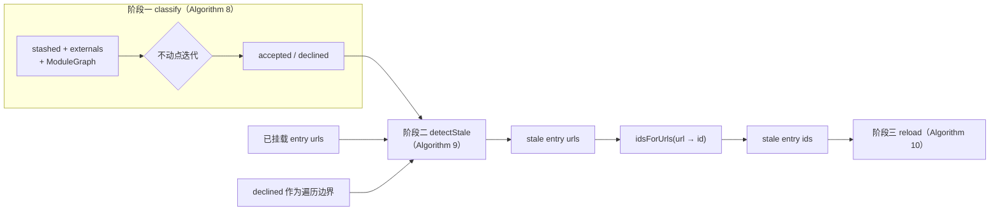
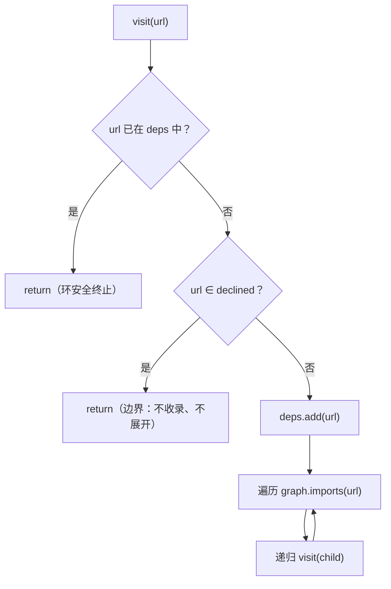
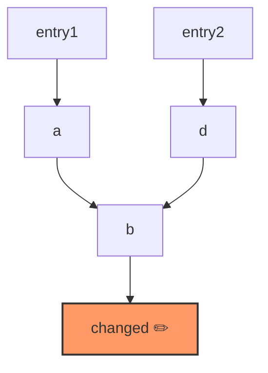

HMR 引擎将一次热替换拆解为三个阶段：分类、检测、重载。本文聚焦**阶段二**——引擎中代码量最小、却承担语义转换最重的一环：把阶段一产出的**模块级变化集合**（`accepted`/`declined`）翻译为**entry 级重载集合**（stale urls）。它的全部逻辑由三个公开方法承载：`dependencies()`（依赖树遍历，即论文 Algorithm 9 的 `get_dependencies` 子算法）、`detectStale()`（陈旧 entry 判定，Algorithm 9 主体）以及 `idsForUrls()`（将 stale url 映射回 entry id，作为通往阶段三的桥）。与 Webpack/Vite 依赖开发者手工标注 acceptance boundary 不同，这里的判定完全由图结构与阶段一结果机械推导——entry 是"组件"与"fiber"的挂载单位，fiber 已经界定了其全部效应的边界，因此**entry 即天然的替换单元**，无需任何注解。[HmrEngine.java](cordis-core/src/main/java/dev/cordis/hmr/HmrEngine.java#L18-L30)

## 定位：从模块变化集到 entry 重载集

阶段二位于流水线的中间位置，其输入输出契约十分精确：上游接收阶段一 `classify()` 返回的 `Classification(accepted, declined)` 记录，以及宿主传入的 `ModuleGraph`；下游产出 stale entry url 集合，经 `idsForUrls()` 转换为 entry id 后交给阶段三的 `reload()` 执行事务性重载。整个数据流如下：



值得强调的是判定问题的**方向性**：阶段一沿 import 方向正向传播（从被改文件向上游扩散），回答"哪些模块需要被替换"；阶段二沿 import 方向**反向**收集（从 entry 向下游展开依赖树），回答"哪些挂载单元的存活代码里含有待替换模块"。两个方向共用同一张 `ModuleGraph`——它是一个 `@FunctionalInterface`，仅暴露 `imports(url)` 一个方法，返回某模块的直接 import 集合。宿主从自己的加载器侧供给该图（构建索引、类引用扫描或手工维护的映射均可），引擎不关心图的来源，只关心其一致性。[ModuleGraph.java](cordis-core/src/main/java/dev/cordis/hmr/ModuleGraph.java#L5-L15)

## 遍历原语：dependencies 与 declined 边界

阶段二的第一块积木是 `dependencies()`：给定根模块 `root`、边界集合 `declined` 与图，返回 `root` 的**传递闭包依赖树**（含 `root` 自身）。实现委托给私有递归函数 `traverse()`，其完整逻辑只有四行，但蕴含三条遍历纪律：

```java
private static void traverse(String url, Set<String> deps, Set<String> declined, ModuleGraph graph) {
    if (deps.contains(url) || declined.contains(url)) return;
    deps.add(url);
    for (String child : graph.imports(url)) traverse(child, deps, declined, graph);
}
```



第一条纪律是**环安全**：`deps` 同时充当访问集与结果集，任何 url 一旦收录便不会二次进入，因此依赖环（乃至自环）天然终止，不会栈溢出也不会重复计数。第二条纪律是 **declined 作为硬边界**：处于 `declined` 中的模块既不被收录进树，也不被继续展开。这与阶段一的语义精确对齐——declined 模块（纯依赖、externals、未决默认拒绝者）是"重载时顺带重新读取"而非"主动替换"的对象，它们不构成失效理由，因此不应出现在用于相交判定的树中。第三条纪律是**确定性**：结果使用 `LinkedHashSet` 收集，遍历顺序即 DFS 先序，同一输入永远得到同一序列化顺序的树，便于日志比对与测试断言。[HmrEngine.java](cordis-core/src/main/java/dev/cordis/hmr/HmrEngine.java#L83-L94)

| url 相对于遍历的状态 | traverse 行为 | 是否进入依赖树 | 是否继续展开 |
|---|---|---|---|
| 已在 `deps` 中（重访/成环） | 立即 return | 否（已收录过） | 否 |
| 属于 `declined` 边界 | 立即 return | 否 | 否 |
| 其余（accepted 或未分类） | 收录后递归子节点 | 是 | 是 |

注意边界只作用于 `declined`——`accepted` 模块**不是**边界：它们会被正常收录并穿越展开。这保证了依赖树覆盖 entry 可达的全部"可替换代码"，而把"不可替换代码"裁剪在树外。`dependencies()` 被声明为公开方法并非偶然：论文将 `get_dependencies` 视为独立子算法，宿主可以脱离 `detectStale` 单独复用它实现自定义失效逻辑。单次调用的代价是经典的 O(V+E)（每个 url 至多收录一次、每条边至多考察一次）。[HmrEngine.java](cordis-core/src/main/java/dev/cordis/hmr/HmrEngine.java#L156-L166)

## 陈旧判定：相交即陈旧与树折叠

`detectStale()` 是阶段二的主体，其 javadoc 给出的判定准则只有一句话：**entry 陈旧，当且仅当其依赖树与 `accepted` 相交**。实现体对每个挂载 entry url 执行三步：调用 `dependencies()` 展开依赖树；用 `intersection()` 检测树与 `acceptedMutable` 的交集；若交集非空则将该 entry 记入 stale 集合，并把**整棵树折叠回 `acceptedMutable`**。[HmrEngine.java](cordis-core/src/main/java/dev/cordis/hmr/HmrEngine.java#L96-L116)

| 参数 | 类型 | 语义 |
|---|---|---|
| `entryUrls` | `Collection<String>` | 全部已挂载 entry 的 url；迭代顺序由调用方集合决定 |
| `accepted` | `Set<String>` | 阶段一产出的待替换模块集合（本方法不修改它） |
| `declined` | `Set<String>` | 阶段一产出的边界集合，透传给 `dependencies()` |
| `graph` | `ModuleGraph` | 宿主供给的模块依赖图 |
| 返回值 | `Set<String>` | stale entry urls，`LinkedHashSet` 保持输入顺序 |

两个细节值得高级读者特别留意。其一，**entry 自身属于自身的依赖树**——`traverse` 在展开子节点前先把根收录进 `deps`，因此当 entry 的模块本身被编辑（stashed → accepted）时，树与 `accepted` 的交集必然包含 entry url 自身，entry 直接判 stale，无需任何特判分支。这解释了"编辑入口模块"这一最常见场景如何在统一框架下免费获得。其二，`acceptedMutable` 是 `accepted` 的**防御性拷贝**（`new HashSet<>(accepted)`），折叠只在本方法内部的逐 entry 循环间累积，调用方传入的 `accepted` 集合在方法返回后保持原样——阶段一的结果不会被阶段二的内部状态污染，两阶段保持可独立测试。[HmrEngine.java](cordis-core/src/main/java/dev/cordis/hmr/HmrEngine.java#L104-L116)

用测试中的最小场景走一遍完整判定：图中 `entry1 → changed`、`entry2 → untouched`。阶段一以 `{changed}` 为 stashed 种子，`accepted = {changed}`。`tree(entry1) = {entry1, changed}`，与 accepted 相交于 `changed` → entry1 陈旧，折叠后 `acceptedMutable = {entry1, changed}`；`tree(entry2) = {entry2, untouched}`，交集为空 → entry2 新鲜。断言 `stale == {entry1}` 恰好覆盖了"到达即失效、未到达则无扰"两个方向。[HmrTest.java](cordis-core/src/test/java/dev/cordis/HmrTest.java#L72-L82)

## 折叠传播：共享依赖下的连锁失效

树折叠（`acceptedMutable.addAll(tree)`）不是可有可无的记账动作，它让**模块身份更替的影响跨 entry 传播**。javadoc 明言其意图："that tree is then folded into accepted, so every stale module along it is invalidated"——一旦 entry 判定陈旧，其树上的每个模块都随重载被重新实例化，模块身份发生更替；任何**其他 entry 若与这棵树共享模块**，其内存中持有的旧模块引用也随之过期，理应一并失效。观察下面的共享拓扑：



按 `entryUrls` 声明顺序推演（入口 `accepted = {changed}`）：

| 迭代轮次 | 当前 entry | tree(entry) | 与 acceptedMutable 相交？ | 判定 | 折叠后 acceptedMutable |
|---|---|---|---|---|---|
| 1 | entry1 | {entry1, a, b, changed} | {changed} ≠ ∅ | **陈旧** | {changed, entry1, a, b} |
| 2 | entry2 | {entry2, d, b} | {b} ≠ ∅（折叠产物） | **陈旧** | {changed, entry1, a, b, entry2, d} |

entry2 自身并不直达任何被改模块——它之所以连锁失效，纯粹因为共享了 `b`，而 `b` 位于已陈旧的 entry1 的树中。这是折叠机制的直接收益：**依赖共享的 entry 结成失效联盟**，不会出现"entry1 换上了新 `b` 而 entry2 还握着旧 `b`"的撕裂状态。[HmrEngine.java](cordis-core/src/main/java/dev/cordis/hmr/HmrEngine.java#L104-L116)

折叠同时引入一个必须如实陈述的性质：**结果对 `entryUrls` 的迭代顺序敏感**。在上例中若 entry2 先于 entry1 被处理，其时尚未发生折叠，`tree(entry2) ∩ {changed} = ∅`，entry2 将被判新鲜，最终结果退化为 `{entry1}`。代码用 `LinkedHashSet` 收集 stale 集合以保证给定输入顺序下输出确定，而顺序本身的责任在调用方——演示宿主中它来自 `loader.ids()` 的挂载序，即 entry 在配置列表中的声明序。换言之，"失效联盟"的闭环程度取决于折叠发生时联盟成员是否已被轮询到；工程上以**稳定的声明顺序供给 entryUrls** 是获得最大连锁覆盖的做法（越早发现陈旧 entry，越多后续 entry 能借折叠入盟）。[HmrEngine.java](cordis-core/src/main/java/dev/cordis/hmr/HmrEngine.java#L106-L115)

## 从 URL 回到 entry id：idsForUrls

阶段二以 url 为货币，阶段三的 `reload()` 却以 entry id 为货币——`idsForUrls()` 负责这最后一跳：遍历 loader 的全部挂载 id，逐一取出 `Mounted` 记录，凡 `entry.url` 命中 stale url 集合者收录。该映射刻意保持**多对一宽容**：两个 entry 完全可以共享同一模块 url（例如同一插件以不同 `isolate` 配置挂载为多租户实例），此时它们会被一并列入重载名单——这与折叠传播的联盟语义在 id 维度上形成呼应。[HmrEngine.java](cordis-core/src/main/java/dev/cordis/hmr/HmrEngine.java#L169-L177)

宿主侧的完整接线在示例程序的场景七中可见一斑：先由 `loader.ids()` 与 `mounted(id).entry.url` 组装出 entryUrls 列表（保持挂载顺序），依次调用 `classify` → `detectStale` → `idsForUrls`，最后把 id 名单交给 `reload`。演示图是一个全叶子模块的平凡图（`url -> Set.of()`），因此每个 entry 的依赖树只含自身，判定退化为"entry 模块自身是否被编辑"——这是理解真实拓扑的退化基线。[Main.java](cordis-example/src/main/java/dev/cordis/example/Main.java#L135-L143)

## 实现注记：代价与不变量

从复杂度看，`detectStale` 对每个 entry 独立调用一次 `dependencies()`，单次 O(V+E)，总体为 O(#entries × 平均树规模）；跨 entry 之间没有树缓存或记忆化——每次展开都从该 entry 的根重新走图。在 entry 数与图规模都有限的热替换场景（开发期工具，非生产路径）中这是合理取舍：换取的是**每次判定只依赖不可变的输入快照**（`accepted`、`declined`、`graph`），阶段二自身除返回值外不产生任何持久状态。另一个隐含不变量：正常流程下 `accepted` 与 `declined` 不相交（阶段一以互斥方式构造两者），因此"entry 模块既被替换又是边界"的病态输入不会在标准管线中出现。[HmrEngine.java](cordis-core/src/main/java/dev/cordis/hmr/HmrEngine.java#L104-L116)

## 小结与延伸阅读

阶段二的本质是**图上的反向可达性判定**：declined 裁剪边界，accepted 充当目标集，entry 的依赖树与目标集相交即触发失效，而树折叠让失效沿共享依赖继续传染。判定输出的是 url 集合，真正替换发生在阶段三——那里的事务性保证、半重载回滚与 backup 机制是另一段故事：

- 想回顾 `accepted`/`declined` 从何而来（不动点迭代与依赖环默认拒绝），见 [HMR 阶段一：模块分类不动点与依赖环默认拒绝](20-hmr-jie-duan-mo-kuai-fen-lei-bu-dong-dian-yu-yi-lai-huan-mo-ren-ju-jue)；
- 想了解 stale ids 交给谁、失败时如何回滚，见 [HMR 阶段三：事务性重载与半重载状态的回滚保证](22-hmr-jie-duan-san-shi-wu-xing-zhong-zai-yu-ban-zhong-zai-zhuang-tai-de-hui-gun-bao-zheng)；
- 想在自己的宿主中供给 `ModuleGraph` 与解析器，见 [宿主集成指南：PluginResolver、ModuleGraph 与模块注册策略](28-su-zhu-ji-cheng-zhi-nan-pluginresolver-modulegraph-yu-mo-kuai-zhu-ce-ce-lue)；
- 完整行为契约清单见 [测试体系：30 个用例覆盖的行为契约清单](27-ce-shi-ti-xi-30-ge-yong-li-fu-gai-de-xing-wei-qi-yue-qing-dan)。