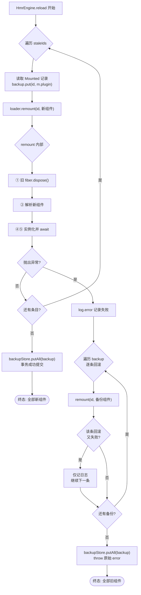

阶段一（[模块分类不动点](20-hmr-jie-duan-mo-kuai-fen-lei-bu-dong-dian-yu-yi-lai-huan-mo-ren-ju-jue)）回答了"哪些模块必须被替换"，阶段二（[依赖树遍历与陈旧 entry 检测](21-hmr-jie-duan-er-yi-lai-shu-bian-li-yu-chen-jiu-entry-jian-ce)）回答了"哪些 entry 受牵连"，而阶段三要回答的是整个 HMR 管线中最尖锐的问题：**当一批陈旧 entry 被逐一替换、而其中某个模块在替换中途失败时，如何保证系统绝不停留在"一部分是新组件、一部分是旧组件、还有一部分悬在半空"的半重载状态**。`HmrEngine.reload` 用一个经典的事务模式——备份先行、逐条提交、失败全量补偿——在引擎层给出了答案。本文深入剖析这个事务的构造方式、`remount` 原语固有的原子性缺口、回滚循环的容错语义，以及重载成功后依赖方的级联重载反应。

Sources: [HmrEngine.java](cordis-core/src/main/java/dev/cordis/hmr/HmrEngine.java#L118-L154)

## 事务边界的构造：备份先行，逐条交换

`HmrEngine.reload` 的签名接受四个参数，构成一个自包含的事务单元：`loader` 是管理 entry 的声明式加载器，`staleIds` 是阶段二检出的待重载 entry id 集合，`fresh` 是 url 到重编译后新 `Plugin` 的映射，`backupStore` 则是一个可选的外部接收 Map，用于在事务结束后向宿主暴露"上一代组件"的快照。

| 参数 | 类型 | 事务角色 |
|---|---|---|
| `loader` | `ComponentLoader` | 事务的资源管理器，持有全部 `Mounted` 记录 |
| `staleIds` | `Collection<String>` | 事务的操作集——每个 id 一次原子交换 |
| `fresh` | `Map<String, Plugin>` | 提交内容；null 值或缺 url 时回退到 resolver 现场解析 |
| `backupStore` | `Map<String, Plugin>` | 事务日志的导出口，成败两条路径均填充 |

主循环的执行顺序经过刻意安排：对每个陈旧 id，**先**读取当前 `Mounted` 记录并把 `m.plugin`（正在服务的旧组件）写入本地 `backup` Map，**再**调用 `loader.remount(id, replacement)` 执行交换。这个"备份先于变更"的顺序是事务正确性的基石——无论 `remount` 在内部哪一步抛出异常，`backup` 中保存的都是变更发生前一刻的、确定可用的旧组件引用。值得注意的是循环对 `m == null || m.fiber == null` 的条目直接跳过：未挂载或已禁用的 entry 不参与事务，也不会出现在备份中。

Sources: [HmrEngine.java](cordis-core/src/main/java/dev/cordis/hmr/HmrEngine.java#L130-L140)

新组件的选取同样体现了容错设计：`fresh.get(m.entry.url)` 若返回 null（或 `fresh` 本身为 null），`remount` 不会失败，而是转而通过 loader 的 resolver 重新解析该 url——这正好覆盖"宿主未预编译、但磁盘模块注册表已更新"的场景。测试中"损坏模块"的失败正是走这条路径触发的：`fresh` 传入空 Map，resolver 解析到抛出 `RuntimeException("syntax error")` 的模块供应商，异常沿调用栈向上冒泡进入回滚分支。

Sources: [HmrEngine.java](cordis-core/src/main/java/dev/cordis/hmr/HmrEngine.java#L138-L139)

## remount 的原子性缺口：为什么必须在引擎层构造事务

要理解回滚的必要性，必须先看清 `ComponentLoader.remount` 内部的非原子窗口。这个方法是 HMR 的专用路由——它换入一个（可能不同的）组件而**完全不改写 entry 记录**（`Mounted` 中的 `Entry` 原样保留），这与调和路径中 `rebuild` 的语义形成对照。其内部步骤是严格顺序的：

```java
public synchronized Fiber remount(String id, Plugin forced) throws Exception {
    Mounted m = mounted.get(id);
    if (m == null) throw new IllegalArgumentException("entry not mounted: " + id);
    Entry e = m.entry;
    if (m.fiber != null) m.fiber.dispose();      // ① 退役旧 fiber
    Plugin plugin = forced != null ? forced : resolver.resolve(e.url);  // ② 可能抛出
    Context ctx = derive(e);                      // ③ 派生上下文
    Fiber fiber = ctx.plugin(plugin, e.config);   // ④ 实例化新 fiber
    fiber.await();                                // ⑤ 可能抛出
    mounted.put(id, new Mounted(e, fiber, plugin, ctx));  // ⑥ 最后才提交记录
}
```

**步骤 ① 到 ⑤ 之间任何一步抛出异常，`Mounted` 记录都不会被更新**——记录中残留的是旧 entry 引用一个**已经 dispose 掉的旧 fiber**。此时系统处于最危险的中间态：服务表中旧 fiber 的全部 `Impl` 已被摘除（O-Retire 的逆操作同步执行了 LIFO 处置），而新组件尚未接管。单靠 `remount` 自身，这个状态无法恢复——这正是"半重载状态"的第一种形态。

Sources: [ComponentLoader.java](cordis-core/src/main/java/dev/cordis/loader/ComponentLoader.java#L202-L214)

多 entry 场景暴露了第二种形态。`reload` 的主循环按顺序处理 `staleIds`：若前 N-1 个 entry 已成功换上新组件、第 N 个失败，则系统同时存在"新版本"与"旧版本"两代组件在服务——版本偏斜（version skew）撕裂了配置的一致性。`HmrEngine` 的回答是**把事务边界上移到引擎层**：单个 `remount` 不提供原子性，但引擎用备份集合补偿整批操作，使批级别的"全有或全无"成为可能。

Sources: [HmrEngine.java](cordis-core/src/main/java/dev/cordis/hmr/HmrEngine.java#L134-L141)

下面这张流程图展示了事务的完整生命周期，包括成功与失败两条终态路径：



Sources: [HmrEngine.java](cordis-core/src/main/java/dev/cordis/hmr/HmrEngine.java#L130-L154)

## 回滚循环的容错语义：错误优先与单条目隔离

回滚分支的十二行代码浓缩了三个关键设计决策。**第一，补偿动作本身就是 `remount`**：`loader.remount(e.getKey(), e.getValue())` 把备份的旧组件作为 `forced` 参数传入，跳过 resolver 直接挂回上一代组件——失败条目的 `Mounted` 记录里那个已 dispose 的旧 fiber 会被再次 `dispose`，而这是安全的，因为效应的单次处置语义保证了幂等。**第二，单个回滚失败只记日志、不中断循环**：`try/catch` 包住每一次补偿 `remount`，任何一个条目回滚失败都不阻止其余条目的恢复尝试——尽力而为（best-effort）的补偿最大化了可恢复面。**第三，最终重抛的是原始异常而非回滚的次生异常**：`throw error` 让调用者看到的失败原因始终是"最初哪里坏了"，回滚过程中产生的错误通过命名日志（`hmr` 频道）单独输出，不污染异常链。

Sources: [HmrEngine.java](cordis-core/src/main/java/dev/cordis/hmr/HmrEngine.java#L141-L152)

二次 dispose 的幂等性来自 `Fiber.effect` 返回的包装器实现。`retireHandle`（即 O-Retire 的逆操作句柄）本质是一个由 `armed` 布尔标志保护的 Disposable：首次调用时将标志置 false、从效应记录中移除并逆序执行已积累的处置器，再次调用则直接返回——文档明确注释"Calling the disposer twice is a no-op"。`Fiber.dispose` 对非根 fiber 只是转发给 `retireHandle.dispose()`，因此回滚循环中对已 DISPOSED fiber 的重复调用是无害的空操作。这个细节使得"用旧组件重走一遍 remount"成为可行的补偿原语，而无需引入专门的恢复状态。

Sources: [Fiber.java](cordis-core/src/main/java/dev/cordis/core/Fiber.java#L449-L456)

Sources: [Fiber.java](cordis-core/src/main/java/dev/cordis/core/Fiber.java#L188-L197)

`backupStore` 的填充时机同样经过斟酌：**成功与失败两条路径的末尾都会执行 `backupStore.putAll(backup)`**。这意味着即使事务提交成功，宿主也能拿到"被换下的那一代组件"映射——这为诊断（对比新旧组件行为）、审计（记录变更历史）乃至实现自定义的"软回滚"策略保留了完整的素材。`reload` 本身不消费这个 Map，它是纯粹的事务日志导出口。

Sources: [HmrEngine.java](cordis-core/src/main/java/dev/cordis/hmr/HmrEngine.java#L150-L153)

## 失败的三个来源与各自的传播路径

`remount` 内部可能抛出异常的位置有三处，它们的传播机制各不相同，但最终都汇入同一个事务回滚：

| 失败来源 | 代码位置 | 异常类型 | 传播机制 |
|---|---|---|---|
| 模块解析失败（语法错误、编译产物损坏） | `resolver.resolve(e.url)` | 宿主 resolver 抛出的任意 `Exception` | 直接冒泡，此时旧 fiber 已 dispose |
| 插件体执行失败（apply 抛出） | `ctx.plugin()` 构造期间的 `reloadCycle` | 任意 `Throwable` 被 fiber 捕获存入 `error` 字段 | fiber 转入 FAILED，效应已由 catch 块内联回滚 |
| 激活等待失败 | `fiber.await()` | error 字段包装为 `RuntimeException` 重抛 | FAILED 错误同步表面化 |

关键在第二条路径：`reloadCycle` 在执行 `plugin.apply(ctx, config)` 时若捕获 `Throwable`，会记录错误、将 epoch 置为 INACTIVE 并链入 `unloadCycle`——新 fiber 自己积累的效应按 LIFO 逆序清空，fiber 停在 FAILED 态。随后 `remount` 中的 `await()` 将 error 重抛，事务捕获后开始回滚。也就是说，**fiber 级的效应折叠与引擎级的组件备份是两层独立的回滚机制**：前者保证单个 fiber 内部不留残迹（这是[可回退效应模型](8-ke-hui-tui-xiao-ying-mo-xing-effectcallback-disposable-yu-duo-jie-duan-yan-xu)的主题），后者保证批级别的组件一致性，两层叠加才构成完整的"无半重载"保证。

Sources: [Fiber.java](cordis-core/src/main/java/dev/cordis/core/Fiber.java#L302-L333)

Sources: [Fiber.java](cordis-core/src/main/java/dev/cordis/core/Fiber.java#L405-L414)

## 级联反应：提供者身份驱动的依赖方重载

事务的成功提交并非终点。测试 `transactionalReloadRollsBackOnFailure` 揭示了一个深层语义：热替换 `greeting` 从 v1 到 v2 后，注入了 `greet-value` 服务的 `consumer` 插件**也被重载了**——断言 `loads.get() >= 2`。原因在于 cordis 的依赖绑定以**提供者身份**（fiber 实例）为标识，而非服务值：新 greeting 挂载时通过 `ReflectService` 通知所有注入方，consumer 的 `checkImpl` 重新解析依赖，发现提供者已换人，epoch 视图随之改变，惯性主机自动链入 unload→reload 循环。这解释了为什么 HMR 无需传播式的显式失效——**换掉一个 fiber，依赖它的 fiber 会被反应式系统自动拖入重载**，事务边界只需覆盖直接陈旧的 entry，级联影响由[惯性主机的链式转换](12-guan-xing-zhu-ji-epoch-target-shi-tu-yu-lian-shi-reload-unload-zhuan-huan)自行消化。

Sources: [HmrTest.java](cordis-core/src/test/java/dev/cordis/HmrTest.java#L122-L129)

回滚后的一致性同样被这条测试锁定：损坏模块触发失败回滚后，`root.get("greet-value")` 仍是 `"v2"`——上一代组件继续服务，且 consumer 不会残留任何对"未曾存在过的坏组件"的引用。端到端演示的场景 8 以更直观的方式呈现这一点：故意将模块注册表替换为抛出"语法错误"的供应商后调用 `reload`，异常按预期抛出，随后打印回滚后 greeting fiber 的 uid，确认"上一组件仍在服务"。

Sources: [HmrTest.java](cordis-core/src/test/java/dev/cordis/HmrTest.java#L131-L136)

Sources: [Main.java](cordis-example/src/main/java/dev/cordis/example/Main.java#L145-L156)

## 与传统 HMR 的本质差异：接受边界的内生化

`HmrEngine` 的类注释点出了这套设计与 Webpack/Vite HMR 的根本分野。传统打包器的 HMR 需要开发者**手工注解接受边界**（`module.hot.accept` 声明哪些模块更新可以原地消化），注解的正确性完全依赖开发者对依赖图的直觉，遗漏即半重载。而在 cordis 中，**fiber 已经天然界定了其组件的全部效应**——一个模块本身就是一个组件，替换它只需一次 fiber 级操作，效应折叠（LIFO 逆变换）自动回收旧实例的全部资源。接受边界不再外置为开发者契约，而是内化为框架的结构属性。

| 维度 | Webpack/Vite HMR | cordis 事务性重载 |
|---|---|---|
| 接受边界 | 开发者手动注解（`hot.accept`） | 内生于 fiber 效应界定，零注解 |
| 失败语义 | 单模块失败常留半更新状态 | 批级全量回滚，无半重载 |
| 回滚素材 | 无系统化备份 | `backup` Map + `backupStore` 导出 |
| 依赖方处理 | 需 accept 声明决定是否级联 | 提供者身份变化自动触发重载 |
| 事务粒度 | 模块级 | entry 批级（引擎层补偿） |

Sources: [HmrEngine.java](cordis-core/src/main/java/dev/cordis/hmr/HmrEngine.java#L18-L30)

## 边界与限制：工程视角的清醒认知

事务保证的范围有其精确边界，集成者应当知晓三点。**其一，回滚是尽力而为而非强保证**：若某条目的补偿 `remount` 本身失败（例如备份组件的 apply 在新环境下也抛错），该条目将停留在失败态且只有日志可查——备份组件是"上一个已知可用"的引用，但环境变化（如其他 entry 的新组件提供了不兼容服务）可能使其无法重新激活。**其二，事务未覆盖 resolver 解析之外的外部副作用**：若旧组件在 dispose 期间触发了不可逆的外部操作（数据库写入、网络请求），回滚恢复的是框架内的组件拓扑，而非外部世界。**其三，`reload` 声明 `throws Exception` 且同步执行**：由于本端口中生命周期转换全部同步落定（`await` 的注释明确说明这一点），事务没有时间窗口暴露给并发观察者，但代价是重载期间的线程被完全占用。

Sources: [HmrEngine.java](cordis-core/src/main/java/dev/cordis/hmr/HmrEngine.java#L141-L152)

Sources: [Fiber.java](cordis-core/src/main/java/dev/cordis/core/Fiber.java#L405-L409)

从整体脉络看，阶段三是三阶段管线的收敛点：分类不动点划定替换集，依赖树遍历检出受牵连的 entry，事务性重载则以"备份先行、批级补偿"的方式将替换安全落地。理解了这一层，接下来可以进入[事件总线](23-shi-jian-zong-xian-emit-parallel-bail-yu-waterfall-pai-fa-yu-yi)如何为 `internal/update` 提供瀑布式钩子（允许 HMR 在配置更新路径上否决或替换重启），或在[宿主集成指南](28-su-zhu-ji-cheng-zhi-nan-pluginresolver-modulegraph-yu-mo-zhu-ce-ce-lue)中了解如何为自定义 resolver 接入这套事务引擎。