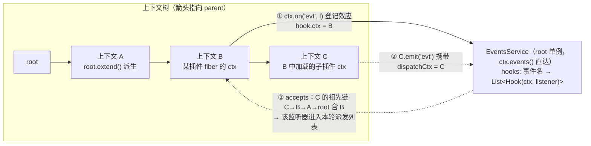
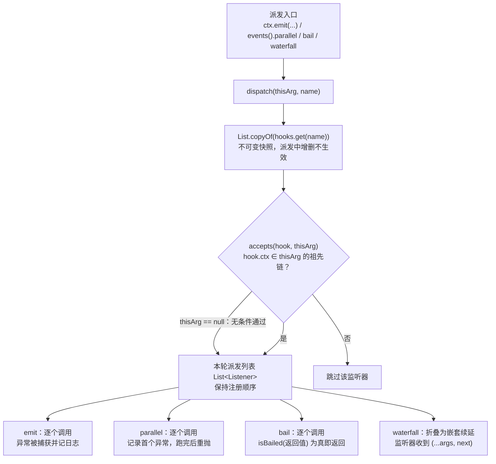
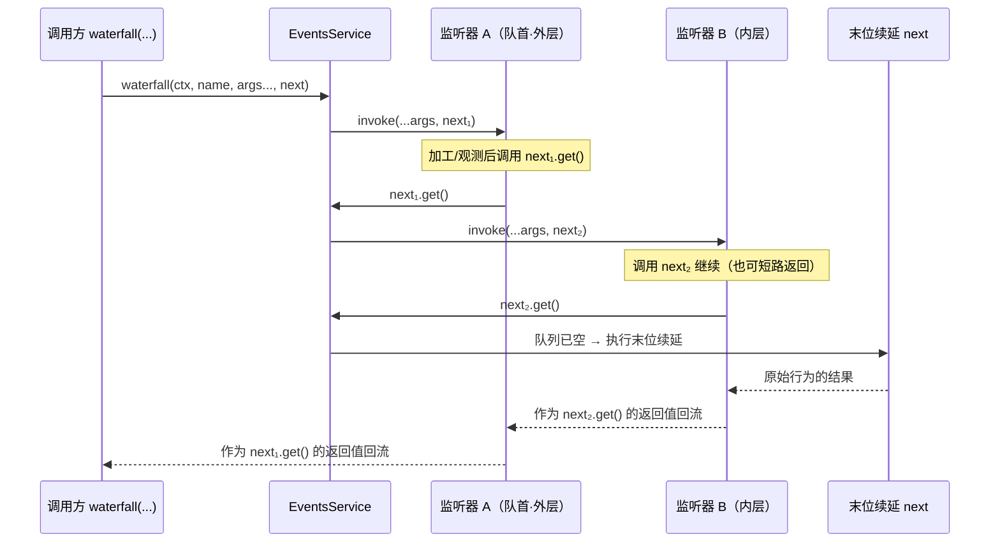

事件总线是 cordis-java 中"通知类"协作的唯一通道：它把**监听器注册**建模为可回退效应（随 fiber 卸载自动移除），把**事件派发**拆成四种语义——`emit`（广播即忘）、`parallel`（全量执行、首错延后重抛）、`bail`（短路仲裁）、`waterfall`（洋葱式续延管道）。本页以 `EventsService` 的 149 行实现为主线，逐一拆解注册机制、冒泡过滤规则与四种派发语义的精确差异；框架内部事件（`internal/*`）只在此速览其派发调用点，协议细节留给[内部事件协议](24-nei-bu-shi-jian-xie-yi-internal-status-config-yu-update-de-guan-ce-he-bian-pai-gou-zi)一页。

## 一、全景：安装在根上下文上的单一总线

`EventsService` 是一个**根上下文单例**：`Context.createRoot()` 在构建时创建它（与 `ReflectService`、`RegistryService`、`LoggerService` 并列），此后任何派生上下文都通过 `ctx.events()` 沿 `rootRef` 直达同一个实例。这意味着事件总线没有 per-context 副本——所谓"上下文相关"完全由 Hook 里记录的**注册上下文**在派发时判定，而不是由多份服务实例隔离。

其全部状态是一张 `Map<String, List<Hook>>`：事件名映射到 Hook 列表，每个 `Hook` 只是（注册上下文 `ctx`，监听器 `listener`）的二元组。监听器是统一的 `@FunctionalInterface`：`Object invoke(Object... args)`——四种派发模式共用这一签名，变体仅在于**返回值如何被解释**（`waterfall` 模式下参数数组的最后一个元素被解释为 `next` 续延，见第四节）。

需要说明的是，`hooks` 使用普通的 `HashMap` 与 `ArrayList`，没有任何同步措施——这与 `Fiber`"生命周期转换同步执行"的整体选择一致，框架假定单线程宿主；类注释明确将其定位为"安装在根上下文、混入每个上下文"的服务。

Sources: [Context.java](cordis-core/src/main/java/dev/cordis/core/Context.java#L49-L57), [Context.java](cordis-core/src/main/java/dev/cordis/core/Context.java#L299-L301), [EventsService.java](cordis-core/src/main/java/dev/cordis/core/EventsService.java#L10-L42)

## 二、注册即效应：监听器的生命周期归 fiber 管

`ctx.on(name, listener)` 是最常见的注册入口，它委托给 `events().on(this, name, listener, false)`。`on` 的实现只有三步，但每一步都携带纪律：先 `ctx.fiber().assertActive()`——fiber 已销毁时抛出 `INACTIVE_EFFECT`，且 `Fiber.effect` 内部还会在 `UNLOADING` 状态再次拒绝，保证卸载途中不再新增效应；然后把（上下文，监听器）二元组追加进对应事件名的列表（`prepend` 为 true 时插到队首，实现优先级）；最后**整个注册被包进一次 fiber 效应**——效应体登记 Hook，返回的 Disposable 就是 `list.remove(hook)`。

这个包装决定了监听器的两条退出路径：**显式**调用返回的 Disposable（由 `Fiber.effect` 的 armed 标志保证单次执行、幂等安全）；**隐式**由 fiber 卸载触发——逆变换进入 LIFO 累加器，随其他效应逆序回退。换句话说，插件作者在 `apply` 里写 `ctx.on(...)`，不需要写任何卸载逻辑，框架在[可回退效应模型](8-ke-hui-tui-xiao-ying-mo-xing-effectcallback-disposable-yu-duo-jie-duan-yan-xu)与 [LIFO 逆变换累加器](9-lifo-ni-bian-huan-lei-jia-qi-xiao-ying-zhe-die-dan-ci-chu-zhi-yu-shi-bai-hui-gun)的机制下自动摘除监听器。示例工程里的 `UserPlugin` 正是这种写法：在 `apply` 中注册 `user:create` 监听器，方法注释直言"监听器 + 服务注册都是被追踪的效应"。

| 注册 API | hook.ctx 绑定到 | 能收到的派发来源 | 说明 |
|---|---|---|---|
| `ctx.on(name, listener)` | 调用时的 `this` 上下文 | 该上下文**及其后代**发出的事件 | 追加到列表尾部；需 fiber 处于活动状态 |
| `ctx.onGlobal(name, listener)` | 根上下文 | 任意上下文发出的派发（含 null 广播） | 实现为 `events().on(getRoot(), ...)` |
| `ctx.events().on(ctx, name, listener, true)` | 指定的 `ctx` | 同 `ctx.on` | `prepend=true` 插入队首，用于优先级控制（Context 门面上未暴露） |

注册时还带上了诊断标签 `"ctx.on(\"事件名\")"`，它会出现在 `fiber.getEffects()` 的效应树里——这正是 [EffectMeta](cordis-core/src/main/java/dev/cordis/core/EffectMeta.java#L11) 注释中举例的两种标签之一（另一种是 `ctx.provide`），为[错误体系与诊断](26-cuo-wu-ti-xi-yu-zhen-duan-cordisexception-cuo-wu-ma-ming-ming-ri-zhi-yu-xiao-ying-zhui-zong)提供可读的追踪线索。

Sources: [EventsService.java](cordis-core/src/main/java/dev/cordis/core/EventsService.java#L44-L58), [Context.java](cordis-core/src/main/java/dev/cordis/core/Context.java#L274-L282), [Fiber.java](cordis-core/src/main/java/dev/cordis/core/Fiber.java#L146-L150), [Fiber.java](cordis-core/src/main/java/dev/cordis/core/Fiber.java#L169-L198), [UserPlugin.java](cordis-example/src/main/java/dev/cordis/example/plugins/UserPlugin.java#L27-L45)

## 三、派发的公共前奏：快照与冒泡过滤

四种派发模式共享同一个入口 `dispatch(thisArg, name)`，它做两件事。**第一是快照**：`List.copyOf(list)` 把 Hook 列表复制为不可变快照——派发期间监听器增删（例如某个监听器在回调里注册新监听器、或触发 fiber 卸载）不会影响本轮迭代，只从下一次派发生效。**第二是冒泡过滤**：`accepts(hook, dispatchCtx)` 沿派发上下文的 parent 链向上走，命中 Hook 的注册上下文即通过。

冒泡规则的方向必须精确理解：**一个在上下文 A 上注册的监听器，收到的是从 A 及其后代上下文发出的事件**。等价地说，事件从派发点向上冒泡，站得越高（越靠近根）的监听器视野越大。这带来一个容易踩的方向陷阱：`root.emit("user:create", "carol")` 只能命中注册在 root 上的监听器（`onGlobal` 或直接 `root.on`）；插件在自己 fiber 上下文里用 `ctx.on` 注册的监听器，只对**从该上下文或其子上下文**发出的同名事件有反应。另有一个特殊通道：`dispatchCtx == null` 时 `accepts` 无条件放行——这是内部事件的广播语义（见第五节），框架核心全部以 `emit(null, ...)` 派发 `internal/*` 事件，因此任何位置注册的监听器都能观测到它们。

Sources: [EventsService.java](cordis-core/src/main/java/dev/cordis/core/EventsService.java#L60-L77), [EventsService.java](cordis-core/src/main/java/dev/cordis/core/EventsService.java#L10-L18)

## 四、四种派发语义逐一剖析

### emit：广播即忘

`emit` 是最宽松的模式：按注册顺序同步调用每个监听器，**返回值一律忽略**，每个监听器的 `Throwable` 被 `try/catch` 捕获后交给 `root.logger("cordis").error(t)` 记录，绝不向上传播。单个监听器崩溃既不会中断后续监听器，也不会污染调用方——典型的"通知"语义，适合日志、度量、缓存失效这类"发出去就不关心结果"的场景。

Sources: [EventsService.java](cordis-core/src/main/java/dev/cordis/core/EventsService.java#L79-L88)

### parallel：全量执行，首错延后重抛

`parallel` 保证**所有监听器都跑完**：循环内捕获每个异常，只记住第一个；循环结束后把首个异常重新抛出——`RuntimeException` 与 `Error` 原样重抛，受检异常包成 `RuntimeException`。与 `emit` 的差别在错误契约：`emit` 吞掉错误（只记日志），`parallel` 把"第一个错误"作为调用方可见的结果；与 `bail` 的差别在完整性：任何监听器异常都不会短路后续执行。方法名沿用了 cordis（TypeScript 版）事件 API 的语义位——"全量派发、错误聚合"——但本移植为同步顺序实现，方法注释明确写着 "Dispatch to every listener in order"；命名与实现取舍的对照见[与 TypeScript 版 cordis 的语义映射](7-yu-typescript-ban-cordis-de-yu-yi-ying-she-yu-tong-bu-hua-she-ji-qu-she)。

Sources: [EventsService.java](cordis-core/src/main/java/dev/cordis/core/EventsService.java#L90-L103)

### bail：短路仲裁

`bail` 是"一票通过"的仲裁器：逐个调用监听器，第一个返回"bail 值"的监听器终止派发，该值成为 `bail` 的返回值；无人 bail 则返回 `null`。判定函数 `isBailed` 只有四个字：`value != null && !Boolean.FALSE.equals(value)`——`null` 与 `Boolean.FALSE` 是仅有的两种"放行"信号。

| 监听器返回值 | `isBailed` 结果 | 语义 |
|---|---|---|
| `null` | `false` | 未表态，继续下一个监听器 |
| `Boolean.FALSE` | `false` | 显式"不拦截"，继续 |
| `Boolean.TRUE` | `true` | 拦截，`bail` 返回 `TRUE` |
| 其他任意非 null 对象 | `true` | 拦截并携带该值返回（如权限对象、错误信息） |

一个关键的严格性差异：`bail` 的循环**没有 try/catch**——监听器异常直接向上传播，立即终止派发（这与 `emit`/`parallel` 的容错形成对照，仲裁者抛错应被视为系统级故障而非可忽略的副作用失败）。当前核心代码中没有 `bail` 的内部调用点，它与 `parallel` 一起作为对齐 cordis 事件 API 的公开派发原语保留，供插件间实现"否决/裁决"协作。

Sources: [EventsService.java](cordis-core/src/main/java/dev/cordis/core/EventsService.java#L105-L117)

### waterfall：洋葱式续延管道

`waterfall` 是表达力最强也最精巧的模式。调用方传入 `(...args, next)`——参数数组的**最后一个元素是末位续延**，可以是 `Listener`（以 args 调用）或 `Supplier`（直接求值），框架内部两处调用都用 `Supplier`。实现把派发列表复制进 `ArrayDeque`，然后用 `waterfallStep` 递归折叠：每个监听器收到的是原始 args 追加一个 `next`（无参 `Supplier`）；调用 `next` 就会展开剩余监听器；队列耗尽时 `next` 落到末位续延上。结果沿调用链**向上回流**——上层监听器拿到的 `next.get()` 返回值，就是其下全部管道执行后的结果。

三个必须掌握的精确约束。**其一，next 携带的永远是原始 args**：`waterfallStep` 每层都传同一份 `args` 数组，监听器无法改写下游监听器看到的输入；要影响结果，只能通过返回值通道——调用 `next` 后替换/包装其返回值，或干脆不调用 `next` 直接返回替代结果（短路，余下管道与末位续延都不再执行）。**其二，异常直接传播**：与 `bail` 一样没有 try/catch。**其三，`next` 重复调用会重复执行剩余管道**——`Supplier` 没有 memoize，框架不做防重入保护，纪律由监听器自负。

四种模式的对照表：

| 维度 | emit | parallel | bail | waterfall |
|---|---|---|---|---|
| 执行顺序 | 注册顺序（快照） | 注册顺序（快照） | 注册顺序（快照） | 注册顺序，外层→内层洋葱展开 |
| 监听器返回值 | 忽略 | 忽略 | `isBailed` 判定 | 经 `next` 链回流为最终结果 |
| 监听器异常 | 捕获，记日志，继续 | 捕获，全跑完后重抛首个 | 直接传播，终止派发 | 直接传播，终止管道 |
| 短路条件 | 无 | 无 | 首个 bail 值 | 监听器不调用 `next` |
| 方法返回值 | `void` | `void` | bail 值或 `null` | 管道最终结果 |
| 典型用途 | 通知广播 | 全量副作用 + 错误上报 | 否决/仲裁/首答 | 中间件管道、配置加工 |
| 监听器收到的参数 | `args` | `args` | `args` | `args + next(Supplier)` |
| 框架内部调用点 | `internal/plugin`、`internal/status`、`internal/service` | 无 | 无 | `internal/config`、`internal/update` |

Sources: [EventsService.java](cordis-core/src/main/java/dev/cordis/core/EventsService.java#L21-L25), [EventsService.java](cordis-core/src/main/java/dev/cordis/core/EventsService.java#L119-L148)

## 五、框架内部与示例中的调用点

框架核心是事件总线最重要的"内部客户"，全部以 `null` 派发上下文广播（绕过冒泡过滤，任何位置的监听器都能收到）。生命周期方面：fiber 实例化（O-Insert）与卸载（O-Retire 逆变换）各广播一次 `internal/plugin`；状态机每次迁移（含 LOADING/UNLOADING 中间态）广播 `internal/status` 并携带旧状态；提供者变化时 `ReflectService.notify` 对每个受影响的服务名广播 `internal/service` 及其当前实现值。管道方面：配置解析走 `waterfall(null, "internal/config", raw, () -> raw)`——末位续延是恒等函数，监听器短路即替换配置、调用 `next` 即透传原始值；配置更新走 `waterfall(null, "internal/update", cfg, Boolean.FALSE, () -> { 应用新配置并 restart })`——末位续延是"应用 + 重启"，监听器不调用 `next` 即否决重启。这五个事件的载荷协议、观测方式与编排钩子属于[内部事件协议](24-nei-bu-shi-jian-xie-yi-internal-status-config-yu-update-de-guan-ce-he-bian-pai-gou-zi)一页的主题，此处仅确立它们复用的正是本页的派发原语。

| 调用点 | 模式 | 事件名 | 载荷 |
|---|---|---|---|
| `Fiber` 构造器 / O-Retire 逆变换 | emit（null 广播） | `internal/plugin` | fiber |
| `Fiber.updateState` | emit（null 广播） | `internal/status` | fiber, 旧状态 |
| `ReflectService.notify` | emit（null 广播） | `internal/service` | 服务名, 当前实现值 |
| `Fiber.resolveConfig` | waterfall（null 广播） | `internal/config` | raw 配置 + 恒等续延 |
| `Fiber.update` | waterfall（null 广播） | `internal/update` | 生效配置, `Boolean.FALSE` + 重启续延 |

示例工程展示了用户侧的两种典型姿势。**插件侧**：`UserPlugin.apply` 中 `ctx.on("user:create", args -> log.info(...))`——监听器注册在插件的 fiber 上下文上，随 fiber 卸载自动摘除，fiber 重新激活时随 `apply` 重跑而重新注册（演示场景 3 的"重新提供"正是依赖这一点）。**宿主侧**：`Main` 用 `root.onGlobal("internal/status", ...)` 打印每次状态迁移——`onGlobal` 把 hook.ctx 绑到根，配合内部事件的 null 广播，宿主获得全系统生命周期的观测窗口；随后 `root.emit("user:create", "carol")` 演示从根派发用户事件，按第三节的方向规则，它命中的是注册在 root 上的监听器。完整的八个场景走读见[端到端演示走读](4-duan-dao-duan-yan-shi-zou-du-ba-ge-chang-jing-li-jie-kuang-jia-quan-bu-neng-li)。

Sources: [Fiber.java](cordis-core/src/main/java/dev/cordis/core/Fiber.java#L98-L119), [Fiber.java](cordis-core/src/main/java/dev/cordis/core/Fiber.java#L365-L378), [Fiber.java](cordis-core/src/main/java/dev/cordis/core/Fiber.java#L382-L391), [Fiber.java](cordis-core/src/main/java/dev/cordis/core/Fiber.java#L429-L446), [ReflectService.java](cordis-core/src/main/java/dev/cordis/core/ReflectService.java#L88-L91), [UserPlugin.java](cordis-example/src/main/java/dev/cordis/example/plugins/UserPlugin.java#L32-L35), [Main.java](cordis-example/src/main/java/dev/cordis/example/Main.java#L50-L69)

## 六、实践要点速查

把前文的精确约束浓缩为一张排错导向的清单。**方向**：监听器站在注册上下文上"向下看"——要收到某插件的事件，要么在该插件的祖先（含 root）上注册，要么在它自己的 ctx 内 emit；`onGlobal` 是"站到根上"的快捷方式。**错误策略选型**：副作用日志用 `emit`（错误只记日志）；要求调用方感知失败用 `parallel`；仲裁/否决用 `bail`；请求加工管道用 `waterfall`——后两者会让异常穿透，监听器必须自行保证异常契约。**优先级**：默认追加到队尾，需要抢先处理时用 `ctx.events().on(ctx, name, listener, true)` 插入队首。**派发中变更**：本轮派发基于不可变快照，监听器增删自下一轮生效。**生命周期**：注册即 fiber 效应，`ctx.on` 后无需也不应手写移除逻辑；显式 Disposable 与 fiber 卸载两条路径由 armed 标志协调，重复 dispose 是安全的 no-op。**线程模型**：总线无同步保护，与 fiber 的同步转换纪律一致，跨线程派发需宿主自行串行化。

Sources: [EventsService.java](cordis-core/src/main/java/dev/cordis/core/EventsService.java#L44-L142), [Fiber.java](cordis-core/src/main/java/dev/cordis/core/Fiber.java#L169-L198)

## 延伸阅读

- 监听器注册所依赖的效应机制：[可回退效应模型：EffectCallback、Disposable 与多阶段延续](8-ke-hui-tui-xiao-ying-mo-xing-effectcallback-disposable-yu-duo-jie-duan-yan-xu)、[LIFO 逆变换累加器：效应折叠、单次处置与失败回滚](9-lifo-ni-bian-huan-lei-jia-qi-xiao-ying-zhe-die-dan-ci-chu-zhi-yu-shi-bai-hui-gun)
- 自动摘除监听器的卸载时机：[生命周期状态机：PENDING 到 DISPOSED 的六状态与转换规则](11-sheng-ming-zhou-qi-zhuang-tai-ji-pending-dao-disposed-de-liu-zhuang-tai-yu-zhuan-huan-gui-ze)
- `internal/*` 五个事件的载荷与编排：[内部事件协议：internal/status、config 与 update 的观测和编排钩子](24-nei-bu-shi-jian-xie-yi-internal-status-config-yu-update-de-guan-ce-he-bian-pai-gou-zi)
- `ctx.on(...)` 标签在效应树中的呈现：[错误体系与诊断：CordisException 错误码、命名日志与效应追踪](26-cuo-wu-ti-xi-yu-zhen-duan-cordisexception-cuo-wu-ma-ming-ming-ri-zhi-yu-xiao-ying-zhui-zong)
- 与 TypeScript 版同名 API 的语义对照：[与 TypeScript 版 cordis 的语义映射与同步化设计取舍](7-yu-typescript-ban-cordis-de-yu-yi-ying-she-yu-tong-bu-hua-she-ji-qu-she)