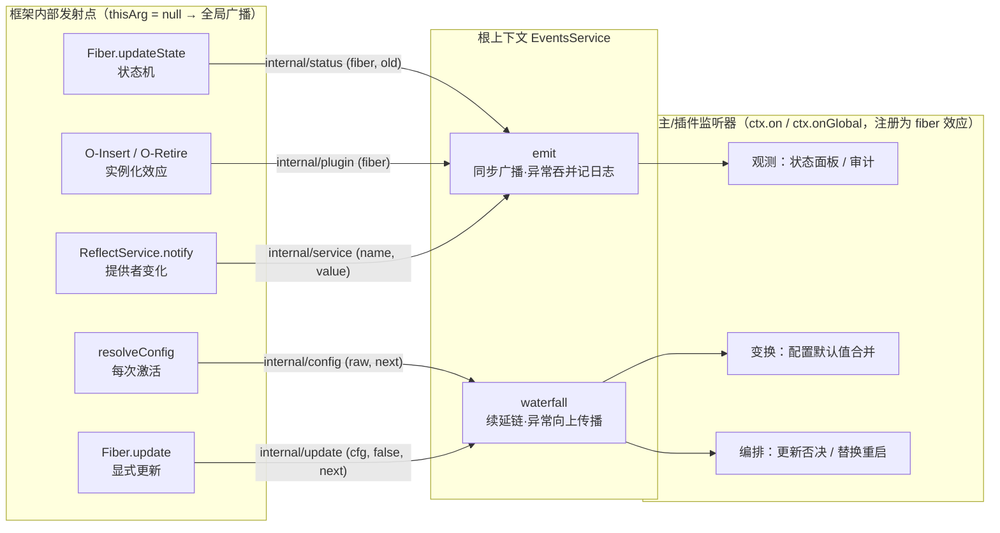
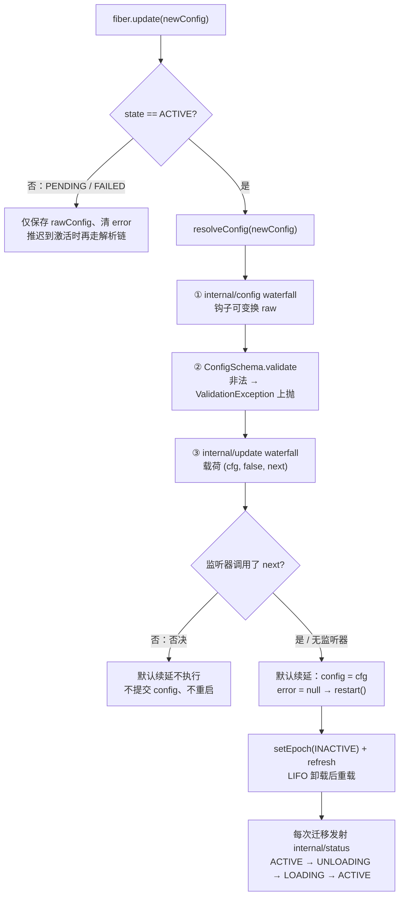

cordis-java 没有把框架自身的运行过程藏进私有日志，而是将其开放为根事件总线上的一组**保留事件名**——`internal/*` 前缀的五个事件。它们分为两种截然不同的角色：一类是**观测钩子**（`internal/status`、`internal/plugin`、`internal/service`），用 `emit` 同步广播，宿主可以据此构建状态面板、审计日志；另一类是**编排钩子**（`internal/config`、`internal/update`），用 `waterfall` 续延链派发，监听器不仅能看到数据，还能**变换**或**否决**框架接下来的动作。本文聚焦这三条主线事件及协议全貌；emit/parallel/bail/waterfall 四种派发原语本身的语义细节请先阅读[事件总线：emit、parallel、bail 与 waterfall 派发语义](23-shi-jian-zong-xian-emit-parallel-bail-yu-waterfall-pai-fa-yu-yi)。

Sources: [Fiber.java](cordis-core/src/main/java/dev/cordis/core/Fiber.java#L55-L58), [ReflectService.java](cordis-core/src/main/java/dev/cordis/core/ReflectService.java#L88-L93)

## 协议全景：五个保留事件与两种派发角色

所有内部事件都从**根上下文**的 EventsService 派发，且 `thisArg` 一律传 `null`。这不是随意选择：EventsService 的冒泡规则规定"监听器注册上下文必须是派发上下文或其祖先"，而当派发上下文为 `null` 时该判定直接通过——也就是说，**内部事件绕过冒泡规则，广播给该事件名下已注册的全部监听器**，无论它们挂在哪个上下文上。框架内部状态的变更属于全局事实，理应对所有观察者可见。

下表汇总五个事件的完整协议：

| 事件名 | 派发原语 | 监听器载荷 | 发射时机 | 角色定位 |
|---|---|---|---|---|
| `internal/status` | `emit` | `(fiber, oldState)` | 生命周期状态实际发生变化时 | 观测：状态迁移面板 |
| `internal/config` | `waterfall` | `(raw, next)` | 每次激活前解析配置时 | 编排：配置变换链 |
| `internal/update` | `waterfall` | `(cfg, false, next)` | 显式调用 `fiber.update()` 时 | 编排：更新否决/替换 |
| `internal/plugin` | `emit` | `(fiber)` | fiber 创建与退休（O-Insert / O-Retire） | 观测：实例追踪 |
| `internal/service` | `emit` | `(name, value)` | 服务提供者变化通知依赖方之后 | 观测：服务可用性 |

注意图中右下角的汇聚点：`internal/update` 的默认续延最终调用 `restart()`，而 restart 驱动的每一次状态迁移又会发射 `internal/status`——**协议的两个半区在一次显式更新中交汇**，这是后文反复出现的叙事主线。

Sources: [EventsService.java](cordis-core/src/main/java/dev/cordis/core/EventsService.java#L70-L88), [Fiber.java](cordis-core/src/main/java/dev/cordis/core/Fiber.java#L370-L383), [Fiber.java](cordis-core/src/main/java/dev/cordis/core/Fiber.java#L440-L445)

## internal/status：生命周期迁移的可观测性

状态事件的唯一发射点是 `Fiber.updateState()`。其纪律非常严格：先把 `state` 字段写成新值，若新旧相同则**静默返回**——只有真实迁移才广播；载荷为 `(fiber, oldState)`，新状态通过 `fiber.state` 读取。演示程序 Main 正是用这一契约把全部六状态迁移打印到控制台：`root.onGlobal("internal/status", st -> ...)` 解包出 fiber 与 old，输出"状态: {name} {old} → {fiber.state}"。

触发点覆盖整个惯性状态机（详见[惯性主机：epoch、target 视图与链式 reload/unload 转换](12-guan-xing-zhu-ji-epoch-target-shi-tu-yu-lian-shi-reload-unload-zhuan-huan)）：

| 调用点 | 迁移方向 | 含义 |
|---|---|---|
| `setEpoch`（epoch 从 INACTIVE 变为活跃摘要） | → `LOADING` | 依赖就绪，即将运行插件体 |
| `setEpoch`（其他 epoch 变化） | → `UNLOADING` | target 视图失配，即将逆变换 |
| `reloadCycle` 收尾 | → `ACTIVE` / `PENDING` / `FAILED` | 加载成功 / 依赖再度缺失 / 插件体抛错 |
| `unloadCycle` 收尾 | → `PENDING` / `DISPOSED` | 卸载后待命 / fiber 已退休 |
| O-Retire 逆效应内 | → `DISPOSED` | uid 置 null 后的计算态 |

因此监听器能观察到包括 `LOADING`、`UNLOADING` 这两个**瞬态**在内的完整迁移序列，例如一次显式更新会产生 `ACTIVE → UNLOADING → LOADING → ACTIVE` 的四段广播。

`updateState` 还藏着一条与观测并列的内部副作用：迁移跨越 **ACTIVE 边界**（无论方向）时，框架会收集该 fiber 提供的全部服务名，调用 `reflect().notify()` 通知所有依赖方重新求值——这正是"提供者失活 → 依赖者级联卸载"反应式链路的扳机，其分类语义属于[inject 声明与 ReflectService 通知：提供者变化的反应式分类](14-inject-sheng-ming-yu-reflectservice-tong-zhi-ti-gong-zhe-bian-hua-de-fan-ying-shi-fen-lei)与[生命周期状态机：PENDING 到 DISPOSED 的六状态与转换规则](11-sheng-ming-zhou-qi-zhuang-tai-ji-pending-dao-disposed-de-liu-zhuang-tai-yu-zhuan-huan-gui-ze)的领地，此处只需记住：**internal/status 的发射点同时是反应式联动的大门**。

Sources: [Fiber.java](cordis-core/src/main/java/dev/cordis/core/Fiber.java#L365-L378), [Main.java](cordis-example/src/main/java/dev/cordis/example/Main.java#L50-L58), [Fiber.java](cordis-core/src/main/java/dev/cordis/core/Fiber.java#L277-L290), [FiberState.java](cordis-core/src/main/java/dev/cordis/core/FiberState.java#L1-L21)

## internal/config：配置解析的变换链

`resolveConfig()` 是每次激活的必经之路：`reloadCycle` 在运行插件体之前调用它解析 `rawConfig`。它先走 `internal/config` waterfall——监听器收到 `(raw, next)`，可以返回自己的变换结果（如合并默认值、解引用远程配置），也可以调用 `next` 维持原值；当没有任何监听器时，内建的默认续延就是恒等函数 `() -> raw`。变换完成后，结果才交给 `plugin.schema()` 做校验。

这里有一个必须精确理解的**顺序契约**：变换在前、校验在后。钩子看到的是原始输入，而 schema 守卫的是变换后的产物——宿主可以放心地在钩子里注入派生配置，非法结果仍会被 `ValidationException` 拦截在门外。另一个关键区分是**作用域**：`internal/config` 在每次（重）激活时都会运行，而 `internal/update` 只包裹显式更新调用——前者是"每次加载的变换机会"，后者是"每次更新的编排机会"。校验器与 ValidationException 的完整体系见[配置系统：ConfigSchema 校验、ValidationException 与 update 流程](25-pei-zhi-xi-tong-configschema-xiao-yan-validationexception-yu-update-liu-cheng)。

Sources: [Fiber.java](cordis-core/src/main/java/dev/cordis/core/Fiber.java#L382-L391), [Fiber.java](cordis-core/src/main/java/dev/cordis/core/Fiber.java#L301-L320), [EventsService.java](cordis-core/src/main/java/dev/cordis/core/EventsService.java#L119-L134)

## internal/update：更新流程的编排钩子

`Fiber.update(newConfig)` 是声明式配置变更的终点站：ComponentLoader 调和时发现某个 entry 仅 `config` 字段变化，就走逐字段分发的最小扰动路径直接调用它，而不是整体重建（见[组件调和：按 id 差分与逐字段分发的最小扰动策略](19-zu-jian-diao-he-an-id-chai-fen-yu-zhu-zi-duan-fen-fa-de-zui-xiao-rao-dong-ce-lue)）。方法内部先分岔：若 fiber 尚非 ACTIVE（如 PENDING 等待提供者、或 FAILED），仅保存 `rawConfig`、清除错误并触发 refresh——**配置解析被推迟到激活时**，因为解析过程可能访问注入的服务。

ACTIVE 分支则构成协议的核心编排链，顺序严格不可变：

`internal/update` 的载荷是 `(cfg, false, next)`：第一个参数是**已通过校验**的配置（因为校验发生在 waterfall 之前），第二个是固定传入的布尔标记，第三个是 Supplier 续延。**否决语义**来自 waterfall 的结构：监听器若不调用 `next`，链条就此止步，"提交 config 并 restart"的默认续延永远不会执行——更新被吞掉，fiber 继续以旧配置运行。Javadoc 明言这个设计的意图："update hooks (and HMR) can veto or replace the restart"——监听器可以否决重启，也可以**不调用 next 而执行自己的替换逻辑**（例如换用新编译的模块重挂载）。需要说明的是，本移植版交付的 HmrEngine 走的是另一条等价路径：它不挂钩该事件，而是直接驱动带备份回滚的事务性 `remount`（见[HMR 阶段三：事务性重载与半重载状态的回滚保证](22-hmr-jie-duan-san-shi-wu-xing-zhong-zai-yu-ban-zhong-zai-zhuang-tai-de-hui-gun-bao-zheng)）；waterfall 保留的是这个扩展点本身。

两条测试用例锚定了行为契约。`updateAppliesNewConfigBehindTheWaterfall` 证明默认路径产生 `up:old → down → up:new` 的完整序列且 `getEffectiveConfig()` 返回新值；Loader 测试则证明**非法更新被前置拒绝**：`update(99)` 违反 schema 时 ValidationException 在进入 waterfall 之前抛出，loader 捕获并记日志，fiber 保持 ACTIVE、继续运行旧 config——而挂载时携带非法初始配置的 fiber 则直接落入 FAILED。ComponentLoader 的 catch 块注释还指出一个细节：被拒绝的更新仍会把新载荷留在 mounted 记录里，与运行态刻意分离。

Sources: [Fiber.java](cordis-core/src/main/java/dev/cordis/core/Fiber.java#L424-L446), [ComponentLoader.java](cordis-core/src/main/java/dev/cordis/loader/ComponentLoader.java#L93-L138), [LifecycleTest.java](cordis-core/src/test/java/dev/cordis/LifecycleTest.java#L134-L153), [LoaderTest.java](cordis-core/src/test/java/dev/cordis/LoaderTest.java#L147-L163), [HmrEngine.java](cordis-core/src/main/java/dev/cordis/hmr/HmrEngine.java#L118-L154)

## 相邻事件：internal/plugin 与 internal/service

协议家族的另外两个成员职责单一，只做观测。`internal/plugin` 在 fiber 生命周期的两端各发射一次：创建时（O-Insert 效应注册之后）与退休时（O-Retire 逆效应内部、`uid` 置 null 之后）——监听器以 `fiber.uid == null` 区分"登场"与"谢幕"，实例化与级联卸载的机制详见[O-Insert 与 O-Retire：插件实例化的效应化与级联卸载](13-o-insert-yu-o-retire-cha-jian-shi-li-hua-de-xiao-ying-hua-yu-ji-lian-xie-zai)。`internal/service` 则由 `ReflectService.notify()` 在完成依赖方刷新之后发射，载荷 `(name, value)`（提供者消失时 value 为 null），为宿主提供全局的服务可用性视图。

Sources: [Fiber.java](cordis-core/src/main/java/dev/cordis/core/Fiber.java#L98-L124), [ReflectService.java](cordis-core/src/main/java/dev/cordis/core/ReflectService.java#L71-L93)

## 注册纪律与两种派发的语义差异

监听器的注册有两条路径：`ctx.on(name, listener)` 把钩子挂在当前上下文（受冒泡规则约束），`ctx.onGlobal(name, listener)` 等价于挂到根上下文（接收一切派发）。无论哪条路径，注册都经由 `EventsService.on` 包装成**当前 fiber 的效应**——断言 ACTIVE 才能注册，fiber 卸载时监听器自动移除。这带来一个重要的推论：**观测者本身也是可回退的**，一个插件注册的 status 面板不会比插件活得更久。

最后，两类派发原语在内部事件场景下的行为差异值得用一张表固化：

| 维度 | emit（观测类事件） | waterfall（编排类事件） |
|---|---|---|
| 监听器返回值 | 忽略 | 最后执行者的返回值成为整链结果 |
| 监听器抛异常 | 捕获、记日志、**不传播** | 沿调用栈上抛至 `update()` 调用方 |
| 流程控制 | 无——广播即结束 | 续延式——不调用 `next` 即中止后续 |
| 典型误用风险 | 监听器异常被静默吞掉 | 编排钩子异常会连带否决本次更新 |

waterfall 的异常传播尤其关键：一个抛错的 `internal/update` 钩子等效于否决更新，异常继续上抛，最终被 ComponentLoader 的 catch 块记录为"entry rejected new config"。框架没有为编排钩子提供容错——**编排者必须为自己的失败负责**。

Sources: [Context.java](cordis-core/src/main/java/dev/cordis/core/Context.java#L274-L287), [EventsService.java](cordis-core/src/main/java/dev/cordis/core/EventsService.java#L49-L58), [EventsService.java](cordis-core/src/main/java/dev/cordis/core/EventsService.java#L79-L88), [EventsService.java](cordis-core/src/main/java/dev/cordis/core/EventsService.java#L136-L142)

## 小结

内部事件协议的本质，是框架把"我正在改变状态"（emit 广播）与"我即将行动，你可以改写"（waterfall 续延）这两类控制流开放为统一的事件总线约定。`internal/status` 让惯性状态机的每次迁移对宿主透明；`internal/config` 在校验之前插入一条可组合的变换链；`internal/update` 则把"提交并重启"降级为可否决、可替换的默认续延——三者在一次显式更新中首尾相接，构成闭环。想继续深入，建议按序阅读：先看[配置系统：ConfigSchema 校验、ValidationException 与 update 流程](25-pei-zhi-xi-tong-configschema-xiao-yan-validationexception-yu-update-liu-cheng)补全校验细节，再看[组件调和：按 id 差分与逐字段分发的最小扰动策略](19-zu-jian-diao-he-an-id-chai-fen-yu-zhu-zi-duan-fen-fa-de-zui-xiao-rao-dong-ce-lue)理解谁在调用 update，最后到[宿主集成指南：PluginResolver、ModuleGraph 与模块注册策略](28-su-zhu-ji-cheng-zhi-nan-pluginresolver-modulegraph-yu-mo-kuai-zhu-ce-ce-lue)学习如何以宿主身份消费这套协议。