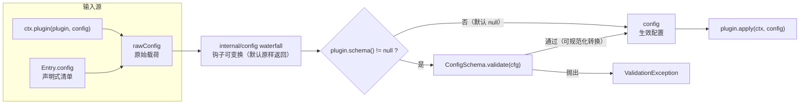
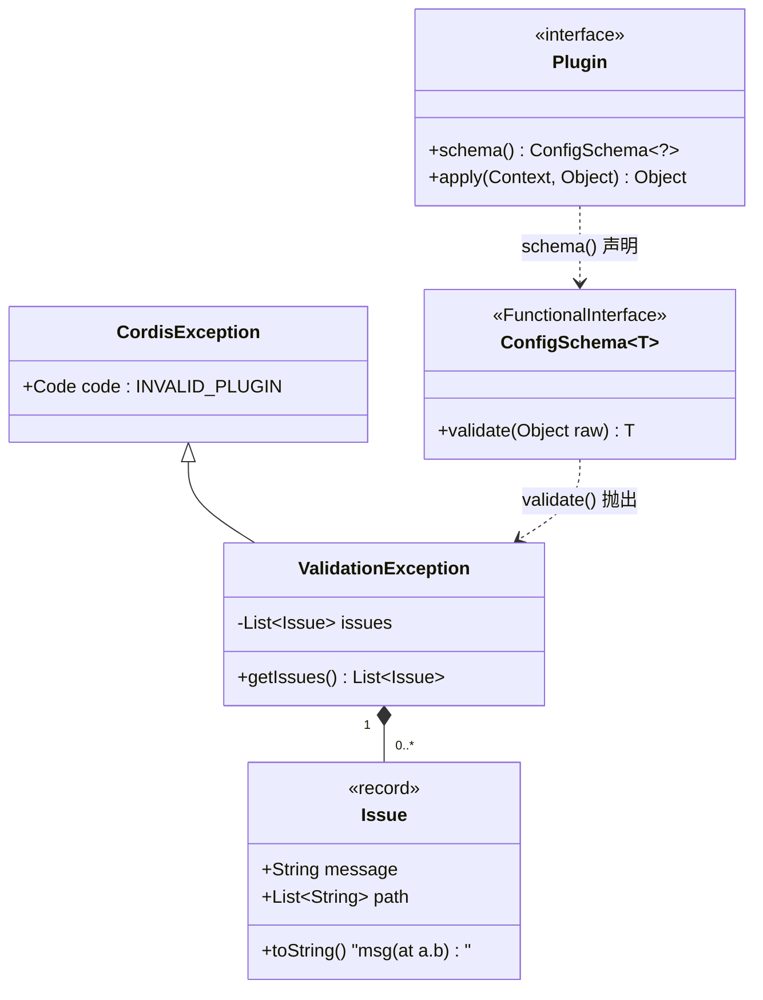
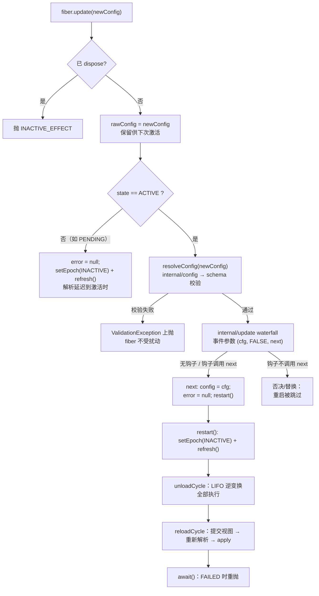

在 cordis-java 的组件模型中，一个插件由三部分构成：**inject**（协同效应规范）、**apply**（效应函数），以及贯穿本文的主题——**config**（实例化绑定载荷）。配置不是插件定义的一部分，而是实例化时绑定的外部数据：同一个 `Plugin` 绑定两个不同载荷，就表现为两个独立的组件（两个 fiber）。本文解释配置从原始载荷到生效对象的三段旅程——`internal/config` 变换钩子、`ConfigSchema` 校验与规范化、以及 `update` 流程如何在不重建 fiber 的前提下完成"校验 → 否决点 → 重启"——并精确刻画校验失败时两种截然不同的结局：初始装载失败落入 `FAILED`，更新校验失败则异常上抛而 fiber 毫发无损。

## 一、配置在组件模型中的位置

`Plugin` 接口将配置建模为 `apply` 的第二个参数：插件体在每次激活时收到一个**已验证的配置对象**（`@param config the validated config`），而不是原始输入。校验契约通过可选的 `schema()` 方法声明——默认返回 `null`，意味着接受任意配置；返回一个 `ConfigSchema` 实例则激活前强制校验。这种"契约内嵌于组件定义、数据注入于实例化时刻"的分离，正是"一个定义、多个实例"模式的基础：[Entry](18-entry-pei-zhi-mo-xing-id-url-isolate-intercept-config-yu-disabled) 清单中的 `config` 字段与 `ctx.plugin(plugin, config)` 调用中的参数，最终都以 `rawConfig` 的形式沉淀在 fiber 上。

Sources: [Plugin.java](cordis-core/src/main/java/dev/cordis/core/Plugin.java#L27-L42)

装载入口在 `RegistryService.plugin(ctx, plugin, config)`：它校验插件非空（否则抛 `INVALID_PLUGIN`）、确保父 fiber 处于活动状态，然后创建携带该配置的 `Fiber`。此后配置的生命周期完全由 fiber 接管。

Sources: [RegistryService.java](cordis-core/src/main/java/dev/cordis/core/RegistryService.java#L71-L81)

## 二、三个配置视图与解析管线

`Fiber` 用两个字段区分配置的两副面孔：`rawConfig` 是**原始输入**，"在每次激活前重新解析"（re-resolved before each activation）；`config` 是**当前激活发布的已验证配置**。二者分别通过 `getRawConfig()` 与 `getEffectiveConfig()` 暴露给诊断与宿主代码。

Sources: [Fiber.java](cordis-core/src/main/java/dev/cordis/core/Fiber.java#L49-L58)

连接两个视图的是私有方法 `resolveConfig(raw)`，它实现了一条两阶段管线：**第一阶段**是把原始配置送入 `internal/config` waterfall——事件参数为 `(raw, next)`，`next` 的默认行为是原样返回 `raw`，因此任何监听 `internal/config` 的钩子都可以在 schema 校验**之前**变换配置（例如环境变量替换、密钥注入）；**第二阶段**是当 `plugin.schema()` 非 null 时调用 `typed.validate(cfg)`，用其返回值替换配置。注意一个边界细节：根 fiber（`runtime == null`）跳过 schema 校验。下图概括这条管线（Mermaid flowchart，读法：箭头表示数据流向，菱形为分支判断）：



这条管线的任何一次激活都会完整重跑——`reloadCycle` 中 `config = resolveConfig(rawConfig)` 位于 `plugin.apply(ctx, config)` 之前，保证插件体永远只接触经过同一套变换与校验的配置。

Sources: [Fiber.java](cordis-core/src/main/java/dev/cordis/core/Fiber.java#L380-L391)、[Fiber.java](cordis-core/src/main/java/dev/cordis/core/Fiber.java#L301-L318)、[EventsService.java](cordis-core/src/main/java/dev/cordis/core/EventsService.java#L119-L134)

需要与之辨析的是**另一类"配置"**：`intercept` 配置（`Entry.intercept` 与 inject 声明中的逐服务配置）走的是服务解析时的右偏合并路径，作用于被注入服务的 config，而非插件自身的 `config`，详见[拦截：intercept 配置右偏合并与编排者权限收缩](17-lan-jie-intercept-pei-zhi-you-pian-he-bing-yu-bian-pai-zhe-quan-xian-shou-suo)。

| 概念 | 定义处 | 作用对象 | 生效方式 |
| --- | --- | --- | --- |
| **Entry.config**（实例化配置） | 声明式清单的载荷字段 | 绑定到该 fiber 的 `apply` 调用 | `resolveConfig` 管线校验后传入 |
| **intercept 配置**（服务拦截配置） | `Entry.intercept` / `Context.intercept` | 被注入服务的已解析配置 | 沿上下文链右偏合并，见第 17 篇 |
| **fiber config**（生效配置） | `resolveConfig` 的产物 | 插件体可见的最终对象 | `getEffectiveConfig()` 观测 |

Sources: [Entry.java](cordis-core/src/main/java/dev/cordis/loader/Entry.java#L20-L28)

## 三、ConfigSchema：校验即规范化

`ConfigSchema<T>` 是一个 `@FunctionalInterface`，唯一方法 `T validate(Object raw) throws ValidationException` 的契约包含两层：**拒绝**非法输入（抛异常），以及**规范化**合法输入——返回值"是传给 `Plugin#apply` 的已解析配置"，因此实现可以自由地把宽松的原始数据收敛为强类型对象（例如把 `Map` 转成 record、补默认值）。下面的测试内联实现展示了最小形态：非 `Integer` 或超过 10 即抛出，否则原样放行：

```java
@Override
public ConfigSchema<?> schema() {
    return raw -> {
        if (!(raw instanceof Integer i) || i > 10) {
            throw new ValidationException(List.of(new ValidationException.Issue("must be ≤ 10")));
        }
        return raw;   // 规范化点：可在此返回转换后的对象
    };
}
```

由于是函数式接口，lambda 即 schema，无需继承任何校验框架——Java 版没有内置 schema DSL，宿主可自行桥接任意校验库（对应 TypeScript 版 cordis 的 standard-schema 钩子语义，见[与 TypeScript 版 cordis 的语义映射与同步化设计取舍](7-yu-typescript-ban-cordis-de-yu-yi-ying-she-yu-tong-bu-hua-she-ji-qu-she)）。

Sources: [ConfigSchema.java](cordis-core/src/main/java/dev/cordis/core/ConfigSchema.java#L7-L18)、[LoaderTest.java](cordis-core/src/test/java/dev/cordis/LoaderTest.java#L131-L139)

## 四、ValidationException：结构化的多问题报告

校验失败不是抛出一个裸字符串异常，而是携带**问题清单**的结构化错误。`ValidationException` 继承自 `CordisException` 并固定使用 `INVALID_PLUGIN` 错误码（"invalid plugin"——配置不合法被归类为插件形状错误），其内部 `Issue` 是一个 record：`(message, path)` 二元组，`path` 为空时便捷构造为空列表，`toString()` 在路径非空时追加 `" (at a.b.c)"` 式的定位后缀。异常消息把所有 issue 逐行拼接为 `"invalid config:\n  - …"` 的清单格式，便于日志直读；`getIssues()` 返回防御性拷贝的不可变列表，调用方可编程消费。

Sources: [ValidationException.java](cordis-core/src/main/java/dev/cordis/core/ValidationException.java#L10-L35)、[CordisException.java](cordis-core/src/main/java/dev/cordis/core/CordisException.java#L9-L25)



作为 `CordisException` 体系的一员，它共享稳定错误码的机器可读约定，完整的错误码表与命名日志、效应追踪配合见[错误体系与诊断](26-cuo-wu-ti-xi-yu-zhen-duuan-cordisexception-cuo-wu-ma-ming-ming-ri-zhi-yu-xiao-ying-zhui-zong)。

## 五、校验时机：激活路径 vs 更新路径

同一个 `resolveConfig` 管线服务两条路径，但**失败的落点完全不同**。**激活路径**（初始装载、依赖重载、restart）：`reloadCycle` 内调用 `resolveConfig`，抛出的任何 `Throwable` 被 catch 后记录到 `fiber.error` 并将 `epoch` 置为 `INACTIVE`——状态机结算为 `FAILED`，`await()` 会向调用方重抛该错误。**更新路径**（`fiber.update`）：`resolveConfig` 在任何状态改变**之前**前置执行，校验失败时异常直接上抛给调用方，fiber 状态与生效配置均不受扰动。测试 `configSchemaFailureLeavesFiberFailed` 精确固化了这两条契约：合法初始配置 `3` 装载后 `ACTIVE`；`update(99)` 抛 `ValidationException` 且 fiber 仍 `ACTIVE`、`getEffectiveConfig()` 仍为 `3`；而以非法配置 `99` 装载新 entry 则落入 `FAILED` 且 `await()` 重抛。

| 维度 | 初始/重载激活时校验失败 | update 前置校验失败 |
| --- | --- | --- |
| **调用位置** | `reloadCycle` 内的 `resolveConfig` | `update` 内、状态变更前的 `resolveConfig` |
| **异常去向** | 捕获存入 `fiber.error`，`epoch = INACTIVE` | 直接上抛调用方 |
| **fiber 终态** | `FAILED`（`await()` 重抛） | 维持 `ACTIVE`，旧配置继续服务 |
| **生效配置** | 无（apply 未执行） | 不变（仍为上一次验证值） |
| **rawConfig** | 已更新并保留 | 已更新并保留（下次激活仍会校验） |
| **测试背书** | `LoaderTest` L159-L162 | `LoaderTest` L152-L157 |

Sources: [Fiber.java](cordis-core/src/main/java/dev/cordis/core/Fiber.java#L301-L333)、[Fiber.java](cordis-core/src/main/java/dev/cordis/core/Fiber.java#L429-L446)、[LoaderTest.java](cordis-core/src/test/java/dev/cordis/LoaderTest.java#L123-L163)

值得注意的推论：更新路径上校验实际执行了**两次**——`update` 中前置一次（为调用方提供即时反馈），`restart` 触发的 `reloadCycle` 中重新激活时又一次（保证任何激活都经过同一管线，且 `internal/config` 钩子在两次调用间可能产生不同变换结果）。

## 六、update 流程走读

`Fiber.update(newConfig)` 是配置变更的完整编排，其注释点明设计意图："先跑 `internal/update` waterfall，使更新钩子（及 HMR）可以否决或替换重启"。逐步分解（下图流程图读法：菱形为条件分支，粗体框为关键副作用）：



三个分支值得展开。**前置守卫**：`assertActive()` 在已 dispose 的 fiber 上抛 `INACTIVE_EFFECT`，杜绝僵尸对象的更新。**延迟分支**：当 fiber 尚非 `ACTIVE`（典型如 PENDING——inject 未满足），`update` 只更新 `rawConfig` 并清理 `error` 后触发 `refresh()`，注释解释了原因——"配置解析可能访问被注入的服务，推迟到激活时"。**否决点**：waterfall 机制（详见[事件总线：emit、parallel、bail 与 waterfall 派发语义](23-shi-jian-zong-xian-emit-parallel-bail-yu-waterfall-pai-fa-yu-yi)）把最后一个参数视为最内层延续 `next`；每个钩子收到 `(cfg, Boolean.FALSE, next)`，只有显式调用 `next` 才会执行重启——不调用即构成否决，框架当前未内置任何 `internal/update` 监听者，这是一个为宿主预留的编排扩展点（协议全景见[内部事件协议](24-nei-bu-shi-jian-xie-yi-internal-status-config-yu-update-de-guan-ce-he-bian-pai-gou-zi)）。

Sources: [Fiber.java](cordis-core/src/main/java/dev/cordis/core/Fiber.java#L416-L446)、[Fiber.java](cordis-core/src/main/java/dev/cordis/core/Fiber.java#L146-L150)、[EventsService.java](cordis-core/src/main/java/dev/cordis/core/EventsService.java#L124-L142)

`next` 延续体本身只有三行：`config = cfg`（使 `getEffectiveConfig()` 立即反映新值）、`error = null`（清除既往失败）、`restart()`。而 `restart()` 是纯粹的惯性状态机驱动——`setEpoch(INACTIVE)` + `refresh()`，随后 unload → reload 链式推进直至 fiber 重新静止于 `ACTIVE`。也就是说，**update 并没有私有的重启机制，它完全复用生命周期状态机**（状态与转换规则见[生命周期状态机](11-sheng-ming-zhou-qi-zhuang-tai-ji-pending-dao-disposed-de-liu-zhuang-tai-yu-zhuan-huan-gui-ze)，链式转换细节见[惯性主机](12-guan-xing-zhu-ji-epoch-target-shi-tu-yu-lian-shi-reload-unload-zhuan-huan)）。`LifecycleTest` 的断言浓缩了可观测行为：`update("new")` 后日志序列恰为 `[up:old, down, up:new]`——旧实例完整卸载、新实例以新配置激活，且这是**同一个 fiber**。

Sources: [LifecycleTest.java](cordis-core/src/test/java/dev/cordis/LifecycleTest.java#L134-L153)

与 `restart()` 的对比澄清 update 的增量本质：`restart` 以当前 `rawConfig` 原地重启（无校验前置、无 waterfall 包装），适合依赖驱动的内部重载；`update` 则是外部驱动的配置变更入口，多出"前置校验 + 否决点"两道闸门。

| 操作 | 配置来源 | 前置校验 | internal/update 钩子 | 典型触发者 |
| --- | --- | --- | --- | --- |
| **restart()** | 复用现有 `rawConfig` | 无（激活时才解析） | 不经过 | 依赖变化 / 手动重启 |
| **update(newConfig)** | 替换 `rawConfig` | 有（失败上抛、零扰动） | 经过（可否决） | 调和器 / 宿主 API |

Sources: [Fiber.java](cordis-core/src/main/java/dev/cordis/core/Fiber.java#L416-L446)

## 七、从声明式清单到 update：调和器的 config 分发

配置变更最常见的入口不是手工调用 `fiber.update`，而是声明式清单的再调和。`ComponentLoader.apply` 按字段做最小扰动分发，config 是优先级最低的字段——只有当 `url`、`disabled`、`isolate`、`intercept` 均未变化时，config 差异才走到专属路径：**不重建 fiber，直接 `m.fiber.update(e.config)`**，同时把 `Mounted` 记录更新为新 entry（新载荷被记账，无论本次更新成败）。失败被显式容错：`RuntimeException` 被捕获并记入 `loader` 命名日志（`"entry s rejected new config"`），调和流程继续，不会因单个 entry 的非法配置中断整批变更。分发策略的全景（为何 url 变化走 rebuild 而非 update）见[组件调和](19-zu-jian-diao-he-an-id-chai-fen-yu-zhu-zi-duan-fen-fa-de-zui-xiao-rao-dong-ce-lue)。

Sources: [ComponentLoader.java](cordis-core/src/main/java/dev/cordis/loader/ComponentLoader.java#L93-L138)

`LoaderTest.reconcileAddsRemovesAndUpdates` 验证了这条路径的三个行为契约：config 变更后同一插件 `apply` 计数从 1 增至 2（原地重启、非重挂载）；插件收到的新配置恰为新值；**未变化的 entry（b）计数保持 1，不被牵连重启**。结合第五节的容错契约，构成 config 分发的完整闭环。

Sources: [LoaderTest.java](cordis-core/src/test/java/dev/cordis/LoaderTest.java#L64-L82)

## 八、行为契约速查

以下契约全部由测试固化，可作为宿主集成与插件开发的依据（测试体系全景见[测试体系：30 个用例覆盖的行为契约清单](27-ce-shi-ti-xi-30-ge-yong-li-fu-gai-de-xing-wei-qi-yue-qing-dan)）：

| # | 契约 | 验证用例 |
| --- | --- | --- |
| 1 | `schema()` 返回 null 时任意配置直接通过 | `Plugin` 默认实现 |
| 2 | 初始装载配置非法 → fiber `FAILED`，`await()` 重抛 `ValidationException` | `configSchemaFailureLeavesFiberFailed` |
| 3 | `update` 校验失败 → 异常上抛，fiber 保持 `ACTIVE` 且生效配置不变 | 同上 |
| 4 | `update` 成功 → 同一 fiber 完成 down/up 循环，`getEffectiveConfig()` 更新 | `updateAppliesNewConfigBehindTheWaterfall` |
| 5 | 调和器 config 变更 → 原地 update 不重挂载，无关 entry 零扰动 | `reconcileAddsRemovesAndUpdates` |
| 6 | `restart` → 以现有配置完整卸载重载 | `restartUnloadsAndReloadsWithSameConfig` |
| 7 | 已 dispose 的 fiber 调用 `update` → `INACTIVE_EFFECT` | `assertActive` 守卫 |

Sources: [LoaderTest.java](cordis-core/src/test/java/dev/cordis/LoaderTest.java#L123-L163)、[LifecycleTest.java](cordis-core/src/test/java/dev/cordis/LifecycleTest.java#L112-L153)

## 九、延伸阅读

配置系统是多个主题的交汇点，建议按以下顺序继续深入：先从[Entry 配置模型](18-entry-pei-zhi-mo-xing-id-url-isolate-intercept-config-yu-disabled)理解声明式清单中 config 与兄弟字段的分工，再到[组件调和](19-zu-jian-diao-he-an-id-chai-fen-yu-zhu-zi-duan-fen-fa-de-zui-xiao-rao-dong-ce-lue)看逐字段分发的完整决策树；[内部事件协议](24-nei-bu-shi-jian-xie-yi-internal-status-config-yu-update-de-guan-ce-he-bian-pai-gou-zi)解释 `internal/config`/`internal/update` 钩子的观测与编排用法，[事件总线](23-shi-jian-zong-xian-emit-parallel-bail-yu-waterfall-pai-fa-yu-yi)提供 waterfall 语义的底层机制；若关注重启链与失败回滚，[生命周期状态机](11-sheng-ming-zhou-qi-zhuang-tai-ji-pending-dao-disposed-de-liu-zhuang-tai-yu-zhuan-huan-gui-ze)与[HMR 阶段三：事务性重载](22-hmr-jie-duan-san-shi-wu-xing-zhong-zai-yu-ban-zhong-zai-zhuang-tai-de-hui-gun-bao-zheng)是自然续篇；而错误码消费方则应阅读[错误体系与诊断](26-cuo-wu-ti-xi-yu-zhen-duan-cordisexception-cuo-wu-ma-ming-ming-ri-zhi-yu-xiao-ying-zhui-zong)。