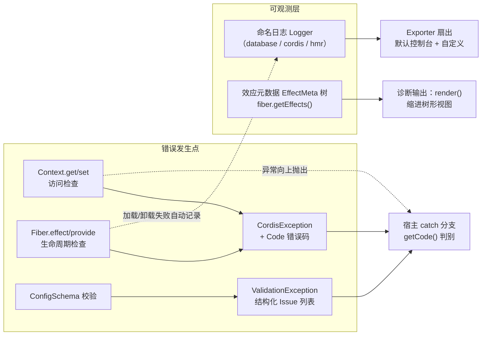
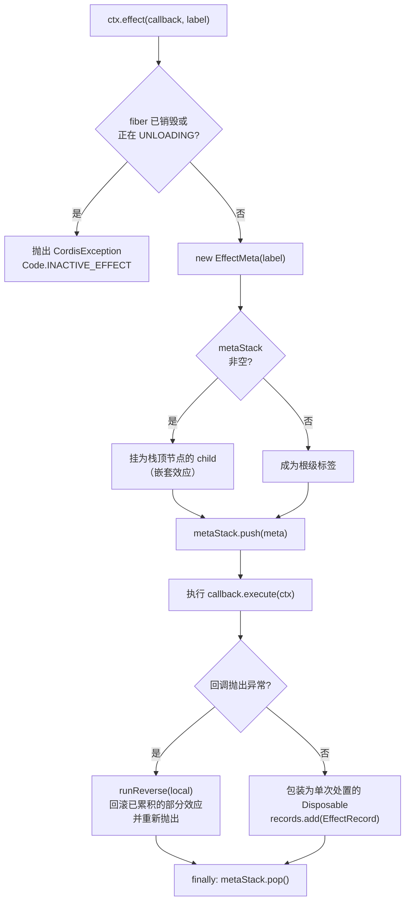

一个插件框架的可观测性决定了开发者排查问题的效率。cordis-java 围绕三大支柱构建了完整的诊断体系：**CordisException 稳定错误码**（告诉你"违反了哪条框架契约"）、**命名日志**（告诉你"错误发生在哪个子系统"）、以及**效应追踪**（告诉你"这个 fiber 当前持有哪些资源、将以什么顺序释放"）。三者各司其职——错误码面向机器判别与 catch 分支，日志面向人眼阅读控制台，效应元数据树面向运行时自省。本文面向初学者，逐层拆解这套体系的设计与使用方式。



## CordisException：机器可读的错误码契约

框架的所有自有异常都继承自一个根类型 `CordisException`，它是 `RuntimeException` 的子类，因此不需要在方法签名上显式声明。其核心设计是**将"错误类别"从"错误文本"中剥离**：每个异常携带一个 `Code` 枚举值，枚举名与默认消息在框架演进中保持稳定，宿主代码可以用 `getCode()` 做程序化判别，而不必解析异常文本。

`Code` 枚举定义了八个错误码，每个都对应一类明确的生命周期或访问契约违规。下表列出全部错误码、默认消息与当前的实际抛出位置：

| 错误码 | 默认消息 | 抛出场景 | 抛出位置 |
|---|---|---|---|
| `INACTIVE_EFFECT` | cannot create effect on inactive context | 在已 DISPOSED 或正在 UNLOADING 的 fiber 上调用 `effect()` | `Fiber.assertActive()`、`Fiber.effect()` 入口 |
| `INACTIVE_ACCESS` | cannot get required service in inactive context | 通过一个声明了 `inject` 但尚未 ACTIVE 的 fiber 读取必需服务 | `Context.get()` 链上发现 `inject` 含该键但 `store` 未提交 |
| `UNDECLARED_ACCESS` | cannot get property without inject | 读取一个没有任何 fiber 声明提供的服务，或解析跨越了 realm 边界 | `Context.get()` 行走 fiber 链到达根仍未命中 |
| `INVALID_SET` | cannot set property without provide | 写入从未 provide 的服务，或写入由其他 fiber 提供的服务 | `Context.set()` 的两道所有权检查 |
| `DUPLICATE_PROVIDE` | service has been registered | 在同一隔离域内重复 provide 同名服务 | `Fiber.provide()` 发现 store 已有同键 Impl |
| `INVALID_PLUGIN` | invalid plugin | 插件形态非法（如传入 null），也是 `ValidationException` 的基码 | `RegistryService` 入口校验、配置校验失败 |
| `INACTIVE_FIBER` | fiber is disposed | 生命周期误用（如重启已销毁的 fiber）| 预留码，当前主代码未触发 |
| `REALM_ERROR` | isolation realm error | 隔离域重指派失败 | 预留码，当前主代码未触发 |

Sources: [CordisException.java](cordis-core/src/main/java/dev/cordis/core/CordisException.java#L6-L32)

构造器提供了一个贴心的**回退语义**：三个重载分别接受 `code`、`code + message`、`code + message + cause`。当传入的 `message` 为 `null` 时，自动回退到该错误码的默认消息——这保证了即使调用方只提供错误码，异常也永远携带可读文本。`cause` 参数则用于保留根因链（例如把配置校验的底层异常包装进来）。

Sources: [CordisException.java](cordis-core/src/main/java/dev/cordis/core/CordisException.java#L36-L53)

从代码考古的角度观察错误码的分布，可以看到一个清晰的规律：**访问类错误（INACTIVE_ACCESS、UNDECLARED_ACCESS、INVALID_SET）集中在 `Context` 的读写路径上**，这是"服务解析算法"的守门员；而**生命周期类错误（INACTIVE_EFFECT、DUPLICATE_PROVIDE）集中在 `Fiber` 的效应与提供路径上**。例如 `Context.get()` 在 fiber 链行走时，若当前 fiber 声明了该键却处于非活动状态，会立即抛出 `INACTIVE_ACCESS` 并附上服务名；`Context.set()` 则先检查"是否有人 provide 过"，再检查"提供者是否就是当前 fiber"，两道检查分别对应 `INVALID_SET` 的两种变体消息。

Sources: [Context.java](cordis-core/src/main/java/dev/cordis/core/Context.java#L188-L208)
Sources: [Context.java](cordis-core/src/main/java/dev/cordis/core/Context.java#L221-L233)

`DUPLICATE_PROVIDE` 的错误消息有一个值得注意的诊断增强：抛出时会拼接**已有注册者的 fiber 名称**（`"service \"name\" has been registered at <owner>"`），让开发者一眼看到冲突的另一方是谁，而不只是知道"冲突了"。

Sources: [Fiber.java](cordis-core/src/main/java/dev/cordis/core/Fiber.java#L459-L479)

## ValidationException：结构化的配置校验错误

配置校验失败不只是一个异常，更是一份**问题清单**。`ValidationException` 继承 `CordisException` 并固定使用 `INVALID_PLUGIN` 错误码，其内部持有 `Issue` record 列表——每条 Issue 由 `message`（问题描述）和 `path`（从配置根到出错字段的点分路径）组成。`path` 为空时 `toString()` 只输出消息；非空时追加 `(at path.to.field)` 后缀。

Sources: [ValidationException.java](cordis-core/src/main/java/dev/cordis/core/ValidationException.java#L10-L22)

构造时，所有 Issue 被聚合为一条多行消息（每条前缀 `"  - "`），因此即使不调用 `getIssues()`，直接打印异常也能看到全部问题；而调用 `getIssues()` 拿到的是**不可变列表**（`Collections.unmodifiableList`），防止外部篡改诊断数据。这种"一次校验、批量报告"的设计避免了修复一个字段后重跑又冒出下一个错误的锯齿式排查体验。

Sources: [ValidationException.java](cordis-core/src/main/java/dev/cordis/core/ValidationException.java#L24-L35)

## 命名日志：Logger 门面与 Exporter 扇出

日志体系由两个类构成，职责严格分离。**`Logger` 是无状态的命名门面**：每个实例绑定一个名称字符串（如 `"database"`、`"cordis"`），提供 `info`/`warn`/`error`/`debug` 四个级别方法（内部映射为单字符 `I`/`W`/`E`/`D`）。它支持 `{}` 占位符的惰性格式化——依次查找消息中的 `{}` 并替换为参数渲染值；若占位符已耗尽，多余参数以空格追加到末尾，保证信息不丢失。

Sources: [Logger.java](cordis-core/src/main/java/dev/cordis/core/Logger.java#L9-L53)

`error(Throwable)` 重载体现了对初学者的照顾：异常对象会被 `stackOf()` 渲染为完整堆栈文本，并且**每一行换行后追加两个空格缩进**，使堆栈在控制台中整体右移、与周围日志行视觉区分。时间戳采用 `HH:mm:ss.SSS` 格式（毫秒精度），足以观察生命周期迁移的先后顺序。

Sources: [Logger.java](cordis-core/src/main/java/dev/cordis/core/Logger.java#L35-L37)
Sources: [Logger.java](cordis-core/src/main/java/dev/cordis/core/Logger.java#L55-L63)

**`LoggerService` 是根上下文持有的日志中枢**（仅 root Context 创建一份，派生上下文通过 `rootRef` 委托访问）。它做两件事：其一，`logger(name)` 方法按名称**缓存** Logger 门面（`computeIfAbsent`），同名调用总是返回同一实例，调用方可以零成本地反复获取；其二，维护一个 `CopyOnWriteArrayList<Exporter>` 导出器列表，将每条日志记录**扇出**给所有导出器。默认预装一个控制台导出器，输出格式为：

```
14:23:45.123 [I] database: 正在打开连接
```

即 `时间戳 [级别] 记录器名: 消息`，与 SLF4J 的经典布局同构，初学者可直接按列阅读。

Sources: [LoggerService.java](cordis-core/src/main/java/dev/cordis/core/LoggerService.java#L11-L37)
Sources: [LoggerService.java](cordis-core/src/main/java/dev/cordis/core/LoggerService.java#L21-L24)
Sources: [Context.java](cordis-core/src/main/java/dev/cordis/core/Context.java#L41-L54)
Sources: [Context.java](cordis-core/src/main/java/dev/cordis/core/Context.java#L303-L310)

诊断基础设施自身的健壮性是这个设计中最精妙的一环：`write()` 方法在遍历导出器时**吞掉一切导出器异常**（`catch (Throwable ignored)`）。其理由写在注释里——"a failing exporter must never break the caller"：如果写日志本身能把业务代码炸掉，那么日志就从诊断工具变成了故障源。配合 `CopyOnWriteArrayList`，导出器可以在运行时通过 `addExporter`/`removeExporter` 动态增删而无需停机，例如把日志接入宿主的 ELK 管道或单元测试的内存断言器。

Sources: [LoggerService.java](cordis-core/src/main/java/dev/cordis/core/LoggerService.java#L26-L32)
Sources: [LoggerService.java](cordis-core/src/main/java/dev/cordis/core/LoggerService.java#L39-L48)

框架内部已约定俗成地保留了一批日志器名称，插件作者应避免占用：

| 保留名 | 归属 | 记录内容 |
|---|---|---|
| `cordis` | 框架核心 | 插件体执行失败、dispose 失败、事件监听器异常、inject 可用性检查谓词异常 |
| `hmr` | HMR 引擎 | 热替换过程信息（静态持有独立 LoggerService 实例） |
| `loader` | 声明式加载器 | entry 调和与加载过程 |
| 插件自身名 | 插件作者 | 插件业务日志，如示例中的 `database`、`users`、`greeting` |

Sources: [Fiber.java](cordis-core/src/main/java/dev/cordis/core/Fiber.java#L246-L251)
Sources: [EventsService.java](cordis-core/src/main/java/dev/cordis/core/EventsService.java#L79-L88)
Sources: [HmrEngine.java](cordis-core/src/main/java/dev/cordis/hmr/HmrEngine.java#L42-L45)
Sources: [ComponentLoader.java](cordis-core/src/main/java/dev/cordis/loader/ComponentLoader.java#L58)
Sources: [DatabasePlugin.java](cordis-example/src/main/java/dev/cordis/example/plugins/DatabasePlugin.java#L21-L42)

在插件代码中获取命名日志器只需一行 `ctx.logger("database")`，随后即可用 `{}` 占位符记录带上下文的业务信息——示例插件 `DatabasePlugin` 正是这样在打开连接、预编译语句、释放资源各环节留下可追溯痕迹的。

Sources: [DatabasePlugin.java](cordis-example/src/main/java/dev/cordis/example/plugins/DatabasePlugin.java#L20-L42)

## 效应追踪：EffectMeta 树与 metaStack 嵌套

效应追踪回答的是第三个诊断问题："这个 fiber 现在到底持有哪些可回退资源？" 答案以一棵**标签树**的形式存在。`EffectMeta` 是极简的树节点：一个 `label`（人类可读标签，如 `ctx.on("event")` 或 `ctx.provide("name")`）加一个 `children` 列表；`render()` 方法按深度缩进两个空格输出整棵树。

Sources: [EffectMeta.java](cordis-core/src/main/java/dev/cordis/core/EffectMeta.java#L9-L31)

树的构建机制藏在 `Fiber` 内部的一个双端队列 `metaStack` 中。当 `effect()` 被调用时：先创建本次效应的 `EffectMeta`；**若栈非空，则将其挂为栈顶节点的子节点**——这正是"嵌套效应"的语义：如果效应 A 的回调内部又注册了效应 B，那么 B 的元数据自然成为 A 的孩子；然后入栈、执行回调、`finally` 中出栈。整个机制复用了方法调用栈的天然嵌套结构，无需任何字节码增强。



Sources: [Fiber.java](cordis-core/src/main/java/dev/cordis/core/Fiber.java#L169-L198)
Sources: [Fiber.java](cordis-core/src/main/java/dev/cordis/core/Fiber.java#L63-L79)

标签的来源有四种，初学者在诊断输出中看到它们时应能立刻对号入座：**框架合成标签**（插件实例化产生 `ctx.plugin()`，服务提供产生 `ctx.provide("name")`）；**插件体标签**（`reloadCycle` 执行 `plugin.apply` 时统一创建 `<插件名>.apply` 作为该 fiber 效应树的根）；**用户自定义标签**（调用 `effect(callback, label)` 时传入的第二个参数，如示例中的 `"open-connection"`、`"prepare-statements"`）。

Sources: [Fiber.java](cordis-core/src/main/java/dev/cordis/core/Fiber.java#L98-L117)
Sources: [Fiber.java](cordis-core/src/main/java/dev/cordis/core/Fiber.java#L301-L318)
Sources: [Fiber.java](cordis-core/src/main/java/dev/cordis/core/Fiber.java#L478-L478)

诊断的入口是公共方法 `fiber.getEffects()`：它返回当前已登记（尚未处置）的所有顶级效应的 `EffectMeta` 列表，随后调用 `render()` 即可得到缩进树形视图。配合 `Fiber.toString()` 的 `Fiber<name#uid:state>` 格式，一行代码即可打印某插件的活动效应全景——这在排查"为什么卸载后连接还没释放"这类问题时是第一手证据。

Sources: [Fiber.java](cordis-core/src/main/java/dev/cordis/core/Fiber.java#L228-L233)
Sources: [Fiber.java](cordis-core/src/main/java/dev/cordis/core/Fiber.java#L481-L484)

`effect()` 的异常路径同样服务于诊断与安全：回调执行中途抛出任何 `Throwable` 时，框架先 `runReverse` **逆序回滚本次已累积的部分效应**（避免半开状态泄漏），再原样抛出异常。而正常路径产出的 Disposable 被包装为带 `armed` 标志的单次处置器——调用两次 dispose，第二次是 no-op；手动 dispose 后 `records` 中的记录被移除，fiber 卸载时不会重复释放。这些行为由 `EffectTrackingTest` 的五个用例作为契约固化：LIFO 卸载顺序、单次处置、多阶段 Iterable 收集、已销毁 fiber 上的 effect 抛 `CordisException`、null 结果合法。

Sources: [Fiber.java](cordis-core/src/main/java/dev/cordis/core/Fiber.java#L174-L197)
Sources: [Fiber.java](cordis-core/src/main/java/dev/cordis/core/Fiber.java#L222-L226)
Sources: [EffectTrackingTest.java](cordis-core/src/test/java/dev/cordis/EffectTrackingTest.java#L39-L95)

## 错误的生命周期：从捕获到 FAILED 状态再到 await() 重抛

框架对插件错误的处理遵循一条不变式：**生命周期机自己永远不因插件错误而崩溃，错误被捕获、被记录、被存储，最终由宿主显式取回**。这条链路的关键节点如下：

插件体 `plugin.apply(ctx, config)` 在 `reloadCycle` 中执行时，任何异常都会被捕获并三连处理：`ctx.logger(name()).error(t)` 用**插件自己的名字**记录堆栈（控制台立即可见）、`error = t` 存入 fiber 的错误字段、`epoch = INACTIVE` 触发后续卸载链，保证半初始化的效应被回滚。

Sources: [Fiber.java](cordis-core/src/main/java/dev/cordis/core/Fiber.java#L301-L333)

卸载路径 `unloadCycle` 中的容错哲学是**失败隔离、逐个上报、绝不中断**：所有累积效应按 LIFO 逆序 dispose，某一个 disposer 抛出异常时仅记录日志后继续处理下一个——单个清理动作的失败不能阻止其余资源（连接、定时器、监听器）的释放。同理，`checkImpl` 中 inject 可用性谓词抛异常时，记录到 `cordis` 日志器并视为"不可用"，让 fiber 自然回到 PENDING 等待提供者恢复。

Sources: [Fiber.java](cordis-core/src/main/java/dev/cordis/core/Fiber.java#L336-L348)
Sources: [Fiber.java](cordis-core/src/main/java/dev/cordis/core/Fiber.java#L238-L259)

错误存储之后如何影响状态机：`computeState()` 中，`error != null` 直接判为 `FAILED` 状态——这是六状态生命周期中唯一由错误驱动的终态。而取回错误的标准姿势是 `fiber.await()`：若 `error` 非空，`RuntimeException` 原样重抛，其他 `Throwable` 包装为 `RuntimeException`；无错则静默返回 fiber 自身以支持链式调用。`restart()` 与 `update()` 则会在重新激活前清空 `error` 字段，给插件一个干净的翻身机会。

Sources: [Fiber.java](cordis-core/src/main/java/dev/cordis/core/Fiber.java#L359-L363)
Sources: [Fiber.java](cordis-core/src/main/java/dev/cordis/core/Fiber.java#L409-L414)
Sources: [Fiber.java](cordis-core/src/main/java/dev/cordis/core/Fiber.java#L429-L446)

除了错误路径，**正常的状态迁移也可观测**：`updateState()` 在状态变化时向根上下文发出 `internal/status` 事件（携带 fiber 与旧状态），示例工程 `Main` 正是订阅该事件，用 `cordis` 日志器打印每次 `名称 旧状态 → 新状态` 的迁移轨迹，让整个加载/卸载/重载过程在控制台上如放电影般可回放。这与错误体系形成互补——事件流回答"何时发生了什么"，日志回答"细节如何"，错误码回答"违反了哪条规则"。

Sources: [Fiber.java](cordis-core/src/main/java/dev/cordis/core/Fiber.java#L365-L378)
Sources: [Main.java](cordis-example/src/main/java/dev/cordis/example/Main.java#L50-L58)

## 诊断实战：一次典型排错的完整路径

假设你看到控制台出现 `dev.cordis.core.CordisException: service "db" has been registered at <database>`，按以下流程定位：

**第一步，读错误码**。`DUPLICATE_PROVIDE` 表明两个插件在同一隔离域内 provide 了同名服务；消息中的 `at <database>` 直接点名了先注册者。检查后可能发现自己在测试环境加载了两个都提供 `db` 的插件——解法是让其中一个换名，或用 `isolate` 派生独立域。**第二步，看日志器名**。日志行 `[E] database:` 开头说明是名为 `database` 的子系统；`[E] cordis:` 则说明是框架自身记录的插件体或 dispose 失败。**第三步，查效应树**。对可疑 fiber 调用 `getEffects().forEach(m -> System.out.print(m.render()))`，确认当前持有的资源及其将来的释放顺序是否与预期一致。

Sources: [CordisException.java](cordis-core/src/main/java/dev/cordis/core/CordisException.java#L18-L19)
Sources: [Fiber.java](cordis-core/src/main/java/dev/cordis/core/Fiber.java#L465-L468)

| 诊断手段 | 获取方式 | 回答的问题 | 典型时机 |
|---|---|---|---|
| 错误码 `getCode()` | catch `CordisException` 后读取 | 违反了哪条框架契约 | 同步 API 调用返回处 |
| 结构化校验问题 | catch `ValidationException` 后 `getIssues()` | 配置哪个字段、因何不合法 | `update()`/加载配置后 |
| 命名日志 | 控制台或自定义 Exporter | 哪个子系统、什么时刻发生了什么 | 全程被动观察 |
| 效应元数据树 | `fiber.getEffects()` + `render()` | 持有哪些资源、释放顺序如何 | 怀疑泄漏或释放次序错误时 |
| 状态迁移事件 | 订阅 `internal/status` | 生命周期何时、如何迁移 | 调试加载/HMR 行为时 |
| `fiber.await()` | 加载后立即调用 | 启动错误根因（含堆栈） | 声明式加载完成处 |

Sources: [CordisException.java](cordis-core/src/main/java/dev/cordis/core/CordisException.java#L51-L53)
Sources: [ValidationException.java](cordis-core/src/main/java/dev/cordis/core/ValidationException.java#L32-L34)

## 小结

cordis-java 的诊断体系体现了"低摩擦、分层可观测"的工程判断：**错误码稳定化**让宿主可以写出不随文案演进而脆断的 catch 分支；**校验错误结构化**让一次反馈覆盖全部问题；**日志与导出器解耦**让同一套门面既能打到控制台也能接入企业管道，且自身故障被完全隔离；**效应元数据树**则把框架最独特的可回退资源模型变成了可打印、可断言的诊断对象。对初学者而言，记住三条入口即可覆盖绝大多数排错场景：控制台日志行（看记录器名与级别）、`await()` 重抛的异常（看 Code）、`getEffects()` 的树（看资源与顺序）。

延伸阅读：错误码触发的深层规则见 [服务解析算法：fiber 链行走、realm 边界与能力纪律](15-fu-wu-jie-xi-suan-fa-fiber-lian-xing-zou-realm-bian-jie-yu-neng-li-ji-lu)；`ValidationException` 的产生源头见 [配置系统：ConfigSchema 校验、ValidationException 与 update 流程](25-pei-zhi-xi-tong-configschema-xiao-yan-validationexception-yu-update-liu-cheng)；效应追踪背后的模型见 [可回退效应模型：EffectCallback、Disposable 与多阶段延续](8-ke-hui-tui-xiao-ying-mo-xing-effectcallback-disposable-yu-duo-jie-duan-yan-xu) 与 [LIFO 逆变换累加器：效应折叠、单次处置与失败回滚](9-lifo-ni-bian-huan-lei-jia-qi-xiao-ying-zhe-die-dan-ci-chu-zhi-yu-shi-bai-hui-gun)；`internal/status` 事件的完整协议见 [内部事件协议：internal/status、config 与 update 的观测和编排钩子](24-nei-bu-shi-jian-xie-yi-internal-status-config-yu-update-de-guan-ce-he-bian-pai-gou-zi)。