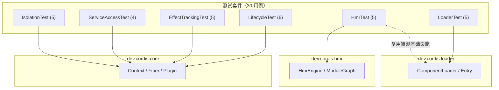

cordis-java 的测试套件不是一个"覆盖率数字"，而是一份**可执行的行为契约清单**：30 个用例、6 个测试类，每个类都通过 Javadoc 注释锚定到框架设计论文的具体章节与算法定义，将形式化规范转译为逐条可验证的断言。本页从体系结构、方法论与逐域契约三个层面拆解这套测试，让你理解"框架承诺了什么"以及"每一条承诺由谁守护"。对于中级开发者而言，这份清单同时是一份逆向学习路线——读懂这 30 个断言，就掌握了框架全部核心语义的边界。

Sources: [LifecycleTest.java](cordis-core/src/test/java/dev/cordis/LifecycleTest.java#L15-L16), [ServiceAccessTest.java](cordis-core/src/test/java/dev/cordis/ServiceAccessTest.java#L12-L13), [HmrTest.java](cordis-core/src/test/java/dev/cordis/HmrTest.java#L18-L19)

## 测试体系全景：六个契约域

测试全部位于 `cordis-core/src/test/java/dev/cordis/` 下，扁平排布、无嵌套包结构——这与被测框架的分层（core / loader / hmr）形成清晰的映射关系。六个测试类的用例数恰好合计为 30：

| 测试类 | 用例数 | 守护的契约域 | 规范锚点（类 Javadoc） |
|---|---|---|---|
| `LifecycleTest` | 6 | 反应式共效应：满足驱动激活 | paper Section 3.2 |
| `EffectTrackingTest` | 5 | 可回退效应：LIFO 追踪与恢复 | paper Section 3.1, Algorithm 1 |
| `IsolationTest` | 5 | 共效应隔离与拦截 | paper Definition 24/25、26/27 |
| `ServiceAccessTest` | 4 | 上下文访问纪律 | paper Algorithm 6 |
| `LoaderTest` | 5 | 声明式配置与组件调和 | paper Section 5.2.1 |
| `HmrTest` | 5 | 热模块替换 | paper Section 5.2.2, Algorithms 8–10 |

Sources: [LoaderTest.java](cordis-core/src/test/java/dev/cordis/LoaderTest.java#L20-L21), [IsolationTest.java](cordis-core/src/test/java/dev/cordis/IsolationTest.java#L13-L14), [EffectTrackingTest.java](cordis-core/src/test/java/dev/cordis/EffectTrackingTest.java#L15-L16)

用例数与契约域的分布并非均匀切割，而是**按语义风险加权**：生命周期与效应追踪合计 11 个用例，占据超过三分之一的篇幅，因为时间维度（效应折叠、状态转换）正是这个框架最难做对、最值得测试投入的部分。下面的图谱展示六个测试类如何分别对准框架的三个子系统的公共 API 表面：



值得注意的是 `HmrTest` 对 `ComponentLoader` 的复用：事务性重载用例直接以 loader 作为编排目标（[HmrTest.java](cordis-core/src/test/java/dev/cordis/HmrTest.java#L84-L136)），这本身验证了一个架构承诺——HMR 引擎不自带状态存储，而是驱动声明式加载器完成重载。

Sources: [HmrTest.java](cordis-core/src/test/java/dev/cordis/HmrTest.java#L84-L136), [ComponentLoader.java](cordis-core/src/main/java/dev/cordis/loader/ComponentLoader.java#L29)

## 测试方法论：四条设计纪律

在逐条展开契约之前，先理解这套测试**怎么写**，比理解它写了什么更重要。它呈现出四条贯穿始终的设计纪律，任何一条都值得在你自己的框架测试中复制。

**纪律一：纯黑盒、零 mock 框架。** 依赖清单里只有 `org.junit.jupiter:junit-jupiter`，没有 Mockito、没有 MockWebServer、没有任何测试替身库。所有替身都是手写的：`LoaderTest` 内嵌一个 `Registry` 类实现 `PluginResolver` 接口、以内存 `Map<url, Supplier<Plugin>>` 充当模块注册表（[LoaderTest.java](cordis-core/src/test/java/dev/cordis/LoaderTest.java#L24-L33)）；`HmrTest` 则将 `ModuleGraph` 接口直接用 lambda 实现——`url -> imports.getOrDefault(url, Set.of())`，三行代码就是一个任意的模块依赖图（[HmrTest.java](cordis-core/src/test/java/dev/cordis/HmrTest.java#L21-L23)。黑盒意味着断言对象只有公共 API（`Context`、`Fiber`、`Plugin`、`ComponentLoader`、`HmrEngine`），内部实现的任何重构都不会惊动这 30 个用例。

**纪律二：事件日志断言。** 几乎所有时序敏感的用例都采用同一模式：插件回调向 `List<String> log` 追加带标签的事件，然后用 `assertEquals(List.of("provider-up", "consumer-up:v1"), log)` 做**精确序列相等断言**（[LifecycleTest.java](cordis-core/src/test/java/dev/cordis/LifecycleTest.java#L60-L71)）。这比"验证某事件发生过"的弱断言严格得多——它同时锁定了事件的发生与顺序，是守护"消费者先于提供者卸载"这类守卫次序契约的唯一可行手段。

**纪律三：错误码即契约。** 异常路径的断言不止于 `assertThrows`，而是进一步校验 `CordisException.Code` 枚举值的精确匹配——例如访问纪律用例分别断言 `UNDECLARED_ACCESS` 与 `INACTIVE_ACCESS`（[ServiceAccessTest.java](cordis-core/src/test/java/dev/cordis/ServiceAccessTest.java#L58-L82)）。这源于框架对错误码的定位：**稳定、机器可读**，宿主程序可以对其做程序化分支，因此错误码本身必须被测试锁定，防止悄悄漂移。

**纪律四：规范可追溯。** 每个测试类的 Javadoc 标注论文章节或算法定义，每个关键用例内部的行内注释解释"为什么"而非"是什么"——例如 `// guard ordering: the consumer fully unloads before the provider's own teardown`（[LifecycleTest.java](cordis-core/src/test/java/dev/cordis/LifecycleTest.java#L82-L85)。这使得测试失败时的第一反应可以是从用例反查规范条文，判定是实现回归还是规范本身需要修订。

Sources: [LoaderTest.java](cordis-core/src/test/java/dev/cordis/LoaderTest.java#L24-L33), [HmrTest.java](cordis-core/src/test/java/dev/cordis/HmrTest.java#L21-L23), [LifecycleTest.java](cordis-core/src/test/java/dev/cordis/LifecycleTest.java#L60-L85), [CordisException.java](cordis-core/src/main/java/dev/cordis/core/CordisException.java#L8-L32)

## 契约清单 · 生命周期反应式共效应（LifecycleTest，6 例）

这个域守护的核心命题是：**依赖的满足驱动激活，依赖的撤回驱动钝化**。提供者与消费者两个手写插件工厂（分别 `provide("svc", value)` 与 `inject` `svc`）构成最小可观测的依赖拓扑，六个用例覆盖了这条拓扑上全部状态跃迁与例外路径。

| # | 用例 | 行为契约 | 关键断言 |
|---|---|---|---|
| 1 | `consumerWaitsThenActivatesOnProvide` | 缺失依赖时消费者停留 `PENDING`，提供者上线后自动激活 | 状态序列 `PENDING → ACTIVE`，日志 `["provider-up", "consumer-up:v1"]` |
| 2 | `withdrawingProviderDeactivatesThenReprovideReactivates` | 撤回提供者后消费者回到 `PENDING`；**守卫次序**：消费者完全卸载先于提供者自身 teardown | 日志 `["consumer-down", "provider-down"]`；重提供后消费者以新值再激活 |
| 3 | `providerReplacementReloadsConsumerAgainstNewFiber` | 消费者因**提供者 fiber 身份变化**而重载（按身份而非值识别绑定） | 日志 `["consumer-up:v1", "consumer-down", "consumer-up:v2"]` |
| 4 | `duplicateProvideInSameRealmThrows` | 同一隔离域内重名提供被拒绝 | `CordisException`（`DUPLICATE_PROVIDE`） |
| 5 | `restartUnloadsAndReloadsWithSameConfig` | `restart()` 复用原配置完整走一轮卸载/重载，终态回到 `ACTIVE` | 日志 `["up:cfg-1", "down", "up:cfg-1"]` |
| 6 | `updateAppliesNewConfigBehindTheWaterfall` | `update()` 在卸载瀑布之后应用新配置 | 日志 `["up:old", "down", "up:new"]`，`getEffectiveConfig() == "new"` |

用例 2 和 3 是这个域的精髓：它们共同验证了框架最反直觉的一条语义——**绑定以提供者实例身份为准**。撤回再重提供、或换成新提供者，即使服务值不变，消费者也必须完整经历卸载与重载；时序断言进一步锁定了级联卸载中"依赖方先走"的守卫次序。状态机六态的完整定义见 [生命周期状态机](11-sheng-ming-zhou-qi-zhuang-tai-ji-pending-dao-disposed-de-liu-zhuang-tai-yu-zhuan-huan-gui-ze)，此处测试只使用其中 `PENDING`/`ACTIVE` 两个稳态做断言。

Sources: [LifecycleTest.java](cordis-core/src/test/java/dev/cordis/LifecycleTest.java#L60-L103), [LifecycleTest.java](cordis-core/src/test/java/dev/cordis/LifecycleTest.java#L105-L153), [FiberState.java](cordis-core/src/main/java/dev/cordis/core/FiberState.java#L1-L40)

## 契约清单 · 上下文访问纪律（ServiceAccessTest，4 例）

对应论文 Algorithm 6 的"代理解析"语义，四个用例穷尽了 `ctx.get` / `ctx.set` 的全部拒绝与放行路径，其组合逻辑可以用一张判定表概括：

| # | 用例 | 场景 | 判定 |
|---|---|---|---|
| 1 | `undeclaredAccessFromPluginContextThrows` | 插件上下文访问**未在 `inject()` 声明**的键（即使已被提供） | 拒绝 → `UNDECLARED_ACCESS` |
| 2 | `declaredAccessOnUnloadedFiberThrowsInactive` | 已声明 `inject` 但 fiber 尚处 `PENDING` 未加载 | 拒绝 → `INACTIVE_ACCESS` |
| 3 | `rootAccessIsNonStrict` | 根上下文读写 | 放行且宽松：可直接 get/set，缺失键返回 `null` 而非抛错 |
| 4 | `setRules` | 写服务的所有权 | 仅**提供该服务的 fiber** 可 `set`；他者或从未提供过的键 → `INVALID_SET` |

前两条用例合起来刻画了访问的**双重门禁**：声明（inject 列表）与激活（fiber 已加载）缺一不可，而根上下文作为编排者豁免于此纪律。用例 1 的注释特意强调一个易误解点——插件提供的服务绑定不是"环境权限"，任何 fiber 未声明就取，哪怕服务明明存在也会被拒。这与 [inject 声明与 ReflectService 通知](14-inject-sheng-ming-yu-reflectservice-tong-zhi-ti-gong-zhe-bian-hua-de-fan-ying-shi-fen-lei) 中描述的反应式分类机制共享同一份声明数据。

Sources: [ServiceAccessTest.java](cordis-core/src/test/java/dev/cordis/ServiceAccessTest.java#L35-L60), [ServiceAccessTest.java](cordis-core/src/test/java/dev/cordis/ServiceAccessTest.java#L62-L111)

## 契约清单 · 可回退效应（EffectTrackingTest，5 例）

对应论文 Section 3.1 / Algorithm 1，测试插件工厂 `effectsPlugin` 依次注册若干带标签效应，每个效应登记 `open:` 事件并返回登记 `close:` 事件的 `Disposable`，从而将 LIFO 折叠次序显性化。

| # | 用例 | 行为契约 | 关键断言 |
|---|---|---|---|
| 1 | `effectsUnwindInLifoOrderOnFiberUnload` | fiber 卸载时效应**严格逆序展开**，终态 `DISPOSED` | 注册 `[a,b,c]`，卸载展开 `[c,b,a]` |
| 2 | `explicitDisposeRunsOnce` | 显式 dispose 幂等（第二次为 no-op）；**已显式处置的效应脱离 fiber**，fiber 卸载不再重复展开 | 日志恰好 `["open","close"]`；随后 `ctx.fiber().dispose()` 不产生新事件 |
| 3 | `multiStageIterableCollectsEveryStage` | `apply` 直接返回 `Iterable<Disposable>` 即惰性多阶段效应，卸载时**逆序逐段收集** | 三个阶段按 `[undo-3, undo-2, undo-1]` 执行 |
| 4 | `effectOnDisposedFiberThrows` | 已 `DISPOSED` 的 fiber 上不可再注册效应 | `CordisException`（`INACTIVE_EFFECT`） |
| 5 | `nullResultIsAnEffectWithNothingToUndo` | 回调返回 `null` 是合法的"无事可撤销"效应 | `EffectCallback.flatten(null)` 与 `ctx.effect(cb -> null)` 均不抛 |

用例 2 是**单次处置语义**（dispose-once）与**所有权转移**的双重验证：显式处置后效应不再属于 fiber，这防止了"用户手动清理 + 框架级联卸载"场景下的双重释放。用例 5 则定义了效应模型的最简基线——null 是效应，只是没有延续。关于多阶段延续与稳定性守卫中断的机制细节，见 [惰性 Iterable 多阶段效应](10-duo-xing-iterable-duo-jie-duan-xiao-ying-yu-wen-ding-xing-shou-wei-zhong-duan)。

Sources: [EffectTrackingTest.java](cordis-core/src/test/java/dev/cordis/EffectTrackingTest.java#L39-L69), [EffectTrackingTest.java](cordis-core/src/test/java/dev/cordis/EffectTrackingTest.java#L71-L102)

## 契约清单 · 隔离与拦截（IsolationTest，5 例）

对应论文 Definition 24/25（隔离域）与 26/27（拦截合并）。五个用例覆盖 `isolate` 派生上下文的两个正交维度：**独立解析**与**通知封闭**。

| # | 用例 | 行为契约 | 关键断言 |
|---|---|---|---|
| 1 | `isolatedScopesResolveIndependently` | 同根派生的两个命名 scope 各自解析本域提供者，根不受影响 | `a→"A"`、`b→"B"`、`root→"root"` 三者互不串扰 |
| 2 | `notifyDoesNotCrossRealms` | **提供者变化通知不跨域传播**：scope-a 上线新提供者只激活 a 的消费者 | `logA=["see:A2"]` 而 `logB=[]` |
| 3 | `defaultIsolateCreatesFreshScopes` | 不带标签的 `isolate` 每次生成全新域 | 两 scope 各自独立，根上 `getOrNull("svc")` 为 `null` |
| 4 | `sameLabelJoinsScopes` | `RealmKey.shared("tenant-1")` 使两个派生上下文**汇入同一域**，一个提供者满足双方 | 两处 `resolveRealm("svc")` 为同一实例，消费者 `ACTIVE` |
| 5 | `interceptMergesWithDescendantsWinning` | 拦截配置沿派生链**右偏合并**，子代覆盖父代同键 | `root{a:1,b:1}` + `leaf{b:2}` → 解析为 `{a:1, b:2}`；根上为 `null` |

用例 2 与用例 4 构成隔离语义的完整拼图：默认严格封闭（通知不出域），但显式共享 `RealmKey` 可以把多个上下文焊接为一个域。用例 5 则锁定合并的方向性——**后代优先**，这是 [拦截配置右偏合并](17-lan-jie-intercept-pei-zhi-you-pian-he-bing-yu-bian-pai-zhe-quan-xian-shou-suo) 页面的主题在测试层的最小重现。

Sources: [IsolationTest.java](cordis-core/src/test/java/dev/cordis/IsolationTest.java#L38-L70), [IsolationTest.java](cordis-core/src/test/java/dev/cordis/IsolationTest.java#L72-L104)

## 契约清单 · 声明式调和（LoaderTest，5 例）

对应论文 Section 5.2.1，以 `ComponentLoader.load(desired)` 为入口验证**按 id 差分、逐字段分发**的调和语义。

| # | 用例 | 行为契约 | 关键断言 |
|---|---|---|---|
| 1 | `reconcileAddsRemovesAndUpdates` | 三向调和：新增挂载；**config 变更走 `update` 不重挂载**；未触碰条目不重启；移除即卸载 | 计数器：a 加载 2 次（含 1 次 update 重启）、b 仅 1 次；`ids()` 收缩为 `["a"]` |
| 2 | `disabledKeepsEntryUnmounted` | `disabled(true)` 条目保留但不挂载；取消 disabled 后正常挂载，再次禁用又卸下 | `mounted("m").fiber` 在 null 与非 null 间切换，加载计数严格对应 |
| 3 | `urlChangeRebuilds` | 同 id 换 url 视为重建，旧 fiber 卸载、新插件挂载 | v1 与 v2 各加载 1 次，`mounted("m").plugin.name() == "v2"` |
| 4 | `configSchemaFailureLeavesFiberFailed` | 校验失败的三种形态：**无效 update 被前置拒绝**（fiber 保持 ACTIVE、旧配置继续生效、直接调用 `fiber.update(99)` 抛 `ValidationException`）；**无效初始配置使 fiber 落入 FAILED** 且 `await()` 抛出 | `getEffectiveConfig() == 3` 不变；`s2` 状态 `FAILED` |
| 5 | `mountUnderMissingModuleIsReportedNotThrown` | 模块缺失**上报而非抛出**，调和继续 | `mounted("x").fiber == null`，`load` 不抛异常 |

用例 4 是全清单中最具层次感的一条：它区分了"更新被拒"（系统可自愈，旧世界继续运行）与"挂载失败"（fiber 进入 FAILED 终局）两种截然不同的故障处理策略，这正是 [配置系统与 ValidationException](25-pei-zhi-xi-tong-configschema-xiao-yan-validationexception-yu-update-liu-cheng) 所述流程的验收标准。用例 5 则体现了声明式系统的容错底线：一条坏配置不应让整批调和失败。

Sources: [LoaderTest.java](cordis-core/src/test/java/dev/cordis/LoaderTest.java#L51-L82), [LoaderTest.java](cordis-core/src/test/java/dev/cordis/LoaderTest.java#L84-L120), [LoaderTest.java](cordis-core/src/test/java/dev/cordis/LoaderTest.java#L122-L172)

## 契约清单 · 热模块替换（HmrTest，5 例）

对应论文 Section 5.2.2 / Algorithms 8–10。前四个用例以纯函数方式测 `HmrEngine` 的静态算法（`classify`、`detectStale`），最后一个用例做端到端的事务性重载演练。

| # | 用例 | 行为契约 | 关键断言 |
|---|---|---|---|
| 1 | `classifyResolvesEntangledModulesAndDeclinesPlainDependencies` | **纠缠模块**（与变更模块构成环的 wrapper）被接受；纯下游依赖被拒绝（随重载拾取而非替换） | accepted ⊇ `{impl, wrapper}`；declined ∋ `core` |
| 2 | `classifyAcceptsModulesInCycleWithAcceptedOnesAndDefaultsUndecided` | 分类不动点的两条边界：环内不含已接受模块 → **默认拒绝**；环内含已接受模块 → 接受 | `{x,y}` declined；`{S,x2}` 全部 accepted |
| 3 | `externalsAreNeverAccepted` | external 模块（如宿主内置）永不进入 accepted | `app` ∈ declined |
| 4 | `detectStaleFindsEntriesReachingChangedModules` | 陈旧 entry 检测 = 依赖可达性：entry 传递依赖到 accepted 集合即陈旧 | `stale == {entry1}`，`entry2` 不受影响 |
| 5 | `transactionalReloadRollsBackOnFailure` | 事务性重载三分量：热替换只换目标 fiber；**消费者因提供者身份变化而级联重载**（`loads ≥ 2`）；**坏模块使重载失败并回滚**，旧版本继续服务 | `v1 → v2` 生效后注入 broken，断言抛出且 `root.get` 仍为 `"v2"` |

用例 5 是整个测试套件中最接近真实 HMR 会话的一条：注册表内 `greeting` 依次从 v1 换到 v2 再换成会抛异常的 broken 工厂，验证"成功时最小扰动、失败时完整回滚"这对矛盾承诺可以共存。其中 `loads >= 2` 的宽松断言别有深意——它故意不锁定消费者的精确重载次数，因为级联重载的扇出是实现自由度，契约只保证"至少重载"。分类不动点、依赖环拒绝与半重载回滚的算法内幕分别展开于 [HMR 阶段一](20-hmr-jie-duan-mo-kuai-fen-lei-bu-dong-dian-yu-yi-lai-huan-mo-ren-ju-jue)、[阶段二](21-hmr-jie-duan-er-yi-lai-shu-bian-li-yu-chen-jiu-entry-jian-ce) 与 [阶段三](22-hmr-jie-duan-san-shi-wu-xing-zhong-zai-yu-ban-zhong-zai-zhuang-tai-de-hui-gun-bao-zheng)。

Sources: [HmrTest.java](cordis-core/src/test/java/dev/cordis/HmrTest.java#L25-L60), [HmrTest.java](cordis-core/src/test/java/dev/cordis/HmrTest.java#L62-L82), [HmrTest.java](cordis-core/src/test/java/dev/cordis/HmrTest.java#L84-L136)

## 断言风格速查：从用例到守护意图

把 30 个用例的断言手法归并，可以提炼出四种可复用的断言模式——它们各自对应一类特定的守护意图，理解这个映射有助于你在扩展测试时选择正确的武器：

| 断言模式 | 守护意图 | 典型示例 |
|---|---|---|
| 精确序列相等（`assertEquals(List.of(...), log)`） | 时序与守卫次序契约 | 级联卸载次序、LIFO 展开、waterfall 更新 |
| 状态枚举相等（`assertEquals(FiberState.X, f.state)`） | 生命周期终局契约 | `PENDING`/`ACTIVE`/`FAILED`/`DISPOSED` |
| 异常类型 + `getCode()` 相等 | 错误码稳定性契约 | `UNDECLARED_ACCESS`、`DUPLICATE_PROVIDE` 等 8 个码位 |
| 不变式宽松断言（`assertTrue(loads.get() >= 2)`） | 语义下界契约（容忍实现扇出） | HMR 级联重载次数 |

Sources: [LifecycleTest.java](cordis-core/src/test/java/dev/cordis/LifecycleTest.java#L82-L85), [CordisException.java](cordis-core/src/main/java/dev/cordis/core/CordisException.java#L9-L32), [HmrTest.java](cordis-core/src/test/java/dev/cordis/HmrTest.java#L127-L129)

## 运行测试与基础设施

测试基础设施刻意保持极简：根 POM 统一管理 `junit.version = 5.10.2` 并在 `pluginManagement` 中固定 `maven-surefire-plugin 3.2.5`，`cordis-core` 模块仅声明 `junit-jupiter` 一项 test-scope 依赖，无任何其他测试库。这意味着本地运行只需一条标准命令：

```bash
./mvnw -pl cordis-core test
```

从仓库根目录执行时以 `-pl cordis-core` 限定模块——`cordis-example` 无测试代码。整套 30 个用例全部为同步逻辑测试（无 `@Timeout`、无并发编排），秒级完成，适合作为开发循环中的持续验证目标。

Sources: [pom.xml](pom.xml#L24-L50), [cordis-core/pom.xml](cordis-core/pom.xml#L17-L18)

## 延伸阅读

这 30 条契约是各专题页面的"验收摘要"。想深入某条契约背后的机制，按域选择入口：生命周期域续读 [生命周期状态机](11-sheng-ming-zhou-qi-zhuang-tai-ji-pending-dao-disposed-de-liu-zhuang-tai-yu-zhuan-huan-gui-ze) 与 [O-Insert 与 O-Retire](13-o-insert-yu-o-retire-cha-jian-shi-li-hua-de-xiao-ying-hua-yu-ji-lian-xie-zai)；效应域续读 [LIFO 逆变换累加器](9-lifo-ni-bian-huan-lei-jia-qi-xiao-ying-zhe-die-dan-ci-chu-zhi-yu-shi-bai-hui-gun)；隔离域续读 [隔离域与多租户实践](16-ge-chi-yu-realmkey-isolate-pai-sheng-shang-xia-wen-yu-duo-zu-hu-shi-jian)；加载域续读 [组件调和](19-zu-jian-diao-he-an-id-chai-fen-yu-zhu-zi-duan-fen-fa-de-zui-xiao-rao-dong-ce-lue)；若你正准备把框架嵌入自己的宿主程序，[宿主集成指南](28-su-zhu-ji-cheng-zhi-nan-pluginresolver-modulegraph-yu-mo-kuai-zhu-ce-ce-lue) 会在 `PluginResolver` 与 `ModuleGraph` 这两个被本测试套件重度使用的接缝上给出集成建议——而这套 30 例契约清单，正是你集成后可以反复运行的回归基线。