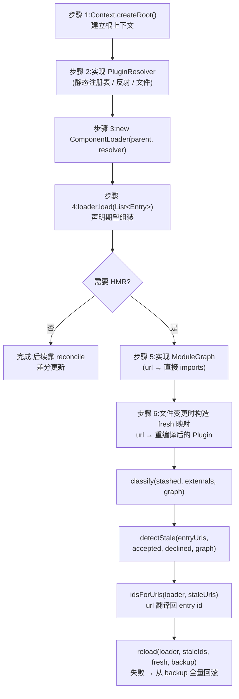

在 Node.js 生态中，`require` 与模块缓存是运行时内建的动态模块注册表；而 JVM 没有等价物。cordis-java 面对这个根本差异做出的设计决策是：**框架不发明模块系统，而是把"模块的引入与撤出"以两个单方法函数式接口的形式交还给宿主**——`PluginResolver` 负责把 Entry 的 `url` 解析为可实例化的 `Plugin` 实例，`ModuleGraph` 负责向 HMR 引擎描述模块的直接依赖关系。本页面向需要在真实应用中接线这套框架的高级开发者，讲清两个接口的精确契约、`ComponentLoader` 与 `HmrEngine` 的消费路径、五种可验证的模块注册策略，以及集成时最容易踩中的契约陷阱。

Sources: [PluginResolver.java](cordis-core/src/main/java/dev/cordis/loader/PluginResolver.java#L5-L12)、[ModuleGraph.java](cordis-core/src/main/java/dev/cordis/hmr/ModuleGraph.java#L5-L9)

## 集成面全景：宿主与框架的职责分界

从第一性原理出发，宿主集成只涉及三个框架类的接线：`ComponentLoader` 需要 `Context`（挂载父上下文）与 `PluginResolver`（模块来源）各一个；`HmrEngine` 是纯静态工具类，其三个阶段函数额外需要 `ModuleGraph`。除此之外的一切——Fiber 生命周期、效应回滚、realm 隔离——框架内部自理。

```mermaid
flowchart LR
    subgraph HOST["宿主侧（你需要提供的）"]
        REG["模块注册策略<br/>Map&lt;String, Supplier&lt;Plugin&gt;&gt; / 反射 / 构建索引"]
        GRAPH["ModuleGraph 实现<br/>url → 直接 imports"]
        ENTRIES["Entry 配置列表<br/>id / url / isolate / intercept / config"]
    end
    subgraph CORE["cordis-core（框架提供）"]
        RES["PluginResolver<br/>(函数式接口)"]
        CL["ComponentLoader<br/>mount / remount / reconcile"]
        HMR["HmrEngine (静态)<br/>classify → detectStale → reload"]
        CTX["Context / Fiber 树"]
    end
    REG -->|"url → Plugin 实例"| RES
    RES -->|注入构造| CL
    GRAPH -->|注入阶段函数| HMR
    ENTRIES -->|load(List&lt;Entry&gt;)| CL
    CL -->|ctx.plugin / fiber.dispose| CTX
    HMR -->|"remount(id, fresh)"| CL
```

分界的关键在于 **`url` 是贯穿四个体系的连接键**：Entry 用它选择组件，resolver 用它查找模块，graph 用它查询依赖，HMR 的 `fresh` 映射用它提供重编译产物。宿主的注册表、依赖图、热更新产物三份数据必须使用同一套 url 语义，这是整个集成面的第一不变量。

Sources: [ComponentLoader.java](cordis-core/src/main/java/dev/cordis/loader/ComponentLoader.java#L55-L59)、[HmrEngine.java](cordis-core/src/main/java/dev/cordis/hmr/HmrEngine.java#L53-L54)、[Entry.java](cordis-core/src/main/java/dev/cordis/loader/Entry.java#L17-L28)

## PluginResolver：模块实例化的唯一入口

### 接口契约

`PluginResolver` 是一个 `@FunctionalInterface`，整个接口只有一行方法签名，但契约密度很高：

```java
@FunctionalInterface
public interface PluginResolver {
    Plugin resolve(String url) throws Exception;
}
```

三条契约条款全部写在 Javadoc 中，且都有对应的框架侧处理路径。**实例新鲜性**：当底层模块可能已变化时，每次调用必须返回全新实例——这直接决定了 HMR 场景下"重新 resolve"能否拿到编辑后的代码，而非复用旧对象。**失败语义**：抛出异常时加载器会记录并报告，而 HMR 重载会整体回滚——异常不是终止信号，而是参与事务回滚协议的输入。**来源自由**：注册表查找、反射类加载、读取外部文件、或为 HMR 合成代表已编辑模块的新实例，均合法。

Sources: [PluginResolver.java](cordis-core/src/main/java/dev/cordis/loader/PluginResolver.java#L13-L25)

### 框架侧的两条消费路径

`ComponentLoader` 持有 resolver 并只在两处调用它，理解这两处的差异是把握契约的前提。第一条是**初始挂载路径**：`mount()` 在派生好隔离/拦截上下文后调用 `resolver.resolve(e.url)` 获取插件，随后 `ctx.plugin(plugin, e.config)` 实例化 fiber；若 resolve 抛出异常，该 entry 并不会从 mounted 表中消失，而是以 `fiber=null, plugin=null, ctx=null` 的降级形态留在记录里，错误被 `log.error` 记录。这意味着**解析失败的 entry 是"已挂载但未实例化"的状态**，后续 reconcile 到同一 id 时会正常走字段分派逻辑。

第二条是**热替换路径**：公开方法 `remount(String id, Plugin forced)` 在 `forced == null` 时重新咨询 resolver——这正是"编辑后的模块"被捡起的位置。先 dispose 旧 fiber，再 resolve、重建派生上下文、实例化新 fiber 并 `await()`，最后更新 mounted 记录。HMR 引擎不直接持有 resolver，它通过 `loader.remount()` 间接复用这条路。

Sources: [ComponentLoader.java](cordis-core/src/main/java/dev/cordis/loader/ComponentLoader.java#L140-L156)、[ComponentLoader.java](cordis-core/src/main/java/dev/cordis/loader/ComponentLoader.java#L195-L214)

## ModuleGraph：HMR 的依赖元数据供给

`ModuleGraph` 同样是单方法函数式接口，语义比 resolver 更克制——它只回答一个问题：**某模块直接 import 了哪些模块**。叶子模块返回空集。框架不规定宿主如何获得这份元数据，Javadoc 明确列出了 Java 移植的三种现实来源：构建索引（build index）、类引用扫描（class reference scan）、手工维护的映射表。

```java
@FunctionalInterface
public interface ModuleGraph {
    /** The modules {@code url} directly imports; an empty set for leaf modules. */
    Set<String> imports(String url);
}
```

它被 `HmrEngine` 的三个静态阶段共同消费：`classify()` 以 stash 文件的 imports 为种子做不动点迭代；`dependencies()` 以 declined 集为边界做传递依赖遍历；`detectStale()` 对每个已挂载 entry 的 url 求依赖树并与 accepted 求交。**精确性要求**是宿主必须注意的：`imports()` 必须返回*直接*依赖而非传递闭包——闭包展开是引擎自己的职责（`traverse()` 递归完成），若宿主图里已经折叠了传递依赖，不动点迭代的接受/拒绝判定会被扭曲。三个阶段的算法细节属于 [HMR 阶段一：模块分类不动点与依赖环默认拒绝](20-hmr-jie-duan-mo-kuai-fen-lei-bu-dong-dian-yu-yi-lai-huan-mo-ren-ju-jue)至 [HMR 阶段三：事务性重载与半重载状态的回滚保证](22-hmr-jie-duan-san-shi-wu-xing-zhong-zai-yu-ban-zhong-zai-zhuang-tai-de-hui-gun-bao-zheng)三页的范围，此处不展开。

Sources: [ModuleGraph.java](cordis-core/src/main/java/dev/cordis/hmr/ModuleGraph.java#L10-L15)、[HmrEngine.java](cordis-core/src/main/java/dev/cordis/hmr/HmrEngine.java#L83-L94)

## 模块注册策略：五种可验证的实现形态

`PluginResolver` 的 Javadoc 与 README 共同枚举了宿主可采用的策略。结合仓库内的三个参考实现（示例宿主、`LoaderTest`、`HmrTest`），下表给出完整对比：

| 策略 | 实现机制 | 适用场景 | 仓库内参考 | 关键约束 |
|---|---|---|---|---|
| **静态注册表** | `Map<String, Supplier<Plugin>>`，每次 resolve 调用 `factory.get()` | 演示、测试、模块集合在编译期固定的宿主 | `LoaderTest.Registry`、`Main.MODULES` | Supplier 保证每调用产出新实例，满足新鲜性契约 |
| **反射类加载** | `Class.forName(url).getDeclaredConstructor().newInstance()` | 模块为classpath 上的类、url 即全限定类名的宿主 | Javadoc 列举 | 需处理 `ClassNotFoundException` 等检查异常；无 HMR 能力（JVM 类不可卸载） |
| **外部文件** | 读取配置/清单文件后定位插件 | 配置驱动的组装、插件位于 jar 外部的部署 | Javadoc 列举 | 文件解析失败的异常即进入"加载器报告 + HMR 回滚"协议 |
| **HMR 合成实例** | 为已编辑模块返回代表新代码的全新实例 | 开发期热替换 | `Main` 的 `fresh` 映射 | 实例须对应重编译产物，否则替换无意义 |
| **依赖元数据图** | `Map<String, Set<String>>` 直接导入表（ModuleGraph 侧） | HMR 的 build index / 类引用扫描 / 手工映射 | `HmrTest.graph` | 只含直接 imports；空集表示叶子 |

静态注册表的参考实现值得逐字对照——这是框架测试自己都在用的形态。`LoaderTest` 中一个名为 `Registry` 的静态内部类直接 `implements PluginResolver`，内部维护 `Map<String, Supplier<Plugin>> modules`，`resolve()` 查表、未命中抛 `IllegalArgumentException`。示例宿主 `Main` 则用 lambda 内联了同一逻辑，并把注册表本身（`MODULES`，一个 `LinkedHashMap`）做成 `static final` 字段——这带来一个重要的副作用：**HMR 的"编辑"被模拟为向同一个 map 覆盖写入新工厂**（`MODULES.put("plugin-greeting", GreetingPluginV2::new)`），随后重新 resolve 自然拿到 v2。真实宿主的"文件保存→重编译→更新注册表"是同一语义的工业化版本。

Sources: [LoaderTest.java](cordis-core/src/test/java/dev/cordis/LoaderTest.java#L23-L33)、[Main.java](cordis-example/src/main/java/dev/cordis/example/Main.java#L42-L48)、[HmrTest.java](cordis-core/src/test/java/dev/cordis/HmrTest.java#L21-L23)、[README.md](README.md#L120-L121)

## 端到端接线：最小宿主的完整步骤

将上述组件组装为一个可运行的宿主，路径如下。示例宿主在多租户场景中展示了"每 realm 一个 loader"的模式（`newLoader(tenantA)` / `newLoader(tenantB)`），在 HMR 场景中展示了完整的三阶段调用——两种模式都基于同一个 `newLoader` 工厂。



HMR 管线的实际代码即示例宿主第 135–143 行的六行调用：`ModuleGraph graph = url -> Set.of()` 声明全叶子图；`HmrEngine.classify(Set.of("plugin-greeting"), Set.of(), graph)` 得到分类；用 `hmrLoader.ids()` 与 `mounted(id).entry.url` 收集全部已挂载 entry 的 url；`detectStale` 求陈旧集合；`idsForUrls` 把 url 翻译回 entry id；`reload` 执行事务性替换。值得注意的是 **`fresh` 映射与 resolver 的协作规则**：reload 的 Javadoc 明确，`fresh` 中为 null 或缺失的 url 会回落到 loader 的 resolver 重新解析——也就是说宿主可以选择只提供部分重编译产物，其余交给注册表兜底。

Sources: [Main.java](cordis-example/src/main/java/dev/cordis/example/Main.java#L123-L143)、[Main.java](cordis-example/src/main/java/dev/cordis/example/Main.java#L165-L171)、[HmrEngine.java](cordis-core/src/main/java/dev/cordis/hmr/HmrEngine.java#L118-L154)

## 契约陷阱与排障指南

高级集成中最值得警惕的四个行为，全部可在代码中直接验证。

**陷阱一：解析失败不会移除 entry**。`mount()` 的 catch 分支将失败 entry 以全 null 的 `Mounted` 形态留存于表中，日志记录 `could not resolve`。宿主若以 `loader.mounted(id).fiber == null` 判断健康状态是正确的；但若期望"失败的 entry 自动从 `ids()` 消失"则与实现相反——它一直在，直到下一次 reconcile 把它从期望列表中删除才会触发 `unmount` 与 fiber dispose。

**陷阱二：resolver 缓存旧实例会废掉 HMR**。新鲜性契约的违反在普通加载下无症状（拿到旧代码也能跑），但在 `remount` 路径下表现为"热替换后行为不变"。示例宿主用 `Supplier<Plugin>` 从类型层面杜绝了共享实例的可能。

**陷阱三：realm 独占导致挂载失败**。示例第 112 与 124 行两次显式调用 `disposeAll()`，注释写明原因——每个 realm 内一个 key 只能有一个提供者，旧 loader 不释放，新 loader 在同 realm 重复提供 `db` 会冲突。多租户/HMR 共存时，**loader 的生命周期管理是宿主责任**。

**陷阱四：回滚是逐 entry 重建而非快照恢复**。`reload` 失败时遍历 `backup` 映射逐个 `remount(e.getKey(), e.getValue())`，某个回滚自身失败只记错误日志不中断其余回滚，最后把原异常重新抛出。宿主不应假设回滚后 fiber uid 不变——旧组件被重新实例化为全新 fiber，示例第 155 行对回滚后 `fiber.uid` 的打印正演示了这一点。

| 症状 | 根因 | 框架侧行为 | 宿主侧处置 |
|---|---|---|---|
| `mounted(id).fiber == null` | resolve 抛异常 | entry 留表、日志 `could not resolve` | 修注册表后重新 reconcile 或 remount |
| HMR 后行为未变 | resolver 返回缓存实例 | 正常替换，但插件是旧的 | 工厂/Supplier 保证每次新实例 |
| 同 realm 二次挂载失败 | 旧 loader 未释放 | 提供 key 冲突 | 释放旧 loader 或换 realm |
| reload 抛出原异常 | 新模块实例化失败 | backup 全量重建、重抛 | 检查 `fresh` 产物与 resolver 产物一致性 |

Sources: [ComponentLoader.java](cordis-core/src/main/java/dev/cordis/loader/ComponentLoader.java#L140-L156)、[HmrEngine.java](cordis-core/src/main/java/dev/cordis/hmr/HmrEngine.java#L141-L153)、[Main.java](cordis-example/src/main/java/dev/cordis/example/Main.java#L111-L124)、[Main.java](cordis-example/src/main/java/dev/cordis/example/Main.java#L145-L156)

## 线程安全与 API 速查

`ComponentLoader` 的全部公开方法（`mounted`、`ids`、`load`、`reconcile`、`remount`、`disposeAll`）均在 `synchronized` 守护下操作同一个 `LinkedHashMap`——**单一 loader 实例可被并发调用，但多个 loader 之间无协调**，宿主需自行保证跨 loader 的 realm/服务约束（见陷阱三）。`Mounted` 记录暴露 `entry`、`fiber`（disabled 或 failed 时为 null）、`plugin`（disabled 时为 null）与派生 `ctx` 四个 final 字段，是宿主观测挂载状态的唯一窗口。`HmrEngine` 无任何实例状态，可静态并发调用。

| API | 签名 | 宿主用途 |
|---|---|---|
| 构造 | `ComponentLoader(Context parent, PluginResolver resolver)` | 唯一接线点 |
| 查询 | `Mounted mounted(String id)` / `List<String> ids()` | 观测挂载与健康状态 |
| 加载 | `synchronized void load(List<Entry>)` | 声明期望组装（reconcile 别名） |
| 热替换 | `synchronized Fiber remount(String id, Plugin forced)` | HMR 专用；`forced=null` 时重咨询 resolver |
| 释放 | `synchronized void disposeAll()` | realm 独占冲突时的宿主责任 |
| 分类 | `HmrEngine.classify(stashed, externals, graph)` | HMR 阶段一 |
| 检测 | `HmrEngine.detectStale(entryUrls, accepted, declined, graph)` | HMR 阶段二 |
| 重载 | `HmrEngine.reload(loader, staleIds, fresh, backupStore)` | HMR 阶段三，事务性 |
| 翻译 | `HmrEngine.idsForUrls(loader, staleUrls)` | url → entry id 便利方法 |

Sources: [ComponentLoader.java](cordis-core/src/main/java/dev/cordis/loader/ComponentLoader.java#L29-L74)、[ComponentLoader.java](cordis-core/src/main/java/dev/cordis/loader/ComponentLoader.java#L202-L221)、[HmrEngine.java](cordis-core/src/main/java/dev/cordis/hmr/HmrEngine.java#L169-L177)

## 延伸阅读

本页只覆盖"宿主提供什么"；两个接口被消费后的深水区由后续页面承接：Entry 六字段的完整语义见 [Entry 配置模型：id、url、isolate、intercept、config 与 disabled](18-entry-pei-zhi-mo-xing-id-url-isolate-intercept-config-yu-disabled)；字段级分派如何选出"最小扰动操作"见 [组件调和：按 id 差分与逐字段分发的最小扰动策略](19-zu-jian-diao-he-an-id-chai-fen-yu-zhu-zi-duan-fen-fa-de-zui-xiao-rao-dong-ce-lue)；HMR 三阶段算法细节见 [HMR 阶段一：模块分类不动点与依赖环默认拒绝](20-hmr-jie-duan-mo-kuai-fen-lei-bu-dong-dian-yu-yi-lai-huan-mo-ren-ju-jue)、[HMR 阶段二：依赖树遍历与陈旧 entry 检测](21-hmr-jie-duan-er-yi-lai-shu-bian-li-yu-chen-jiu-entry-jian-ce) 与 [HMR 阶段三：事务性重载与半重载状态的回滚保证](22-hmr-jie-duan-san-shi-wu-xing-zhong-zai-yu-ban-zhong-zai-zhuang-tai-de-hui-gun-bao-zheng)；示例宿主的完整八个场景走读见 [端到端演示走读：八个场景理解框架全部能力](4-duan-dao-duan-yan-shi-zou-du-ba-ge-chang-jing-li-jie-kuang-jia-quan-bu-neng-li)。