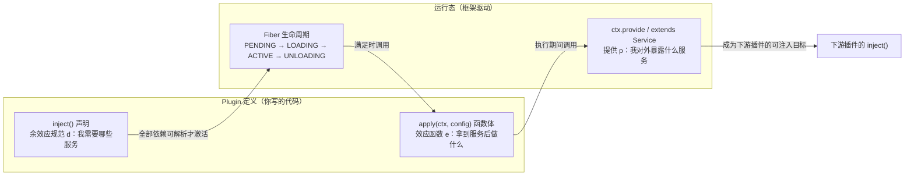
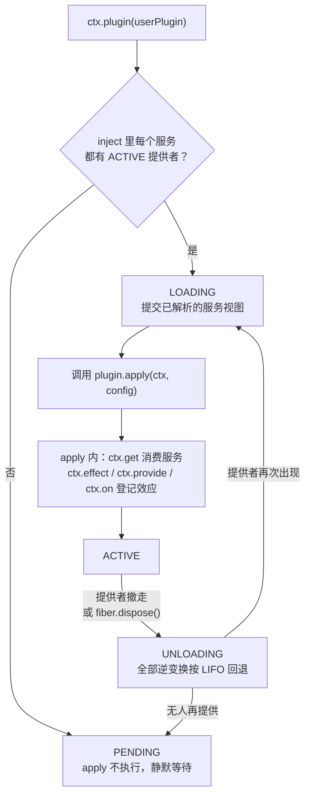

本页是一篇面向初学者的动手教程：从零开始，在 cordis-java 中写出你的第一个插件。你会学到框架最核心的三个动作——实现 **`Plugin` 接口**、用 **`inject()` 声明依赖**、用 **`ctx.provide` 提供服务**——并理解为什么这三者加在一起，就能让插件"加载有条件、卸载有回退"。读完本页后，你可以直接阅读 [端到端演示走读：八个场景理解框架全部能力](4-duan-dao-duan-yan-shi-zou-du-ba-ge-chang-jing-li-jie-kuang-jia-quan-bu-neng-li) 观察这些插件在完整系统中如何运转。

## 一、心智模型：一个插件 = 两个声明 + 一个函数体

在写代码之前，先建立一个正确的模型。框架官方对 `Plugin` 的定义是：一个插件把**余效应规范**（`inject()`，论文中的 `d`）与**效应函数**（`apply`，论文中的 `e`）配对在一起；而它**提供什么**（`p`）不写在接口上，而是在运行期间通过 `Context#provide` 声明。换句话说，"我需要什么"是静态声明的，"我做什么、我暴露什么"都在 `apply` 运行时动态发生。实例化时框架会把 `config` 绑定进 apply 调用，因此同一个插件绑定两份配置，行为上等于两个独立组件。

Sources: [Plugin.java](cordis-core/src/main/java/dev/cordis/core/Plugin.java#L6-L14)

用一张图表示这三者与运行时的关系：



注意箭头的方向：`inject` 决定你的插件**何时**能运行（提供者全部就绪），`provide` 决定**别人**的插件何时能运行。插件之间不是显式互相调用，而是通过这对"声明/提供"关系被框架自动编排起来——这正是本框架"空间可组合性"的日常形态。

Sources: [Plugin.java](cordis-core/src/main/java/dev/cordis/core/Plugin.java#L15-L42)

## 二、Plugin 接口全貌

`Plugin` 是一个只有四个方法的接口，其中三个有默认实现，真正必须手写的只有 `apply`：

| 方法 | 签名 | 作用 | 是否必须 |
|---|---|---|---|
| `name` | `String name()` | 显示名，用于 fiber 诊断与日志命名；可为 `null` | 可选（默认 `null`） |
| `inject` | `List<String> inject()` | 声明所需服务名列表；**全部可用时插件才会加载** | 可选（默认空列表） |
| `schema` | `ConfigSchema<?> schema()` | 激活前的配置校验 schema；`null` 表示接受任意配置 | 可选（默认 `null`） |
| `apply` | `Object apply(Context ctx, Object config)` | 插件函数体；返回值是卸载时要回退的效应 | **必须实现** |

`apply` 的两个参数分别是该插件实例运行所在的 fiber 上下文 `ctx`，以及经过校验的配置 `config`。返回值的约定是本框架最独特的一点：可以返回一个 `Disposable`（单阶段效应）、一个 `Disposable` 的 `Iterable`（多阶段效应）、或者 `null`（没有额外要回退的东西）——因为通过 `ctx.effect`、`ctx.provide` 登记的效应**已经被运行时自动追踪**，多数插件直接返回 `null` 即可。

Sources: [Plugin.java](cordis-core/src/main/java/dev/cordis/core/Plugin.java#L15-L42)

如果不想定义一个类，也可以用静态工厂 `Plugin.of(name, inject, body)` 把一段 lambda 包装成插件——后面第六节的最小示例会用到它。

Sources: [Plugin.java](cordis-core/src/main/java/dev/cordis/core/Plugin.java#L44-L62)

## 三、第一步：写一个不依赖任何服务的插件

从最简单的形态开始：一个只打印问候、启动一个"定时器"效应的插件。下面是示例工程中的真实代码（`GreetingPluginV1`）：

```java
public class GreetingPluginV1 implements Plugin {

    @Override
    public String name() {
        return "greeting";
    }

    @Override
    public Object apply(Context ctx, Object config) {
        Logger log = ctx.logger("greeting");
        log.info("hello from greeting v1");

        ctx.effect(cb -> {
            log.info("  [greeting-timer v1] started");
            return (dev.cordis.core.Disposable) () -> log.info("  [greeting-timer v1] stopped");
        }, "greeting-timer");
        return null;
    }
}
```

这段代码展示了初学者要掌握的两个要点。第一，**插件函数体在每次激活时都会完整执行一次**：`apply` 被调用时，你拿到的是一个属于本插件实例的 `ctx`，从中取命名日志、注册效应都通过它进行。第二，`ctx.effect(callback, label)` 是登记"可回退效应"的标准入口：回调在登记时立即执行（这里是打印 "started"），它**返回的 `Disposable` 就是逆变换**——框架持有它，等插件卸载时调用（打印 "stopped"）。你不需要写任何 `try/finally` 或"卸载清理函数"，返回逆变换这一个动作就完成了全部资源管理约定。

Sources: [GreetingPluginV1.java](cordis-example/src/main/java/dev/cordis/example/plugins/GreetingPluginV1.java#L13-L31)

`EffectCallback` 允许返回三种东西：单个 `Disposable`（一阶段）、`null`（无需回退）、或 `Disposable` 的 `Iterable`（多阶段——每个 yield 的清理器边产生边被收集，阶段边界是运行时可以打断转换的地方）。`Disposable` 本身只是一个 `void dispose()` 的函数式接口，框架保证它**至多被调用一次**，因此无需写成幂等。

Sources: [EffectCallback.java](cordis-core/src/main/java/dev/cordis/core/EffectCallback.java#L19-L29)

对比一下"没有框架时"与"用框架"写同一个带清理逻辑的模块，差异一目了然：

| 维度 | 传统手写（before） | 插件写法（after） |
|---|---|---|
| 启动逻辑 | 构造函数 / init 方法 | `apply` 函数体 |
| 清理逻辑 | 手写 `close()` + `try/finally` 链 | 返回 `Disposable` 逆变换 |
| 清理顺序保证 | 手工维护（容易写反） | 运行时按 LIFO 自动执行 |
| 出错回滚 | 半初始化状态需手工兜底 | 已登记的逆变换自动逆序回滚 |
| 依赖等待 | 自己轮询/排序启动 | `inject` 声明后框架自动调度 |

"回调即安装、返回即卸载"这个模式的理论背景（效应折叠与 LIFO 恢复）属于后续深读内容，见 [可回退效应模型：EffectCallback、Disposable 与多阶段延续](8-ke-hui-tui-xiao-ying-mo-xing-effectcallback-disposable-yu-duo-jie-duan-yan-xu)。

Sources: [Disposable.java](cordis-core/src/main/java/dev/cordis/core/Disposable.java#L12-L34)

## 四、第二步：提供你的第一个服务

一个插件如果只有效应没有产出，就无法参与组合。**提供服务的动作本身也是一个可回退效应**：服务随提供它的 fiber 激活而出现在注册表中，随 fiber 卸载而自动消失。框架提供两种等价写法。

### 写法 A：直接调用 ctx.provide

```java
ctx.provide("db", new DbService(ctx));
```

`Context` 上有两个 `provide` 重载：两参版本注册一个由当前 fiber 拥有的服务实现；三参版本额外接受一个**可用性谓词** `check`，框架在放行下游依赖者加载之前会先咨询它（例如数据库服务在"尚未完成连接"时返回 `false`，依赖者会继续等待而不是拿到半成品）。两个版本都返回一个 `Disposable`——需要提前撤销提供时可以手动调用它，通常则交给框架。

Sources: [Context.java](cordis-core/src/main/java/dev/cordis/core/Context.java#L235-L243)

### 写法 B：继承 Service 基类，构造即提供

示例工程中的 `DbService` 采用的是这种风格：

```java
public class DbService extends Service {

    public final Map<String, String> rows = new LinkedHashMap<>();
    private final boolean readOnly;

    public DbService(Context ctx) {
        super(ctx, "db");                    // 构造函数里完成 provide
        Object intercept = interceptConfig();
        this.readOnly = intercept instanceof Map<?, ?> m
                && Boolean.TRUE.equals(m.get("readOnly"));
    }

    public void put(String key, String value) { /* read-only 时抛出 */ }
    public String get(String key) { return rows.get(key); }
}
```

`Service` 基类在构造函数中执行 `super(ctx, name)` 时，就立即以当前 fiber 的名义调用了 `provide(name, this, value -> isAvailable())`——也就是说 `new DbService(ctx)` 这一行本身就完成了服务注册，且注册随 fiber 卸载自动注销，子类完全不用关心生命周期。基类还暴露 `interceptConfig()`，返回编排者为该服务合并的拦截配置（上例据此决定是否只读），这让服务可以在不修改自身代码的情况下被外部收缩权限。

Sources: [DbService.java](cordis-example/src/main/java/dev/cordis/example/plugins/DbService.java#L16-L41)

两种写法的取舍如下：

| 维度 | `ctx.provide(...)` | 继承 `Service` |
|---|---|---|
| 注册时机 | 显式调用时 | 构造函数内自动完成 |
| 可用性谓词 | 三参重载显式传入 | 重写 `isAvailable()` |
| 适用场景 | 提供第三方对象、lambda、已有实例 | 服务自身就是插件的一部分 |
| 拦截配置 | 服务内部需自行读取 | 自带 `interceptConfig()` |

底层实现上，`provide` 会被包装成一个带 `"ctx.provide(\"...\")"` 标签的效应：登记时写入按 realm 键控的服务存储并通知依赖者，逆变换则移除注册并再次通知。若同名服务在同一个 realm 中已被提供，会抛出 `DUPLICATE_PROVIDE`——**一个 realm 一个名字只允许一个提供者**。

Sources: [Service.java](cordis-core/src/main/java/dev/cordis/core/Service.java#L11-L33), [Fiber.java](cordis-core/src/main/java/dev/cordis/core/Fiber.java#L458-L479)

### 组合进提供者插件

把效应与服务提供组合起来，就是一个完整的提供者插件（示例中的 `DatabasePlugin`）：它先登记两个效应（获取连接、准备语句），再构造 `DbService` 完成提供，`apply` 最后返回 `null`——因为**所有需要撤销的东西都已经通过 `ctx.effect`/`provide` 被追踪**，作者不需要手写任何卸载路径。

Sources: [DatabasePlugin.java](cordis-example/src/main/java/dev/cordis/example/plugins/DatabasePlugin.java#L14-L45)

## 五、第三步：声明 inject，消费别人的服务

现在写消费方。`UserPlugin` 声明 `inject: ["db"]`，在 `apply` 里用 `ctx.get("db")` 拿到数据库服务：

```java
public class UserPlugin implements Plugin {

    @Override
    public String name() {
        return "users";
    }

    @Override
    public List<String> inject() {
        return List.of("db");            // 余效应规范：我需要 db
    }

    @Override
    public Object apply(Context ctx, Object config) {
        Logger log = ctx.logger("users");
        DbService db = ctx.get("db");    // 能力受 inject 声明约束
        log.info("loaded, resolved db@" + System.identityHashCode(db));

        ctx.on("user:create", args -> {  // 事件监听器也是可回退效应
            log.info("event user:create " + args[0]);
            return null;
        });

        UsersService users = new UsersService(ctx, db);   // 构造即提供 "users" 服务
        users.create("alice");
        return null;                     // 监听器 + 服务注册都是已追踪效应
    }
}
```

`inject()` 返回的列表就是插件的**加载条件**：只要其中任何一个服务没有处于 ACTIVE 状态的提供者，插件就停在 PENDING，`apply` 不会被调用；提供者出现时插件被自动激活，提供者撤走时插件连同其全部效应被自动回退。这不是"建议性"的依赖文档，而是**硬性的能力纪律**：`ctx.get` 在解析时会沿 fiber 链行走，若你想取一个**没有在 `inject` 里声明**的名字，会直接抛 `UNDECLARED_ACCESS` 异常；若声明的依赖当前不可用（例如在已去激活的上下文里访问），则抛 `INACTIVE_ACCESS`。

Sources: [UserPlugin.java](cordis-example/src/main/java/dev/cordis/example/plugins/UserPlugin.java#L16-L48), [Context.java](cordis-core/src/main/java/dev/cordis/core/Context.java#L173-L209)

把这个响应式过程画成流程图，初学者可以按图索骥地理解每一次状态变化：



两个初学者容易忽略的细节。其一，`ctx.on(...)` 注册的事件监听器同样是效应，随插件卸载自动移除——所以 `apply` 结尾的 `return null` 是安全的。其二，`UsersService` 这类"既消费 db 又对外提供 users"的服务是组合的基本形态：它构造时把 `db` 缓存为字段，且读的是**提交视图**，因此在自己的卸载过程中依然能读到数据库。其构造函数 `super(ctx, "users")` 一行即完成对外的 `users` 服务提供。

Sources: [UsersService.java](cordis-example/src/main/java/dev/cordis/example/plugins/UsersService.java#L15-L31), [Fiber.java](cordis-core/src/main/java/dev/cordis/core/Fiber.java#L335-L357)

## 六、把插件跑起来：最小可运行示例

定义好插件后，加载只需两步：创建根上下文，调用 `ctx.plugin(...)`。下面是 README 中"作为库使用"的最小示例，展示了**乱序加载**也不会出问题——先加载消费方，它进入 PENDING 等待；加载提供者后，消费方被自动通知并激活：

```java
Context root = Context.createRoot();

// 插件：声明 inject（余效应规范 d），apply 即效应函数 e
Plugin database = Plugin.of("database", List.of(), (ctx, cfg) -> {
    ctx.effect(cb -> {
        log.info("opened");
        return (Disposable) () -> log.info("closed");   // 逆变换
    }, "connection");
    ctx.provide("db", new DbService(ctx));              // 提供 (p)
    return null;                                        // 已登记的效应自动回滚
});

Plugin users = Plugin.of("users", List.of("db"), (ctx, cfg) -> {
    DbService db = ctx.get("db");                       // 能力受 inject 约束
    return null;                                        // db 消失时整段自动回滚
});

Fiber f = root.plugin(users);        // PENDING：db 未提供
root.plugin(database).await();       // db ACTIVE → users 被通知 → 重载 → ACTIVE
f.await();
```

`ctx.plugin(plugin)` 或 `ctx.plugin(plugin, config)` 会把插件交给注册表：它规范化插件形态、创建或复用 `PluginRuntime`（同一个插件对象的全部实例共享一条运行时记录），并返回新建的 `Fiber`。`fiber.await()` 用于在启动后取出错误——本实现是同步端口，转换在返回前已经完成，`await` 的主要作用是把 `FAILED` 状态下的启动异常重新抛给调用方。若只需要"依赖齐了就跑一段"而不想定义插件类，`ctx.inject(deps, body)` 是快捷方式，它内部就是用 `Plugin.of(null, deps, body)` 构造匿名插件再走同一条加载路径。

Sources: [Context.java](cordis-core/src/main/java/dev/cordis/core/Context.java#L257-L270), [Fiber.java](cordis-core/src/main/java/dev/cordis/core/Fiber.java#L409-L414), [README.md](README.md#L48-L70)

在示例工程的 `Main` 中，你可以看到同一组插件通过**声明式加载器**运行的等价写法：`loader.load(List.of(Entry.of("users", "plugin-users").build(), Entry.of("database", "plugin-database").build()))` 先挂载 users 也安全（它会等待提供者），随后 `root.getOrNull("users")` 取出服务并调用。`Entry` 的 `config/isolate/intercept/disabled` 等字段属于声明式配置模型，将在 [Entry 配置模型：id、url、isolate、intercept、config 与 disabled](18-entry-pei-zhi-mo-xing-id-url-isolate-intercept-config-yu-disabled) 详述，本页只需知道 `load` 是"插件化三件套"之外的另一种（也是宿主应用更常用的）装载入口。

Sources: [Main.java](cordis-example/src/main/java/dev/cordis/example/Main.java#L63-L72)

最后补一张本页涉及的 `Context` 核心 API 速查表：

| API | 返回值 | 语义 |
|---|---|---|
| `ctx.get(name)` | `<T> T` | 沿 fiber 链解析服务；未声明 inject 会抛 `UNDECLARED_ACCESS` |
| `ctx.getOrNull(name)` | `Object` | 不做 inject 要求的读取；无（活跃）提供者时返回 `null` |
| `ctx.set(name, value)` | `void` | 覆写自己 provide 过的服务；越权或未提供时抛 `INVALID_SET` |
| `ctx.provide(name, value[, check])` | `Disposable` | 以当前 fiber 名义注册服务；重复注册抛 `DUPLICATE_PROVIDE` |
| `ctx.effect(callback[, label])` | `Disposable` | 登记可回退效应，逆变换随 fiber 卸载 LIFO 执行 |
| `ctx.on(name, listener)` | `Disposable` | 注册事件监听器（也是效应） |
| `ctx.plugin(plugin[, config])` | `Fiber` | 加载插件，依赖满足时响应式激活 |
| `ctx.inject(deps, body)` | `Fiber` | 以匿名插件形式"依赖齐了就执行" |

Sources: [Context.java](cordis-core/src/main/java/dev/cordis/core/Context.java#L211-L270)

## 七、常见报错与排查

初学者第一次写插件时，最常遇到的异常都集中在"能力纪律"和"效应返回值约定"上：

| 现象 / 错误码 | 原因 | 排查与修复 |
|---|---|---|
| `UNDECLARED_ACCESS`：cannot get property without inject | `ctx.get` 访问了未在 `inject()` 中声明的服务名 | 把名字加进 `inject()` 列表；框架拒绝"未声明的隐式依赖" |
| `INACTIVE_ACCESS`：cannot get required service in inactive context | 声明了依赖，但当前 fiber 处于未激活状态时访问 | 检查是否在插件生命周期之外（如异步回调晚到）访问 `ctx`；依赖消失时插件已被回退，不应再访问 |
| `DUPLICATE_PROVIDE`：service has been registered | 同一 realm 内两个 fiber 提供了同名服务 | 检查是否重复挂载提供者；或为多实例场景引入 isolate 隔离域（见 [隔离域：RealmKey、isolate 派生上下文与多租户实践](16-ge-chi-yu-realmkey-isolate-pai-sheng-shang-xia-wen-yu-duo-zu-hu-shi-jian)） |
| `INVALID_SET`：cannot set property without provide | `ctx.set` 了一个别人提供的服务 | 只有提供者本人可以 set；改用你自己的 provide |
| `IllegalArgumentException`：Invalid effect, expected Disposable | `apply` 或 `ctx.effect` 回调返回了非 `Disposable`/`Iterable<Disposable>`/`null` 的对象 | 返回值只能是这三种；普通业务对象请改用 `ctx.provide` 暴露 |
| 插件一直停在 PENDING | `inject` 中某服务的提供者从未进入 ACTIVE | 用 `root.registry()` 遍历 fiber 状态，或订阅 `internal/status` 事件观察转换（示例 `Main` 即这么做） |

Sources: [CordisException.java](cordis-core/src/main/java/dev/cordis/core/CordisException.java#L13-L19), [EffectCallback.java](cordis-core/src/main/java/dev/cordis/core/EffectCallback.java#L31-L46), [Main.java](cordis-example/src/main/java/dev/cordis/example/Main.java#L53-L61)

## 八、小结与下一步

本页你完成了插件开发的完整闭环：**`Plugin` 接口**定义了"声明式依赖 + 函数式主体"的形状；**`inject()`** 是硬性的加载条件与能力边界，让插件在提供者就绪时自动激活、撤走时自动回退；**`provide`（或继承 `Service`）** 把插件的服务产出变成随生命周期自动注册/注销的效应。这三件套合起来，意味着你写插件时只需要关心"启动时做什么、逆变换是什么"，编排、等待、清理、级联全部交给框架。

按目录继续阅读的自然顺序是：

1. [端到端演示走读：八个场景理解框架全部能力](4-duan-dao-duan-yan-shi-zou-du-ba-ge-chang-jing-li-jie-kuang-jia-quan-bu-neng-li)——运行 `mvn -pl cordis-example exec:java`，看本页的三个插件在响应式、隔离、拦截、HMR 场景中的实际表现；
2. [可回退效应模型：EffectCallback、Disposable 与多阶段延续](8-ke-hui-tui-xiao-ying-mo-xing-effectcallback-disposable-yu-duo-jie-duan-yan-xu)——深入理解 `ctx.effect` 背后的理论模型；
3. [inject 声明与 ReflectService 通知：提供者变化的反应式分类](14-inject-sheng-ming-yu-reflectservice-tong-zhi-ti-gong-zhe-bian-hua-de-fan-ying-shi-fen-lei)——理解"提供者出现/消失时框架如何分类并通知依赖者"；
4. [整体架构：核心库、声明式加载器与 HMR 引擎的三层分层](5-zheng-ti-jia-gou-he-xin-ku-sheng-ming-shi-jia-zai-qi-yu-hmr-yin-qing-de-san-ceng-fen-ceng)——把本页接触的 `Context`/`Fiber`/`ComponentLoader` 放回全局视图。