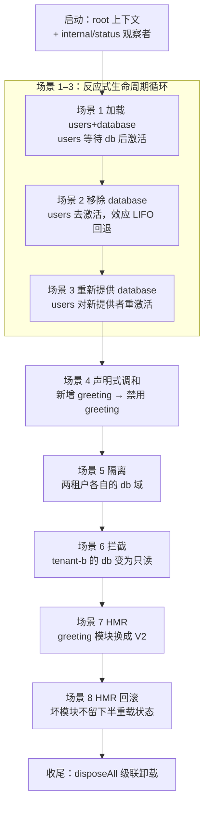
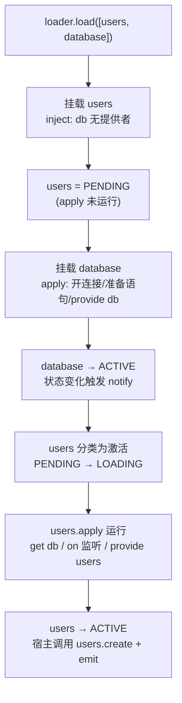
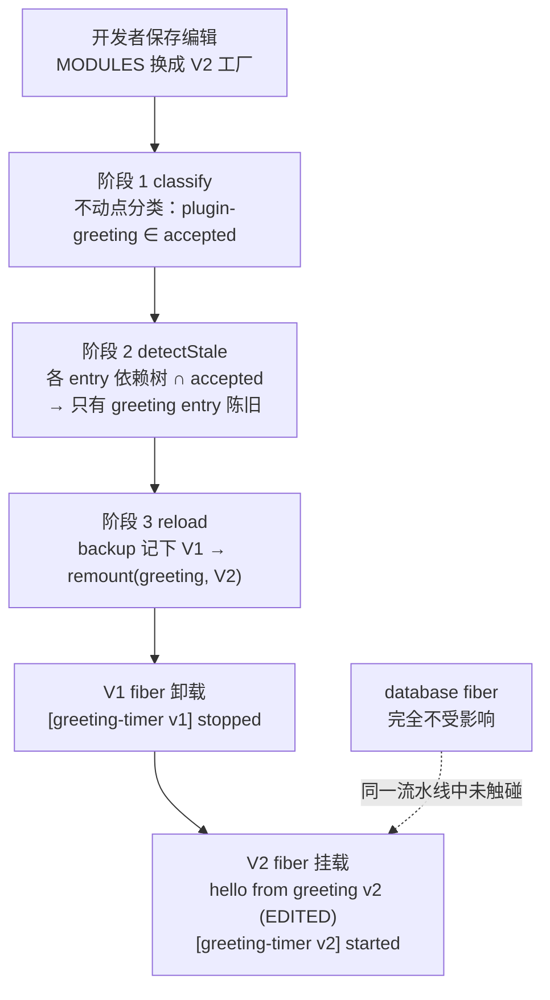

本文是对 `cordis-example` 模块中 `Main` 演示程序的逐场景走读。这个不足 200 行的入口类在一条线程上顺序推进**八个场景**，覆盖了 cordis-java 的全部能力面：反应式余效应（消费者等待提供者）、可回退效应（LIFO 自动回滚）、声明式加载（按 id 调和）、隔离域（多租户）、拦截（编排者权限收缩）、HMR 热替换及其事务回滚。每个场景都被设计为"一个小实验"：改变一个输入，观察框架的自动响应。阅读本文前建议先完成[编写第一个插件](3-bian-xie-di-ge-cha-jian-plugin-inject-sheng-ming-yu-provide-ti-gong-fu-wu)，了解 `Plugin`、`inject`、`provide` 的基本写法。

Sources: [Main.java](cordis-example/src/main/java/dev/cordis/example/Main.java#L26-L48)

## 演示总览：如何运行与如何观察

运行演示只需两条命令（见 README）：先 `mvn install` 安装核心库到本地仓库，再 `mvn -pl cordis-example exec:java` 启动，Maven 的 exec 插件配置的 mainClass 就是 `dev.cordis.example.Main`。整个演示是纯同步的——框架在调用线程上完成所有状态转换，因此控制台输出的**顺序本身就是语义证据**：哪条日志先出现，就说明哪段逻辑先执行。

Sources: [README.md](README.md#L44-L46), [pom.xml](cordis-example/pom.xml#L27-L30)

`Main` 的 `main` 方法提供三类观察信号。第一类是 `banner()` 打印的场景标题（`==== 1. reactive coeffects ... ====`）；第二类是注册在根上下文上的全局监听器 `root.onGlobal("internal/status", ...)`，它订阅框架的内部状态事件，把每个 fiber 的生命周期迁移打印成 `status: users PENDING → ACTIVE` 这样的行；第三类是 `printStates()`，它遍历 `root.registry().runtimes()` 打印注册表中每个 fiber 的名字、uid 与当前状态快照。三者叠加，让你能同时看到"框架做了什么"（状态迁移）与"插件做了什么"（命名日志）。

Sources: [Main.java](cordis-example/src/main/java/dev/cordis/example/Main.java#L53-L63), [Main.java](cordis-example/src/main/java/dev/cordis/example/Main.java#L176-L187)

下面这张总览图给出八个场景的推进脉络与各自验证的能力，后续章节逐个展开：

## 出场角色：模块注册表、三个插件与两个服务

演示用一个静态 `MODULES` 映射模拟 Node 式的模块注册表：`url → Supplier<Plugin>`，即"每个 url 对应一个产出已编译模块的工厂"。`newLoader()` 把它包装成 `ComponentLoader` 需要的 `PluginResolver`——解析 url 时调用工厂取实例，找不到就抛 `IllegalArgumentException`。这个抽象是场景 7、8 的关键伏笔：**HMR 中的"开发者保存了编辑后的文件"，在演示里就是替换 `MODULES` 里的工厂**。

Sources: [Main.java](cordis-example/src/main/java/dev/cordis/example/Main.java#L45-L51), [Main.java](cordis-example/src/main/java/dev/cordis/example/Main.java#L168-L174)

| 组件 | inject 声明 | provide 服务 | 登记的效应 | 在演示中的角色 |
|---|---|---|---|---|
| `DatabasePlugin` | 无 | `db`（`DbService`） | 打开连接、准备语句 | 提供者；场景 1–3 的被依赖方，场景 5/6 的隔离与拦截对象 |
| `UserPlugin` | `["db"]` | `users`（`UsersService`） | 事件监听器 + 服务注册 | 消费者；反应式加载与去激活的主角 |
| `GreetingPluginV1/V2` | 无 | 无 | 一个"定时器"效应 | HMR 的换血目标：V1 是编辑前，V2 是编辑后 |

三个插件的写法体现了框架的核心纪律：**作者只登记效应，不写卸载路径**。`DatabasePlugin.apply` 通过两次 `ctx.effect` 登记"打开连接"与"准备语句"，各自的返回值（`Disposable` lambda）就是逆变换；方法直接 `return null`，因为运行时已把逆变换累加进 fiber，卸载时会按 LIFO 自动执行。`UserPlugin` 声明 `inject() { return List.of("db"); }`——这是余效应规范：在 `db` 有 ACTIVE 提供者之前，它的 `apply` 根本不会运行；此外它用 `ctx.on("user:create", ...)` 注册事件监听器，监听器同样是可回退效应，随 fiber 卸载自动移除。

Sources: [DatabasePlugin.java](cordis-example/src/main/java/dev/cordis/example/plugins/DatabasePlugin.java#L22-L44), [UserPlugin.java](cordis-example/src/main/java/dev/cordis/example/plugins/UserPlugin.java#L24-L47)

两个服务都继承 `Service` 基类：构造函数里 `super(ctx, name)` 立即把实例注册为当前 fiber 的 provide 效应，fiber 卸载时自动注销。`DbService` 是一个内存键值存储，特殊之处在于构造时读取 `interceptConfig()`——如果编排者配置了 `readOnly: true`，`put` 会抛 `IllegalStateException`，这为场景 6 铺路。`UsersService` 持有 `DbService` 引用，`create(name)` 同时更新内存集合与 db 中的 `user:<name>` 行；由于它通过 fiber 的已提交视图读取 db，在自身卸载过程中仍能完成清理读取。

Sources: [DbService.java](cordis-example/src/main/java/dev/cordis/example/plugins/DbService.java#L16-L41), [UsersService.java](cordis-example/src/main/java/dev/cordis/example/plugins/UsersService.java#L15-L31), [Service.java](cordis-core/src/main/java/dev/cordis/core/Service.java#L18-L32)

## 场景一至三：反应式余效应与可回退效应的完整循环

### 场景 1：users 声明 db，等 db ACTIVE 后才加载

第一个实验故意把消费者排在提供者**前面**：`loader.load` 接收的列表是 `[users, database]`。加载器按列表顺序挂载——users 先挂载，但因为 `db` 尚无提供者，fiber 停在 **PENDING**；随后 database 挂载，其 `apply` 打开连接、准备语句、构造 `DbService`（写入 `boot=ok`）。当 database fiber 迁移到 ACTIVE 的那一刻，状态变化触发 `ReflectService.notify`，users 被分类为"激活"：PENDING → LOADING → ACTIVE，其 `apply` 此时才运行——日志 `loaded, resolved db@<identityHashCode>` 里的对象就是 database 提供的那个实例。随后它注册 `user:create` 监听器、提供 `users` 服务、播种用户 alice。

Sources: [Main.java](cordis-example/src/main/java/dev/cordis/example/Main.java#L65-L72), [UserPlugin.java](cordis-example/src/main/java/dev/cordis/example/plugins/UserPlugin.java#L29-L45)

激活完成后，演示从**宿主侧**消费这个组合体：先 `root.getOrNull("users")` 拿到服务直接调用 `users.create("bob")`（服务方法路径），再 `root.emit("user:create", "carol")` 走事件总线（监听器路径）。两条路径的日志证明 users 已完全就绪。值得注意的时序细节：users 的 `apply` 运行在 database 的 ACTIVE 转换**之后**而非其 `apply` 之中——`Fiber.provide` 只在 fiber 已是 ACTIVE 时才通知依赖者，保证消费者看到的提供者一定处于稳定状态。

Sources: [Main.java](cordis-example/src/main/java/dev/cordis/example/Main.java#L69-L72), [Fiber.java](cordis-core/src/main/java/dev/cordis/core/Fiber.java#L458-L478)

### 场景 2：移除 database，一切按 LIFO 回退

第二个实验把 database 从期望列表中删掉：`loader.load` 只传 users 一个 entry。调和逻辑发现 database 不在新列表中，执行 `unmount` → `fiber.dispose()`。此时控制台输出揭示了两个关键秩序。**第一是消费者先于提供者回退**（L-Unload guard）：database 进入 UNLOADING 的状态迁移会同步通知依赖者，users 的卸载链先跑完——监听器移除、`users` 服务注销、状态回到 PENDING（注意 fiber 没有销毁，entry 还在，它只是重新等待提供者）——然后才轮到 database 自己的逆变换。**第二是提供者内部的 LIFO 逆序**：登记顺序是"打开连接 → 准备语句"，回退顺序则是 `[statements] closed` 先于 `[connection] released`——后开的先关，栈式展开。

Sources: [Main.java](cordis-example/src/main/java/dev/cordis/example/Main.java#L74-L76), [Fiber.java](cordis-core/src/main/java/dev/cordis/core/Fiber.java#L335-L357)

`printStates` 此时的输出只剩 `users#N=PENDING`：database 的 fiber 已 DISPOSED 并从注册表移除，空 runtime 一并清除。插件作者没有写任何一行卸载代码——这就是时间可组合性的直观呈现：**每个上下文变换携带自己的逆变换，运行时按 LIFO 折叠恢复**。深入机制可阅读[可回退效应模型](8-ke-hui-tui-xiao-ying-mo-xing-effectcallback-disposable-yu-duo-jie-duan-yan-xu)与[LIFO 逆变换累加器](9-lifo-ni-bian-huan-lei-jia-qi-xiao-ying-zhe-die-dan-ci-chu-zhi-yu-shi-bai-hui-gun)。

Sources: [Main.java](cordis-example/src/main/java/dev/cordis/example/Main.java#L176-L182), [Fiber.java](cordis-core/src/main/java/dev/cordis/core/Fiber.java#L98-L117)

### 场景 3：重新提供，users 对新的提供者 fiber 重激活

第三个实验把 database 加回列表。调和发现这是一个**新 entry**（旧记录已随 unmount 清除），于是全新挂载：新的 database fiber、新的 `DbService` 实例（内存表是新的，只有 `boot=ok`，没有 alice/bob——旧数据随旧实例一起回退了）。users 收到激活通知后重跑 `apply`，日志中的 `resolved db@<identityHashCode>` 是一个不同的哈希值，肉眼可证它绑定的是新提供者。演示随后重新 `getOrNull("users")` 获取**新的** `UsersService` 实例并写入 dave——旧的 users 服务实例已随场景 2 的去激活注销，这也是为什么必须重新取引用。

Sources: [Main.java](cordis-example/src/main/java/dev/cordis/example/Main.java#L78-L84)

这三个场景合起来构成了框架时间维度与空间维度的最小完整循环：提供者的出现/消失驱动消费者的激活/去激活（空间维度的反应式余效应），而每次去激活都自动回退该 fiber 登记的全部效应（时间维度的可回退效应）。状态迁移的完整规则见[生命周期状态机](11-sheng-ming-zhou-qi-zhuang-tai-ji-pending-dao-disposed-de-liu-zhuang-tai-yu-zhuan-huan-gui-ze)，通知分类机制见[inject 声明与 ReflectService 通知](14-inject-sheng-ming-yu-reflectservice-tong-zhi-ti-gong-zhe-bian-hua-de-fan-ying-shi-fen-lei)。

## 场景四：声明式加载与按 id 调和

第四个实验分两步演示**声明式加载**的调和语义。第一步加载三个 entry（users、database、greeting）：users 与 database 已挂载且无变化，greeting 是新增，挂载后 V1 的"定时器"效应启动。第二步提交的列表唯一变化是 `greeting` entry 多了 `.disabled(true)`——调和器按 id 差分后对这个 entry 做字段级分发：`disabled` 从 false 变 true 时，调用 `fiber.dispose()` 卸载 fiber（`[greeting-timer v1] stopped`），但**保留 entry 记录**（fiber 字段置 null），以便将来重新启用。值得注意的是"移除 entry"的调和路径其实已在场景 2 出现过——database 就是从列表中消失而被卸载的。

Sources: [Main.java](cordis-example/src/main/java/dev/cordis/example/Main.java#L86-L94)

`ComponentLoader.apply` 的逐字段分发策略是本场景的机制核心，完整规则如下表（演示只显式触发了 disable，但其余路径是同一方法内的兄弟分支）：

| 字段变化 | 调和动作 | 扰动级别 |
|---|---|---|
| entry 从列表消失 | `unmount`：`fiber.dispose()` 并移除记录 | fiber 销毁 |
| `disabled` false → true | `fiber.dispose()`，记录保留（fiber/plugin 置 null） | fiber 销毁，entry 留档 |
| `disabled` true → false | `rebuild`：以同 id 重新实例化新 fiber | fiber 重建 |
| `url` 变化 | `rebuild`（组件身份变化，走通用重建路线） | fiber 重建 |
| `isolate` 变化 | `rebuild`（realm 重指派） | fiber 重建 |
| `intercept` 变化 | `rebuild`（拦截注解生在派生上下文上） | fiber 重建 |
| `config` 变化 | 记录更新 + `fiber.update(config)`（schema 校验，失败则 fiber 转 FAILED） | 原地更新，不重建 |

这张表的背后是一条元定理（Theorem 80）：终态只依赖最终配置，所以"重建"这条最粗暴的路线与从零加载的结果完全一致，加载器可以放心地把无法原地处理的字段变化都路由到重建。展开阅读见[组件调和：按 id 差分与逐字段分发的最小扰动策略](19-zu-jian-tiao-he-an-id-chai-fen-yu-zhu-zi-duan-fen-fa-de-zui-xiao-rao-dong-ce-lue)与[Entry 配置模型](18-entry-pei-zhi-mo-xing-id-url-isolate-intercept-config-yu-disabled)。

Sources: [ComponentLoader.java](cordis-core/src/main/java/dev/cordis/loader/ComponentLoader.java#L93-L138), [ComponentLoader.java](cordis-core/src/main/java/dev/cordis/loader/ComponentLoader.java#L82-L91)

## 场景五与六：空间维度——隔离域与拦截

### 场景 5：两租户共享插件代码，各用各的 db 域

第五个实验切换到空间维度。宿主从 root 派生两个租户上下文：`root.isolate("db", "db@tenant-a").isolate("users", "users@tenant-a")` 与对应的 tenant-b——字符串标签经 `RealmKey.shared` 全局共享，同名标签 Join 到同一个域。随后**两个独立的 `ComponentLoader`** 分别以两个租户上下文为 parent，加载**同一份** entry 列表（database + users）。结果：两套完全独立的 fiber 树在各自的 realm 中运行，`dbA != dbB` 输出 `true`——同一份插件代码，两个互不可见的数据库实例。`dbA.put("tenant","A")` 与 `dbB.put("tenant","B")` 互不干扰，打印出的两个 `get` 结果证明写读都命中了各自的域。

Sources: [Main.java](cordis-example/src/main/java/dev/cordis/example/Main.java#L96-L112), [Context.java](cordis-core/src/main/java/dev/cordis/core/Context.java#L100-L120)

注意此时 root 域上场景 3/4 的 database/users 仍然 ACTIVE——`isolate` 派生的子上下文对 `db` 的读写解析到标签域而非父域，所以两个租户的 provide 不会与 root 域的 `db` 冲突（`DUPLICATE_PROVIDE` 检查按 realm 键控）。服务解析沿 fiber 链行走并尊重 realm 边界的完整算法见[服务解析算法](15-fu-wu-jie-xi-suan-fa-fiber-lian-xing-zou-realm-bian-jie-yu-neng-li-ji-lu)与[隔离域：RealmKey、isolate 派生上下文与多租户实践](16-ge-chi-yu-realmkey-isolate-pai-sheng-shang-xia-wen-yu-duo-zu-hu-shi-jian)。

### 场景 6：编排者把 tenant-b 的 db 收缩为只读

第六个实验演示**拦截**：不改提供者、不改消费者，由编排者在上下文层注入约束。前置步骤 `loaderB.disposeAll()` 先释放 tenant-b 域（每个 realm 键只允许一个提供者，不释放则新挂载会触发 `DUPLICATE_PROVIDE`）。然后从 tenantB 派生 `tenantBPoliced = tenantB.intercept("db", Map.of("readOnly", true))`——拦截注解同样生在派生上下文上，配置沿祖先链**右偏合并**（后代覆盖祖先）。在这个上下文下重新加载同一份 entry 列表，行为全面自适应：

| 观察点 | 无拦截（场景 5） | `readOnly: true` 拦截后 |
|---|---|---|
| `DatabasePlugin.apply` 启动写 `boot=ok` | 执行 | 跳过，日志 `db ready in read-only mode; skipping boot write` |
| `UserPlugin.apply` 播种 alice | 执行 | 跳过，日志 `db is read-only; skipping seed user` |
| 服务 `dbBP.put("hack","nope")` | 正常写入 | 抛 `IllegalStateException: db is read-only (intercepted by the orchestrator)` |

机制链条是：`DbService` 构造函数调用 `Service.interceptConfig()` → `ctx.resolveIntercept("db")` 合并拦截配置 → `readOnly` 标志生效于 `put` 的守卫。**插件代码中没有任何 `if (拦截)` 的分支判断编排**——提供者只诚实地暴露读写两个操作，权限收缩完全发生在上下文派生层。展开阅读见[拦截：intercept 配置右偏合并与编排者权限收缩](17-lan-jie-intercept-pei-zhi-you-pian-he-bing-yu-bian-pai-zhe-quan-xian-shou-suo)。

Sources: [Main.java](cordis-example/src/main/java/dev/cordis/example/Main.java#L114-L124), [DbService.java](cordis-example/src/main/java/dev/cordis/example/plugins/DbService.java#L21-L36), [Context.java](cordis-core/src/main/java/dev/cordis/core/Context.java#L122-L141)

## 场景七与八：HMR 的模块级换血与事务回滚

### 场景 7：编辑 greeting 模块，只有它的 fiber 被替换

第七个实验模拟开发者热更新。前置：`loader.disposeAll()` 释放 root 域，新建 `hmrLoader` 加载 database + greeting（此时 `MODULES` 里 greeting 仍指向 V1）。随后两步模拟"保存文件"：`MODULES.put("plugin-greeting", GreetingPluginV2::new)` 更新模块注册表，同时构造 `fresh` 映射（url → 预构建的 V2 实例）作为"重编译后的新模块"直接交给引擎。HMR 走三阶段流水线：

演示用的 `ModuleGraph` 是 `url -> Set.of()`（所有模块都是叶子），所以 `classify` 的不动点立即收敛：种子集合（被编辑的模块）即 accepted。`detectStale` 对每个已挂载 entry 求依赖树并与 accepted 求交——`plugin-database` 的依赖树 `{plugin-database}` 与 accepted 无交集故不陈旧，`plugin-greeting` 命中。`idsForUrls` 把陈旧 url 映射回 entry id `["greeting"]`，`reload` 对它执行 `remount`：旧 fiber dispose（V1 定时器停止）→ 用 `fresh` 里的 V2 实例（跳过 resolver）在**同一 entry 记录**上挂载新 fiber。整个过程 database 纹丝不动——这就是"模块级应用可回退效应模式"：fiber 已经圈定了组件全部效应的边界，换模块只需换 fiber，无需 Webpack/Vite 式的开发者自声明接受边界。三个阶段的算法细节见 [HMR 阶段一](20-hmr-jie-duan-mo-kuai-fen-lei-bu-dong-dian-yu-yi-lai-huan-mo-ren-ju-jue)、[阶段二](21-hmr-jie-duan-er-yi-lai-shu-bian-li-yu-chen-jiu-entry-jian-ce)、[阶段三](22-hmr-jie-duan-san-shi-wu-xing-zhong-zai-yu-ban-zhong-zai-zhuang-tai-de-hui-gun-bao-zheng)。

Sources: [Main.java](cordis-example/src/main/java/dev/cordis/example/Main.java#L126-L146), [HmrEngine.java](cordis-core/src/main/java/dev/cordis/hmr/HmrEngine.java#L53-L81), [HmrEngine.java](cordis-core/src/main/java/dev/cordis/hmr/HmrEngine.java#L104-L116)

### 场景 8：坏模块不会留下半重载状态

第八个实验故意搞破坏：把 `MODULES` 里 greeting 的工厂换成**直接抛 `RuntimeException("syntax error in edited greeting.ts")`** 的版本（模拟编译失败），然后用空的 `broken` 映射调用 `reload`。因为 `fresh` 里没有这个 url，`remount` 回落到 resolver 路径 → 工厂抛异常。此时事务性保证登场：`reload` 在换血前已把每个 entry 的旧组件存入 `backup`，任一环节失败就把**所有已换的 entry 从上一组件重建**——这里即用 backup 里的 V2 实例重新 `remount` greeting，V2 再次上线（`hello from greeting v2 (EDITED)` 再次出现），然后原始异常向上抛出，被演示的 `catch` 捕获打印 `reload failed as expected`。

Sources: [Main.java](cordis-example/src/main/java/dev/cordis/example/Main.java#L148-L159), [HmrEngine.java](cordis-core/src/main/java/dev/cordis/hmr/HmrEngine.java#L130-L154)

最后一行输出 `greeting fiber after rollback: #<uid> (previous component still serving)` 值得细看：回滚产生的是**新的 fiber uid**，但服务的是**回滚前的组件**（V2）。中途有个隐藏的正确性细节：失败的 `remount` 在抛异常前已 dispose 了旧 V2 fiber，回滚的 `remount` 会再次对这条已销毁的 fiber 调用 `dispose`——这之所以安全，是因为效应处置是**单次生效**的（armed 标志保证重复调用为 no-op）。系统任何时刻都不存在"一半新一半旧"的中间态，这是 Theorem 80 在模块层的对应保证。`remount` 本身作为 HMR 路由的入口（dispose + 以 forced 组件原位重挂、不动 entry 记录）见 `ComponentLoader.remount`。

Sources: [HmrEngine.java](cordis-core/src/main/java/dev/cordis/hmr/HmrEngine.java#L141-L153), [ComponentLoader.java](cordis-core/src/main/java/dev/cordis/loader/ComponentLoader.java#L202-L214), [Fiber.java](cordis-core/src/main/java/dev/cordis/core/Fiber.java#L188-L197)

## 收尾：disposeAll 级联卸载

演示的最后一句 banner 之后，四个加载器（root 的 `loader`、两个租户的 `loaderA`/`loaderBP`、`hmrLoader`）依次 `disposeAll`。每个 entry 的 fiber 被销毁，而 fiber 的实例化本身是登记在**父 fiber**上的效应（O-Insert，其逆即 O-Retire）——所以父级卸载会级联到全部子孙，"disposing root cascades through every fiber" 逐字兑现。插件作者自始至终没有写过一行清理代码；整个演示的八场景，就是"声明效应、声明依赖、声明期望状态，框架负责其余"这一契约的完整展示。级联机制的展开见[O-Insert 与 O-Retire](13-o-insert-yu-o-retire-cha-jian-shi-li-hua-de-xiao-ying-hua-yu-ji-lian-xie-zai)与[惯性主机：epoch、target 视图与链式 reload/unload 转换](12-guan-xing-zhu-ji-epoch-target-shi-tu-yu-lian-shi-reload-unload-zhuan-huan)。

Sources: [Main.java](cordis-example/src/main/java/dev/cordis/example/Main.java#L161-L165), [Fiber.java](cordis-core/src/main/java/dev/cordis/core/Fiber.java#L98-L117)

## 八场景能力速查表

| 场景 | 验证的能力 | 关键 API | 控制台观察信号 |
|---|---|---|---|
| 1 | 反应式余效应：消费者等待提供者 | `Entry.of`、`loader.load`、`inject` | users `PENDING → ACTIVE` 状态行、`resolved db@<hash>` |
| 2 | 可回退效应 + 卸载守卫顺序 | 调和移除 entry → `fiber.dispose` | users 先回 PENDING，随后 `[statements] closed` → `[connection] released`（LIFO） |
| 3 | 提供者替换触发重激活 | 重新 `loader.load` 同 id entry | 新 `db@<hash>`、`registry:` 快照中 database 换新 uid |
| 4 | 声明式调和：新增/禁用 | `Entry.Builder.disabled(true)` | `disable greeting` 日志、`[greeting-timer v1] stopped` |
| 5 | 隔离域：多租户 | `root.isolate(name, label)` | `distinct instances: true`、两租户读写互不影响 |
| 6 | 拦截：权限收缩 | `ctx.intercept("db", {readOnly})` | `write rejected as designed`、跳过启动写/播种的日志 |
| 7 | HMR：模块换血 | `HmrEngine.classify/detectStale/reload` | `hello from greeting v2 (EDITED)`，database 无日志扰动 |
| 8 | HMR：事务回滚 | `reload` 失败 → backup 重建 | `reload failed as expected` + `previous component still serving` |

## 延伸阅读

按目录推荐的后续路径：若想理解场景 1–3 背后的机制，进入[上下文范式：Context 作为效应与余效应的统一中介](6-shang-xia-wen-fan-shi-context-zuo-wei-xiao-ying-yu-yu-xiao-ying-de-tong-zhong-jie)；若对场景 5–6 的空间维度感兴趣，先读[整体架构：核心库、声明式加载器与 HMR 引擎的三层分层](5-zheng-ti-jia-gou-he-xin-ku-sheng-ming-shi-jia-zai-qi-yu-hmr-yin-qing-de-san-ceng-fen-ceng)建立全局图景；若要复刻这套演示到自己的宿主程序，[宿主集成指南：PluginResolver、ModuleGraph 与模块注册策略](28-su-zhu-ji-cheng-zhi-nan-pluginresolver-modulegraph-yu-mo-kuai-zhu-ce-ce-lue)讲解了如何把 `MODULES` 模拟注册表换成真实的模块来源；最后可用[测试体系：30 个用例覆盖的行为契约清单](27-ce-shi-ti-xi-30-ge-yong-li-fu-gai-de-xing-wei-qi-yue-qing-dan)对照本文每个场景的断言级验证。