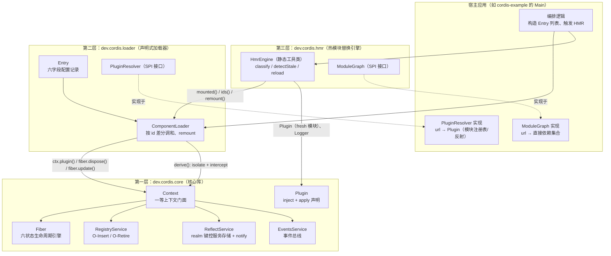
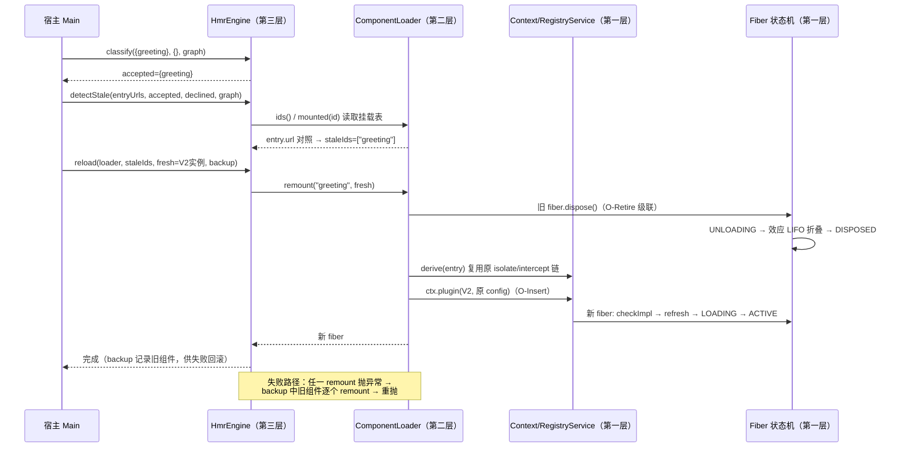

理解一个元框架，最有效的入口是它的分层图。cordis-java 将全部运行时能力组织为**三层严格单向依赖的架构**：底层是承载时空可组合性语义的核心库，中层是将"期望态配置"翻译为生命周期操作的声明式加载器，顶层是在模块粒度上复用这套机制的热模块替换引擎。本页给出三层的职责划分、依赖方向与层间契约，并演示一个请求如何穿越三层——这是后续所有深入解析页面的骨架。需要先说明的是，"三层"是**逻辑包分层**：它们同居于 `cordis-core` 这一个 Maven 模块内，以 `dev.cordis.core`、`dev.cordis.loader`、`dev.cordis.hmr` 三个 Java 包的形式存在，`cordis-example` 则是消费三层的宿主演示。分层由包边界与 import 关系强制，而非由 Maven 模块强制。
Sources: [README.md](README.md#L38-L61) · [pom.xml](pom.xml#L16-L19)

## 三层总览：职责、边界与依赖方向

在展开细节前，先用一张图建立整体认知。下图自下而上描绘三层：箭头表示**编译期依赖方向**，全部指向下方；右侧两个虚线框是宿主必须提供的接入点（SPI），它们是分层体系中仅有的"外向开口"。阅读这张图的关键在于：上层从不被下层感知——核心库的代码中不存在任何对加载器或 HMR 的引用，这一点已通过全库检索验证。

三层在规模与抽象层次上呈现出清晰的金字塔结构：核心库以约 2000 行实现了论文第 3–4 章的全部运行时语义；加载器以约 340 行将命令式的 `ctx.plugin()` 升级为声明式的配置调和；HMR 引擎仅约 190 行，因为它完全复用前两层，只是把可回退效应模式应用到"模块"这个粒度上。

| 维度 | 第一层 core | 第二层 loader | 第三层 hmr |
|---|---|---|---|
| **解决的问题** | 单个组件如何加载、卸载、反应式重载 | 一组组件的期望态如何声明并增量实现 | 模块代码变更后如何原地换件且不进半成品状态 |
| **核心抽象** | Context、Fiber、Plugin、Disposable | Entry、Mounted | Classification（accepted/declined） |
| **关键类** | Context(316行)、Fiber(486行) | ComponentLoader(222行)、Entry(91行) | HmrEngine(178行) |
| **依赖** | 无（仅 JDK） | core | core + loader |
| **状态持有** | 全部运行态（fiber、服务、效应） | 每条 Entry 的挂载记录 | **零状态**（静态方法） |
| **宿主需要提供** | 无（`Context.createRoot()` 即完备） | `PluginResolver` | `ModuleGraph` + 重编译后的 fresh 模块 |
| **对应论文章节** | §3.1–3.3、§4.4、§5.1 | §5.2.1（Definition 81） | §5.2.2（Algorithm 8–10） |

依赖方向的严格单向是这张分层的**唯一硬约束**，也是它最重要的性质：全库检索 `dev.cordis.loader` 与 `dev.cordis.hmr` 在 `dev.cordis.core` 包内的出现次数为零；`ComponentLoader` 只 import 核心库的 `Context`、`Fiber`、`Logger`、`Plugin`、`RealmKey`；`HmrEngine` 额外 import 了 `ComponentLoader` 与 `PluginResolver`。这意味着你可以单独使用核心库（如 README 快速开始中直接 `root.plugin(users)` 的示例），也可以在核心库之上只用加载器而完全不引入 HMR——每一层都是下一层的**可选增强**，而非必需依赖。
Sources: [HmrEngine.java](cordis-core/src/main/java/dev/cordis/hmr/HmrEngine.java#L1-L16) · [ComponentLoader.java](cordis-core/src/main/java/dev/cordis/loader/ComponentLoader.java#L1-L14)

## 第一层：核心库 dev.cordis.core——运行时原语

核心库回答一个最小问题：**"一个组件在环境变化时如何自动加载与回滚"**。它由三类角色构成：`Context` 是统一门面与装配点，`Fiber` 是生命周期引擎，`Plugin` 是组件的声明形状。

### Context：装配点与统一门面

`Context.createRoot()` 是整个框架的起点——这一行代码装配了四个内置服务（`ReflectService` 服务存储、`RegistryService` 插件注册表、`EventsService` 事件总线、`LoggerService` 命名日志）并创建根 fiber。此后组件与环境的**全部交互都经过上下文**：注册效应（`ctx.effect`，即逆变换累加器）、解析与提供服务（`ctx.get`/`ctx.provide`，即依赖表 Σ）、派生子域（`ctx.isolate`/`ctx.intercept`，只影射不修改父表）。值得在架构层面注意的是：四个内置服务只存在于根上下文的字段上，子上下文通过 `rootRef` 引用回到它们——这是一个刻意的中枢化设计，使服务存储与事件总线天然全局唯一，而派生规则（隔离、拦截）则随上下文链分布。`Context` 本身不实现任何生命周期逻辑，它的 `plugin()` 方法只是一行委托：`registry().plugin(this, plugin, config)`。
Sources: [Context.java](cordis-core/src/main/java/dev/cordis/core/Context.java#L48-L57) · [Context.java](cordis-core/src/main/java/dev/cordis/core/Context.java#L245-L270)

### Fiber：惯性生命周期引擎

`Fiber` 是核心库中最重的类（486 行），也是唯一持有可变运行态的类。每个 fiber 追踪：声明的 inject 规范、已提交的服务视图（`store`）、目标摘要（`target`，由提供者 uid 拼接而成）、效应记录栈，以及六状态生命周期（`PENDING → LOADING → ACTIVE → FAILED → UNLOADING → DISPOSED`）。它的驱动核心是 `refresh()`：从余效应存储重算目标视图，若摘要变化则启动 `reloadCycle` 或 `unloadCycle`，并通过 `runChain()` 以同步 Runnable 链的方式**一鼓作气跑完所有连锁转换**——转换一旦开始必然完成，完成后才响应新的目标变化。这正是论文 §4.4"惯性主机"的就地实现，也是 Java 版相对 TS 版最显著的取舍（后者基于事件循环的异步惯性）。对本页而言只需记住架构结论：**上层的"重建""热替换""调和"最终都塌缩为对 `Fiber.dispose()`、`Fiber.update()`、`refresh()` 这几个原语的调用**。
Sources: [Fiber.java](cordis-core/src/main/java/dev/cordis/core/Fiber.java#L15-L31) · [Fiber.java](cordis-core/src/main/java/dev/cordis/core/Fiber.java#L261-L299) · [Fiber.java](cordis-core/src/main/java/dev/cordis/core/Fiber.java#L416-L456)

插件实例化本身也被效应化了：fiber 构造函数在**父 fiber** 上注册一个效应，其正向动作是把 fiber 加入运行时记录（O-Insert），其逆变换（O-Retire）负责摘除、级联通知与状态清理。因此"卸载父插件会级联卸载子插件"不是一段专门的级联代码，而是 LIFO 效应折叠的自然结果——这是理解后两层为何能如此薄的关键。
Sources: [Fiber.java](cordis-core/src/main/java/dev/cordis/core/Fiber.java#L98-L117) · [RegistryService.java](cordis-core/src/main/java/dev/cordis/core/RegistryService.java#L71-L81)

### Plugin：组件的双面声明

`Plugin` 接口把论文中的组件三元组压缩为两个方法：`inject()` 声明余效应规范（论文的 d——需要哪些服务、附带什么拦截配置），`apply(ctx, config)` 即效应函数（论文的 e——返回待回滚的 `Disposable`、多阶段 `Iterable<Disposable>` 或 null）。提供什么（p）不在声明里，而是运行时通过 `ctx.provide` 动态登记。这个"双面"形状是加载器与 HMR 得以工作的前提：**上两层只需要搬运 `Plugin` 实例，而无需理解其内部**。
Sources: [Plugin.java](cordis-core/src/main/java/dev/cordis/core/Plugin.java#L15-L42)

## 第二层：声明式加载器 dev.cordis.loader

核心库的 `ctx.plugin()` 是命令式的：编排者必须自己决定何时装载、何时卸载。加载器把它升级为声明式：**编排者只描述期望态（一份 Entry 列表），加载器负责差分出最小操作序列**。这层只有三个类型，却各自承担精确的架构角色。

### Entry：期望态的持久记录

`Entry` 是六字段的不可变记录：`id`（调和键）、`url`（解析器键，指向组件模块）、`isolate`（隔离注解）、`intercept`（拦截注解）、`config`（绑定进组件的配置）、`disabled`（行政关闭位）。论文 Definition 81 的对应关系体现在类注释中：一个 entry 恰好记录了"支撑一个 fiber 所需的全部信息"。`isolate`/`intercept` 以 `Map.copyOf` 冻结，Builder 模式保证构造后不可变——**期望态必须是纯数据**，这是调和可预测性的前提。
Sources: [Entry.java](cordis-core/src/main/java/dev/cordis/loader/Entry.java#L6-L37)

### ComponentLoader：按 id 差分的调和器

`ComponentLoader` 持有一张 `mounted` 表（id → Mounted 记录，含 entry、fiber、plugin、派生 ctx），`load(desired)` 即 `reconcile(desired)`：不在期望列表中的挂载被 `unmount`（即 `fiber.dispose()`），幸存者逐条 `apply`，新条目按列表顺序 `mount`。`apply` 的分派逻辑是这层的精华——**逐字段比较，选择最小扰动操作**：

| 变化字段 | 分派的操作 | 理由 |
|---|---|---|
| `url` | `rebuild`（dispose 后重挂） | 身份/组件变了 |
| `disabled` true→false | `rebuild` | 同名重新实例化新 fiber |
| `disabled` false→true | 仅 `fiber.dispose()`，记录保留 | 保留 entry 占位 |
| `isolate` | `rebuild`（复用 plugin） | realm 重指派 |
| `intercept` | `rebuild`（复用 plugin） | 拦截配置活在派生上下文上 |
| `config` | `fiber.update(e.config)` | 无需重建，走 update 流程 |

其中 `derive(e)` 演示了加载器如何组合核心库的派生原语：先按 entry 的 isolate 注解逐条 `ctx.isolate(name, key)`，再逐条 `ctx.intercept(name, config)`，得到该 entry 专属的上下文链。正确性不靠局部技巧，而靠元理论兜底：**Theorem 80 保证静息态只是最终配置的函数**，所以"重建"这条通用路径必然到达与从零加载相同的状态——加载器无需为每种字段变化证明单独的正确性。
Sources: [ComponentLoader.java](cordis-core/src/main/java/dev/cordis/loader/ComponentLoader.java#L76-L138) · [ComponentLoader.java](cordis-core/src/main/java/dev/cordis/loader/ComponentLoader.java#L175-L193)

### PluginResolver：宿主接入的第一道缝

JVM 没有 Node 式的动态模块注册表，"引入/撤出一个模块"无法由框架单方面完成。加载器为此留出一道缝：`PluginResolver` 是一个 `@FunctionalInterface`，把 `url → Plugin` 的映射交给宿主——注册表查找、反射加载、外部文件读取均可，HMR 场景下则是返回"重编译后的新实例"。构造 `ComponentLoader` 时必须提供它，这道缝同时也规定了失败语义：`resolve` 抛出的异常会被 `mount` 捕获记录，HMR 重载时触发回滚。
Sources: [PluginResolver.java](cordis-core/src/main/java/dev/cordis/loader/PluginResolver.java#L5-L25) · [ComponentLoader.java](cordis-core/src/main/java/dev/cordis/loader/ComponentLoader.java#L140-L156)

## 第三层：HMR 引擎 dev.cordis.hmr

HMR 引擎把可回退效应模式应用到**模块粒度**：因为 fiber 已经界定了组件的全部效应，一个本身就是组件的模块可以被"原地替换"而无需进程重启，也**无需开发者标注 accept 边界**（对比 Webpack/Vite）。这层只有两个类型，且 `HmrEngine` 是**全静态、零状态**的纯函数集合——它不持有任何运行态，所有状态都在加载器的 `mounted` 表和核心库的 fiber 里。

### 三阶段流水线与 ModuleGraph

引擎暴露三个静态阶段，恰好对应论文 Algorithm 8–10：`classify`（以变更文件的依赖闭包为域做不动点分类，环上未决模块默认 declined）、`detectStale`（挂载 entry 的依赖树与 accepted 相交者即为陈旧）、`reload`（事务性重载——逐个 `remount`，任一失败则用 backup 中的旧组件重建全部已换条目并重抛异常，系统永不进入半重载状态）。`ModuleGraph` 是第二道宿主接入缝：一个返回"模块直接依赖集"的函数接口，宿主可从构建索引、类引用扫描或手维护映射中供给。
Sources: [HmrEngine.java](cordis-core/src/main/java/dev/cordis/hmr/HmrEngine.java#L18-L45) · [HmrEngine.java](cordis-core/src/main/java/dev/cordis/hmr/HmrEngine.java#L47-L116) · [ModuleGraph.java](cordis-core/src/main/java/dev/cordis/hmr/ModuleGraph.java#L5-L15)

### remount：唯一贯通三层的桥

`HmrEngine.reload` 的全部副作用都经由 `ComponentLoader.remount(id, forced)` 完成：dispose 旧 fiber、（forced 非空时）跳过 resolver 直接采用 fresh 模块、在**同一派生上下文**中重新 `ctx.plugin()`。注意 `remount` 不改动 entry 记录本身——配置、隔离、拦截全部原样继承，被替换的只有组件实现。这个方法是理解三层协作的最佳标本：HMR 引擎不触碰任何 fiber，加载器不感知"HMR"概念，二者仅凭一个通用方法协作。
Sources: [ComponentLoader.java](cordis-core/src/main/java/dev/cordis/loader/ComponentLoader.java#L195-L214) · [HmrEngine.java](cordis-core/src/main/java/dev/cordis/hmr/HmrEngine.java#L118-L154)

## 层间契约：上层是下层的普通用户

分层架构的价值不在于"分了"，而在于**层间契约足够窄**。下表穷举了本仓库中全部跨层调用点——上层调用的每一个下层 API 都是公开 API，没有任何为上层开后门的包私有通道：

| 调用方 → 被调方 | API | 用途 |
|---|---|---|
| loader → core | `Context.plugin(Plugin, Object)` | 挂载 entry 时实例化 fiber |
| loader → core | `Context.isolate` / `intercept` | `derive()` 构建派生上下文 |
| loader → core | `Fiber.dispose()` | unmount / rebuild / disable 的统一出口 |
| loader → core | `Fiber.update(Object)` | config 字段变化的最小扰动路径 |
| loader → core | `Fiber.await()` | mount/remount 后抛出启动错误 |
| hmr → loader | `ComponentLoader.mounted(id)` / `ids()` | 读取挂载记录（依赖树检测、id 映射） |
| hmr → loader | `ComponentLoader.remount(id, Plugin)` | 热替换与回滚的唯一写路径 |
| hmr → core | `Plugin`（fresh 实例）、`Logger` | 替换件的数据载体与诊断日志 |

反过来读这张表能得出更强的结论：**核心库对上层的全部要求只有一个——`Plugin` 实例**。加载器与 HMR 之间则只共享 `ComponentLoader` 的挂载表视图与一个 `remount` 方法。如此窄的契约带来一个工程上可验证的性质：三层可以各自独立演化（例如未来给 HMR 增加新阶段），只要公开 API 签名不动，其余层无需重新编译认知。这也是测试策略的基础——六个测试类按行为切分（Lifecycle、Loader、Hmr、Isolation、ServiceAccess、EffectTracking），恰好每层都有独立的契约测试，30 个用例覆盖三层的行为边界。
Sources: [HmrEngine.java](cordis-core/src/main/java/dev/cordis/hmr/HmrEngine.java#L130-L154) · [ComponentLoader.java](cordis-core/src/main/java/dev/cordis/loader/ComponentLoader.java#L200-L214)

## 一个请求穿越三层：HMR 热替换的完整调用链

抽象的分层需要一次具体的走读来固化。下面以演示程序场景 7 为例（greeting 模块被编辑为 V2 版本），追踪一次热替换如何自上而下穿越三层再回到顶层。先解释图中要素：`HmrEngine.classify` 的输入是"被修改的模块集合"与宿主提供的依赖图；`detectStale` 把模块级的 accepted 集合翻译为 entry 级的陈旧名单；`reload` 才真正产生副作用，且其回滚路径（虚线）同样经由 `remount` 完成。

走读演示代码可以逐行对照这张图：`Main` 维护一个 `MODULES` 注册表充当 `PluginResolver` 的实现（`newLoader` 方法），编辑发生时把 `plugin-greeting` 指向 V2 工厂并构造 `fresh` 映射；依赖图在本演示中是恒返回空集的 lambda（叶子模块）；随后的 `classify → detectStale → idsForUrls → reload` 四步即图中时序。场景 8 进一步演示失败路径：把注册表条目换成抛异常的工厂后，`reload` 抛错，但 greeting fiber 仍是旧组件的实例在继续服务——**半重载状态在架构上不可达**。
Sources: [Main.java](cordis-example/src/main/java/dev/cordis/example/Main.java#L126-L159) · [Main.java](cordis-example/src/main/java/dev/cordis/example/Main.java#L168-L174)

## 小结与阅读路线

回望三层，可以提炼出三条贯穿性的设计判断。**其一，正确性下沉**：状态机、效应折叠、反应式通知这些最难做对的机制全部锁在核心层，并依赖元定理（Theorem 70 无需加载顺序、Theorem 80 终态只依赖最终配置）保证；上两层因此可以是薄的翻译层。**其二，宿主外置**：JVM 缺失的能力（模块注册表、依赖图）不留桩、不假设，而是以两个函数接口的形式精确外包，连"HMR 后的新模块"也作为参数传入。**其三，状态单点**：全部可变运行态集中于 fiber 与挂载表，HMR 引擎保持纯函数性质，这让每层的行为都能被独立推理与测试。

基于本页建立的骨架，建议按以下顺序深入：先理解核心层的两个中枢——[上下文范式：Context 作为效应与余效应的统一中介](6-shang-xia-wen-fan-shi-context-zuo-wei-xiao-ying-yu-yu-xiao-ying-de-tong-zhong-jie)与[生命周期状态机：PENDING 到 DISPOSED 的六状态与转换规则](11-sheng-ming-zhou-qi-zhuang-tai-ji-pending-dao-disposed-de-liu-zhuang-tai-yu-zhuan-huan-gui-ze)；再进入加载器层的[Entry 配置模型：id、url、isolate、intercept、config 与 disabled](18-entry-pei-zhi-mo-xing-id-url-isolate-intercept-config-yu-disabled)与[组件调和：按 id 差分与逐字段分发的最小扰动策略](19-zu-jian-diao-he-an-id-chai-fen-yu-zhu-zi-duan-fen-fa-de-zui-xiao-rao-dong-ce-lue)；最后以[HMR 阶段一：模块分类不动点与依赖环默认拒绝](20-hmr-jie-duan-mo-kuai-fen-lei-bu-dong-dian-yu-yi-lai-huan-mo-ren-ju-jue)开启三阶段流水线的细节之旅。若想先看分层取舍与 TS 原版的关系，[与 TypeScript 版 cordis 的语义映射与同步化设计取舍](7-yu-typescript-ban-cordis-de-yu-yi-ying-she-yu-tong-bu-hua-she-ji-qu-she)提供了完整对照。