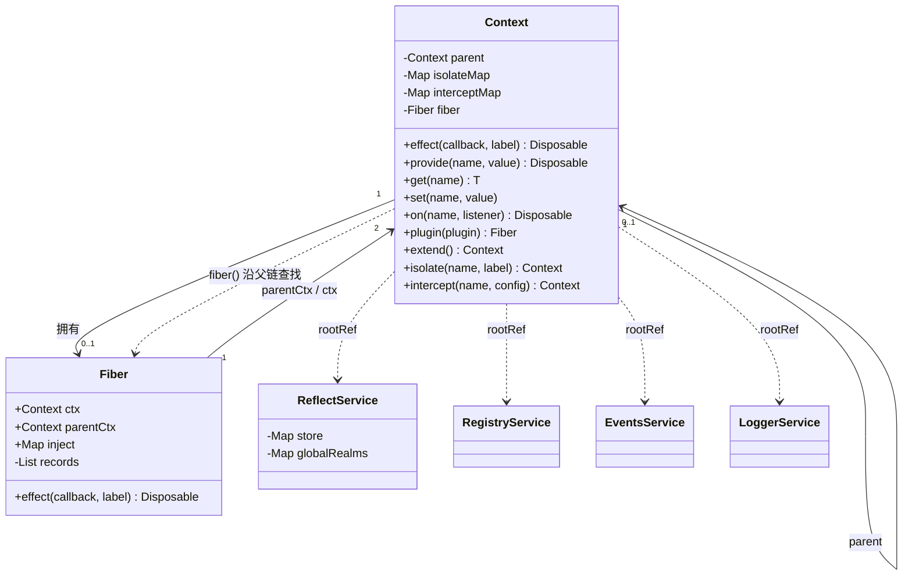
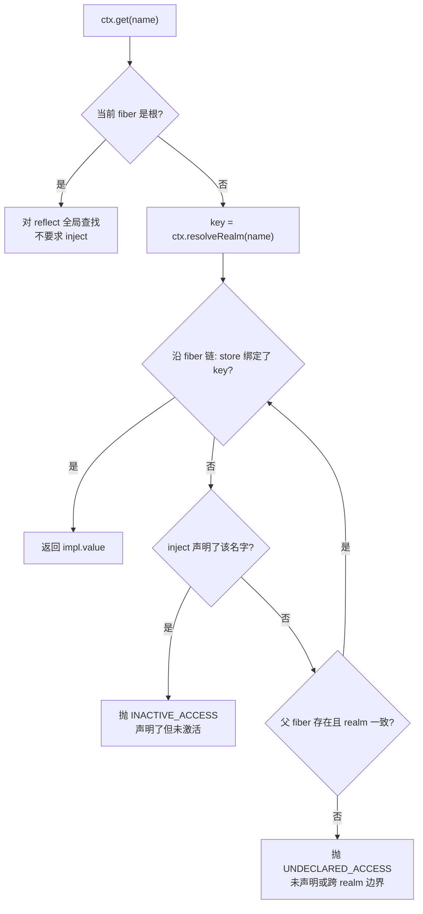
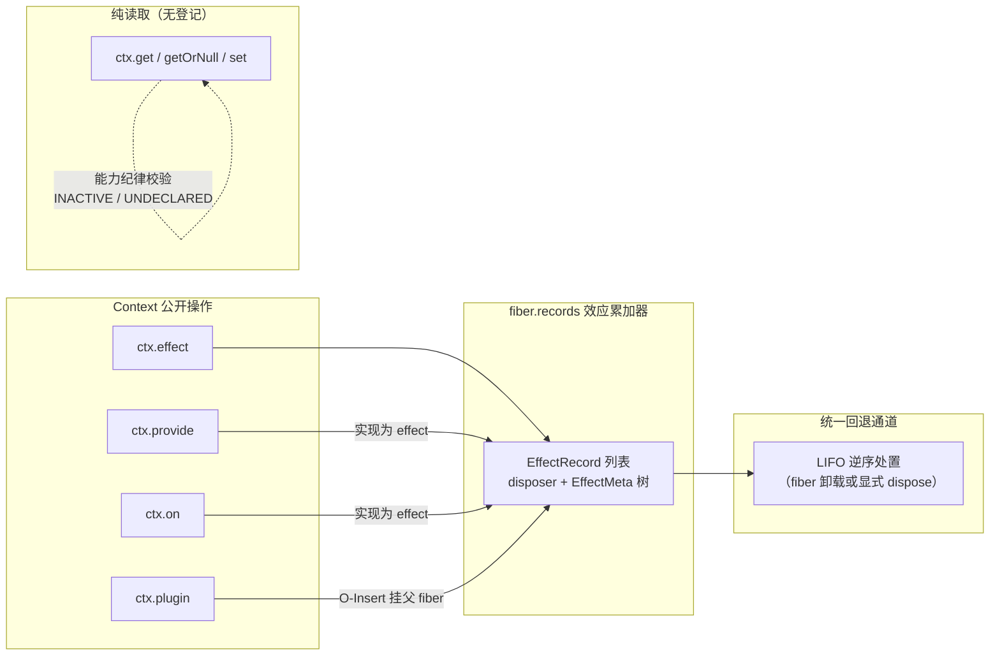

在 cordis-java 的整体分层中，`Context` 是插件世界与运行时环境之间的**唯一契约面**：插件对环境施加的每一次改变（效应，effect）与从环境获得的每一次供给（余效应，coeffect）都必须经由上下文中转，不存在绕过上下文直接触碰运行时的旁路。本页解释这一范式的动机、`Context` 的内部解剖，以及最容易被忽视却最关键的设计事实——**所有上下文操作最终都收敛为效应**，从而使"谁拥有、谁回滚"的纪律成为构造性保证而非编码约定。本页聚焦范式本身；效应模型细节、服务解析算法与状态机机制由后续页面分别展开。

## 一、问题的起点：为什么插件与环境的全部交互要收束到一个对象

一个插件在运行期要做两类性质截然相反的事。它要**改变世界**：打开数据库连接、注册事件监听、派生子插件——这些是效应，具有时间维度，需要可回退。它也要**依赖世界**：读取 `db` 服务、接受配置注入——这些是余效应，具有空间维度，提供者变化时依赖方必须被重新评估。若这两类交互散落在不同 API 上，插件作者就必须手写卸载逻辑、手工追踪依赖，HMR 与级联卸载将无从谈起。

cordis 的解法是把两类交互统一收束到一等公民的上下文对象上。`Plugin` 接口的形状直接体现了这个二元结构：`inject()` 声明余效应规范（论文中的 `d`），`apply(ctx, config)` 是效应函数（`e`），而它运行时通过 `ctx.provide` 提供的内容则是 `p`。`apply` 收到的第一个参数就是 `Context`，一个插件自始至终只通过它与外界对话。

Sources: [Plugin.java](cordis-core/src/main/java/dev/cordis/core/Plugin.java#L7-L42)

`Context` 类的 Javadoc 对此有一句精确的自我定义："组件与环境的每一次交互都经过一个上下文：效应登记在它上面（`effect`，即回退 fiber 全部效应的累加器），余效应对它解析（`get`/`provide`，即依赖表 Σ）"。类注释同时指出，派生子上下文（`extend`、`isolate`、`intercept`）以影子方式覆盖父上下文的 realm 表 ρ 与 intercept 表 ι，而不发生变异——这是后文第六节的主题。

Sources: [Context.java](cordis-core/src/main/java/dev/cordis/core/Context.java#L10-L29)

## 二、Context 的解剖：父链、两张影子表与四个根服务

从第一性原理出发，`Context` 只需要回答三个问题：我属于哪个 fiber？我在哪个隔离域解析服务？我为哪些服务叠加了什么拦截配置？其字段布局正对应这三个问题的答案：`parent` 指向父上下文（根为 null），`isolateMap` 与 `interceptMap` 是两张只属于本节点的影子表，`fiber` 是本上下文直接持有的 fiber（可能为 null，沿父链查找），而 `rootRef` 缓存了根上下文的引用——四个内建服务（`ReflectService`、`RegistryService`、`EventsService`、`LoggerService`）只安装在根上，任何派生上下文通过 `rootRef` 直达它们。

Sources: [Context.java](cordis-core/src/main/java/dev/cordis/core/Context.java#L32-L41)

`Context.createRoot()` 是整个应用的构造原点：它创建无父的根上下文，装上四个内建服务，并构造 uid 为 0、状态直接为 ACTIVE 的根 fiber。根 fiber 没有 `PluginRuntime`，其 `store` 为空表——这意味着根上下文上注册的一切效应只能通过显式调用其 Disposable 或 `Fiber.dispose()` 触发根 fiber 的全局拆除（`registry().deleteAll()`）来回退。

Sources: [Context.java](cordis-core/src/main/java/dev/cordis/core/Context.java#L48-L57)

下面的类图概括了 `Context` 在整个对象图中的位置：它是 fiber 链与两张影子表的持有者，同时是四个根服务的分发入口。

注意图中 `Fiber` 与 `Context` 的双向关系：每个非根 fiber 在构造时通过 `parentCtx.deriveChild(this)` 获得一个**专属的子上下文**（即 `apply` 收到的那个 `ctx`），同时通过 `parentCtx` 记住它被加载时所在的上下文。`fiber()` 方法的查找语义是"本上下文自己的 fiber，或最近祖先的"——这正是服务解析能沿 fiber 链向上行走的结构前提。

Sources: [Context.java](cordis-core/src/main/java/dev/cordis/core/Context.java#L69-L85)

## 三、效应面：时间的入口，注册即登记

`ctx.effect(callback, label)` 是效应范式的用户侧入口，它一行委托给 `fiber().effect(...)`。理解这个委托的语义至关重要：**效应注册在拥有该上下文的 fiber 上，而不是上下文本身**。上下文只是入口，fiber 才是累加器——fiber 内部维护 `records`（`EffectRecord` 列表，每条记录持有 disposer 与诊断元数据）与 `metaStack`（当前正在运行效应的元数据栈）。

Sources: [Context.java](cordis-core/src/main/java/dev/cordis/core/Context.java#L247-L255)

`Fiber.effect` 的实现展示了一个微缩的注册协议：回调**立即执行**，其返回值被 `collectResult` 归一化——单个 `Disposable`、`null`、或惰性 `Iterable<Disposable>`（多阶段效应，逐阶段收集且阶段边界可被稳定性守卫打断，细节见[可回退效应模型](8-ke-hui-tui-xiao-ying-mo-xing-effectcallback-disposable-yu-duo-jie-duan-yan-xu)与[惰性 Iterable 多阶段效应](10-duo-xing-iterable-duo-jie-duan-xiao-ying-yu-wen-ding-xing-shou-wei-zhong-duan)）。若回调抛出异常，已收集的部分逆变换立即逆序回滚（`runReverse(local)`）后异常继续上抛——注册失败不留半成品。成功路径则将包装 disposer 计入 `records`，`armed` 布尔数组保证单次处置语义。值得留意 `metaStack` 的嵌套规则：当一个效应体内再注册子效应时，子效应的 `EffectMeta` 会挂到当前栈顶的 `children` 上，形成可渲染的诊断树（`EffectMeta.render()`）。

Sources: [Fiber.java](cordis-core/src/main/java/dev/cordis/core/Fiber.java#L169-L198)

用户代码因此获得了"局部性关切"的编码风格。示例插件 `DatabasePlugin` 的 `apply` 是范式最清晰的注脚：它先注册"打开连接"效应，再注册"准备语句"效应，最后返回 `null`——作者没有写任何卸载路径，因为两件事要撤销的一切都已被运行时累计；卸载时按 LIFO 逆序执行（先关语句、再关连接），顺序由注册顺序的逆构造性地保证。

Sources: [Fiber.java](cordis-core/src/main/java/dev/cordis/core/Fiber.java#L200-L233)
Sources: [EffectCallback.java](cordis-core/src/main/java/dev/cordis/core/EffectCallback.java#L5-L28)
Sources: [DatabasePlugin.java](cordis-example/src/main/java/dev/cordis/example/plugins/DatabasePlugin.java#L7-L45)

## 四、余效应面：空间的入口，读取即受约束

如果说效应面是"向时间写入"，余效应面就是"从空间读取"——但 cordis 的读取从来不是自由的全局查找。`ctx.get(name)` 是能力纪律（capability discipline）在运行时的执法点：先解析 realm，然后沿 fiber 链自下而上行走——第一个已提交视图（`store`）绑定了该 key 的 fiber 给出答案；若某 fiber 在 `inject` 中**声明了**该 key 却尚未装载，抛出 `INACTIVE_ACCESS`；若一路走到根仍未声明，抛出 `UNDECLARED_ACCESS`；若父 fiber 与当前 fiber 对该服务的 realm 不一致，同样以 `UNDECLARED_ACCESS` 拒绝——realm 边界即能力边界。

Sources: [Context.java](cordis-core/src/main/java/dev/cordis/core/Context.java#L173-L209)

这张流程图概括了 `ctx.get` 的完整判定路径（算法 6 的运行时形态，完整解析规则见[服务解析算法](15-fu-wu-jie-xi-suan-fa-fiber-lian-xing-zou-realm-bian-jie-yu-neng-li-ji-lu)）：

围绕 `get`，`Context` 还提供三个配套操作：`getOrNull` 绕过 inject 要求做宽松查询（找不到或不活跃时返回 null）；`set` 只允许**提供该服务的那个 fiber** 覆写值（未提供时抛 `INVALID_SET`，跨 fiber 写入同样抛错）；而 `provide` 则是供给方的注册入口。realm 与 intercept 的解析各自沿上下文父链行走：`resolveRealm` 找到最近的 `isolateMap` 条目否则回落到全局默认 realm，`resolveIntercept` 则把根到叶的配置自顶向下做右偏合并——后代的同名字段覆盖祖先（详见[拦截](17-lan-jie-intercept-pei-zhi-you-pian-he-bing-yu-bian-pai-zhe-quan-xian-shou-suo)）。

Sources: [Context.java](cordis-core/src/main/java/dev/cordis/core/Context.java#L211-L243)
Sources: [Context.java](cordis-core/src/main/java/dev/cordis/core/Context.java#L133-L169)

## 五、统一的关键：一切上下文操作最终都是效应

这是本页最核心的洞察，也是"统一中介"名副其实的原因：**余效应的供给侧本身被实现为效应**。看 `Fiber.provide` 的实现——`Context.provide` 委托到它，而它的第一行就是 `effect(cb -> {...}, "ctx.provide(\"name\")")`。注册一个服务绑定是一个效应：回调把 `Impl` 放入 reflect 的 realm 键控 store、放入本 fiber 的已提交视图、并（若已 ACTIVE）通知依赖方；返回的 disposer 则撤出绑定、再次通知、从视图中移除。换句话说，"提供 db 服务"与"打开数据库连接"在累加器眼里是同一类东西——都登记了逆变换，都会在 fiber 卸载时自动回退。

Sources: [Context.java](cordis-core/src/main/java/dev/cordis/core/Context.java#L235-L243)
Sources: [Fiber.java](cordis-core/src/main/java/dev/cordis/core/Fiber.java#L458-L479)

同一模式出现在另外两处。`ctx.on(name, listener)` 在 `EventsService.on` 中同样以 `ctx.fiber().effect(...)` 实现，标签为 `ctx.on("name")`，其逆变换从监听列表中摘除 hook——事件订阅因此随 fiber 卸载自动注销。而 `ctx.plugin(plugin)` 触发的 fiber 实例化，在 `Fiber` 构造器里被实现为**挂在父 fiber 上的一个效应**（实例化原语，即 O-Insert）：回调把新 fiber 加入运行时记录并广播 `internal/plugin` 事件，返回的 disposer 就是 O-Retire——级联卸载由此免费获得（详见 [O-Insert 与 O-Retire](13-o-insert-yu-o-retire-cha-jian-shi-li-hua-de-xiao-ying-hua-yu-ji-lian-xie-zai)）。

Sources: [EventsService.java](cordis-core/src/main/java/dev/cordis/core/EventsService.java#L44-L58)
Sources: [Fiber.java](cordis-core/src/main/java/dev/cordis/core/Fiber.java#L81-L134)

下表将 `Context` 的公开操作按两个维度归类，并给出每项操作落入效应累加器时的诊断标签——标签的统一格式本身就是收敛性的直接证据：

| 操作 | 维度 | 语义角色 | 落入累加器的标签 | 自动逆变换 |
|---|---|---|---|---|
| `effect(cb, label)` | 效应 | 注册任意可回退效应 | 用户自定义 label | 回调返回的 disposer |
| `provide(name, value)` | 余效应（供给） | 注册服务绑定 | `ctx.provide("name")` | 撤出绑定并通知依赖方 |
| `on(name, listener)` | 效应（订阅） | 注册事件监听 | `ctx.on("name")` | 从监听列表移除 |
| `plugin(plugin)` | 结构 | 实例化子插件 | `ctx.plugin()` | O-Retire 级联卸载 |
| `get(name)` | 余效应（消费） | 能力受控读取 | —（纯读取，无登记） | — |
| `getOrNull(name)` | 余效应（消费） | 宽松读取 | —（纯读取，无登记） | — |
| `set(name, value)` | 余效应（消费） | 提供者限定覆写 | —（覆写值，无登记） | — |
| `inject(deps, body)` | 余效应（消费） | 匿名依赖回调 | 复用 `plugin()` 路径 | 随依赖变化重载 |
| `extend()/isolate()/intercept()` | 结构 | 派生子上下文 | —（影子，无需逆） | 回滚即丢弃派生上下文 |

这张收敛图直观呈现了范式：无论从哪个入口出发，凡是"改变了世界"的操作最终都汇入 fiber 的 `records` 累加器；纯读取操作则不产生任何登记。

`RegistryService` 侧的两个入口印证了表中最后一行的含义：`inject(deps, body)` 只是把匿名 lambda 包装成 `Plugin.of(null, deps, body)` 再走 `plugin()` 路径，`plugin()` 则断言父 fiber 活跃后创建 `Fiber`——生命周期从这两个入口出发**反应式地**推进，而非立即执行（"the fiber loads reactively once its inject is satisfied"）。

Sources: [RegistryService.java](cordis-core/src/main/java/dev/cordis/core/RegistryService.java#L71-L97)
Sources: [Context.java](cordis-core/src/main/java/dev/cordis/core/Context.java#L257-L270)

## 六、派生上下文：影子而非变异，回滚无需逆变换

效应面的一切都要逆变换，那 `isolate`、`intercept` 这类**改变解析行为本身**的操作如何回退？答案体现了范式的另一半精妙：它们根本不需要逆变换。`extend()`、`isolate(name, label)`、`intercept(name, config)` 都返回一个**新建的子上下文**，只在子节点的 `isolateMap` 或 `interceptMap` 中放一条记录，父上下文分毫未动。由于 recovery（丢弃派生上下文）本身就撤销了这条影子记录，这些操作在类注释中被明确豁免于逆变换要求——"recovery discards the derived context, so these operations need no inverse"。

Sources: [Context.java](cordis-core/src/main/java/dev/cordis/core/Context.java#L19-L29)
Sources: [Context.java](cordis-core/src/main/java/dev/cordis/core/Context.java#L92-L131)

`isolate(name, label)` 的重载规则值得一提：label 为 `RealmKey` 时直接采用；为 null 时 `RealmKey.fresh(name)` 生成全新私有域；为任意其他对象时 `RealmKey.shared(label)` 以相等性识别共享域——字符串标签即可让多个派生上下文加入同一个域。README 的多租户示例浓缩了这个用法：`root.isolate("db", "db@tenant-a")` 让同名 `db` 服务在不同 realm 独立解析，再叠加 `intercept("db", Map.of("readOnly", true))` 由编排者收缩权限。

Sources: [Context.java](cordis-core/src/main/java/dev/cordis/core/Context.java#L100-L120)
Sources: [README.md](README.md#L84-L89)

影子机制还有一处内建的特例：fiber 构造时，`deriveChild` 创建的专属上下文会通过包私有的 `interceptSelf` 把该 fiber **inject 声明携带的拦截配置**直接安装到自己身上——即插件声明的 `inject: ["db"]` 若展开为带配置的映射，配置落在插件自己运行的上下文节点上，优先于任何祖先的 intercept 配置。

Sources: [Context.java](cordis-core/src/main/java/dev/cordis/core/Context.java#L87-L90)
Sources: [Fiber.java](cordis-core/src/main/java/dev/cordis/core/Fiber.java#L89-L96)

## 七、范式收束：两张表、一个累加器与一条纪律

把全页内容折叠为一句话：`Context` 用**两张影子表**（ρ 与 ι）承载空间维度的解析可变性，用**一个效应累加器**（fiber 的 `records`）承载时间维度的可回退性，用**一条能力纪律**（inject 声明 + realm 边界 + 三类错误码）约束读取。三者互为表里：影子表使空间变化免于逆变换，累加器使时间变化必然可逆，能力纪律使"读"与"写"的权限在 `get`/`set`/`provide` 三个动词上被精确区分——`get` 要求声明、`set` 要求所有权、`provide` 唯一性冲突抛 `DUPLICATE_PROVIDE`。`Context` 的 `toString` 返回 `"Context<" + fiber().name() + ">"` 也在提醒使用者：每个上下文的身份最终锚定在它所属的 fiber 上。

Sources: [Context.java](cordis-core/src/main/java/dev/cordis/core/Context.java#L181-L233)
Sources: [Context.java](cordis-core/src/main/java/dev/cordis/core/Context.java#L312-L315)

与 TypeScript 版 cordis 的对照是理解取舍的捷径：TS 版的 `ctx` 是 Proxy 加原型链，属性访问被语言级拦截；Java 无此原语，`ctx.get(key)` 以显式方法承担同样的按需能力检查（详见[与 TypeScript 版 cordis 的语义映射](7-yu-typescript-ban-cordis-de-yu-yi-ying-she-yu-tong-bu-hua-she-ji-qu-she)）。

Sources: [README.md](README.md#L105-L106)

## 八、小结与延伸阅读

`Context` 作为效应与余效应的统一中介，其价值不在于 API 数量，而在于**收敛性**：插件作者只需记住"改变世界走 `effect` 系动词、依赖世界走 `get`/`inject` 系动词"，运行时便自动获得 LIFO 回滚、级联卸载、反应式重载与能力隔离。要深入本页各条线索，建议按如下顺序继续阅读：

- 时间维度展开：[可回退效应模型：EffectCallback、Disposable 与多阶段延续](8-ke-hui-tui-xiao-ying-mo-xing-effectcallback-disposable-yu-duo-jie-duan-yan-xu)与[LIFO 逆变换累加器：效应折叠、单次处置与失败回滚](9-lifo-ni-bian-huan-lei-jia-qi-xiao-ying-zhe-die-dan-ci-chu-zhi-yu-shi-bai-hui-gun)
- 空间维度展开：[inject 声明与 ReflectService 通知：提供者变化的反应式分类](14-inject-sheng-ming-yu-reflectservice-tong-zhi-ti-gong-zhe-bian-hua-de-fan-ying-shi-fen-lei)与[服务解析算法：fiber 链行走、realm 边界与能力纪律](15-fu-wu-jie-xi-suan-fa-fiber-lian-xing-zou-realm-bian-jie-yu-neng-li-ji-lu)
- 派生语义展开：[隔离域：RealmKey、isolate 派生上下文与多租户实践](16-ge-chi-yu-realmkey-isolate-pai-sheng-shang-xia-wen-yu-duo-zu-hu-shi-jian)
- 统一性的极端体现：[O-Insert 与 O-Retire：插件实例化的效应化与级联卸载](13-o-insert-yu-o-retire-cha-jian-shi-li-hua-de-xiao-ying-hua-yu-ji-lian-xie-zai)与[生命周期状态机：PENDING 到 DISPOSED 的六状态与转换规则](11-sheng-ming-zhou-qi-zhuang-tai-ji-pending-dao-disposed-de-liu-zhuang-tai-yu-zhuan-huan-gui-ze)