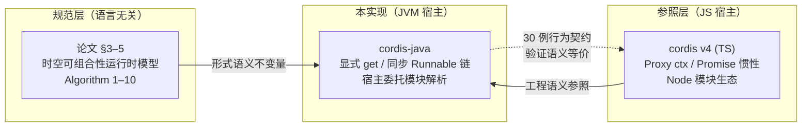
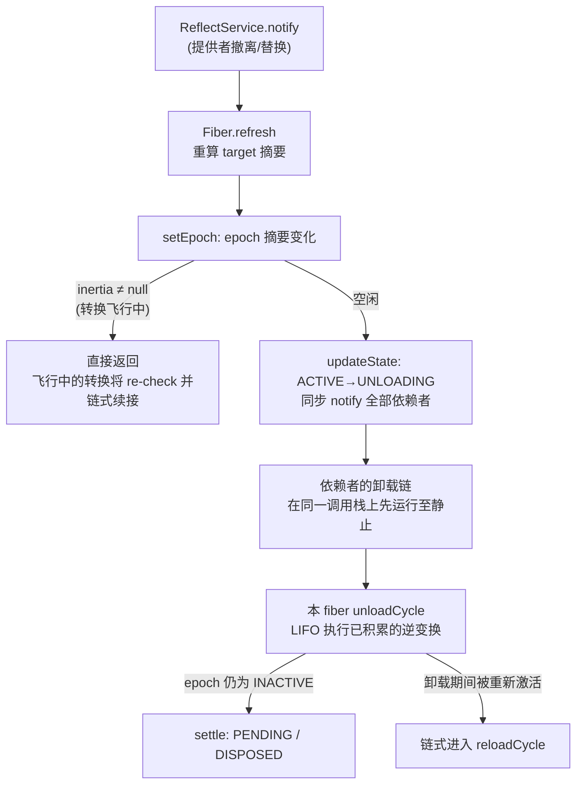

本页回答一个贯穿整个移植工程的问题：**cordis-java 与 TypeScript 版 cordis v4 之间，什么是必须原样保持的语义，什么是允许随宿主语言重造的形状？** 本页不重复各子系统的内部机制（那些由后续页面展开），而是聚焦于映射策略本身——八个核心语义单元的对照词汇表、四项关键设计取舍的论证，以及一份"语义不变量"保真度清单。阅读本页后，你应当能判断：当你对照 TS 版源码阅读本仓库时，哪些差异是有意的、有证明的，哪些差异值得警惕。

Sources: [README.md](README.md#L3-L6)

## 移植基准：论文规范、TS 参照与 Java 实现的三方定位

理解映射策略的第一步是分清两个"上游"。cordis-java 的语义来源有两条线：其一是论文 *A Programming Paradigm for Spatiotemporal Composability* 第 3–5 章的运行时模型（Algorithm 1–10 与各 Definition），它是**规范语义**——形式化的不变量，与语言无关；其二是 vendor 自 [deepseek-ai/deepseek-harness](https://github.com/deepseek-ai/deepseek-harness) 仓库的 cordis v4 源码，它是**工程参照**——展示了同一套语义在 JS 事件循环、Proxy、Node 模块系统上的具体落位。Java 版对前者逐条兑现（LIFO 逆变换折叠、目标视图摘要、L-Unload 守卫），对后者则只保留语义而重造形状（Runnable 链替代 Promise、显式 `get` 替代 Proxy 拦截）。

这一分层决定了差异的判定标准：**凡论文规定的转换不变量（转换一旦开始必然完成、依赖先于提供者完成卸载、终态只依赖最终配置），Java 版必须逐条满足；凡 TS 版中由 JS 语言特性"顺便"实现的形状（Proxy、生成器、Promise、Symbol），Java 版可以重造，只要语义等价可论证**。仓库自身的表述是"以 vendor 的 cordis 源码为语义参照"而非"为 API 移植"，这一措辞即是取舍的宣言。

Sources: [README.md](README.md#L3-L6)

## 核心词汇表：八个语义单元的映射总表

下表是全仓库最浓缩的对照。左列是 cordis v4 的运行时概念，中列是 Java 对应物，右列说明语义保真点与差异成因。后续四节将分别展开表中代价最大的四行。

| cordis v4 (TS) | cordis-java | 语义保真点 / 差异成因 |
|---|---|---|
| `ctx`（Proxy + prototype 链） | `Context`（parent 链 + 显式 isolate/intercept 表） | 派生上下文影子化父表而不改父表；Java 无属性拦截原语，读写走显式方法 |
| `ctx.effect(cb)` / 生成器效应 | `ctx.effect(EffectCallback)` | 惰性 `Iterable<Disposable>` 承接生成器多阶段语义，stage 边界即 `Maybe(ℑ)` 延续 |
| `fiber.epoch` / `fiber.target` | `Fiber.epoch` / `Fiber.target` | 提供者 uid 摘要逐字符一致；覆写绑定（`set`）不触发重载 |
| `fiber.inertia`（Promise） | `Fiber.inertia`（同步 Runnable 链） | 惯性主机语义等价：转换必然完成、完成后才响应新目标；见"取舍一" |
| unload 前等待被通知的依赖 | ACTIVE→UNLOADING 状态变化同步通知 | 消费者先于提供者的逆变换完成卸载（L-Unload 守卫），由构造顺序保证 |
| `@cordisjs/loader` 按 id 调和 | `ComponentLoader.reconcile` | 差分与逐字段分发一致；终态只依赖最终配置 |
| `@cordisjs/hmr`（Loader 内省） | `HmrEngine` + 宿主 `ModuleGraph`/`PluginResolver` | 三阶段算法一致；模块引入/撤出与依赖图外置给宿主 |
| `symbols.isolate`（JS Symbol） | `RealmKey`（对象身份 + intern） | 对象相等性镜像 Symbol 唯一性；字符串标签经 `shared` 全局 Join |

插件形状的映射同样遵循"语义优先"：TS 的 `Plugin` 携带余效应规范（`inject`，论文的 *d*）与效应函数（`apply`，论文的 *e*），提供物 *p* 在运行时经 `provide` 声明；一个插件绑定两份 config 即表现为两个组件。Java 的 `Plugin` 接口逐项保留这三个语义位——`inject()`、`apply(ctx, config)`、以及 apply 返回值作为待回退效应（`Disposable`、`Iterable<Disposable>` 或 null）——差异仅在返回类型从生成器换成了惰性可迭代物。

Sources: [README.md](README.md#L101-L111), [Plugin.java](cordis-core/src/main/java/dev/cordis/core/Plugin.java#L7-L14)

## 取舍一：同步转换替代异步惯性——Promise 链到 Runnable 链

这是全部取舍中最根本的一项。TS 版的惯性主机建立在 JS 事件循环之上：`fiber.inertia` 是一个 Promise，转换经由微任务排队展开，unload 之前需要主动 `await` 被通知到的依赖者。Java 版没有事件循环的免费赠品，于是选择在**调用线程上同步完成整条 reload/unload 链**。这个选择之所以成立，是因为惯性主机的语义不变量只有两条：**转换一旦开始必然完成；转换完成后才响应新的目标变化**。这两条与异步无关——同步执行是它们的最强满足形式。

实现上的锚点是三个协作结构。`Fiber.inertia` 字段是单个 `Runnable` 引用，`runChain()` 用 while 循环把它抽干：每个周期取出当前任务、清空槽位、执行；任务执行中若目标再次变化（`setEpoch` 被重入调用），新任务写回槽位，循环自然续接——这就是"链式衔接"的物理形态。关键的重入防护在 `setEpoch` 的第一行分支：若 `inertia != null` 说明一次转换正在飞行中，此时 epoch 已更新但直接返回，由飞行中的转换在收尾时重新比对并自行链上下一程。这与 TS 版"进行中的 Promise 会 re-check 并级联"完全同构，只是把微任务队列折叠成了调用栈。

同步化带来的第二重收益是 **L-Unload 守卫从"运行时协议"降格为"构造顺序"**。TS 版必须在卸载提供者之前显式等待被通知的依赖；Java 版中，`updateState` 在状态从 ACTIVE 跨向非 ACTIVE 的瞬间同步发出 `reflect.notify`，所有消费者的卸载链在当前调用栈上先于提供者自身的 `unloadCycle` 执行完毕——`unloadCycle` 开头的注释直言这一点："Dependents were already drained … cordis awaits notified dependents here instead"。守卫不再是一条需要遵守的规则，而是控制流的自然产物，顺序推理因此更容易。

这一取舍的代价与边界同样明确。其一，`await()` 退化为纯错误传播：同步端口的转换在返回前已经静止，`await()` 只负责把 FAILED 状态下的启动错误重抛——它对应 TS 版 await Promise 的落点，但不再是等待原语。其二，长依赖链的转换深度消耗调用栈而非堆上的微任务，宿主若预期极深级联需自行评估。其三，真正的异步清理（如等待网络连接关闭）不被运行时托管，设计上要求用户在 `Disposable` 内部自行对接 `CompletableFuture`——运行时只承诺同步地"启动"逆变换，不承诺其内部阻塞语义。

Sources: [Fiber.java](cordis-core/src/main/java/dev/cordis/core/Fiber.java#L26-L31), [Fiber.java](cordis-core/src/main/java/dev/cordis/core/Fiber.java#L277-L299), [Fiber.java](cordis-core/src/main/java/dev/cordis/core/Fiber.java#L335-L357), [Fiber.java](cordis-core/src/main/java/dev/cordis/core/Fiber.java#L405-L414), [README.md](README.md#L113-L117)

## 取舍二：Proxy 缺席下的能力纪律——属性拦截到显式 get 与错误码

TS 版的 `ctx` 是 Proxy：任意属性访问被拦截，在拦截器内完成论文 Algorithm 6 的按需能力检查——声明的依赖在解析点直接返回，未声明的访问抛错。这层语言魔法让"能力纪律"（capability discipline）对用户不可见。Java 没有属性拦截原语，于是 `Context.get(String)` 承担起整个检查协议，代价是访问必须显式，收益是失败模式被**枚举为错误码**而非散落的运行时异常。

`get` 的行走逻辑是一个三段式的 fiber 链算法：自本 fiber 起，先查其已提交视图 `store`（命中即返回，这是覆写绑定仍返回旧值、不触发重载的原因）；再查 `inject` 声明——已声明但不在 store 中，抛 `INACTIVE_ACCESS`（语义：上下文处于未激活态）；声明与绑定都没有则走向父 fiber，但跨越前先校验 realm 一致性（父链上该名字解析到不同 `RealmKey` 时同样抛 `UNDECLARED_ACCESS`，附注 realm 边界）；走穿到根仍未声明，抛 `UNDECLARED_ACCESS`。两条错误码把论文中"未声明访问"与"已声明未激活"两种失败在类型层面分开，宿主可以精确区分"插件写错了依赖"与"依赖暂时不在场"。

映射中还有一条刻意的豁免通道：根上下文（`fiber().runtime == null`）与 `getOrNull` 绕过 inject 要求直接查询存储——它们对应 TS 版中非插件代码直接访问 `ctx` 服务的场景，把"能力纪律只约束插件"这条边界做成了显式 API 而非隐式约定。

Sources: [Context.java](cordis-core/src/main/java/dev/cordis/core/Context.java#L14-L28), [Context.java](cordis-core/src/main/java/dev/cordis/core/Context.java#L173-L215), [README.md](README.md#L118-L120)

## 取舍三：模块系统外置——Node 注册表到 PluginResolver 与 ModuleGraph

`@cordisjs/loader` 与 `@cordisjs/hmr` 在 TS 生态里是"白得"的：`import()` 天然引入模块，模块图可以从 Node 的解析记录内省。JVM 没有等价的动态模块注册表，本实现的处理方式不是造一个，而是**把模块边界的两个职责声明为宿主接口**：`PluginResolver`（url → 待实例化的组件）承担"引入/撤出模块"，其 Javadoc 明确列举合法宿主策略——注册表查找、反射加载、外部文件读取，或为 HMR 合成代表"编辑后新模块"的全新实例；`ModuleGraph`（url → 直接 import 集合）承担依赖图供给，宿主可由构建索引、类引用扫描或手工映射实现。

这一外置直接塑造了 HMR API 的形状。`HmrEngine.reload` 的 `fresh` 参数（url → 重编译后的 Plugin）就是"重编译模块"在无注册表环境下的等价物：命中则注入新实例，缺项回落到 loader 的 resolver 重解析。三阶段算法本身（分类不动点、陈旧 entry 检测、事务性重载）与 TS 版保持算法级一致——尤其第三阶段的回滚保证：任一模块重载失败，全部已换 entry 从备份组件重建，系统绝不进入半重载状态。值得强调的是这个设计立场：**fiber 已经界定了组件的全部效应，因此"自身即组件"的模块可以仅凭 fiber 操作完成原位替换，不需要 Webpack/Vite 式的开发者标注接受边界**——这是可回退效应模型对传统 HMR 的结构性优势，两版语义在此完全重合。

Sources: [PluginResolver.java](cordis-core/src/main/java/dev/cordis/loader/PluginResolver.java#L1-L25), [ModuleGraph.java](cordis-core/src/main/java/dev/cordis/hmr/ModuleGraph.java#L1-L15), [HmrEngine.java](cordis-core/src/main/java/dev/cordis/hmr/HmrEngine.java#L18-L29), [HmrEngine.java](cordis-core/src/main/java/dev/cordis/hmr/HmrEngine.java#L118-L150)

## 取舍四：Symbol 隔离标签的相等性重建——RealmKey

JS `Symbol` 为 `symbols.isolate` 提供了两条语义：全局唯一性（每次创建都是新身份）与按相等性 Join（同 Symbol 的两个隔离上下文解析到同一 realm）。Java 版用 `RealmKey` 这一 final 类配合两条工厂重建之：`fresh(hint)` 每次分配新对象，对象身份即唯一性——镜像"每次 `Symbol()` 都是新的"；`shared(label)` 经全局 `SHARED` map 做 intern，相等标签返回同一实例——镜像"同一 Symbol 引用自然 Join"。类 Javadoc 明言"Realm identity is object identity, mirroring JS `Symbol`"。

用户侧入口是 `Context.isolate(name, label)` 的三分支：传入已是 `RealmKey` 则直接采用；传 `null` 走 `fresh`（私有 realm，各隔离互不相通）；传任意其他对象走 `shared`（字符串标签即全局共享，同名 Join）。需要留意一个刻意的语义细节：`shared` 的键是 `Object` 相等性而非引用相等性——两个内容相同的字符串标签会 Join 到同一 realm，这与 JS 中"字符串不相等、Symbol 引用才相等"的直觉相反，是多租户实践中有意放开的便利通道（详见[隔离域](16-ge-chi-yu-realmkey-isolate-pai-sheng-shang-xia-wen-yu-duo-zu-hu-shi-jian)页）。

Sources: [RealmKey.java](cordis-core/src/main/java/dev/cordis/core/RealmKey.java#L1-L29), [Context.java](cordis-core/src/main/java/dev/cordis/core/Context.java#L100-L120)

## 生成器到惰性 Iterable：中断点的显式化

TS 版效应函数可以写成生成器：每个 `yield` 落下一个阶段的逆变换，运行时可在阶段之间观察目标视图并中断。Java 缺生成器，本实现的重建方案是**惰性 `Iterable<Disposable>` 加稳定性守卫**：`EffectCallback.execute` 可返回单个 `Disposable`、`null` 或一个 Iterable；`collectResult` 驱动迭代时，每取一个元素前先咨询守卫布尔供给器，守卫一旦翻假（`reloadCycle` 传入的是 `target == target0`，即目标视图已变），迭代停止，已积累的逆变换原位保留——这正是"stage 边界即 `Maybe(ℑ)` 延续"的运行时形态。惰性是硬要求：若 Iterable 预先展开，中断点就不存在了。

与生成器相比，这套重建少了一样东西——迭代体内的任意副作用（生成器 yield 之间可以执行代码，Iterable 只声明了产出物）。这意味着"阶段间的前置工作"必须写在自定义 Iterator 的 `next()` 里。这是本页映射表中唯一一处**表达能力严格收窄**的地方，设计上以"多阶段效应本身罕见"为接受理由，单阶段效应（返回单个 Disposable）覆盖绝大多数场景。

Sources: [EffectCallback.java](cordis-core/src/main/java/dev/cordis/core/EffectCallback.java#L6-L18), [Fiber.java](cordis-core/src/main/java/dev/cordis/core/Fiber.java#L154-L163), [Fiber.java](cordis-core/src/main/java/dev/cordis/core/Fiber.java#L200-L220)

## 保真度总评：语义不变量清单

下表以论文规定的不变量为准绳做最终核对——每行的"Java 落位"是本页四处取舍交汇后仍成立的最小机制。结论：**所有不变量满足；全部偏离集中在形状层（同步、显式、外置），无一触及语义层**。

| 论文语义不变量 | cordis v4 机制 | cordis-java 机制 | 保真结论 |
|---|---|---|---|
| 转换一旦开始必然完成 | Promise 链 drained by event loop | `runChain` 循环抽干 `inertia` | 等价（更强：栈上完成） |
| 新目标在转换静止后才被响应 | 进行中 Promise re-check | `setEpoch` 的 `inertia != null` 早退 + 链式续接 | 等价 |
| 依赖先于提供者完成卸载（L-Unload 守卫） | unload 前 `await` 被通知依赖 | ACTIVE→UNLOADING 同步 notify，构造顺序保证 | 等价（顺序按构造成立） |
| 逆变换按 LIFO 折叠、单次处置 | 生成器 + 数组逆序 | `runReverse` 逆序遍历，`armed` 单次闸门 | 等价 |
| 未声明/未激活访问被拒 | Proxy 拦截器抛错 | `UNDECLARED_ACCESS` / `INACTIVE_ACCESS` 错误码 | 等价且可枚举 |
| 同标签隔离域 Join | Symbol 引用相等 | `RealmKey.shared` intern | 等价（标签语义放宽为 Object 相等） |
| 重载终态只依赖最终配置 | loader 按 id 差分 | `ComponentLoader.reconcile` 逐字段分发 | 等价 |
| HMR 失败不产生半重载态 | Loader 内省 + 回滚 | `HmrEngine.reload` 备份重建 | 等价 |
| 覆写绑定（`set`）不触发重载 | proxy set 直写 | `Impl.value` 直写，不 notify | 等价 |

对高级读者的实操建议由此导出：**对照 TS 源码阅读本仓库时，把搜索锚点放在语义名词（`epoch`、`target`、`inertia`、`checkImpl`、`notify`）上，而非 API 形状上**——注释中标注的 cordis 同名概念（如 `Fiber.checkImpl` 对应 `_checkImpl`）是两版之间的直接桥梁；遇到形状差异时，先回到上表核对不变量是否被触及，再判断它属于已论证的取舍还是潜在缺陷。

Sources: [README.md](README.md#L113-L123), [Fiber.java](cordis-core/src/main/java/dev/cordis/core/Fiber.java#L26-L31), [Fiber.java](cordis-core/src/main/java/dev/cordis/core/Fiber.java#L237-L259)

## 延伸阅读

本页横向覆盖了全部映射面；四个纵深方向各有专页。时间维度上，效应折叠与多阶段中断的完整机制见[可回退效应模型](8-ke-hui-tui-xiao-ying-mo-xing-effectcallback-disposable-yu-duo-jie-duan-yan-xu)与[LIFO 逆变换累加器](9-lifo-ni-bian-huan-lei-jia-qi-xiao-ying-zhe-die-dan-ci-chu-zhi-yu-shi-bai-hui-gun)；同步转换链所驱动的状态机与惯性主机见[生命周期状态机](11-sheng-ming-zhou-qi-zhuang-tai-ji-pending-dao-disposed-de-liu-zhuang-tai-yu-zhuan-huan-gui-ze)与[惯性主机](12-guan-xing-zhu-ji-epoch-target-shi-tu-yu-lian-shi-reload-unload-zhuan-huan)；`get` 所实现的解析算法见[服务解析算法](15-fu-wu-jie-xi-suan-fa-fiber-lian-xing-zou-realm-bian-jie-yu-neng-li-ji-lu)；模块外置策略的宿主侧落地见[宿主集成指南](28-su-zhu-ji-cheng-zhi-nan-pluginresolver-modulegraph-yu-mo-kuai-zhu-ce-ce-lue)。