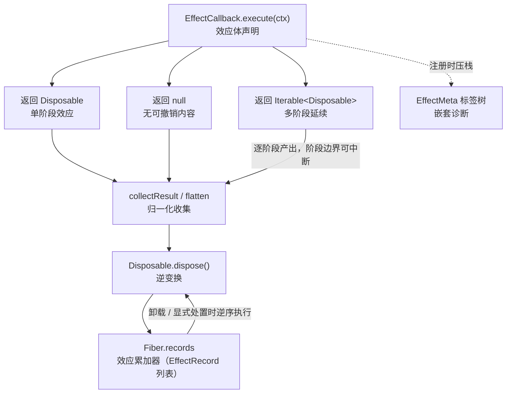
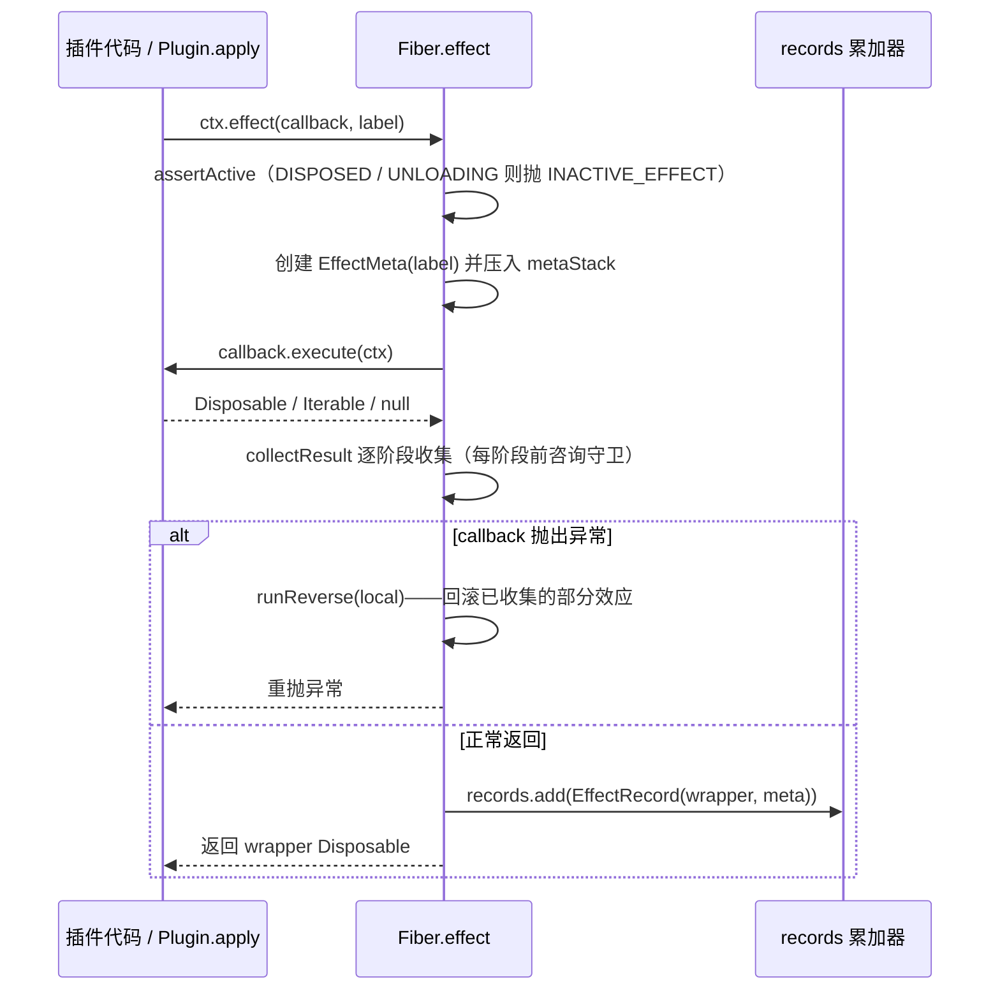

在 cordis-java 的时间维度上，一切"做过的事"都必须能被"撤销"——这不是通过 try/finally 的约定来实现的，而是通过一个显式的、可组合的**可回退效应模型**：插件执行的每一个改变环境的动作（打开连接、注册服务、订阅事件、甚至实例化子插件），都以"正向动作 + 逆变换"成对的形式被运行时登记。本文解析这个模型的三个核心构件——`EffectCallback`（效应体契约）、`Disposable`（逆变换的一等公民）与**多阶段延续**（Iterable 形态的分期撤销计划），以及它们在 `Fiber` 中的注册与收集路径。LIFO 折叠的精确语义与惰性 Iterable 的中断行为分别在后续两篇中深入展开。

## 第一性原理：可回退性来自"逆变换在应用点被交出"

传统插件框架的卸载逻辑往往写在独立的 `destroy()` 方法里，与安装代码分离，随着插件演化两者逐渐失配。cordis 的选择在结构上杜绝了这种失配：**效应在应用的那一刻，就把自己的逆变换交给运行时持有**。`Disposable` 的 Javadoc 直指这一点——它是"effect 在处置期间释放资源的函数，是可回退效应的逆"（论文 3.1 节），且"在应用点被提供、由运行时持有，这使得每个效应在构造上就是可回退的（Algorithm 1）"。

Sources: [Disposable.java](cordis-core/src/main/java/dev/cordis/core/Disposable.java#L1-L10)

这个设计有一个关键推论：插件作者永远只写"打开"的代码，并在同一个词法位置写出"关闭"的代码，二者天然对齐。示例工程中的 `DatabasePlugin` 是最佳注脚——它的 `apply` 方法注册了两个效应（获取连接、预处理语句）然后直接 `return null`，Javadoc 明确说明"运行时累加它们的逆变换（open → prepare），卸载时以 LIFO 顺序执行（close statements → close connection），作者无需编写任何卸载路径（关注点局部性）"。

Sources: [DatabasePlugin.java](cordis-example/src/main/java/dev/cordis/example/plugins/DatabasePlugin.java#L7-L44)

## Disposable：逆变换的一等公民

`Disposable` 是一个单方法函数式接口，`dispose()` 执行撤销。它的契约刻意收紧：Javadoc 要求实现"**幂等安全**——cordis 保证单次调用"。也就是说，实现者*可以*不防重入，因为运行时的 wrapper 机制保证 `dispose` 只会被真正执行一次；这份保证的兑现细节属于 [LIFO 逆变换累加器](9-lifo-ni-bian-huan-lei-jia-qi-xiao-ying-zhe-die-dan-ci-chu-zhi-yu-shi-bai-hui-gun) 一篇的主题。

Sources: [Disposable.java](cordis-core/src/main/java/dev/cordis/core/Disposable.java#L12-L16)

接口上还附带三个组合算子，把逆变换组织成一个代数结构：

| API | 语义 | 代数角色 |
| --- | --- | --- |
| `dispose()` | 执行撤销 | 基本操作 |
| `noop()` | 空逆变换 | 组合的**单位元**（identity） |
| `composeAfter(before)` | 先执行 `before` 再执行 `this` | 向累加器**前插**新逆变换，从而得到 LIFO 恢复序（论文 Algorithm 1 第 6 行、Theorem 16） |
| `sequence(first, second)` | 顺序执行两个逆变换 | 双参组合辅助 |

Sources: [Disposable.java](cordis-core/src/main/java/dev/cordis/core/Disposable.java#L17-L43)

值得注意 `composeAfter` 的方向性：`f.composeAfter(g)` 运行 `g()` 再运行 `f()`——新的逆变换被"后置"，装在旧逆变换的外层，因此**后注册者先撤销**。这个方向选择是整个时间维度一致性的种子，具体折叠过程由 `Fiber` 内部的记录列表与逆序遍历实现（详见第 9 篇）。

## EffectCallback：效应体的统一契约

`EffectCallback` 是效应体的形状：接收效应运行所处的 `Context`，返回"应当被撤销的东西"。它是 `@FunctionalInterface`，唯一方法 `Object execute(Context ctx)` 的返回值被 Javadoc 规约为**三种合法形态**：

| 返回形态 | 语义 | 收集行为 |
| --- | --- | --- |
| 单个 `Disposable` | 单阶段效应 | 整体作为一个逆变换收集 |
| `null` | 无可撤销内容的效应 | 空操作，注册本身仍占位 |
| `Iterable<Disposable>` | **多阶段效应** | 逐阶段收集：每产出一个 disposer 即登记，阶段边界是运行时可以中断转换的地方 |

Sources: [EffectCallback.java](cordis-core/src/main/java/dev/cordis/core/EffectCallback.java#L5-L28)

接口还提供静态方法 `flatten(Object result)`，把三种形态归一化为 `List<Disposable>`：`null` 归一为空列表，单个 `Disposable` 归一为单元素列表，Iterable 则逐项校验（跳过 `null` 项，遇到非 `Disposable` 元素抛出 `IllegalArgumentException`）。任何其他类型同样被拒绝——**效应体的返回值类型空间是封闭的**，不存在"返回一个自定义清理对象"的逃生通道。

Sources: [EffectCallback.java](cordis-core/src/main/java/dev/cordis/core/EffectCallback.java#L30-L46)

在阅读下图的 Mermaid 概念图前需要先明确三个前提：`EffectCallback` 是效应的*声明*，`Disposable` 是效应的*撤销*，`Fiber.records` 是运行时持有的*累加器*——三者构成"声明 → 收集 → 逆序撤销"的闭环。

## 多阶段延续：Iterable 作为分期交付的撤销计划

单阶段效应把"做"与"撤"打包成一个原子对，但有些效应天然是**长程的**：初始化要分几步走，且中途世界可能已经改变。cordis 用返回 `Iterable<Disposable>` 来表达这种结构——Javadoc 将其描述为多阶段效应，"每产出一个 disposer 即被收集，而**阶段边界正是运行时可以中断一次转换的地方**（效应迭代器的 `Maybe(ℑ)` 延续，论文 Definition 17）"。

Sources: [EffectCallback.java](cordis-core/src/main/java/dev/cordis/core/EffectCallback.java#L13-L17)

把 Iterable 理解为"延续"（continuation）而非"列表"是关键：迭代器在消费时才计算下一阶段，因此**阶段的推进时机由收集方（运行时）控制**。`Fiber.collectResult` 中的消费循环印证了这一点——在拉取每个阶段之前会先咨询一个 `BooleanSupplier` 守卫，守卫为假即 `break`，已收集的逆变换原样保留。守卫的来源有两条路径：`ctx.effect` 注册路径读取 wrapper 的 armed 标志；`Plugin.apply` 激活路径比较 target 摘要是否在迭代中途漂移（`Objects.equals(target, target0)`）。惰性迭代、守卫中断与"中途留下半份撤销计划"的完整分析见 [惰性 Iterable 多阶段效应与稳定性守卫中断](10-duo-xing-iterable-duo-jie-duan-xiao-ying-yu-wen-ding-xing-shou-wei-zhong-duan)。

Sources: [Fiber.java](cordis-core/src/main/java/dev/cordis/core/Fiber.java#L200-L220)

测试 `multiStageIterableCollectsEveryStage` 给出了最小验证：`apply` 返回包含三个 disposer 的 `Arrays.asList`，fiber 卸载后日志恰好为 `undo-3, undo-2, undo-1`——每个阶段都被收集，且按逆序撤销。

Sources: [EffectTrackingTest.java](cordis-core/src/test/java/dev/cordis/EffectTrackingTest.java#L71-L86)

## 两条注册路径：ctx.effect 与 Plugin.apply

效应进入累加器有两条入口。第一条是显式的 `ctx.effect(callback, label)`：`Context` 只是转发给所属 fiber 的同名方法（无 label 时默认 `"anonymous"`）。第二条是隐式的：`Plugin.apply` 的返回值本身就是一个效应体——接口 Javadoc 规定其返回"a `Disposable`、an `Iterable` of disposables（阶段——当 target 视图转向时运行时可在其间停止），或 null"。同一个 `collectResult` 同时服务两条路径，这正是模型统一性的体现。

Sources: [Context.java](cordis-core/src/main/java/dev/cordis/core/Context.java#L245-L255), [Plugin.java](cordis-core/src/main/java/dev/cordis/core/Plugin.java#L32-L42)

注册的完整时序如下（先说明两个角色：`Fiber.effect` 是注册算法本体，`EffectRecord` 是"逆变换 + 诊断元数据"的登记条目）：

Sources: [Fiber.java](cordis-core/src/main/java/dev/cordis/core/Fiber.java#L169-L198)

注册路径有三处值得逐一确认的实现细节。**其一，前置守卫**：`assertActive()` 在 uid 已置空（DISPOSED）时抛 `INACTIVE_EFFECT`，且方法开头对 `UNLOADING` 状态同样抛出——正在卸载的 fiber 不接受新效应，错误码在 `CordisException.Code` 中定义为"cannot create effect on inactive context"。**其二，异常即回滚**：callback 抛出的任何 `Throwable` 都触发对局部已收集列表的 `runReverse`（逆序执行）后原样重抛——失败效应不会在累加器中留下残骸，其完整事务语义在第 9 篇展开。**其三，返回的 wrapper 自带"解除武装"语义**：首次 `dispose()` 将 `armed` 置假、把自己从 `records` 移除并逆序执行局部列表，此后再调用是纯空操作；显式撤销过的效应在 fiber 卸载时不再重复执行。

Sources: [Fiber.java](cordis-core/src/main/java/dev/cordis/core/Fiber.java#L169-L198), [Fiber.java](cordis-core/src/main/java/dev/cordis/core/Fiber.java#L147-L150), [CordisException.java](cordis-core/src/main/java/dev/cordis/core/CordisException.java#L9-L25)

`Plugin.apply` 路径的差异在于守卫与登记方式：`reloadCycle` 在激活开始时记下 `target0`，执行 `plugin.apply(ctx, config)` 后以 `() -> Objects.equals(target, target0)` 为守卫收集返回值——若依赖视图在 apply 执行期间发生转向，多阶段效应的推进即被截停；收集到的每个 disposer 直接以裸 `EffectRecord` 追加进 `records`，没有 wrapper 层（fiber 卸载时统一处置）。apply 若抛异常则记录错误、将 epoch 置 INACTIVE，走卸载链回收。

Sources: [Fiber.java](cordis-core/src/main/java/dev/cordis/core/Fiber.java#L301-L333)

## 框架自身即效应模型的最大用户

这个模型不只是给插件作者用的 API——框架的每个"改变世界"的内置操作都以效应的形式实现，各自带有可读的诊断标签：

| 内置操作 | 标签 | 正向动作 | 逆变换 |
| --- | --- | --- | --- |
| `ctx.on(name, listener)` | `ctx.on("name")` | 向事件总线挂载监听器 | 从列表移除该监听器 |
| `ctx.provide(name, value)` | `ctx.provide("name")` | 向 realm 写入 `Impl` 并通知依赖者 | 从 store 移除并再次通知 |
| `ctx.plugin(...)` 实例化 | `ctx.plugin()` | 父 fiber 上登记 O-Insert，子 fiber 入列 | **O-Retire**：级联卸载子 fiber |

Sources: [EventsService.java](cordis-core/src/main/java/dev/cordis/core/EventsService.java#L49-L58), [Fiber.java](cordis-core/src/main/java/dev/cordis/core/Fiber.java#L458-L479), [Fiber.java](cordis-core/src/main/java/dev/cordis/core/Fiber.java#L98-L117)

其中最深刻的一条是**插件实例化本身被效应化**：`Fiber` 构造器在父 fiber 上调用 `parentCtx.fiber().effect(...)`，正向动作把新 fiber 加入 runtime 的 fibers 列表，返回的 Disposable 就是 O-Retire——撤销它不仅移除登记，还会触发 epoch 重算、链式转换，甚至为仍持有效应的 PENDING fiber 补一次卸载。这意味着"卸载父插件级联卸载子插件"不是特殊规则，而是效应模型的自然推论（专题见 [O-Insert 与 O-Retire：插件实例化的效应化与级联卸载](13-o-insert-yu-o-retire-cha-jian-shi-li-hua-de-xiao-ying-hua-yu-ji-lian-xie-zai)）。同理，`provide` 的逆变换在移除服务的同时调用 `reflect.notify`——服务消失作为一种"反应式余效应"通知依赖者重新计算 target。

Sources: [Fiber.java](cordis-core/src/main/java/dev/cordis/core/Fiber.java#L98-L124)

嵌套效应的结构由 `EffectMeta` 树承载：每次注册创建带 label 的节点，若 `metaStack` 非空则挂为栈顶节点的子节点；`provide` 内部再调 `ctx.effect` 时，标签树就长出了层级，`render()` 以缩进文本输出整棵树用于诊断（错误追踪专题见 [错误体系与诊断](26-cuo-wu-ti-xi-yu-zhen-duan-cordisexception-cuo-wu-ma-ming-ming-ri-zhi-yu-xiao-ying-zhui-zong)）。

Sources: [EffectMeta.java](cordis-core/src/main/java/dev/cordis/core/EffectMeta.java#L7-L31), [Fiber.java](cordis-core/src/main/java/dev/cordis/core/Fiber.java#L174-L187)

## 契约清单：模型承诺了什么、由什么验证

把上述行为汇总为可检验的契约，每一条都对应仓库中的既有测试：

| 契约 | 履行机制 | 验证 |
| --- | --- | --- |
| 卸载时逆序撤销（LIFO） | `runReverse` 从列表尾部遍历 | `effectsUnwindInLifoOrderOnFiberUnload`：open a,b,c → close c,b,a |
| 显式处置恰好一次 | wrapper 的 `armed` 标志 + 从 records 移除 | `explicitDisposeRunsOnce`：二次调用无副作用，卸载不再补执行 |
| 多阶段全量收集、逆序撤销 | `collectResult` 对 Iterable 逐项入列 | `multiStageIterableCollectsEveryStage` |
| 死 fiber 上拒绝注册 | `assertActive` / UNLOADING 检查抛 `INACTIVE_EFFECT` | `effectOnDisposedFiberThrows` |
| `null` 是合法效应 | flatten 归一为空列表 | `nullResultIsAnEffectWithNothingToUndo` |

Sources: [EffectTrackingTest.java](cordis-core/src/test/java/dev/cordis/EffectTrackingTest.java#L39-L102)

## 小结与延伸阅读

`EffectCallback` 定义了效应体的封闭返回类型空间（Disposable / null / Iterable），`Disposable` 提供了带单位元与组合律的逆变换代数，而 Iterable 形态把"撤销计划"升格为可分期交付、可在阶段边界被打断的延续。三者共同保证：任何改变环境的动作，其撤销方式在应用点就被确定并交由 `Fiber` 持有。接下来建议沿两条线深入——折叠与失败语义请读 [LIFO 逆变换累加器：效应折叠、单次处置与失败回滚](9-lifo-ni-bian-huan-lei-jia-qi-xiao-ying-zhe-die-dan-ci-chu-zhi-yu-shi-bai-hui-gun)，惰性推进与守卫中断请读 [惰性 Iterable 多阶段效应与稳定性守卫中断](10-duo-xing-iterable-duo-jie-duan-xiao-ying-yu-wen-ding-xing-shou-wei-zhong-duan)；若想看效应如何嵌入六状态生命周期，参见 [生命周期状态机：PENDING 到 DISPOSED 的六状态与转换规则](11-sheng-ming-zhou-qi-zhuang-tai-ji-pending-dao-disposed-de-liu-zhuang-tai-yu-zhuan-huan-gui-ze)。