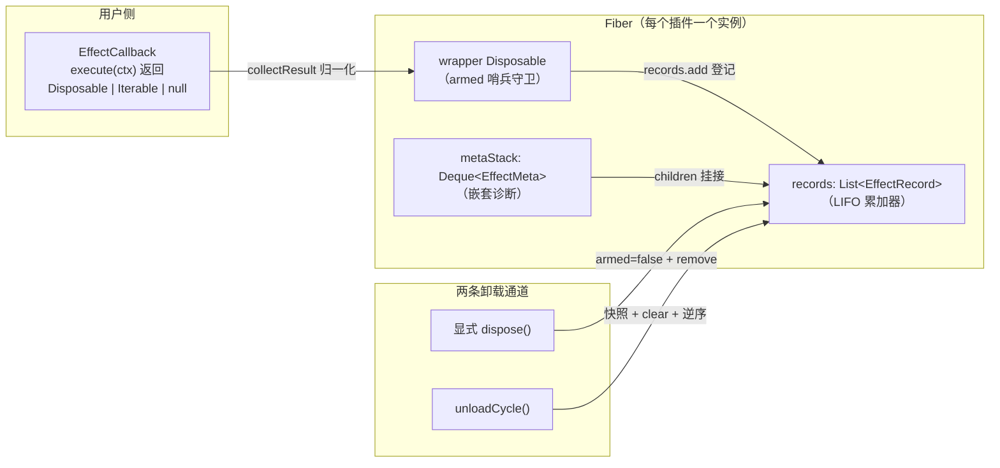
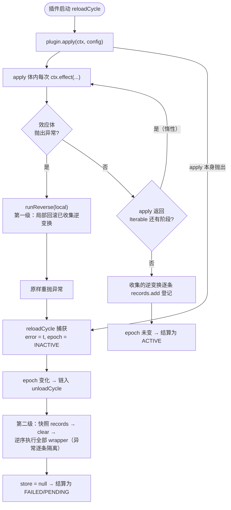

上一篇我们建立了可回退效应的**概念模型**——`EffectCallback` 声明正向操作并交出逆操作 `Disposable`。本页深入引擎内部，回答三个实现层面的关键问题：fiber 如何**累积**这些逆变换？为何保证每个逆变换**恰好执行一次**？当效应体或插件体在中途抛出异常时，已完成的半成品如何**回滚**？答案集中在一个结构上：`Fiber` 内部的 `records` 列表——一个 LIFO 逆变换累加器。理解它是理解 reload、unload、HMR 事务性回滚的前提。

## 逆变换的代数：折叠出 LIFO

先从第一性原理出发。"打开资源 A，再打开资源 B"的回退必须是"先关 B，再关 A"——这与代码块的括号匹配是同一种结构：**逆序配对**。cordis-java 把这个结构显式建模在 `Disposable` 接口的组合原语上。`noop()` 是组合的单位元（什么都不撤销）；`composeAfter` 接收一个"更早注册的"逆变换，返回的新逆变换先执行参数、再执行自身；`sequence` 则按参数顺序顺序执行。

关键在于 `composeAfter` 的方向语义：`f.composeAfter(g)` 先跑 `g` 再跑 `f`。如果累加器每次都用 `accumulator.composeAfter(新逆变换)` 把新逆变换**前置**到链条头部，那么整条链的执行顺序就是"最新者先执行"——这正是 LIFO。代码注释明确引用了这一对应关系（paper Algorithm 1 第 6 行、Theorem 16）：用该操作把每个新逆变换前置到累加器上，即得 LIFO 恢复。

Sources: [Disposable.java](cordis-core/src/main/java/dev/cordis/core/Disposable.java#L17-L42)

| 原语 | 代数角色 | 执行顺序 | 在累加器中的用途 |
|---|---|---|---|
| `Disposable.noop()` | 单位元 e（A ∘ e ≡ A） | 无操作 | `null` 结果、空阶段的表示 |
| `f.composeAfter(g)` | 前置组合 g ⊕ f | 先 g 后 f | 每次注册向累加器头部折叠新逆变换 |
| `Disposable.sequence(f, g)` | 顺序组合 f ⊗ g | 先 f 后 g | 按注册序顺序执行（供外部组装用） |
| `dispose()` | 求值 | — | 执行一次逆变换 |

这是**规范形态**（specification form）。而 `Disposable` 的 Javadoc 同时给出了另一条不变量：框架**保证单次调用**——"cordis guarantees single invocation"，用户编写的清理逻辑无需自我幂等防御（尽管防御性幂等仍是良好实践）。

Sources: [Disposable.java](cordis-core/src/main/java/dev/cordis/core/Disposable.java#L3-L15)

## 运行时形态：records 列表与效应记录

如果只追求折叠语义，运行时完全可以用 `composeAfter` 把所有逆变换折叠成**一个**复合 `Disposable`——但实际实现没有这样做。`Fiber` 持有的是 `List<EffectRecord> records`，每条记录绑定一个**包装后的** disposer 与一份 `EffectMeta` 诊断元数据；另有 `Deque<EffectMeta> metaStack` 在注册期追踪嵌套关系。

这个工程取舍的动机有三：其一，**单效应可提前卸下**——用户拿到 `ctx.effect(...)` 返回的 disposer 后可以单独处置某个效应，而不必倾倒整个 fiber；折叠成单个复合对象后做不到精确摘除。其二，**诊断粒度**——`getEffects()` 逐条暴露记录的 label 树（`EffectMeta.render()` 渲染缩进树），供错误追踪输出"哪一层效应正在被回退"。其三，**卸载时刻的原子快照**——逆序遍历一份快照列表，等价于对折叠链求值，但让"清空登记"成为一步可见操作（下文详述）。列表 + 逆序遍历，是折叠语义的**展开表示**（unrolled representation）。

Sources: [Fiber.java](cordis-core/src/main/java/dev/cordis/core/Fiber.java#L67-L79)
Sources: [EffectMeta.java](cordis-core/src/main/java/dev/cordis/core/EffectMeta.java#L11-L19)

## 注册路径：即时执行、收集与登记

`Context.effect(callback, label)` 只是薄委托，真正的逻辑在 `Fiber.effect()`。整个方法可分解为五步：**守卫 → 建栈 → 执行 → 收集 → 登记**。守卫有两道：`assertActive()` 检查 fiber 是否已 DISPOSED（`uid == null` 时抛 `INACTIVE_EFFECT`），随后显式拒绝在 `UNLOADING` 状态注册——正在拆卸的机器不允许再安装新零件。建栈指构造三样东西：局部列表 `local`（本效应的逆变换暂存区）、单元素布尔数组 `armed`（单次处置哨兵）、以及 `EffectMeta` 节点——若 `metaStack` 非空则把自己挂为当前父效应的 child，再入栈。

然后**立即**执行回调——cordis 的效应是即时生效的，不是延迟到某处统一执行。返回值经 `collectResult` 归一化进 `local`：单个 `Disposable` 直接收下；`Iterable` 逐项拉取（每步询问守卫谓词，这是惰性多阶段效应的中断点，详见下一页）；`null` 视为零逆变换。收集完成后才构造包装 disposer 并 `records.add` 登记——**登记是最后一步**，这个顺序是失败回滚正确性的根基。

Sources: [Fiber.java](cordis-core/src/main/java/dev/cordis/core/Fiber.java#L169-L198)
Sources: [Fiber.java](cordis-core/src/main/java/dev/cordis/core/Fiber.java#L200-L226)
Sources: [Context.java](cordis-core/src/main/java/dev/cordis/core/Context.java#L245-L256)

值得对比的是 `EffectCallback.flatten` 这个静态工具：它做同样的类型归一化，但**急切**展开整个 Iterable 且无守卫谓词——服务于外部一次性校验场景；而 `Fiber.collectResult` 是运行时版本，保留了逐步拉取与守卫中断能力。二者共享同一套合法返回值契约：`Disposable`、`Iterable<Disposable>` 或 `null`。

Sources: [EffectCallback.java](cordis-core/src/main/java/dev/cordis/core/EffectCallback.java#L9-L17)
Sources: [EffectCallback.java](cordis-core/src/main/java/dev/cordis/core/EffectCallback.java#L30-L48)

## 单次处置：armed 哨兵与双通道汇合

框架对每个效应承诺"逆变换恰好执行一次"。实现核心是 `armed` 哨兵与包装 disposer 的配合：wrapper 首行检查 `armed[0]`，非 armed 直接返回；否则置 false、从 `records` 中**摘除自己**、再 `runReverse(local)` 逆序执行局部逆变换。因为每次执行前哨兵必然翻转为 false，第二次调用任何路径的 dispose 都成为 no-op。

关键在于**双通道**的设计——"返回的 disposer 被调用，或 fiber 卸载，**先到者胜**"。显式通道走 wrapper 自身：摘除记录 + 局部逆序执行。隐式通道走 `unloadCycle`：先快照 `records` 到 `pending`，随即 `records.clear()`，再对快照**逆序**调用每条记录的 wrapper。两通道最终都收敛到同一个 wrapper，因此 armed 哨兵天然消解了双通道的竞态：显式处置过的效应已不在 `records` 中，unload 快照里自然没有它；反之，unload 已清空的列表也不会再响应迟到的显式调用。测试 `explicitDisposeRunsOnce` 验证了完整闭环——先 `d.dispose()` 两次只见一次 "close"，随后卸载整个 fiber 日志保持为空。

Sources: [Fiber.java](cordis-core/src/main/java/dev/cordis/core/Fiber.java#L188-L197)
Sources: [EffectTrackingTest.java](cordis-core/src/test/java/dev/cordis/EffectTrackingTest.java#L54-L70)

| 维度 | 显式通道（用户调用返回的 disposer） | 隐式通道（fiber 卸载） |
|---|---|---|
| 触发方 | 持有 disposer 的用户代码 | `unloadCycle`（reload 链、dispose、失败回滚） |
| 记录清理 | `records.remove(self)` 精确摘除 | 快照后 `records.clear()` 整体清空 |
| 执行范围 | 仅该效应自身的 local 列表 | 快照中**所有**存活效应 |
| 执行顺序 | local 内部逆序 | 记录间逆序 + wrapper 内 local 逆序（全局 LIFO） |
| 幂等保证 | armed 哨兵 | armed 哨兵（同一 wrapper） |

## LIFO 的两台执行引擎

逆序执行在代码中出现了两次，值得并置审视。`runReverse` 是一个 4 行静态方法：对传入列表从尾到头逐个 `dispose()`——它服务于**局部**回滚（效应体抛异常、显式处置）。`unloadCycle` 是 fiber 级引擎：先声明"依赖者已排干"（ACTIVE→UNLOADING 的状态变化已同步通知依赖者先完成各自的卸载链，这是 L-Unload 守卫的顺序保证），再对快照逆序执行全部 wrapper，最后 `store = null` 并根据 epoch 决定归于 PENDING 还是链入下一轮 reload。

| 维度 | `runReverse` | `unloadCycle` |
|---|---|---|
| 作用域 | 单个效应的 local 列表 | fiber 的全部登记记录（含各效应 local） |
| 触发时机 | 回滚 / 显式 dispose | 卸载、重载前半程、启动失败回滚 |
| 异常处理 | **无捕获**——异常向上传播 | 逐条 try/catch，日志记录后继续 |
| 后续动作 | 无 | 清 store、结算状态或链入 reloadCycle |

两者的异常策略差异是刻意的：`runReverse` 出现在注册路径上，异常继续传播意味着"注册失败"信号必须送达调用方；而 `unloadCycle` 面对的是**必然要继续**的拆卸过程——一个清理函数抛异常不应阻断其余清理，否则会留下更深的泄漏，因此每条记录的 dispose 都被隔离，异常交由命名日志记录。测试 `effectsUnwindInLifoOrderOnFiberUnload` 用三个命名效应验证了全局逆序：open 顺序 a→b→c，close 顺序 c→b→a。

Sources: [Fiber.java](cordis-core/src/main/java/dev/cordis/core/Fiber.java#L222-L226)
Sources: [Fiber.java](cordis-core/src/main/java/dev/cordis/core/Fiber.java#L335-L357)
Sources: [EffectTrackingTest.java](cordis-core/src/test/java/dev/cordis/EffectTrackingTest.java#L40-L52)

## 失败回滚：两级语义

失败回滚是累加器存在的终极理由。cordis-java 在两个层级实现了回滚，粒度递进：

**第一级——效应体中途抛出。** 回到 `effect()` 的 try/catch：若 `callback.execute(ctx)` 或收集过程抛出任何 `Throwable`，立即 `runReverse(local)` 把**本效应已收集到**的逆变换逆序回退，然后原样重抛。注意登记尚未发生（`records.add` 在 try 块之后），所以这些部分效应不会残留于累加器——回滚与登记的互斥由语句顺序保证。外层效应的 metaStack 也通过 finally 正确出栈。

**第二级——插件 apply 中途抛出。** 插件体的执行在 `reloadCycle` 中：`plugin.apply(ctx, config)` 若抛出，异常被捕获记录为 `fiber.error`（供 `await()` 重抛），epoch 置为 `INACTIVE`。此时 epoch 与进入时不再相等，循环末尾的状态机判定将 fiber 推入 `UNLOADING` 并把 `unloadCycle` 设为惯性任务——于是 apply 执行到一半**已经登记**的全部效应（apply 体内各次 `ctx.effect` 的、`ctx.provide` 的服务注册逆操作）由卸载引擎 LIFO 清空。插件启动失败不留任何残留效应，这就是"失败回滚"的完整语义。

Sources: [Fiber.java](cordis-core/src/main/java/dev/cordis/core/Fiber.java#L179-L187)
Sources: [Fiber.java](cordis-core/src/main/java/dev/cordis/core/Fiber.java#L301-L333)

顺带一提 `ctx.provide` 的实现方式：它内部就是一次 `effect()` 调用——正向操作是向 `reflect.store` 写入 `Impl` 并通知，返回的逆操作是从 store 移除并再通知。服务注册因此自动获得累加器的一切保证（LIFO、单次、回滚），这是效应模型统一性的直接红利——细节留待 [O-Insert 与 O-Retire：插件实例化的效应化与级联卸载](13-o-insert-yu-o-retire-cha-jian-shi-li-hua-de-xiao-ying-hua-yu-ji-lian-xie-zai)展开。

Sources: [Fiber.java](cordis-core/src/main/java/dev/cordis/core/Fiber.java#L438-L462)

## 边界守卫与行为契约

守卫语义收束为一条错误码：`INACTIVE_EFFECT`——"cannot create effect on inactive context"。触发条件有两类：fiber 已 DISPOSED（`assertActive`，`uid == null`），或 fiber 正处于 `UNLOADING`。测试 `effectOnDisposedFiberThrows` 锁定了前者。另一个隐蔽的边界出现在 O-Retire 的逆操作里：一个从未激活（PENDING）的 fiber 可能**已经**拥有效应（例如构造期登记的 retireHandle 之外的效应），其级联卸载会显式检查 `records` 非空并手动驱动一次 unloadCycle——累加器非空即需清空，无例外。

Sources: [CordisException.java](cordis-core/src/main/java/dev/cordis/core/CordisException.java#L11)
Sources: [Fiber.java](cordis-core/src/main/java/dev/cordis/core/Fiber.java#L107-L115)
Sources: [EffectTrackingTest.java](cordis-core/src/test/java/dev/cordis/EffectTrackingTest.java#L89-L96)

| 测试用例 | 锁定的契约 |
|---|---|
| `effectsUnwindInLifoOrderOnFiberUnload` | 卸载时逆序执行；处置后状态 DISPOSED |
| `explicitDisposeRunsOnce` | 双重显式处置只执行一次；处置后的效应脱离 fiber |
| `multiStageIterableCollectsEveryStage` | Iterable 各阶段全部收集并逆序回退 |
| `effectOnDisposedFiberThrows` | 已处置 fiber 上注册效应抛 `INACTIVE_EFFECT` |
| `nullResultIsAnEffectWithNothingToUndo` | `null` 是合法的零逆变换效应 |

Sources: [EffectTrackingTest.java](cordis-core/src/test/java/dev/cordis/EffectTrackingTest.java#L40-L104)

## 小结与延伸

LIFO 逆变换累加器的三个支柱至此闭合：**折叠**——逆变换以列表形态累积，逆序遍历即规范折叠的求值，`composeAfter` 给出其代数根据；**单次处置**——armed 哨兵让显式与隐式两条通道汇合于同一 wrapper，"先到者胜、后到者无操作"；**失败回滚**——注册路径的局部 `runReverse` 与状态机链入的 `unloadCycle` 构成两级递进的回滚，且拆卸过程中的异常逐条隔离，不阻断恢复。这个机制是 fiber 生命周期一切转换（reload、unload、restart、HMR 事务）的地基。

若想继续深挖，有三条路径：惰性 Iterable 效应如何在阶段边界被稳定性守卫中断，见 [惰性 Iterable 多阶段效应与稳定性守卫中断](10-duo-xing-iterable-duo-jie-duan-xiao-ying-yu-wen-ding-xing-shou-wei-zhong-duan)；`UNLOADING` 状态在六状态机中的位置与转换规则，见 [生命周期状态机：PENDING 到 DISPOSED 的六状态与转换规则](11-sheng-ming-zhou-qi-zhuang-tai-ji-pending-dao-disposed-de-liu-zhuang-tai-yu-zhuan-huan-gui-ze)；累加器如何承载插件实例化本身（O-Insert/O-Retire），见 [O-Insert 与 O-Retire：插件实例化的效应化与级联卸载](13-o-insert-yu-o-retire-cha-jian-shi-li-hua-de-xiao-ying-hua-yu-ji-lian-xie-zai)。