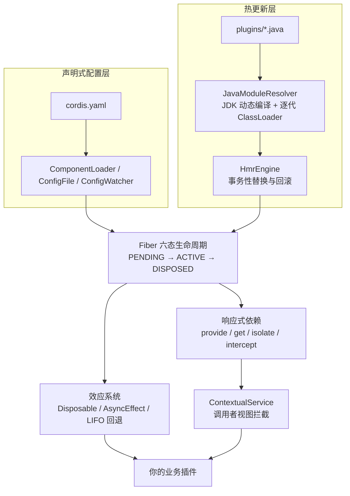

本页是整个文档体系的入口，面向初学者回答三个问题：cordis-java 解决什么问题、它由哪些部分组成、以及读者应按什么顺序学习。后续所有页面都会展开本页提到的概念，这里只需建立整体图景。

## 一句话定义

cordis-java 是 Cordis 框架的 Java 实现——一个"时空可组合性（spatiotemporal composability）元框架"，核心能力包括**可回退效应、响应式依赖、上下文隔离与拦截、组件生命周期、声明式配置树和 JVM 源码热更新**。它以论文《A Programming Paradigm for Spatiotemporal Composability》第 3–5 章以及 deepseek-harness 中的 Cordis 实现为参照，是 Java API 层面的重新实现，不提供与 TypeScript 插件的二进制兼容。
Sources: [README.md](README.md#L1-L8)

对初学者而言，可以把它理解为：**一个让"插件"这种代码单元能够安全地被加载、依赖、卸载、隔离，甚至在不重启进程的情况下热更新的运行时框架**。你写的每个插件都声明自己需要什么（依赖）、提供什么（服务），框架负责在正确的时间按正确的顺序装配它们，并在卸载时逆序清理。

## 两大模块与工程结构

项目是一个双模块 Maven 工程（`maven.compiler.release=25`，需 JDK 25）：

| 模块 | 职责 | 运行时依赖 |
|---|---|---|
| `cordis-core` | 框架本体：运行时、效应、依赖注入、配置加载、HMR | 仅 SnakeYAML 2.5（安全读取 YAML/JSON） |
| `cordis-example` | 多租户电商订单示例，演示全部核心机制 | 依赖 cordis-core |

Sources: [pom.xml](pom.xml#L14-L24), [cordis-core/pom.xml](cordis-core/pom.xml#L12-L22)

源码按功能域组织在 `dev.cordis` 下，每个包对应文档目录的一个章节，建议按此对照阅读：

```
cordis-core/src/main/java/dev/cordis/
├── core/       Plugin、ConfigSchema、CordisException     → 基础概念
├── core/runtime/   Context、Fiber、FiberState、Events/Timer/LoggerService → 生命周期与运行时
├── core/effect/    Disposable、AsyncDisposable、AsyncEffect → 可回退效应
├── core/coeffect/  Service、ContextualService、RealmKey    → 响应式依赖与拦截
├── loader/         ComponentLoader、ConfigFile、ConfigWatcher、JavaModuleResolver → 配置树与热更新
├── hmr/            HotReloadService、HmrEngine、ModuleGraph → 源码热更新引擎
```
Sources: [pom.xml](pom.xml#L14-L24)

## 核心机制速览

框架由五个相互协作的子系统构成，下图展示了它们的关系：插件（Plugin）在根上下文（Context）中通过 Fiber 获得生命周期；效应系统保证资源可回退；coeffect 系统负责依赖注入与拦截；配置加载器把 YAML 声明装配成运行中的插件树；HMR 引擎在其上叠加源码热更新能力。



各子系统的关键行为（详细语义在后续章节展开）：

- **效应与生命周期**：`Plugin.apply` 可返回 `Disposable`、`CompletionStage` 或 `AsyncEffect`；逆操作按 LIFO 执行，单项失败不阻断其余清理；六态模型为 `PENDING / LOADING / ACTIVE / FAILED / UNLOADING / DISPOSED`。
- **响应式依赖**：插件用 `ctx.provide("db", ...)` 提供服务、用 `List.of("db")` 声明依赖；提供者未就绪时消费者停留在 `PENDING`，提供者上线后自动激活。
- **隔离与拦截**：`root.isolate("db", "tenant-a")` 创建私有域实现多租户隔离，`intercept("db", ...)` 原地注入策略而不重启插件；Java 上通过 `ContextualService` 调用者视图实现拦截。
- **声明式配置树**：YAML 中的每个条目（id + url）被调和为运行中的插件，支持 `group`、`include`、配置回写与文件监听。
- **源码热更新**：修改 `.java` 文件触发编译与事务性替换，失败自动回滚到旧插件，语法错误不影响运行中的实例。
Sources: [README.md](README.md#L25-L60), [README.md](README.md#L62-L100), [README.md](README.md#L102-L143)

## 能快速验证的两个入口

读完概念后，最直观的学习方式是跑通两个示例。**电商示例**演示完整业务流程：下单、幂等、支付失败补偿、双店铺隔离、促销策略热替换——运行 `mvn -pl cordis-example exec:java`，输出会逐步打印已校验的业务结果。**热更新示例**（`examples/hot-reload`）则让你在编辑器里修改 `HelloPlugin.java` 或 `cordis.yaml`，实时观察框架的编译、替换与调和过程。
Sources: [README.md](README.md#L10-L19), [cordis-example/README.md](cordis-example/README.md#L1-L29)

| 维度 | cordis-java 能做到 | 明确不做（语义边界） |
|---|---|---|
| 资源清理 | 撤销插件登记的效应（LIFO 逆操作） | 不会自动撤销任意文件、网络请求或数据库写入 |
| 依赖 | 声明式、响应式、自动激活/停用 | — |
| 热更新 | 当前配置树中的源码插件 | 不兼容 Node ESM/CJS 缓存、不动态下载 JAR、不迁移运行中对象的字段 |

需要强调的是：论文的正确性结论有前提——**插件作者提供的逆操作必须真正撤销效应**，框架提供机制与行为验证，但不证明用户提供的 inverse 正确，也不把 93 个测试用例等同于形式化证明。
Sources: [README.md](README.md#L174-L184), [pom.xml](pom.xml#L14-L24)

## 建议阅读路径

按目录顺序学习即可，推荐的依赖关系是：

1. [环境准备与构建运行（JDK 25 / Maven）](2-huan-jing-zhun-bei-yu-gou-jian-yun-xing-jdk-25-maven) — 搭好 JDK 25 + Maven 环境
2. [第一个 Cordis 插件：Context、Plugin 与 Fiber](3-di-ge-cordis-cha-jian-context-plugin-yu-fiber) — 用最小代码理解三大基础抽象
3. [电商订单示例：运行与业务流程导览](4-dian-shang-ding-dan-shi-li-yun-xing-yu-ye-wu-liu-cheng-dao-lan) — 在真实业务中看到所有机制协作
4. 进入"深入解析"部分，从 [六态生命周期模型：PENDING 到 DISPOSED 的转换与 await 语义](5-liu-tai-sheng-ming-zhou-qi-mo-xing-pending-dao-disposed-de-zhuan-huan-yu-await-yu-yi) 开始逐层深入

如果你只关心某一主题，生命周期（第 5–9 页）、配置树（第 13–16 页）和热更新（第 17–20 页）三组章节相对独立，可在完成前两步后按需跳读。