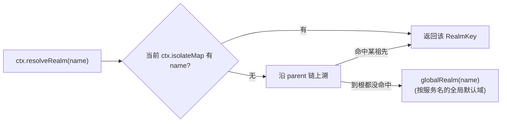
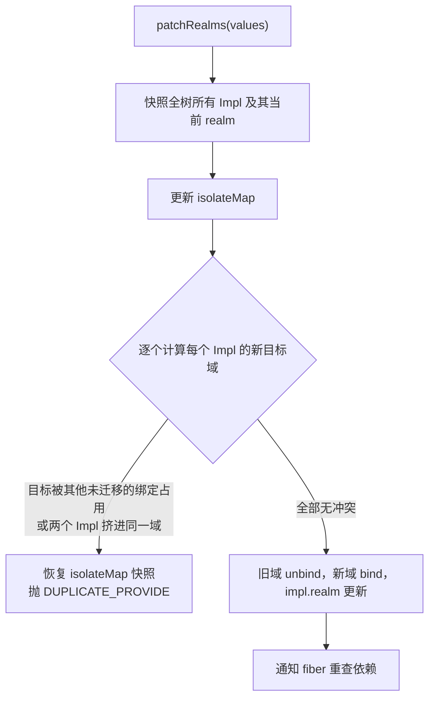

在 cordis 中，同一服务名在不同分支下可以有完全不同的绑定——这正是 isolate 与 RealmKey 的职责。本页解释隔离域（realm）模型：`RealmKey` 如何作为"域门牌"标识一条绑定、`Context.isolate` 如何在子树里切换解析结果、配置合并（intercept）与隔离的区别，以及 ComponentLoader 如何把 YAML 配置里的 isolate 声明转化为 RealmKey 并支持热迁移。

## RealmKey：隔离域的"门牌号"

`RealmKey` 是一个极简的标识类，核心思想是**以对象身份判定是否同一个域**：两个上下文把某服务名解析到同一个 `RealmKey` 实例，就共用同一条服务绑定。它提供两种创建方式——`fresh(hint)` 新建一个独享域（每次调用都是新实例），`shared(label)` 则维护一张全局表，让相同标签返回同一个实例（内部用 `WeakReference` 清理已无引用的共享域，`shared(name, label)` 用一个 `(name, label)` 二元组标签避免不同服务名意外共享）。因此"共享域"与"私有域"的区别不在类型上，而在创建方式上：`fresh` 天然互不相干，`shared` 按标签对齐。

Sources: [RealmKey.java](cordis-core/src/main/java/dev/cordis/core/coeffect/RealmKey.java#L11-L53)

服务的运行时表示 `Impl` 中有一个可变的 `realm` 字段——这为后续的"域迁移"（patchRealms）埋下伏笔：一条绑定属于哪个域并非终身不变。

Sources: [Impl.java](cordis-core/src/main/java/dev/cordis/core/coeffect/Impl.java#L14-L34)

## 隔离域解析链：从叶子到根，再到全局默认

`Context` 内部维护 `isolateMap`（服务名 → RealmKey）。当插件提供或获取服务时，`resolveRealm(name)` 沿上下文父链**自下而上**查找第一个声明了该名字隔离域的祖先；找到就用它，否则回落到根上的 `globalRealm(name)`——即 ReflectService 为每个服务名 lazily 创建的全局默认域。

ReflectService 的绑定表正是以 `RealmKey` 为键：`store: Map<RealmKey, Impl>`。同一个服务名（如 `"database"`）可以在不同域里各有一条绑定、由不同 fiber 各自持有。`getImpl(from, name, strict)` 从调用者上下文视角先解析域、再查表——这就是"同名服务在不同范围里查到不同结果"的实现核心。

Sources: [Context.java](cordis-core/src/main/java/dev/cordis/core/runtime/Context.java#L184-L190), [ReflectService.java](cordis-core/src/main/java/dev/cordis/core/coeffect/ReflectService.java#L25-L84)

## isolate 的三种派生方式

`Context.isolate(name, label)` 派生一个子上下文，并在子上下文的 `isolateMap` 里登记该服务名对应的域，label 参数决定了域的身份：

| 调用方式 | label 处理 | 得到的域 | 典型场景 |
|---|---|---|---|
| `isolate(name)` | 转为 `isolate(name, null)` | `RealmKey.fresh(name)` 独享新域 | 测试沙箱、一次性隔离 |
| `isolate(name, label)` | label 非 RealmKey 时走 `RealmKey.shared(name, label)` | 相同 label 的分支共用一个域 | 多租户（共享 label 如 tenantId） |
| `isolate(name, realmKey)` | label 本身是 RealmKey 时直接使用 | 显式复用既有域 | 跨子树合并域 |

关键在于"共享"是**可编程的**：传相同的字符串或对象给两个分支，它们就进入同一个域；传不同的值（或传 `null`），就各归各的域。

Sources: [Context.java](cordis-core/src/main/java/dev/cordis/core/runtime/Context.java#L125-L146)

## get 的域边界检查

隔离不只是"查到不同的绑定"，它还是一道**可见性边界**。`getChecked` 在沿 fiber 链向上查找服务时，会比对当前解析出的 `RealmKey`：fiber 本地存储中的绑定若 `impl.realm != key` 视为不存在；跨到父 fiber 前，还要确认 `parentCtx.resolveRealm(name) == key`，否则抛出 `UNDECLARED_ACCESS`（"realm boundary"）。这意味着被隔离的服务对域外分支是不可见的——不会"串台"到全局默认域的绑定上。

Sources: [Context.java](cordis-core/src/main/java/dev/cordis/core/runtime/Context.java#L204-L238)

## isolate 与 intercept：隔离与配置合并的对比

Context 还有第三种派生操作 `intercept(name, config)`：它不改变服务绑定本身，而是给子树里的插件追加一层配置。两者的合并语义截然不同：

| 维度 | isolate（隔离域） | intercept（拦截配置） |
|---|---|---|
| 目标 | 服务绑定的身份（换一条绑定） | 服务配置的叠加（同一条绑定） |
| 数据结构 | `isolateMap: Map<String, RealmKey>` | `interceptMap: Map<String, Object>` |
| 合并规则 | **就近覆盖**：沿父链找到第一个声明即止 | **逐层合并**：根→叶收集，叶子优先；Map 类型做浅合并（`putAll`），非 Map 直接替换 |
| 提供者影响 | 不同域由不同 fiber 各自 provide | 提供者和消费者都不变 |
| 热更新 | 变更需要 `patchRealms` 原子迁移 | `patchIntercept` 直接清空重写，无需重启 |

配置合并的细节在 `resolveIntercept`：从当前上下文逐层向上收集该服务名的所有配置片段，反转后按根→叶顺序合并——两侧都是 Map 时做浅合并（叶子键覆盖祖先键），否则后出现的整值覆盖前值。

Sources: [Context.java](cordis-core/src/main/java/dev/cordis/core/runtime/Context.java#L148-L179), [Context.java](cordis-core/src/main/java/dev/cordis/core/runtime/Context.java#L24-L29)

## ComponentLoader：配置声明到 RealmKey 的翻译

在声明式配置树里，`Entry.isolate` 是 `Map<String, Object>`，其值的解释规则由 `realms(entry)` 完成，实现了"配置语言"到"运行时域对象"的三种翻译：

| 配置值 | 翻译结果 |
|---|---|
| `RealmKey` 实例 | 直接使用 |
| `true`（Builder.isolate） | 私有域：`privateRealms` 按 `(entryId, name)` 缓存的 `fresh` 域 |
| 其他对象（Builder.isolateShared） | `RealmKey.shared(name, label)` 共享域 |

翻译后的 `Map<String, RealmKey>` 在派生插件上下文时通过 `patchRealms` 安装。这条配置化路径正是电商示例多租户方案的基础：`CommerceApplication` 对 7 个业务服务（database、inventory、payments 等）逐个调用 `scope.isolate(service, tenantId)`，让每个租户实例拥有一整套独立的同名服务绑定。

Sources: [ComponentLoader.java](cordis-core/src/main/java/dev/cordis/loader/ComponentLoader.java#L278-L291), [Entry.java](cordis-core/src/main/java/dev/cordis/loader/Entry.java#L71-L90), [CommerceApplication.java](cordis-example/src/main/java/dev/cordis/example/CommerceApplication.java#L13-L26)

## patchRealms：域的原子迁移与冲突回滚

isolate 与 intercept 在热更新路径上的代价差异，来自一个架构事实：拦截配置在**调用时**读取（改了立即生效），而隔离域决定服务绑定的存放位置——改变域意味着**存量 `Impl` 需要搬家**。`patchRealms(values)` 在根的 runtime 锁内完成一次事务性迁移：

整个过程中若任何一步检测到冲突（目标域已被占用、或迁移目的地撞车），立即回滚 `isolateMap` 并抛异常，不会留下半迁移状态。这与 `reparent`（移动子树时保留本地域、失败恢复父指针）共同保证了域拓扑调整的原子性。

Sources: [Context.java](cordis-core/src/main/java/dev/cordis/core/runtime/Context.java#L400-L470)

在 ComponentLoader 的调和流程中，只有当新旧 Entry 的 `isolate` 声明不相等时才触发 `patchRealms`——即插件实例与 fiber 均原地保留，仅服务绑定按新配置重新落域；而 `intercept` 的变化只需 `patchIntercept` 覆写拦截映射，更轻量。

Sources: [ComponentLoader.java](cordis-core/src/main/java/dev/cordis/loader/ComponentLoader.java#L260-L270)

## 小结与延伸阅读

isolate/RealmKey 解决"**谁提供、谁可见**"的问题（换绑定），intercept 解决"**带什么参数**"的问题（叠配置），两者都通过不可变的派生上下文构建树形作用域，并在 Loader 的热更新协议里分别对应 patchRealms 的原子迁移与 patchIntercept 的即时覆写。理解了域模型后，建议继续阅读：

- [ContextualService 调用者视图：JVM 上拦截的具体类适配方案](11-contextualservice-diao-yong-zhe-shi-tu-jvm-shang-lan-jie-de-ju-ti-lei-gua-pei-fang-an) —— 拦截如何落到 JVM 具体类
- [intercept 原地更新与租户隔离实战（电商双店铺）](12-intercept-yuan-di-geng-xin-yu-zu-hu-ge-chi-shi-zhan-dian-shang-shuang-dian-pu) —— 本页机制的实战演练
- [ComponentLoader 调和机制：Entry 差分与 id/url/disabled/config 更新策略](13-componentloader-diao-he-ji-zhi-entry-chai-fen-yu-id-url-disabled-config-geng-xin-ce-lue) —— isolate/intercept 变更所在的差分框架