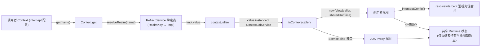

在脚本语言（如 JS）中，服务拦截通常依赖动态 Proxy——调用者拿到的是同一个对象，方法分发时才解析当前上下文。JVM 的静态类型系统不允许这种"隐式 this 重绑定"，cordis-java 的答案是 `ContextualService<T>`：让服务自己声明"每个调用者上下文各得一个视图实例"，共享状态不变，但拦截解析永远以调用者为出发点。本页拆解这一机制的接口契约、两条适配路径（具体类视图与动态代理）、以及 `get` 链路上的 contextualize 注入点。

## 问题本质：为什么需要"调用者视图"

服务本质上是共享状态的所有者，但服务行为往往依赖"谁在调用"——调用者所在子树的 intercept 配置、隔离域归属都会影响语义。cordis-java 中同一服务名的绑定按隔离域分 key 存储，查找时通过 `resolveRealm` 从调用者上下文向上解析，同一个名字在不同范围内可能解析到不同的绑定。这意味着 `ctx.get("orders")` 返回的对象必须"知道"是哪个上下文在取它，而不是永远带着提供者的上下文行动。

`ContextualService` 的 Javadoc 一句话点明契约："视图委托共享状态，但每次操作都从调用者解析拦截"。接口本身只有一个方法：

```java
@FunctionalInterface
public interface ContextualService<T> {
    T inContext(Context context);
}
```

核心思路是：**提供者持有不可变（或受锁保护的）共享 Runtime 状态；视图是轻量的"外壳"，只包一层调用者上下文引用**。

Sources: [ContextualService.java](cordis-core/src/main/java/dev/cordis/core/coeffect/ContextualService.java#L5-L13), [ReflectService.java](cordis-core/src/main/java/dev/cordis/core/coeffect/ReflectService.java#L66-L77)

## 注入点：contextualize 与 get 链路

框架不会要求调用者手工调用 `inContext`——所有服务读取路径都经过统一的 contextualize 出口：

```java
private Object contextualize(Object value) {
    return value instanceof ContextualService<?> service ? service.inContext(this) : value;
}
```

三个读取路径都会触发它：

| 读取 API | 语义 | contextualize 应用 |
|---|---|---|
| `get(name)` | 沿 fiber 链向上找第一个可得该服务的祖先，带能力检查（INACTIVE_ACCESS / UNDECLARED_ACCESS） | 找到即转换 |
| `getOrNull(name)` | 不做声明检查，未就绪返回 null | 转换后返回 |
| 根上下文访问 | 无 inject 能力约束，按依赖快照查 | 转换后返回 |

此外，依赖检查也走同一条路：`Fiber.checkImpl` 在评估依赖可用性时，会先用 `service.inContext(ctx)` 生成调用者视角的候选值，再交给 `impl.check` 谓词判定——也就是说"服务是否可用"的判断同样是按调用者视角进行的，而不是拿提供者的原始实例去检查。

Sources: [Context.java](cordis-core/src/main/java/dev/cordis/core/runtime/Context.java#L355-L238), [Context.java](cordis-core/src/main/java/dev/cordis/core/runtime/Context.java#L243-L248), [Fiber.java](cordis-core/src/main/java/dev/cordis/core/runtime/Fiber.java#L249-L262)

## 适配路径一：具体类视图（interface 自实现）

这是 `ContextualService` 的主用法：服务类同时继承 `Service` 并实现 `ContextualService<自身>`。电商示例的 `OrderService` 是最完整的范本，其结构值得逐行分析：

```java
public final class OrderService extends Service implements ContextualService<OrderService> {
    private static final class Runtime { /* provider、database、inventory、payments、pricing、active */ }
    private final Runtime runtime;

    public OrderService(Context ctx, ...) {          // 提供者构造：register=true
        super(ctx, "orders");
        runtime = new Runtime(ctx, db, inventory, payments, pricing);
        ctx.effect(c -> (Disposable) () -> { runtime.active = false; }, "checkout availability");
    }
    private OrderService(Context caller, Runtime runtime) {   // 视图构造：register=false
        super(caller, "orders", false);
        this.runtime = runtime;
    }
    @Override public OrderService inContext(Context caller) {
        return new OrderService(caller, runtime);
    }
}
```

三个关键设计点：

1. **共享状态收敛到 `Runtime`**。所有可变业务字段（数据库句柄、依赖服务、活跃标志）都放进一个内部对象，视图与提供者引用同一个 `Runtime` 实例——视图绝不复制状态，只委托。
2. **视图构造使用 `register=false`**。`Service` 基类的三参构造允许跳过 `ctx.provide` 注册，否则每次 `get` 都会在调用者的 fiber 上重复提供同名服务，触发 DUPLICATE_PROVIDE 冲突。
3. **生命周期效应只挂在提供者上**。`active = false` 的回退效应由提供者构造函数注册，视图随用随抛，不需要自己的清理逻辑。

另一个精妙细节是锁与事件的次序：`checkout` 在释放 `synchronized(runtime)` 之后才 emit `order/paid` 事件，因为生命周期 teardown 可能正在等待这个操作完成——视图内任何阻塞行为都要考虑与提供者卸载的交互。

Sources: [OrderService.java](cordis-example/src/main/java/dev/cordis/example/service/OrderService.java#L12-L39), [Service.java](cordis-core/src/main/java/dev/cordis/core/coeffect/Service.java#L19-L26)

## 适配路径二：动态代理（`Service.bind`，面向接口）

为接口类服务手写一个视图类太重，cordis-java 提供 `Service.bind` 一行完成：

```java
public static <T> ContextualService<T> bind(Class<T> api, BiFunction<Context, MethodCall, Object> invoke)
```

它要求 API 必须是接口（否则抛 `IllegalArgumentException`），内部用 `java.lang.reflect.Proxy` 创建代理，把每次方法调用连同当前 `Context` 打包成 `MethodCall(method, arguments)` 交给回调。注意 `inContext` 返回的是**闭包捕获固定 context 的代理工厂**——`bind` 产生的 `ContextualService` 本身不感知调用者，是 `get` 路径上的 contextualize 以"调用者上下文"去请求它，代理内部再把该 context 转给 invoke 回调。

对 `Object` 方法（equals/hashCode/toString）做了特殊处理：equals 走引用相等、hashCode 用 identityHashCode，避免代理语义失真。测试中可见典型用法：

```java
root.provide("db", Service.bind(Database.class, (ctx, call) -> { ... }));
```

两条路径的对比：

| 维度 | 具体类视图 | `Service.bind` 代理 |
|---|---|---|
| 适用形态 | 具体服务类 | 纯接口 API |
| 视图成本 | 手写私有构造 + inContext | 一行 lambda |
| 类型安全 | 编译期完整 | 方法分发走反射 |
| 状态共享 | 显式 Runtime 对象 | 闭包捕获 |
| 典型场景 | 复杂业务服务（orders） | 轻量门面（db、gate） |

Sources: [Service.java](cordis-core/src/main/java/dev/cordis/core/coeffect/Service.java#L36-L53), [ContextExtensionTest.java](cordis-core/src/test/java/dev/cordis/ContextExtensionTest.java#L19), [RuntimeUtilitiesTest.java](cordis-core/src/test/java/dev/cordis/RuntimeUtilitiesTest.java#L32)

## 拦截的兑现：inContext 视图如何读到调用者的配置

视图只是"载体"，真正让每个调用者看到不同行为的是 `Service.interceptConfig()`——它调用 `ctx.resolveIntercept(name)`，而 `ctx` 正是视图持有的调用者上下文。`resolveIntercept` 从根向叶子沿途收集 `intercept` 安装的配置并合并（Map 类型逐键覆盖，叶子优先；非 Map 直接替换）。

于是 `CommerceApplication` 中的审计入口可以这样工作：

```java
public OrderService auditOrders() {
    return context.intercept("orders", Map.of("readOnly", true)).get("orders");
}
```

`intercept` 派生一个只装了 `readOnly=true` 的子上下文，`get` 时 contextualize 用这个子上下文调 `inContext`，产出的视图在执行业务方法时通过 `interceptConfig()` 读到的就是 `readOnly=true`，进而在 `available()` 检查处拒绝写操作——提供者和消费者代码零改动，隔离完全由调用者侧的上下文派生实现。这正是"调用者视图"的完整闭环：**同一个 `Runtime`，不同的上下文外壳，不同的策略解析结果**。

Sources: [Context.java](cordis-core/src/main/java/dev/cordis/core/runtime/Context.java#L148-L179), [CommerceApplication.java](cordis-example/src/main/java/dev/cordis/example/CommerceApplication.java#L46-L49), [OrderService.java](cordis-example/src/main/java/dev/cordis/example/service/OrderService.java#L108-L117)

## 概念关系图



## 小结与延伸

`ContextualService` 用极小的接口面积（一个方法）解决了 JVM 静态类型下服务拦截的根本难题：把"上下文感知"从运行时的隐式分发提升为类型系统中的显式契约。所有 `get` 路径的 contextualize 出口保证了契约的统一兑现，而 `Service.bind` 为接口型服务免除了手写视图的样板成本。理解了这套机制后，下一步可以看它在多租户隔离中的实战应用：[intercept 原地更新与租户隔离实战（电商双店铺）](12-intercept-yuan-di-geng-xin-yu-zu-hu-ge-chi-shi-zhan-dian-shang-shuang-dian-pu)；若想先补齐隔离域的前置概念，请阅读 [isolate 与 RealmKey：私有域、共享域与配置合并](10-isolate-yu-realmkey-si-you-yu-gong-xiang-yu-yu-pei-zhi-he-bing)。