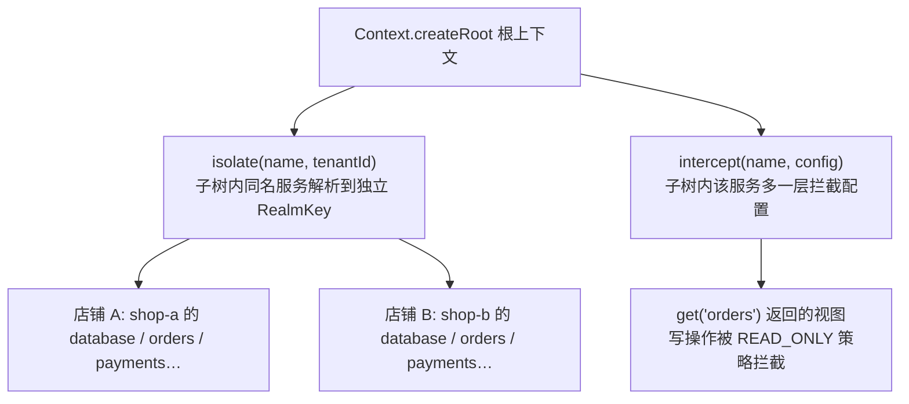
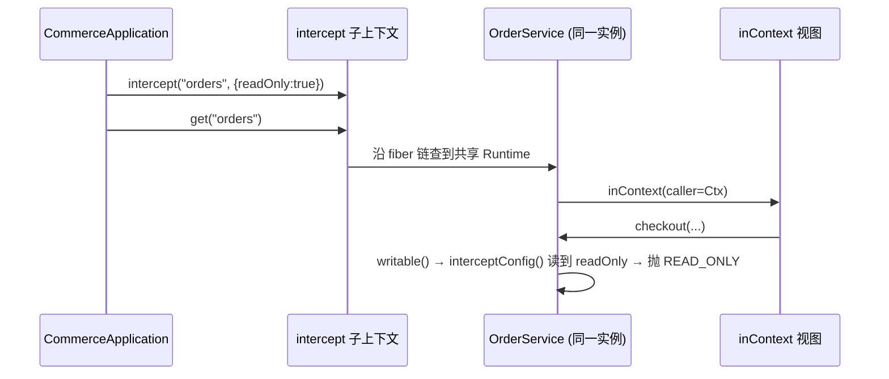
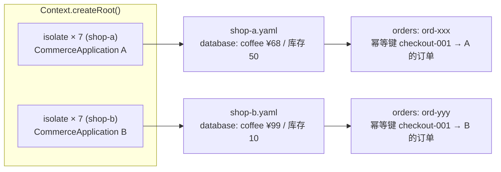

Cordis 的 `Context` 提供了三种"不动父级"的派生操作：`extend`、`isolate`、`intercept`。本页聚焦后两者：`isolate` 如何用 `RealmKey` 把同名服务切成互不干扰的租户域，`intercept` 如何在不改提供者与消费者的前提下给服务叠加一层"运行时策略"（如只读），以及为什么这套机制能支撑电商示例里的双店铺隔离与审计角色场景。

## 三个核心机制的分工

`Context` 的 javadoc 把三种派生操作讲得非常清楚：`extend` 是普通子上下文；`isolate` 让某服务名在子树里解析到独立的绑定（多租户）；`intercept` 给某服务追加一层配置（比如只读），不改提供者和消费者。



关键区别在于**解析时机**：

- `isolate` 影响的是服务**绑定**——`resolveRealm(name)` 沿父链找第一个登记了该名字的 `isolateMap`，拿到 `RealmKey`；`get` 在 fiber 存储中查找时会校验 `impl.realm == key`，域不匹配则视为不存在（`Context.java#L184-L192`、`Context.java#L214-L237`）。
- `intercept` 影响的是服务**调用时的配置**——`resolveIntercept(name)` 从根往叶子合并各层 `interceptMap`，叶子优先；Map 类型做浅合并，非 Map 直接覆盖。

Sources: [Context.java](cordis-core/src/main/java/dev/cordis/core/runtime/Context.java#L18-L33), [Context.java](cordis-core/src/main/java/dev/cordis/core/runtime/Context.java#L128-L176), [Context.java](cordis-core/src/main/java/dev/cordis/core/runtime/Context.java#L184-L237)

## intercept 的原地更新语义

`intercept` 返回一个子上下文，子级的配置**盖过**父级同名配置；两个 Map 会按"根→叶"顺序浅合并，叶子键优先。这带来一个重要性质：**拦截配置在每次操作时从调用者上下文重新解析，不需要重启任何插件**。框架甚至专门暴露了 `patchIntercept` 供 Loader 做原子补丁——注释明确写着"Interception is read on invocation; changes need no restart"。

服务侧拿配置的方式非常轻：`Service.interceptConfig()` 就是 `ctx.resolveIntercept(name)`——注意它用的是**调用者视图的 ctx**，而不是提供者的 ctx。这正是 [ContextualService 调用者视图](11-contextualservice-diao-yong-zhe-shi-tu-jvm-shang-lan-jie-de-ju-ti-lei-gua-pei-fang-an) 一页讨论的核心：JVM 上没有隐式的动态作用域，所以服务必须显式实现 `ContextualService<T>`，通过 `inContext(caller)` 生成一个携带调用者上下文的视图。

Sources: [Context.java](cordis-core/src/main/java/dev/cordis/core/runtime/Context.java#L152-L176), [Context.java](cordis-core/src/main/java/dev/cordis/core/runtime/Context.java#L420-L427), [Service.java](cordis-core/src/main/java/dev/cordis/core/coeffect/Service.java#L31-L33), [ContextualService.java](cordis-core/src/main/java/dev/cordis/core/coeffect/ContextualService.java#L7-L14)

另外，fiber 构造时插件 `inject` 自带的配置也会通过 `interceptSelf` 装进当前上下文的 `interceptMap`，让"声明式依赖时附带的配置"和"调用方追加的拦截"走同一条合并管道（`Fiber.java#L84`）。

Sources: [Fiber.java](cordis-core/src/main/java/dev/cordis/core/runtime/Fiber.java#L80-L88)

## 实战一：审计角色的只读拦截

电商示例中 `CommerceApplication.auditOrders()` 是 intercept 最典型的用法，只有一行：

```java
public OrderService auditOrders() { return context.intercept("orders", Map.of("readOnly", true)).get("orders"); }
```

调用链如下：`intercept` 派生一个带 `orders → {readOnly: true}` 的子上下文 → `get("orders")` 沿 fiber 链找到同一个 `OrderService` 实例 → 因为 `OrderService` 实现了 `ContextualService`，`get` 内部的 `contextualize` 调用 `inContext(caller)` 生成一个新视图，视图的 `ctx` 指向这个拦截子上下文 → 之后每次写操作都从该视图解析配置。

`OrderService` 把策略检查集中在一个私有方法里：

```java
private void writable() {
    available(); Object policy = interceptConfig();
    if (policy instanceof Map<?, ?> map && Boolean.TRUE.equals(map.get("readOnly")))
        throw new BusinessException("READ_ONLY", "审计角色只能查询订单");
}
```

`checkout` 和 `cancel` 都先调 `writable()`，而 `find`/`list` 只调 `available()` 不调 `writable()`——读不受限，写被拦截。测试验证了这一语义：审计视图能 `find` 到订单，但 `checkout` 和 `cancel` 都抛 `READ_ONLY`，且底层支付记录、库存完全不受影响（同一个服务实例，只是视图不同）。



Sources: [CommerceApplication.java](cordis-example/src/main/java/dev/cordis/example/CommerceApplication.java#L48-L48), [OrderService.java](cordis-example/src/main/java/dev/cordis/example/service/OrderService.java#L112-L117), [CommerceWorkflowTest.java](cordis-example/src/test/java/dev/cordis/example/CommerceWorkflowTest.java#L113-L122)

## 实战二：双店铺租户隔离（isolate + RealmKey）

`CommerceApplication` 构造函数里，七项业务服务对同一个 `tenantId` 调用 `isolate(service, tenantId)`：

```java
public static final List<String> SERVICES = List.of("database", "inventory", "payments", "pricing", "orders", "orderQueries", "fulfillment");
...
Context scope = root;
for (String service : SERVICES) scope = scope.isolate(service, tenantId);
context = scope;
```

`isolate(name, label)` 的标签语义值得注意：传入相同字符串（如 `"shop-a"`）表示共用同一个隔离域，即 [RealmKey.shared](10-isolate-yu-realmkey-si-you-yu-gong-xiang-yu-yu-pei-zhi-he-bing)；传 `null` 则 `RealmKey.fresh` 新建独享域。这样店铺 A 和店铺 B 各自派生一条上下文链，所有七个服务都落在各自的域里——每个店铺用独立的 `DatabasePlugin.Config(file, tenantId)` 打开自己的数据文件，提供自己的 `database/inventory/payments/orders` 实例。

隔离的正确性由 fiber 查找逻辑保证：`get` 沿 fiber 链向上走时，若父级 fiber 的 `resolveRealm(name)` 与当前域不一致，直接抛 `UNDECLARED_ACCESS`——**服务解析不允许跨域逃逸**。这是编译期声明能力之外的第二道运行时防线。

Sources: [CommerceApplication.java](cordis-example/src/main/java/dev/cordis/example/CommerceApplication.java#L22-L30), [Context.java](cordis-core/src/main/java/dev/cordis/core/runtime/Context.java#L126-L141), [Context.java](cordis-core/src/main/java/dev/cordis/core/runtime/Context.java#L226-L237)

### 双店铺行为验证

`Main` 与测试同时验证了隔离效果：两个店铺种下同 SKU `coffee` 但不同价格（¥68.00 vs ¥99.00）、不同库存；店铺 B 用与店铺 A 相同的请求键 `checkout-001` 下单，拿到的是**不同的订单 id 和不同价格**，库存也各自独立扣减；`tenantsHaveSeparateCatalogsInventoryPaymentsOrdersAndEvents` 测试进一步断言订单列表、出库单、事件互不可见，且同一个请求键在两个租户下各自幂等成功——幂等键的 scopes 也是租户级的。



此外，同一租户的数据文件受文件锁保护：对 `shop-a.yaml` 的二次 `CommerceDatabase.open` 会抛 `OverlappingFileLockException`，防止两个会话覆盖同一租户数据。

Sources: [Main.java](cordis-example/src/main/java/dev/cordis/example/Main.java#L21-L75), [CommerceWorkflowTest.java](cordis-example/src/test/java/dev/cordis/example/CommerceWorkflowTest.java#L216-L233), [CommerceWorkflowTest.java](cordis-example/src/test/java/dev/cordis/example/CommerceWorkflowTest.java#L235-L239), [DatabasePlugin.java](cordis-example/src/main/java/dev/cordis/example/plugins/DatabasePlugin.java#L11-L28)

## intercept vs isolate 对比

| 维度 | intercept | isolate |
|---|---|---|
| 改变什么 | 调用时的配置（附加策略层） | 服务的绑定（RealmKey 域归属） |
| 服务实例 | 同一个，只是视图不同 | 每个域独立实例 |
| 配置合并 | 根→叶浅合并，叶子优先 | 无合并，沿父链找第一个命中 |
| 修改是否需要重启 | 否（每次操作重新解析，支持 patchIntercept） | 移动域需 patchRealms/reparent |
| 典型场景 | 审计只读、inject 附带配置 | 多租户、测试沙箱 |

## 与其他机制的协作

`intercept` 与 `inject` 共享同一条配置管道：插件声明依赖时带的配置由 fiber 构造时 `interceptSelf` 安装，调用方追加的拦截由 `intercept` 子上下文携带，二者在 `resolveIntercept` 中按"祖先先、后代后"合并。而 `isolate` 的域信息在 Loader 调和时通过 `patchRealms` 原子重指派——这也是 [isolate 与 RealmKey](10-isolate-yu-realmkey-si-you-yu-gong-xiang-yu-yu-pei-zhi-he-bing) 页的主题。租户级业务可观察行为（幂等、补偿在域内的表现）则见 [可观察的业务行为](24-ke-guan-cha-de-ye-wu-xing-wei-mi-deng-bu-chang-jiang-ji-yu-cu-xiao-re-ti-huan)。