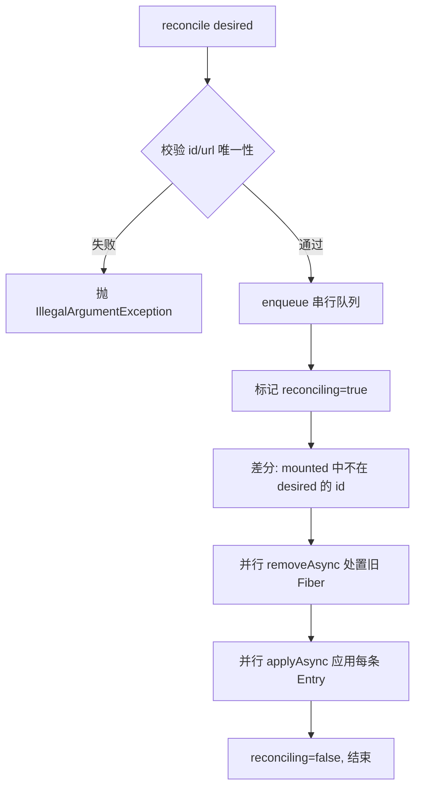
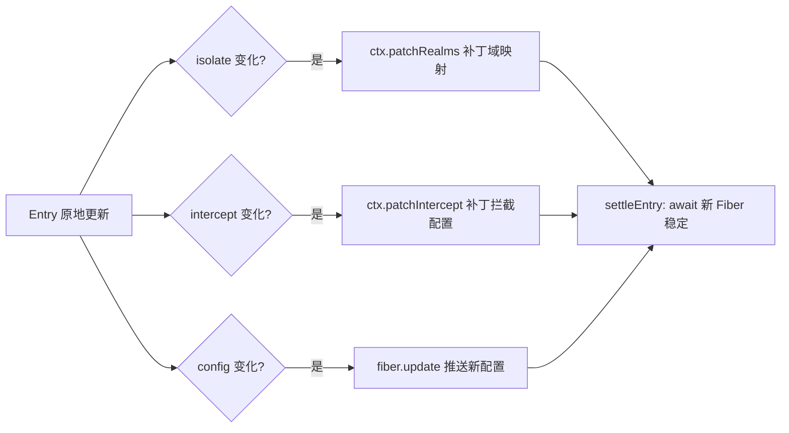

ComponentLoader 是 cordis-java 声明式配置树的核心：它接收一份期望状态的 `Entry` 列表，通过与当前挂载状态做差分（reconcile），以最小的代价让运行时收敛到期望状态。本文剖析这条调和流水线的关键设计——以 `id` 为身份判定"改了还是删了又加"，并按 url/disabled/isolate/intercept/config 的变化程度选择"重建"或"原地更新"策略。理解本文需要先掌握 [六态生命周期模型](5-liu-tai-sheng-ming-zhou-qi-mo-xing-pending-dao-disposed-de-zhuan-huan-yu-await-yu-yi) 中的 Fiber await 语义。

## 数据模型：Entry 与 Mounted

`Entry` 是不可变的声明式配置条目，五个字段各司其职：`id` 是稳定身份（调和时靠它区分"是改了，还是删了又加"）、`url` 指定插件模块、`config` 传给插件、`disabled` 决定条目保留但不挂载、`isolate`/`intercept` 调整上下文隔离与拦截。所有字段通过 Builder 构造并提供 `withConfig`/`withDisabled` 派生方法，保证条目本身永远不可变。

Sources: [Entry.java](cordis-core/src/main/java/dev/cordis/loader/Entry.java#L13-L38)

与 Entry 对应的运行时侧是内部类 `Mounted`，它把一条 Entry 与四个运行时对象绑定：`fiber`（生命周期载体）、`plugin`（已解析插件）、`ctx`（派生上下文）。`with` 方法支持"换 Entry、留 Fiber"的原地元数据更新——这正是调和算法的核心原语。

Sources: [ComponentLoader.java](cordis-core/src/main/java/dev/cordis/loader/ComponentLoader.java#L16-L32)

## 调和的整体流程

`reconcile(List<Entry>)` 是调和入口，分三步执行：**校验 → 移除多余 → 应用全部**。入口处先做纯数据校验：id 不能为空、url 不能为空、id 不能重复，任何一条不满足直接抛 `IllegalArgumentException`，不会触碰运行时。随后按每个配置子树一条的串行队列（`enqueue`）排队执行，避免并发调和互相踩踏；调和期间置 `reconciling = true`，抑制 `onChange` 回调和 `internal/plugin` 钩子的副作用。

值得注意的是两条并行策略的注释性设计意图："Start all modules before awaiting any async apply; startup must not impose entry order"——所有模块先启动、再统一等待，启动阶段不施加条目顺序依赖。

Sources: [ComponentLoader.java](cordis-core/src/main/java/dev/cordis/loader/ComponentLoader.java#L202-L235)

## 差分分类：删、重建、原地更新

`applyAsync(entry)` 是差分决策的核心，按变化程度从重到轻分为四档：

| 差分结果 | 判定条件 | 更新策略 |
|---|---|---|
| 全新条目 | `mounted` 中无此 id | 直接 `mount` 挂载 |
| 重建 | `url` 变化 或 `disabled` 翻转 | 先 `removeAsync` 处置旧 Fiber，再重新 `mount` |
| 纯停用 | `entry.disabled == true`（其余未变） | 只更新元数据 `mounted.put(old.with(entry))`，不触碰 Fiber |
| 原地更新 | url/disabled 均未变 | 分字段增量 patch（见下节） |

Sources: [ComponentLoader.java](cordis-core/src/main/java/dev/cordis/loader/ComponentLoader.java#L243-L271)

"重建"这一档的逻辑值得细看：`url` 变化意味着要加载不同的插件模块，旧 Fiber 必须完整走 dispose 流程释放资源；`disabled` 从 false 翻到 true 也走重建路径（先卸载），而 true 翻回 false 则在"old.fiber == null"分支里重新挂载。停用但不删除的场景（只改 disabled 且其余相同）只更新元数据，条目保留但不挂载。

## 原地更新的字段级策略

当 url 与 disabled 都未变化时，调和进入最细粒度的字段比对，三个字段三种手段：

- **isolate**：用 `patchRealms(realms(entry))` 打上下文补丁。`realms()` 负责把声明翻译为 `RealmKey`——布尔 `TRUE` 映射为按 `id` 缓存的私有域（`privateRealms` 保证同一条目的私有域跨调和保持稳定），具名标签映射为共享域，已是 `RealmKey` 的值直接透传。
- **intercept**：用 `patchIntercept` 原地更新拦截声明，无需重建上下文。
- **config**：用 `fiber.update(entry.config)` 推送新配置；若插件抛出 `RuntimeException`，只记录日志，不影响调和整体完成。

所有路径最终都汇入 `settleEntry(id)`：对已挂载的 Fiber 执行 `awaitAsync()` 并吞掉异常（`.handle((f, e) -> null)`），确保调和返回时每条启用的条目要么已稳定、要么失败已被记录——调和本身不因单个插件启动失败而中断。

Sources: [ComponentLoader.java](cordis-core/src/main/java/dev/cordis/loader/ComponentLoader.java#L260-L284)

## 挂载与失败语义

`mount` 体现"先发布、后等待"的设计：派生上下文（`derive` = `parent.extend()` + realms/intercept 补丁）→ 解析插件 → `context.plugin(plugin, entry.config)` 创建 Fiber → 立即写入 `mounted` → 异步 await。这样即使插件启动抛异常，失败清理也总能从 `mounted` 里找到该条目；异常时写入 `new Mounted(entry, null, null, context)` 的空壳条目，仅记录日志，让调和继续推进其他条目。此外，若父上下文的 Fiber 已失效（`uid == null`），`mount` 直接静默返回，避免在垂死的运行时上继续挂载。

Sources: [ComponentLoader.java](cordis-core/src/main/java/dev/cordis/loader/ComponentLoader.java#L293-L311)

## 与运行时事件的双向同步

调和不是单向的：ComponentLoader 在构造时挂了两个全局钩子，让运行时的自发变化反向回写到 Entry 树：

- **config 钩子**（`internal/config-updated`）：插件内部通过 `fiber.update` 改了自己的配置后，加载器把新 config 写回对应 Entry（`entry.withConfig`），保证 `snapshot()` 反映真实状态。这条回写协议的持久化细节见 [配置回写与原子写文件](15-pei-zhi-hui-xie-yu-yuan-zi-xie-wen-jian-fiber-update-de-chi-jiu-hua-xie-yi)。
- **plugin 钩子**（`internal/plugin`）：当某 Fiber 失效（`uid == null`，例如热更新模块被替换）且不在调和/关闭流程中时，加载器把该条目标记为 `withDisabled(true)` 并清空 Fiber 引用——条目保留在树中但不挂载，等待下一次调和或 `remount` 恢复。

两个钩子都先对 `mounted.values()` 做快照拷贝再遍历，避免回调中修改集合导致并发修改异常。

Sources: [ComponentLoader.java](cordis-core/src/main/java/dev/cordis/loader/ComponentLoader.java#L48-L77)

## 串行队列与事务边界

所有结构性操作（调和、移除、move）都通过 `enqueue` 串行化：每棵配置子树一条编排队列，用 `operationTail` 链式串联前序操作，且**绝不在持锁时等待**——锁内只做队列接线，真正的动作在虚拟线程 `cordis-loader-transaction` 上异步执行。对外则提供两种形态：`reconcile` 在运行时回调内自动转为异步（`inRuntime()` 检测），否则持根锁同步阻塞到完成；`transaction` 提供显式的多子树事务边界（配合 `acquireOperations` 返回的 `Lease` 跨加载器持锁，如 `move` 的实现）。

Sources: [ComponentLoader.java](cordis-core/src/main/java/dev/cordis/loader/ComponentLoader.java#L127-L170)

## 小结：为什么这样分层

把差分结果映射到更新成本，是这套调和机制的精髓：

| 更新成本 | 触发条件 | 保留的东西 |
|---|---|---|
| 最高：dispose + 重挂载 | url 或 disabled 翻转 | 仅 id 身份 |
| 中：上下文补丁 | isolate/intercept 变化 | Fiber、私有域、已获资源 |
| 最低：元数据替换 | 仅 config 变化或纯停用 | 全部运行时状态 |

这意味着改动一个插件的 `config` 不会触发类加载或资源重建，而改 `url` 必然走完整的资源回退流程（LIFO 逆操作，见 [效应与资源回退](6-xiao-ying-yu-zi-yuan-hui-tui-disposable-lifo-ni-cao-zuo-yu-shi-bai-bu-zu-duan-qing-li)）。`remount` 与 `detachForReload` 则为 JVM 源码热更新提供了"预检旧代码退役 → 候选先行发布 → 失败自动清理"的事务性替换入口，这部分与 HmrEngine 的协作详见 [HmrEngine 事务性替换](18-hmrengine-shi-wu-xing-ti-huan-mo-kuai-fen-lei-shi-bai-hui-gun-yu-chen-ji-tiao-mu-jian-ce)。