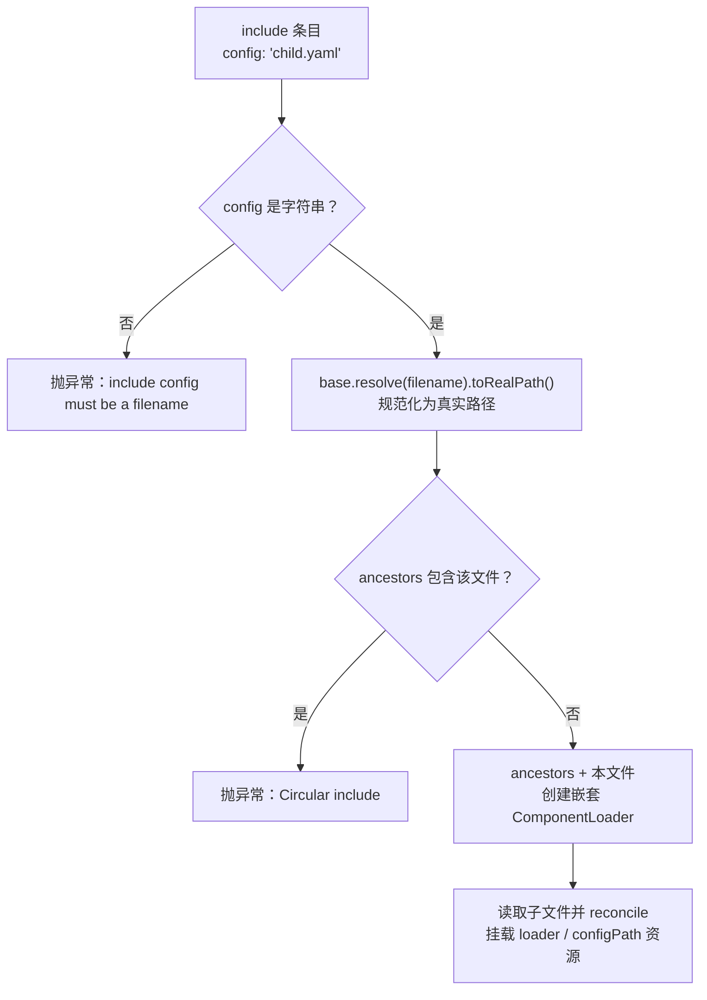

Cordis 的配置树采用“配置即代码”的设计：一份 YAML（兼容 JSON）文件描述了一组插件条目（Entry），其中两个**内建插件** `group` 与 `include` 让配置可以递归组合成树，而 `include` 通过祖先链集合实现**循环引用检测**。本文聚焦这三者的格式约定与实现机制；条目差分与回写协议请参考 [ComponentLoader 调和机制](13-componentloader-diao-he-ji-zhi-entry-chai-fen-yu-id-url-disabled-config-geng-xin-ce-lue) 与 [配置回写与原子写文件](15-pei-zhi-hui-xie-yu-yuan-zi-xie-wen-jian-fiber-update-de-chi-jiu-hua-xie-yi)。

## 配置文件的读取与条目解析

`ConfigFile` 是配置 I/O 的唯一入口。读取时使用 SnakeYAML 的 `SafeConstructor`（禁用任意类型标签，安全），并通过 `setAllowDuplicateKeys(false)` 拒绝重复键；由于 YAML 是 JSON 的超集，JSON 文件无需额外解析器即可加载。顶层结构必须是一个**列表**——每个元素是一个 Entry 映射，任何其他形态都会抛出 `IllegalArgumentException("Configuration must be an entry list")`。

每个条目要求 `id`（非空字符串，全列表内唯一，重复即抛 `Duplicate id`），以及 `url` 或旧名 `name`（指向 `PluginResolver` 可解析的插件标识）。可选字段包括：`disabled`（必须为布尔值）、`config`（透传给插件的任意配置，由插件侧的 `ConfigSchema` 校验）、`isolate`（scope 共享映射）和 `intercept`（服务拦截映射）。这些字段在解析阶段完成基础类型检查并构建为不可变的 `Entry` 对象。

Sources: [ConfigFile.java](cordis-core/src/main/java/dev/cordis/loader/ConfigFile.java#L18-L53)

## group：子配置树的组合插件

`group` 把一段嵌套配置当作**子树**处理：它为当前 Context 创建一个新的 `ComponentLoader`，用传入的 `config`（即嵌套的条目列表）进行调和，并把子 loader 作为 `loader` 资源挂到 Fiber 上。这带来两个语义保证：一是子 loader 的生命周期由 Fiber 的 effect 栈托管，父组销毁时自动逆序释放；二是子树与父树共享同一套回写协议——`children.onChange` 回调里调用 `ctx.fiber().commitConfig(entries)`，把子条目变化同步回父 Fiber 的配置状态。此外 `group` 还监听 `internal/update` 事件，支持运行时对子树的异步重调和。因此 **group 不是语法糖，而是一个普通的内建插件**，其子加载器是“被拥有的 effect”。

Sources: [BuiltinPlugins.java](cordis-core/src/main/java/dev/cordis/loader/BuiltinPlugins.java#L30-L41)

## include：引用外部配置文件

`include` 与 `group` 的关键区别在于：它的 `config` 是一个**文件名**而非内联条目列表。解析流程是：

`include` 的子 loader 挂载了三个运行时锚点：`loader`（嵌套加载器，随 Fiber 生命周期释放）、`configPath`（子文件的真实路径），并通过 `loader/config-open` 事件把打开行为暴露给监听方。子文件自身的 `onChange` 回调则直接将条目**回写到该子文件**——也就是说 include 树中每个文件独立持久化自己的变化，而不是合并回父文件。

Sources: [BuiltinPlugins.java](cordis-core/src/main/java/dev/cordis/loader/BuiltinPlugins.java#L43-L69)

## 循环引用检测：祖先链（ancestors）设计

循环检测的核心是 `ancestors: Set<Path>` 集合，配合 `toRealPath()` 的路径规范化。要点有三：

1. **路径规范化**：检测前先用 `toRealPath()` 解析符号链接与相对路径，保证 `./child.yaml` 与 `child.yaml`、以及经由链接的间接引用都被归一化，避免假阴性。
2. **祖先链逐层累积**：每次进入新的 include 文件时，把该文件加入副本链 `chain`，并传给下一层的 resolver；同一文件在链上出现第二次即判定为环并抛出 `Circular include: <file>`。
3. **检测是按分支的**：使用 `HashSet` 副本而非共享计数，意味着菱形引用（A include B 与 C，B 和 C 都 include D）是合法的——只有沿**单条调用链**成环才被拒绝。

值得注意的是，`group` 与 `include` 并非特殊语法，而是通过 `resolver(modules, base, ancestors)` 递归构造的 `PluginResolver` 分支实现：url 命中 `group`/`include`（或带 `@cordis/` 前缀的别名）时返回对应内建插件，否则透传给宿主提供的模块解析器。循环检测的能力正是沿着这条 resolver 递归链向下传播的。

Sources: [BuiltinPlugins.java](cordis-core/src/main/java/dev/cordis/loader/BuiltinPlugins.java#L17-L28)

## group 与 include 对比

| 维度 | group | include |
|---|---|---|
| config 含义 | 内联条目列表 | 外部文件名（相对 base 目录） |
| 子加载器来源 | 新建 `ComponentLoader` | 新建 `ComponentLoader`，base 换为子文件目录 |
| 配置持久化 | 回写到父 Fiber（`commitConfig`） | 回写到子文件自身（`ConfigFile.write`） |
| 循环检测 | 不涉及文件 | ancestors 链 + `toRealPath()` 规范化 |
| 额外挂载资源 | `loader` | `loader`、`configPath` |
| 事件 | 监听 `internal/update` | 发出 `loader/config-open` |

两者共同点是：子加载器都是 Fiber 拥有的 effect，父级销毁时通过 `disposeAllAsync` 逆序清理子树。这确保了 include 树无论嵌套多深，资源释放都符合 LIFO 语义（详见 [效应与资源回退](6-xiao-ying-yu-zi-yuan-hui-tui-disposable-lifo-ni-cao-zuo-yu-shi-bai-bu-zu-duan-qing-li)）。

## YAML 写回与 JSON 显式序列化

`ConfigFile.write` 根据目标文件扩展名选择格式：`.json` 文件**不依赖** YAML flow style，而是用自实现的 `json()` 序列化器显式输出（注释明确说明“YAML flow style 不保证 JSON 引号”），处理字符串转义、拒绝非有限数字；其余文件按 YAML BLOCK 风格输出。序列化会过滤掉默认值字段（如 `disabled: false`、空的 isolate/intercept），保持回写文件的最小化。写入采用临时文件 + `ATOMIC_MOVE` 的原子协议，细节见 [配置回写与原子写文件](15-pei-zhi-hui-xie-yu-yuan-zi-xie-wen-jian-fiber-update-de-chi-jiu-hua-xie-yi)。

Sources: [ConfigFile.java](cordis-core/src/main/java/dev/cordis/loader/ConfigFile.java#L65-L113)

## 验证与实战入口

循环 include 的行为在测试中有覆盖：禁用 include 条目不会读取子文件，启用后子文件中的条目正常调和（[RuntimeUtilitiesTest.java](cordis-core/src/test/java/dev/cordis/RuntimeUtilitiesTest.java#L148-L155)）。一个最小的 YAML 示例如 [cordis.yaml](examples/hot-reload/cordis.yaml#L1-L5) 所示——`id: hello`、`url: HelloPlugin.java`、嵌套 `config`，可结合 [热更新演示应用](25-re-geng-xin-yan-shi-ying-yong-cordisapplication-yu-examples-hot-reload) 运行体验。

若想理解配置树被调和后的差分与更新策略，请继续阅读 [ComponentLoader 调和机制](13-componentloader-diao-he-ji-zhi-entry-chai-fen-yu-id-url-disabled-config-geng-xin-ce-lue)；对文件监听与热加载感兴趣，可前往 [ConfigWatcher 文件监听](16-configwatcher-wen-jian-jian-ting-fang-dou-cuo-wu-bao-liu-yuan-shu-yu-loader-shi-jian)。