配置回写是 cordis 声明式配置树中“运行时状态 → 磁盘文件”的逆向通道：插件在运行期通过 `fiber.update` 修改自身配置后，加载器捕获这一变化并将整棵配置树安全地写回 YAML/JSON 文件。本文解析这条持久化链路的完整协议——从 `Fiber.update` 的原地更新事件，到 `ComponentLoader` 的 changed 通知，再到 `ConfigFile.write` 的临时文件原子替换，以及 group/include 嵌套树如何逐层向上冒泡并写回各自的文件。

## 持久化链路总览

回写不是由写文件方主动“拉取”的，而是由配置变更事件驱动的单向管道。整条链路有三个关键角色：`Fiber` 负责产生 `internal/config-updated` 事件，`ComponentLoader` 监听事件并维护权威的条目快照，`ConfigFile` 则负责序列化与原子落盘。

```mermaid
flowchart LR
    P[插件调用 fiber.update&#40;newConfig&#41;] --> W["waterfall 'internal/update'"]
    W --> E["emit 'internal/config-updated'"]
    E --> H["ComponentLoader 配置钩子<br/>mounted.put&#40;entry.withConfig&#41;"]
    H --> C["changed&#40;&#41; → onChange&#40;snapshot&#41;"]
    C --> W2["ConfigFile.write&#40;file, entries&#41;"]
    W2 --> T["临时文件 .cordis-*.tmp"]
    T --> M["ATOMIC_MOVE 替换目标文件"]
```

插件的更新入口是 `Fiber.update`：它在根上下文的串行锁内断言 fiber 活跃、替换 `rawConfig`，然后通过 `internal/update` waterfall 事件让组件有机会**原地消化**这次更新（返回 `CompletionStage` 时会记录为 `updateBarrier`，供 `awaitAsync` 观察未完成的更新）。waterfall 结束后提交新配置并发出 `internal/config-updated`，这正是加载器感知变更的事件源。

Sources: [Fiber.java](cordis-core/src/main/java/dev/cordis/core/runtime/Fiber.java#L433-L451), [Fiber.java](cordis-core/src/main/java/dev/cordis/core/runtime/Fiber.java#L57-L63)

## ComponentLoader 的变更捕获与快照广播

`ComponentLoader` 在构造时通过 `parent.onGlobal("internal/config-updated", ...)` 注册钩子：任何 fiber 发出的配置更新事件，只要匹配当前挂载表中的某个 `Mounted` 记录，就会以 `entry.withConfig(args[1])` 生成**不可变的新 Entry**（`Entry.withConfig` 基于 Builder 复制构造），替换挂载表条目并调用 `changed()`。

`changed()` 是回写的总闸门：它只在非 `closing`、非 `reconciling` 状态下才把当前 `snapshot()`（挂载表中全部 Entry 的有序列表）交给 `onChange` 监听者。这保证了调和过程中（`reconcileAsync` 批量应用期望树时）中间态不会被逐条写盘，只有用户侧或插件侧的离散变更才触发持久化。`onChange` 本身在 `parent.atomic` 下替换，保证监听者切换的原子性。

Sources: [ComponentLoader.java](cordis-core/src/main/java/dev/cordis/loader/ComponentLoader.java#L51-L60), [ComponentLoader.java](cordis-core/src/main/java/dev/cordis/loader/ComponentLoader.java#L109-L122), [Entry.java](cordis-core/src/main/java/dev/cordis/loader/Entry.java#L56-L58)

## ConfigFile.write：临时文件 + 原子替换协议

`ConfigFile.write` 是整个持久化协议的核心，它对“写到一半崩溃”这一经典风险给出了明确的应对协议，分为四个阶段：

| 阶段 | 操作 | 关键点 |
|---|---|---|
| 1. 准备 | `Files.createDirectories(target.getParent())` | 确保目标目录存在 |
| 2. 序列化 | 按扩展名选择 YAML BLOCK 或显式 JSON | JSON 不依赖 YAML flow style，自行转义引号/控制字符，拒绝非有限数字 |
| 3. 临时写入 | `createTempFile(dir, ".cordis-", ".tmp")` + `writeString` | 临时文件与目标同目录，保证 `ATOMIC_MOVE` 不跨文件系统 |
| 4. 原子替换 | `Files.move(temporary, target, ATOMIC_MOVE, REPLACE_EXISTING)` | 不支持原子移动时降级为普通 `move`；`finally` 中 `deleteIfExists` 清理残留 |

两个设计细节值得注意。其一是 **JSON 显式输出**：代码注释明确指出 YAML flow style 不能保证 JSON 引号语义，因此 `.json` 文件走自实现的 `json()` 序列化器，对字符串做逐 code point 转义（`"`、`\`、换行、回车、制表符及 `< 32` 的控制字符），从源头保证写出的文件能被 `read()`（`SafeConstructor` + 禁止重复键）无损读回。其二是**序列化 whitelist**：`serialize()` 只接受 `Entry`、`List`、`Map`（键强制 String）与 null/String/Number/Boolean，其他类型直接抛 `IllegalArgumentException`——配置树中不允许出现不可表达的对象，避免静默写出损坏数据。

Sources: [ConfigFile.java](cordis-core/src/main/java/dev/cordis/loader/ConfigFile.java#L61-L79), [ConfigFile.java](cordis-core/src/main/java/dev/cordis/loader/ConfigFile.java#L81-L101), [ConfigFile.java](cordis-core/src/main/java/dev/cordis/loader/ConfigFile.java#L103-L133), [ConfigFile.java](cordis-core/src/main/java/dev/cordis/loader/ConfigFile.java#L17-L23)

## 回写格式的确定性：字段顺序与省略规则

写回的文件是 Entry 结构的规范化投影，而非任意配置原样回显。`serialize()` 对每个 Entry 按 `id → url → disabled → isolate → intercept → config` 的固定顺序写入 `LinkedHashMap`，并遵循**最小省略原则**：

| 字段 | 写出条件 |
|---|---|
| `id` / `url` | 总是写出 |
| `disabled` | 仅在为 `true` 时写出 |
| `isolate` / `intercept` | 仅在非空 Map 时写出 |
| `config` | 仅在非 null 时写出 |

这意味着读取时的默认值（`disabled=false`、空隔离声明）在回写时被折叠掉，文件保持紧凑；同时 `LinkedHashMap` 保序使得多次“读→改→写”循环不会重排键，产生的 diff 稳定可审计。嵌套的 `config`、`isolate`、`intercept` 值会被递归 `serialize`，保证树中每一层都符合同一约束。

Sources: [ConfigFile.java](cordis-core/src/main/java/dev/cordis/loader/ConfigFile.java#L81-L101), [Entry.java](cordis-core/src/main/java/dev/cordis/loader/Entry.java#L40-L47)

## 两种回写宿主：ConfigFile.open 与 include 插件

`ConfigFile` 提供了两个把 `onChange` 绑定到磁盘文件的入口，覆盖配置树的根与中间层：

- **`ConfigFile.open(parent, resolver, file)`**：创建根 `ComponentLoader` 并注册 `onChange → write(file, entries)`，随后 `read(file)` 加载初始条目。若加载失败会 `close()` 已创建的 loader 再抛出，保证不留半初始化的组件。异常以 `UncheckedIOException` 包装向上传播。
- **`include` 内置插件**：嵌套配置文件被建模为普通插件，`include` 解析文件真实路径（`toRealPath`）并用祖先集合检测循环引用后，创建子 loader 并注册同样的回写钩子——每个被 include 的文件有自己独立的持久化目标。子树的任何变更写回**该子树自己的文件**，而非根文件。

而 `group` 插件走的是另一条路：它不写文件，而是把子树快照通过 `ctx.fiber().commitConfig` 提交给自己的 fiber——group 的“配置”就是子条目列表，子树变更会沿 `internal/update` → `reconcileAsync` → `commitConfig` → `internal/config-updated` 的路径继续向上冒泡，最终由根部的 `ConfigFile.open` 钩子统一落盘。

```mermaid
flowchart TD
    subgraph 根文件
        A["ConfigFile.open<br/>onChange → write&#40;root.yaml&#41;"] --> B["根 loader"]
    end
    B --> C["group 条目"]
    C --> D["group 插件子 loader<br/>onChange → commitConfig&#40;向上冒泡&#41;"]
    D --> E["include 条目"]
    E --> F["include 插件子 loader<br/>onChange → write&#40;nested.yaml&#41;"]
    D --> G["普通条目<br/>fiber.update → 事件冒泡 → 根 loader 落盘"]
    F -.独立文件.-> H[nested.yaml]
```

Sources: [ConfigFile.java](cordis-core/src/main/java/dev/cordis/loader/ConfigFile.java#L135-L151), [BuiltinPlugins.java](cordis-core/src/main/java/dev/cordis/loader/BuiltinPlugins.java#L43-L67), [BuiltinPlugins.java](cordis-core/src/main/java/dev/cordis/loader/BuiltinPlugins.java#L30-L41)

## 调和路径上的 fiber.update 与回写的分工

需要区分两条更新路径对持久化的影响。`reconcileAsync` 期望树驱动的调和走 `applyAsync`：url/disabled 变化触发卸载重挂载，isolate/intercept 差异走 `patchRealms`/`patchIntercept` 原地修补，只有 `config` 不相等时才调用 `old.fiber.update(entry.config)`（失败仅记录日志，不中断调和）。调和期间 `reconciling=true`，`changed()` 被抑制，因此**调和本身不会引发回写**——磁盘文件正是调和的输入来源，不应被输出污染。

相反，运行期插件自主调用 `fiber.update`（例如内部状态需持久化到配置）时，`internal/config-updated` 事件命中加载器钩子，走 changed → onChange → write 的回写协议。这条“运行时改配置 → 写回文件”的路径配合 `ConfigWatcher`（见 [ConfigWatcher 文件监听](16-configwatcher-wen-jian-jian-ting-fang-dou-cuo-wu-bao-liu-yuan-shu-yu-loader-shi-jian)）形成了配置的双向同步闭环。

Sources: [ComponentLoader.java](cordis-core/src/main/java/dev/cordis/loader/ComponentLoader.java#L243-L271), [ComponentLoader.java](cordis-core/src/main/java/dev/cordis/loader/ComponentLoader.java#L120-L122), [Fiber.java](cordis-core/src/main/java/dev/cordis/core/runtime/Fiber.java#L433-L451)

## 协议保证与边界

综上，`fiber.update` 的持久化协议提供以下保证，以及明确的边界：

| 保证 | 机制 |
|---|---|
| 崩溃不产生半写文件 | 临时文件 + `ATOMIC_MOVE` 替换；不支持时降级普通 move（有窗口） |
| 写出的文件可无损读回 | 显式 JSON 转义 / YAML SafeConstructor + 禁止重复键 |
| 序列化失败早失败 | serialize whitelist，未知类型抛异常而非静默跳过 |
| 调和不写盘 | `reconciling` 状态下抑制 `changed()` |
| 嵌套树各自落盘 | include 子树绑定自身文件，group 子树向上冒泡 |
| 临时文件不残留 | `finally` 中 `deleteIfExists` |

边界方面：`ATOMIC_MOVE` 降级路径（文件系统不支持原子移动）仍存在短暂的非原子窗口；`onChange` 监听者抛出的异常（如 `UncheckedIOException`）会沿事件链路传播，写盘失败不会静默吞掉，但也意味着监听者失败会中断发起更新的一方；此外协议不承诺 fsync——`Files.writeString`/`move` 依赖操作系统的崩溃语义，极端掉电场景下 durability 由文件系统层保证而非本协议。

Sources: [ConfigFile.java](cordis-core/src/main/java/dev/cordis/loader/ConfigFile.java#L61-L79), [ComponentLoader.java](cordis-core/src/main/java/dev/cordis/loader/ComponentLoader.java#L120-L122)

---
阅读完本文后，建议继续了解配置的“读方向”与监听侧：[YAML/JSON 配置格式：group、include 与循环引用检测](14-yaml-json-pei-zhi-ge-shi-group-include-yu-xun-huan-yin-yong-jian-ce)、[ConfigWatcher 文件监听：防抖、错误保留原树与 loader 事件](16-configwatcher-wen-jian-jian-ting-fang-dou-cuo-wu-bao-liu-yuan-shu-yu-loader-shi-jian)，以及承载 `internal/update` 语义的事件系统 [事件系统：作用域、once、parallelAsync/serialAsync 与 waterfall](21-shi-jian-xi-tong-zuo-yong-yu-once-parallelasync-serialasync-yu-waterfall)。