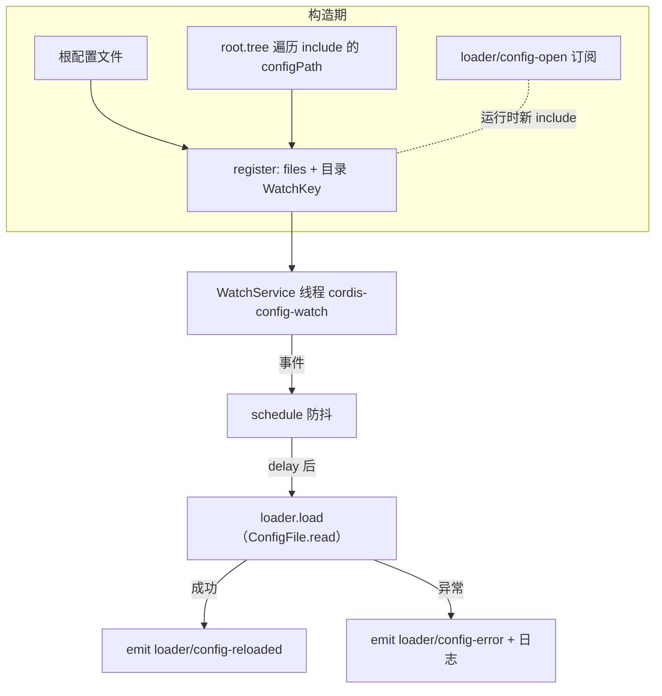

`ConfigWatcher` 是 cordis-java 声明式配置体系的"热重载哨兵"：它基于 JDK NIO `WatchService` 监听根配置文件与所有 `include` 引入的子配置文件，在文件变更后经过**防抖窗口**触发对应 `ComponentLoader` 的重新调和。它的三条核心设计原则是——**编辑器多次写入只触发一次重载**、**非法 YAML 不会破坏正在运行的旧配置树**、**通过 `loader/config-open` / `loader/config-reloaded` / `loader/config-error` 三个事件与外界解耦通信**。本文解析其实现机制、事件协议与边界行为。

Sources: [ConfigWatcher.java](cordis-core/src/main/java/dev/cordis/loader/ConfigWatcher.java#L16-L18)

## 整体架构：一个 Watcher 如何覆盖整棵配置树

`ConfigWatcher` 的监听范围在构造时静态建立，并通过事件动态扩展。构造函数做四件事：

1. 对根配置文件调用 `register(file, root)`，建立"文件 → loader"映射；
2. 遍历 `root.tree()`，为每个已挂载 `configPath` 附件的子 loader 注册其 include 文件；
3. 订阅全局事件 `loader/config-open`，当 include 插件在运行时挂载新配置文件时自动补注册；
4. 通过 `root.context().effect(...)` 注册一个名为 `"config watcher"` 的资源，随上下文销毁自动清理，同时启动虚拟线程 `cordis-config-watch` 消费文件系统事件。



关键数据结构是三张并发容器：`files`（规范化路径 → 负责重载的 `ComponentLoader`）、`directories`（`WatchKey` → 监听目录）、`pending`（文件 → 未到期的防抖任务）。`register` 使用 `toRealPath()` 做路径规范化，这保证符号链接和相对路径写入的事件都能命中 `files` 表——测试用例 `watcherTracksIncludeAndRootInTheSameCanonicalDirectory` 正是依赖这一语义。

Sources: [ConfigWatcher.java](cordis-core/src/main/java/dev/cordis/loader/ConfigWatcher.java#L37-L57), [ConfigWatcher.java](cordis-core/src/main/java/dev/cordis/loader/ConfigWatcher.java#L59-L69), [ComponentLoader.java](cordis-core/src/main/java/dev/cordis/loader/ComponentLoader.java#L82-L88)

## 事件循环与 OVERFLOW 兜底

监听线程在 `run()` 中循环 `watch.take()`。对每个事件，它解析出目标文件路径（`directory.resolve(...).toAbsolutePath().normalize()`），只有当该文件存在于 `files` 表中才调度重载——无关文件（编辑器临时文件、锁文件等）被天然过滤。两个细节值得注意：

- **OVERFLOW 处理**：当操作系统事件队列溢出时，NIO 无法告知具体哪个文件变了，`ConfigWatcher` 的策略是对 `files` 中**全部**文件重新调度防抖重载，宁可多调和也不漏更新；
- **失效目录清理**：`key.reset()` 返回 `false` 表示目录不可访问（例如被删除），此时从 `directories` 中移除，避免僵尸 WatchKey。

Sources: [ConfigWatcher.java](cordis-core/src/main/java/dev/cordis/loader/ConfigWatcher.java#L71-L88)

## 防抖机制：cancel-and-reschedule

`schedule` 是防抖的核心。它利用 `ConcurrentHashMap.compute` 的原子性实现"同文件去重"：

```java
pending.compute(file, (path, old) -> {
    if (old != null) old.cancel(false);
    ...
    return worker.schedule(() -> { ... }, delay, TimeUnit.MILLISECONDS);
});
```

每次文件事件到来，都会**取消该文件尚未执行的旧任务并重新计时**。这意味着编辑器在一次保存中产生的多次写入（如原子写文件的"写临时文件 + rename"两步）会合并为 `delay` 之后的**一次**重载。所有任务都跑在单线程的 `cordis-config` 调度线程池上，重载因此天然串行，无需额外加锁。构造函数显式拒绝负的防抖时长（`Negative debounce`），默认时长由 `CordisApplication.open` 设为 **150ms**。

重载任务本身分三步：先检查 `loader.context().fiber().uid == null`——loader 所属的 Fiber 已被销毁时直接把该文件从映射中移除（自动清理已卸载的 include 分支）；然后调用 `loader.load(ConfigFile.read(file))` 触发完整的差分调和；成功后向根上下文发出 `loader/config-reloaded` 事件（载荷为重载的文件路径）。

Sources: [ConfigWatcher.java](cordis-core/src/main/java/dev/cordis/loader/ConfigWatcher.java#L90-L112), [CordisApplication.java](cordis-core/src/main/java/dev/cordis/loader/CordisApplication.java#L38-L40)

## 错误保留原树：失败只上报、不回滚、不中断

重载过程中任何异常（YAML 语法错误、插件初始化失败等）都被捕获并转化为事件与日志：

```java
} catch (Exception error) {
    root.context().emit("loader/config-error", file, error);
    root.context().logger("loader").error(error);
}
```

这里没有回滚逻辑，因为**回滚是不必要的**：`loader.load` 内部是差分调和，只有解析和构建成功后才会应用变更；一旦抛出异常，旧的组件树完全未受影响，继续以旧配置运行。调用方可以通过订阅 `loader/config-error`（参数为文件路径与异常）实现自定义告警，而框架保证下一个有效编辑到来时重载会再次尝试。这是"配置热重载永不击垮运行中服务"这一语义边界的实现基础。

Sources: [ConfigWatcher.java](cordis-core/src/main/java/dev/cordis/loader/ConfigWatcher.java#L96-L110)

## 事件协议与动态 include 注册

三个事件构成了 watcher 与外界的完整契约：

| 事件 | 触发时机 | 载荷 |
|---|---|---|
| `loader/config-open` | include 插件挂载新配置文件时（由 `BuiltinPlugins.include` 发出） | `(Path file, ComponentLoader nested)` |
| `loader/config-reloaded` | 防抖后重载成功 | `(Path file)` |
| `loader/config-error` | 重载抛出异常 | `(Path file, Exception error)` |

`loader/config-open` 的订阅使 watcher 无需预知配置树结构：include 插件在执行时对 Fiber 附加 `configPath` 并 emit 该事件，watcher 收到后立即注册监听。这意味着嵌套 include、运行期才解析出的配置文件都能被覆盖，测试中"同一规范化目录下根文件与 include 子文件都被监听"的行为正源于此。

Sources: [ConfigWatcher.java](cordis-core/src/main/java/dev/cordis/loader/ConfigWatcher.java#L50-L52), [BuiltinPlugins.java](cordis-core/src/main/java/dev/cordis/loader/BuiltinPlugins.java#L44-L66)

## 生命周期与资源回收

`ConfigWatcher` 实现了 `AutoCloseable`，持有两份 `Disposable`：`hook`（`loader/config-open` 的事件订阅）与 `ownership`（上下文效应）。`close()` 先调用私有 `stop()`——置位 `closed`、关闭 `WatchService`（使监听线程以 `ClosedWatchServiceException` 优雅退出）、`shutdownNow` 调度线程、清空两张映射——再依次释放 hook 与 ownership。此外，由于 `ownership` 是通过 `context.effect` 注册的，即便调用方忘记 `close()`，根上下文销毁时 LIFO 资源回退也会触发 `stop`，防止守护线程与 WatchService 泄漏。

Sources: [ConfigWatcher.java](cordis-core/src/main/java/dev/cordis/loader/ConfigWatcher.java#L114-L120), [ConfigWatcher.java](cordis-core/src/main/java/dev/cordis/loader/ConfigWatcher.java#L41-L45)

## 行为验证：测试如何刻画语义

`RuntimeUtilitiesTest` 中两个测试用例精确刻画了上文语义。`fileWatcherReconcilesAnEditedConfiguration` 验证：写入 `config("before")` 后编辑为 `config("after")`，在 100ms 防抖窗口内，`loader/config-reloaded` 事件到达且插件收到的配置值变为 `"after"`——证明重载走的是真实调和而非缓存。第二个测试 `watcherTracksIncludeAndRootInTheSameCanonicalDirectory` 则验证了两条组合语义：修改 include 的 `child.yaml` 只重载该子树（事件路径为 `child.yaml`，`root.get("value")` 变为 `"two"`）；随后禁用 include 条目重载根文件，事件路径为 `root.yaml` 且共享域中的 `value` 变为 `null`——include 禁用后子树被卸载，`files` 表中的陈旧条目在下次事件或 Fiber 失活检查中被清理。

Sources: [RuntimeUtilitiesTest.java](cordis-core/src/test/java/dev/cordis/RuntimeUtilitiesTest.java#L123-L157)

## 小结与延伸阅读

| 设计点 | 实现手段 | 保证 |
|---|---|---|
| 防抖 | `pending.compute` + cancel-and-reschedule，单线程调度器 | 编辑风暴合并为一次重载 |
| 错误保留原树 | 捕获异常 → `config-error` 事件 + 日志，无回滚需求 | 非法配置不影响运行中组件 |
| 动态监听范围 | `configPath` 附件 + `loader/config-open` 订阅 | 运行期 include 自动纳入 |
| 资源安全 | `AutoCloseable` + `context.effect` 双保险 | 上下文销毁必然回收 watcher |

理解 ConfigWatcher 后，建议继续阅读差分调和的内部机制 [ComponentLoader 调和机制：Entry 差分与 id/url/disabled/config 更新策略](13-componentloader-diao-he-ji-zhi-entry-chai-fen-yu-id-url-disabled-config-geng-xin-ce-lue)，以及与之并行的源码热更新通道 [HmrEngine 事务性替换：模块分类、失败回滚与陈旧条目检测](18-hmrengine-shi-wu-xing-ti-huan-mo-kuai-fen-lei-shi-bai-hui-gun-yu-chen-ji-tiao-mu-jian-ce)；若想看两者在实际应用中的协作，可参考 [热更新演示应用：CordisApplication 与 examples/hot-reload](25-re-geng-xin-yan-shi-ying-yong-cordisapplication-yu-examples-hot-reload)。