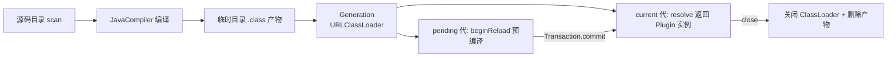
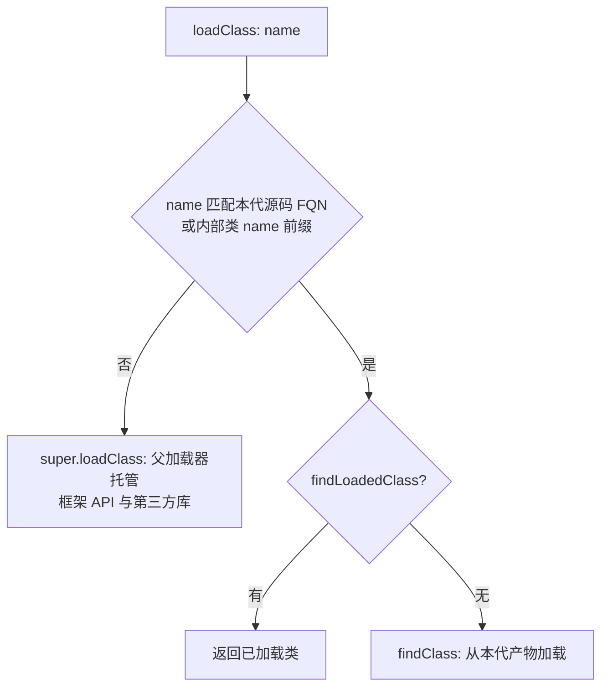
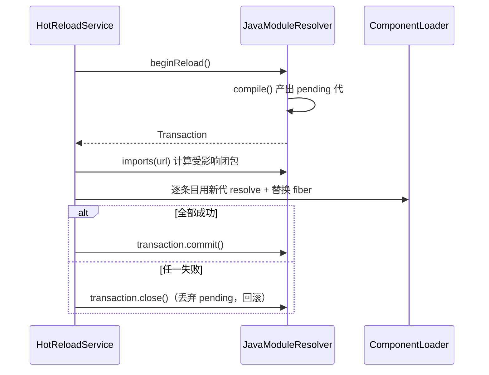

`JavaModuleResolver` 是 cordis-java 源码热更新（HMR）链路的地基：它扫描一个源码目录，用当前 JDK 的 `javax.tools.JavaCompiler` 动态编译全部 `.java` 文件，并把产物装进一个隔离的、逐代递增的 ClassLoader 中。它同时实现了三个角色——[PluginResolver](cordis-core/src/main/java/dev/cordis/loader/PluginResolver.java#L1-L17)（把 url 解析成 `Plugin` 实例）、[ModuleGraph](cordis-core/src/main/java/dev/cordis/hmr/ModuleGraph.java#L1-L13)（为 HMR 引擎提供保守引用图）和 `AutoCloseable`（统一回收所有历史代际）。本文聚焦该类自身的编译、类加载隔离与代际事务机制；HMR 引擎如何消费这些能力见 [HmrEngine 事务性替换](18-hmrengine-shi-wu-xing-ti-huan-mo-kuai-fen-lei-shi-bai-hui-gun-yu-chen-jiu-tiao-mu-jian-ce)，整体适配边界见 [适配边界：externals、restart-required 与不支持的场景](20-gua-pei-bian-jie-externals-restart-required-yu-bu-zhi-chi-de-chang-jing)。

## 架构总览：三接口一体的解析器

`JavaModuleResolver` 被声明为 `final class`，实现 `PluginResolver, ModuleGraph, AutoCloseable` 三个接口，核心状态只有四个字段：源码根目录、编译 classpath、代际列表 `generations`，以及指向当前/待交接代际的 `current` 与 `pending` 引用。整条数据流如下：

关键设计意图在类注释中一句话点明：**核心 Cordis API 类来自宿主 classloader，源码类来自当前代际**。也就是说，代与代之间只有用户源码被隔离，框架 API 始终是同一套 `Class` 对象——这保证了 `Plugin` 接口类型检查（`instanceof Plugin`）跨代际恒真，避免经典 HMR 方案中“同一个类名、不同 Class 对象导致 `ClassCastException`”的陷阱。

Sources: [JavaModuleResolver.java](cordis-core/src/main/java/dev/cordis/loader/JavaModuleResolver.java#L13-L23), [ModuleGraph.java](cordis-core/src/main/java/dev/cordis/hmr/ModuleGraph.java#L1-L13)

## 类路径收集：hostClasspath 的三重来源

无参构造默认调用 `hostClasspath()`，为动态编译组装 classpath，来源有三层，按顺序去重保序（`LinkedHashSet`）：

1. `java.class.path` 系统属性拆分出的所有条目；
2. `Plugin.class.getProtectionDomain().getCodeSource()` 定位到的 Cordis API jar/目录——这是硬性依赖，定位失败直接抛 `IllegalStateException("Cannot locate Cordis API classes")`；
3. 沿当前线程上下文 ClassLoader 向父链遍历，把所有 `URLClassLoader` 中 `file:` 协议的 URL 收入路径。

第三层是兼容性兜底：在 IDE 或嵌入式场景下 classpath 系统属性可能不完整，运行时 ClassLoader 链上的 URL 才是真实可用路径。三者合并后以 `File.pathSeparator` 拼接，作为 `-classpath` 传给编译任务。

Sources: [JavaModuleResolver.java](cordis-core/src/main/java/dev/cordis/loader/JavaModuleResolver.java#L29-L50)

## 源码扫描与 FQN 推导

`scan()` 用 `Files.walk(sourceRoot)` 递归遍历所有 `.java` 文件（排序后处理，保证确定性），逐文件读取全文，用正则 `^\s*package\s+([\w.]+)\s*;` 提取包声明，推导出完整类名 `包名.文件名去后缀`。扫描结果是一个以 `file:` URL 为 key、`Source(path, name, text)` 记录为 value 的 `LinkedHashMap`——**URL 即模块标识**，贯穿 `resolve`、`urls`、`imports` 三个接口。

url 规范化由 `canonical()` 完成：`file:` 开头的 url 直接转路径求 realpath，否则视为相对 `sourceRoot` 的路径再转换；`url()` 方法优先 `toRealPath()`，失败时退回绝对规范化路径。这保证了大小写/软链接/相对路径差异不会造成同一模块被识别为两个 url。

Sources: [JavaModuleResolver.java](cordis-core/src/main/java/dev/cordis/loader/JavaModuleResolver.java#L56-L70), [JavaModuleResolver.java](cordis-core/src/main/java/dev/cordis/loader/JavaModuleResolver.java#L119-L131)

## compile()：JDK 动态编译与类加载隔离的核心

`compile()` 是整个类的引擎，每次调用产出一个全新的 **Generation**（代际），流程分四步：

**第一步：编译前置校验。** 扫描源码，空目录直接抛 `IllegalArgumentException`；随后通过 `ToolProvider.getSystemJavaCompiler()` 取编译器，取不到说明运行在 JRE 上，抛出明确错误 "HMR requires a JDK, not a JRE"——这是硬性环境约束，HMR 功能不提供降级方案。

**第二步：调用编译任务。** 创建 `cordis-module-` 前缀的临时输出目录，装配 `DiagnosticCollector` 收集诊断，编译选项为 `-proc:none`（关闭注解处理器，避免源码目录中的处理器干扰编译）、用户 classpath 和输出目录。编译失败时把全部诊断拼进异常信息抛出，且在 catch 块中删除临时目录——**失败不留垃圾**。

**第三步：构建细粒度隔离的 URLClassLoader。** 这是本类最精妙的部分。ClassLoader 以 `Plugin.class.getClassLoader()` 为父（即宿主），但**重写了 `loadClass(name, resolve)`**，实现“源码类本地优先”的加载策略：

匹配规则为 `name.equals(n) || name.startsWith(n + "$")`——即源码声明的每个顶层类**及其全部内部类/匿名类**都强制走本地加载，其余一切（cordis 核心、SnakeYAML、JDK 类）都委派父加载器。整个过程在 `getClassLoadingLock(name)` 下进行，符合标准双亲委派模型的线程安全要求。其效果是：**同一份源码类在每一代都有独立的 `Class` 对象**，旧代实例继续用旧类运行，新代实例用新类创建，互不干扰。

**第四步：登记代际。** `Generation` 记录输出目录、ClassLoader、源码映射，以及一个惰性填充的 `plugins` 缓存，加入 `generations` 列表。异常路径上临时目录总会被清理，但成功的代际产物会保留到 `close()` 才删除。

Sources: [JavaModuleResolver.java](cordis-core/src/main/java/dev/cordis/loader/JavaModuleResolver.java#L154-L189), [JavaModuleResolver.java](cordis-core/src/main/java/dev/cordis/loader/JavaModuleResolver.java#L191-L219)

## 代际事务：pending/current 双槽与原子交接

代际切换采用**预编译 + 显式事务**模型，而非即时替换，这是与 HMR 引擎协作的协议基础：

| 操作 | 语义 | 失败路径 |
|---|---|---|
| `beginReload()` | 在事务改动任何 fiber 之前，同步编译出新代挂到 `pending` 槽位 | 抛异常，`current` 不受影响 |
| `Transaction.commit()` | 在持有外层锁的 `synchronized` 块内把 `current` 指向 pending 代，`pending` 清空 | 不可失败（编译早已完成） |
| `Transaction.close()`（未 commit） | 仅丢弃 pending 代引用 | `current` 原封不动，即整体回滚 |
| `resolve(url)` | 若 pending 存在则从 pending 代解析，否则从 current 代 | 解析异常由上层决定是否回滚 |

三点值得注意。其一，`beginReload` 带 `synchronized` 且检查 `pending != null`，**同一时刻只允许一个重载事务在飞行中**，并发重载被直接拒绝。其二，`commit()`/`close()` 均在 `synchronized (JavaModuleResolver.this)` 中执行且幂等（`finished` 标志），try-with-resources 与显式 commit 组合不会双重生效。其三，`resolve` 在 pending 存在时始终读 pending 代——这使 HMR 引擎在事务窗口内安装/替换的插件统一来自新代，而未受事务影响的旧 fiber 仍持有旧代类实例，直到 dispose 后新 fiber 才感知新代码。

`resolve` 内部按 url 查 `Generation.sources`，找不到抛 `IllegalArgumentException("Module not found: ...")`；找到则 `Class.forName(name, true, classes)` 强制初始化并反射调用无参构造，实例若不实现 `Plugin` 同样抛出。同一代内同一 url 的实例被缓存在 `plugins` map 中，重复 resolve 返回同一实例。

Sources: [JavaModuleResolver.java](cordis-core/src/main/java/dev/cordis/loader/JavaModuleResolver.java#L72-L114), [JavaModuleResolver.java](cordis-core/src/main/java/dev/cordis/loader/JavaModuleResolver.java#L203-L212)

## 保守引用图：imports() 的实现取舍

作为 `ModuleGraph` 的实现，`imports(url)` 提供的是**极保守的文本级引用分析**：重新扫描全目录，对源文件全文用 `\b类简单名\b` 词边界正则匹配其余每个源文件的 FQN 简单名，命中即建立依赖边。源码注释直白承认了这一取舍："Extra edges cause extra reloads, never stale class reuse"——**多报依赖只会导致多余的重载，绝不会复用过期的类**。这与 HMR 引擎“重载整个受影响闭包”的策略配合（详见 [保守引用分析：为什么热更新会重载整个源码目录](19-bao-shou-yin-yong-fen-xi-wei-shi-yao-re-geng-xin-hui-zhong-zai-zheng-ge-yuan-ma-mu-lu)），用正确性换取分析精度。由于每次调用都重新 `scan()`，该方法总是反映磁盘上的最新状态。

Sources: [JavaModuleResolver.java](cordis-core/src/main/java/dev/cordis/loader/JavaModuleResolver.java#L133-L152)

## 生命周期与关闭协议：close 的顺序约束

`close()` 遍历**全部**历史代际（不只是 current），逐个 `Generation.close()`——关闭 `URLClassLoader` 并逆序递归删除临时输出目录。任一代关闭失败时采用“首个异常 + 后续异常挂 suppressed”的模式聚合上报，最终清空 `generations`、`current`、`pending` 并置 `closed` 标志；此后任何 `resolve`/`beginReload` 都会抛 `IllegalStateException`。

方法注释明确了调用时序契约：**"Close only after disposing all fibers loaded from this resolver"**。因为旧代的 `Class` 对象一旦 ClassLoader 关闭就无法再加载新类，仍在运行的旧代 fiber 若后续触发类加载（如首次执行到某方法）会得到 `NoClassDefFoundError`。在 `CordisApplication` 中，该顺序由 close 链强制保证：先 `hmr.close()`、`configs.close()`、`loader.close()`、`context.fiber().dispose()`，最后才 `modules.close()`。

Sources: [JavaModuleResolver.java](cordis-core/src/main/java/dev/cordis/loader/JavaModuleResolver.java#L227-L244), [CordisApplication.java](cordis-core/src/main/java/dev/cordis/loader/CordisApplication.java#L49-L56)

## 集成位置与协作关系

`JavaModuleResolver` 在框架中的接线只发生在一处：`CordisApplication.open(config, sources, watch)` 中以 `new JavaModuleResolver(sources)` 创建，随后同时交给 `ConfigFile.open`（作为 `PluginResolver` 装载初始插件）和 `HotReloadService`（作为编译与引用图后端驱动 HMR）。三者的职责切分如下：

| 组件 | 职责 | 与本类的关系 |
|---|---|---|
| `JavaModuleResolver` | 编译、代际隔离、url→Plugin 解析 | 本文主体 |
| `ComponentLoader` | 按 url 调用 `resolve` 安装/替换 fiber | 消费 `PluginResolver` 接口 |
| `HotReloadService` | 文件监听、判定重载闭包、驱动事务 | 消费 `beginReload`/`Transaction` 与 `ModuleGraph.imports` |

Sources: [CordisApplication.java](cordis-core/src/main/java/dev/cordis/loader/CordisApplication.java#L24-L37), [HotReloadService.java](cordis-core/src/main/java/dev/cordis/hmr/HotReloadService.java#L142)

## 语义边界小结

使用该解析器时需要牢记的边界：**必须运行在 JDK 上**（非 JRE）；**代际隔离以源码类为界**，跨代实例之间不构成同类型（`instanceof` 依接口而非实现类判断）；**关闭时机由调用方保证**，框架不回收仍在运行的旧代 fiber；**url 是模块身份**，文件移动/改名即视为新模块。理解这些边界后，建议继续阅读 [HmrEngine 事务性替换：模块分类、失败回滚与陈旧条目检测](18-hmrengine-shi-wu-xing-ti-huan-mo-kuai-fen-lei-shi-bai-hui-gun-yu-chen-jiu-tiao-mu-jian-ce) 与 [保守引用分析：为什么热更新会重载整个源码目录](19-bao-shou-yin-yong-fen-xi-wei-shi-yao-re-geng-xin-hui-zhong-zai-zheng-ge-yuan-ma-mu-lu)，以及实战演示 [热更新演示应用：CordisApplication 与 examples/hot-reload](25-re-geng-xin-yan-shi-ying-yong-cordisapplication-yu-examples-hot-reload)。