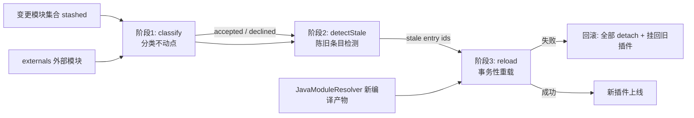
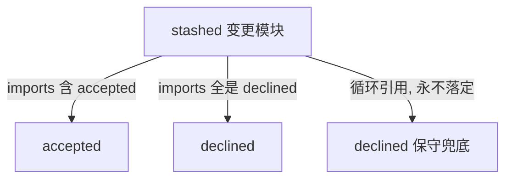
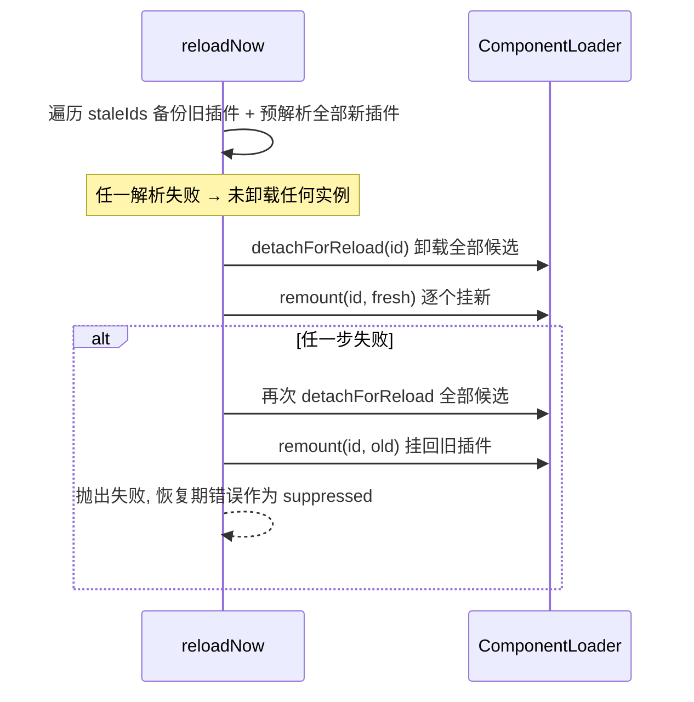

`HmrEngine` 是 cordis-java 热更新体系的核心决策层：它不负责文件监听和编译（由 [HotReloadService](#hotreloadservice-的封装) 和 [JavaModuleResolver](17-javamoduleresolver-jdk-dong-tai-bian-yi-yu-zhu-dai-classloader-ge-chi) 负责），而是回答三个问题——**哪些模块能热换**、**哪些配置条目因此陈旧**、**换挂失败时如何把系统恢复到一致状态**。整个引擎建立在框架自身的效应回退机制之上：每个运行实例（fiber）圈住了自己组件的全部效应，所以“换模块”等价于“卸旧 fiber + 挂新 fiber”，效应自动回滚重放，无需 webpack/vite 那样的手写“接受边界” [HmrEngine.java](cordis-core/src/main/java/dev/cordis/hmr/HmrEngine.java#L17-L31)。

## 三阶段流水线与模块图抽象

引擎的全部工作基于一个极简的抽象——`ModuleGraph` 函数式接口，它只要求回答“某个 url 直接引用了哪些模块”，由宿主提供（构建索引、类引用扫描或手写映射均可）。引擎不关心依赖图是怎么来的 [ModuleGraph.java](cordis-core/src/main/java/dev/cordis/hmr/ModuleGraph.java#L1-L15)。

### 阶段 1：classify 分类不动点

`classify` 从变更文件集合（`stashed`）出发，把 `externals`（不可热换的外部模块，如 JVM 源码目录之外或宿主明确声明需要重启的模块）直接归入 declined。随后进入一个**不动点循环**：反复推导直到集合不再变化。规则有三条——

1. 引用了“已 accepted”模块的模块，自己也被接受（它是“纠缠模块”，与新代码有状态耦合，必须一起换）；
2. 引用到的模块**全部**属于 declined 的模块，自己也归入 declined（它只是新模块的普通依赖，重挂新插件时会随解析器自然拿到新版，无需替换）；
3. 因为**循环引用**始终无法落到前两条规则的，一律按 declined 处理——保守策略，宁可整树重挂也不冒进。

测试验证了三个关键边界：与变更模块形成循环的 `wrapper` 会被 accepted，而其普通依赖 `core` 只会 declined；从不与 accepted 集合发生接触的循环 `x ↔ y` 被 declined；`externals` 中的模块永远不可能被 accepted [HmrTest.java](cordis-core/src/test/java/dev/cordis/HmrTest.java#L26-L69)。

Sources: [HmrEngine.java](cordis-core/src/main/java/dev/cordis/hmr/HmrEngine.java#L51-L80)、[ModuleGraph.java](cordis-core/src/main/java/dev/cordis/hmr/ModuleGraph.java#L1-L15)、[HmrTest.java](cordis-core/src/test/java/dev/cordis/HmrTest.java#L26-L69)

### 阶段 2：detectStale 陈旧条目检测

`dependencies` 从任一根模块出发做传递闭包遍历，但把 declined 模块当作边界不再深入（它们会在重挂时由解析器自然提供新版本）。`detectStale` 据此判定：**一个配置条目只要其依赖树里出现过任何一个 accepted 模块，就算陈旧，必须重装**，树中其余的陈旧模块一并作废。判定过程同样是不动点循环——先被标记为陈旧的条目会扩大 acceptedMutable 集合，从而可能把更多条目拉进来，直到收敛 [HmrEngine.java](cordis-core/src/main/java/dev/cordis/hmr/HmrEngine.java#L82-L120)。测试中 `entry1 → changed` 被检出陈旧，而 `entry2 → untouched` 保持不动 [HmrTest.java](cordis-core/src/test/java/dev/cordis/HmrTest.java#L73-L81)。

辅助方法 `idsForUrls` 把陈旧 url 反查为加载器中的配置条目 id，因为阶段 3 的事务操作以 id 为粒度 [HmrEngine.java](cordis-core/src/main/java/dev/cordis/hmr/HmrEngine.java#L191-L203)。

Sources: [HmrEngine.java](cordis-core/src/main/java/dev/cordis/hmr/HmrEngine.java#L82-L120)、[HmrTest.java](cordis-core/src/test/java/dev/cordis/HmrTest.java#L73-L81)

## 阶段 3：事务性重载与失败回滚

`reload` 把整个替换包进 `loader.transaction(...)` 中执行，后者在根上下文上串行化并在独立虚拟线程中运行，保证替换期间没有并发操作干扰 [ComponentLoader.java](cordis-core/src/main/java/dev/cordis/loader/ComponentLoader.java#L143-L168)。`reloadNow` 的核心设计是**先备后换**，其执行顺序有明确的事务语义：

三个细节值得注意。其一，**所有新插件都在卸载任何旧实例之前 import/resolve**——注释 "Import every candidate before withdrawing any working instance" 说明编译错误会在旧代码仍在线时被发现，从源头减少回滚触发 [HmrEngine.java](cordis-core/src/main/java/dev/cordis/hmr/HmrEngine.java#L143-L153)。其二，`fresh` 映射按条目的 `entry.url` 查找新产物，缺失时回退到 `loader.resolve(url)` 重新解析 [HmrEngine.java](cordis-core/src/main/java/dev/cordis/hmr/HmrEngine.java#L146-L152)。其三，`backupStore` 参数可选接收换下的旧插件，供宿主做额外兜底。

回滚阶段遵循“先全部卸载、再恢复全部”的两遍式清理：恢复过程中任何二次错误不会吞掉原始失败，而是通过 `addSuppressed` 附加，最终由 `Stages.propagate` 统一抛出——但注释也明确指出**用户逆操作（dispose 链）的正确性仍由组件自身保证**，引擎只负责把系统送回旧状态 [HmrEngine.java](cordis-core/src/main/java/dev/cordis/hmr/HmrEngine.java#L154-L174)。`remount` 内部还有一道独立防线：先对新插件做 preflight，挂载失败会立即 `detachForReload` 该条目再抛出 [ComponentLoader.java](cordis-core/src/main/java/dev/cordis/loader/ComponentLoader.java#L366-L380)。

`HmrTest` 中 `transactionalReloadRollsBackOnFailure` 场景构造了一个 resolve 时抛异常的"被编辑"模块，验证替换失败后旧插件（提供 `v1` 值）被完整恢复 [HmrTest.java](cordis-core/src/test/java/dev/cordis/HmrTest.java#L83-L95)。

Sources: [HmrEngine.java](cordis-core/src/main/java/dev/cordis/hmr/HmrEngine.java#L132-L176)、[ComponentLoader.java](cordis-core/src/main/java/dev/cordis/loader/ComponentLoader.java#L354-L380)、[HmrTest.java](cordis-core/src/test/java/dev/cordis/HmrTest.java#L83-L95)

## HotReloadService 的封装

`HotReloadService` 是引擎的文件系统驱动层：WatchService 监听源码树（含新建目录的递归注册）、防抖批处理变更文件、把 `externals` 路径的变更转为 `hmr/restart-required` 事件而非尝试热换。其 `performReload` 实现了与 `HmrEngine.reload` 同构但更完整的事务：利用 `JavaModuleResolver.beginReload()` 的**逐代 Transaction**——`transaction.commit()` 原子提交新 ClassLoader 代，失败时 `transaction.close()` 丢弃整代 [HotReloadService.java](cordis-core/src/main/java/dev/cordis/hmr/HotReloadService.java#L152-L178)；并且先通过 `acquireOperations` 拿到 loader 整棵树所有子树的编排队列锁，保证跨子树替换的原子性 [HotReloadService.java](cordis-core/src/main/java/dev/cordis/hmr/HotReloadService.java#L118-L133)。失败时同样遵循两遍式回滚（全部 detach → 全部挂回旧插件），suppressed 异常语义一致。

| 维度 | HmrEngine.reload | HotReloadService.performReload |
|---|---|---|
| 触发方式 | 宿主显式调用 | 文件监听 + 防抖自动触发 |
| 编译代管理 | 由调用方传入 fresh 映射 | resolver.beginReload() Transaction 提交/丢弃 |
| 加锁范围 | 单 loader（transaction + synchronized） | 整棵 loader 树 acquireOperations |
| 陈旧判定 | classify → detectStale 全流程 | 直接对源码目录内全部已挂载条目重载（保守引用分析） |
| 回滚 | detach 全部候选 → remount 旧插件 | 同左，外加 transaction.close() 丢弃编译代 |

Sources: [HotReloadService.java](cordis-core/src/main/java/dev/cordis/hmr/HotReloadService.java#L114-L191)

## 小结与语义边界

`HmrEngine` 把热更新拆解为三个纯函数式的阶段（分类、陈旧检测）加一个事务性操作（reload），核心保守性原则贯穿始终：循环引用不定则 declined、externals 永不 accepted、新代码先解析后卸载、失败两遍式恢复并以 suppressed 异常如实上报。但要认识到这套机制的边界——它是“把系统送回旧状态”的恢复协议，而非保证任意业务状态可回退；dispose 链的用户逆操作正确性仍依赖组件编写者，这一点在 [论文前提与语义边界：框架不保证的回退正确性](27-lun-wen-qian-ti-yu-yu-yi-bian-jie-kuang-jia-bu-bao-zheng-de-hui-tui-zheng-que-xing) 中有系统论述。若想理解为什么 HotReloadService 采取“整目录重载”而非按模块粒度替换，请继续阅读 [保守引用分析：为什么热更新会重载整个源码目录](19-bao-shou-yin-yong-fen-xi-wei-shi-yao-re-geng-xin-hui-zhong-zai-zheng-ge-yuan-ma-mu-lu)。