在使用 cordis-java 的热更新（HMR）时，你可能会观察到这样一个现象：明明只改了一个类文件，结果整个源码目录下的所有插件都被重新编译、重新挂载了。这不是 bug，而是一个刻意的工程决策。本文解释这背后的机制——**保守的源码引用分析**——以及为什么"宁可多换、绝不陈旧"是 JVM 动态编译场景下的正确权衡。

## ModuleGraph：一个故意留白的接口

cordis-java 把"模块之间谁引用谁"这个问题抽象成一个只有 14 行的函数式接口 `ModuleGraph`，它只回答一个问题：给定某个模块的 url，它直接引用了哪些其他模块？注释明确说明这个图可以由宿主通过"构建索引、类引用扫描，或手写的映射"来提供。

```mermaid
flowchart LR
    W[文件变更事件] --> E[HmrEngine / HotReloadService]
    E -->|imports&#40;url&#41;| G[ModuleGraph 接口]
    G --> R[JavaModuleResolver 默认实现<br/>保守文本扫描]
    E --> C[classify 模块分类]
    E --> S[detectStale 陈旧检测]
    C --> RL[事务性重载]
    S --> RL
```

也就是说，框架本身并不规定依赖图怎么算；但它自带了一个默认实现，而这个实现选择了极端保守的策略。理解这个默认实现为什么如此保守，需要先理解 JVM 类加载的一个硬约束。

Sources: [ModuleGraph.java](cordis-core/src/main/java/dev/cordis/hmr/ModuleGraph.java#L1-L15)

## 硬约束：逐代 ClassLoader 隔离下没有"局部替换"

cordis-java 的源码加载器 `JavaModuleResolver` 每次 reload 都会把整个源码目录重新编译到一个**全新的临时输出目录**，并创建一个全新的 `URLClassLoader`，形成一个新的"代"（Generation）。旧代的 ClassLoader 在新代 commit 之后才会被关闭。

这个设计带来了事务性——编译失败不影响运行中的旧插件，回滚只需放弃新代——但也意味着：**一旦发生任何替换，所有源码类都换到了新的 ClassLoader 里**。JVM 中类的身份由"类名 + ClassLoader"共同决定，旧代的 `Foo` 和新代的 `Foo` 是两个不同的类。如果只重载"受影响的"少数插件，而某些未被重载的插件还在持有旧代 ClassLoader 里的类实例，就会出现新旧类混用、类型转换失败等陈旧状态。

这就是为什么 `HotReloadService.performReload` 的做法是：先调 `resolver.beginReload()` 编译出完整的新代，然后把**加载器树中所有挂载的、非禁用的源码插件全部 detach 并 remount 到新代编译出的实例**——它遍历的是 `resolver.urls()`（整个源码目录），而不是某个差集。

Sources: [JavaModuleResolver.java](cordis-core/src/main/java/dev/cordis/loader/JavaModuleResolver.java#L149-L197), [HotReloadService.java](cordis-core/src/main/java/dev/cordis/hmr/HotReloadService.java#L138-L169)

## 默认实现的保守策略：文本级引用扫描

`JavaModuleResolver` 自己实现了 `ModuleGraph`，它的 `imports(url)` 方法就是"保守引用分析"的核心。算法分三步：

1. **扫描源码目录**：`Files.walk` 遍历 `sourceRoot` 下所有 `.java` 文件，用正则提取每个文件的 `package` 声明，得到"文件 url → 全限定类名 + 源码文本"的映射。
2. **提取类名候选**：对除自己之外的每个源文件，取其全限定类名的**简单名**（去掉包名的部分）。
3. **全文匹配**：在当前文件的源码文本中，用 `\b` 单词边界正则查找该简单名。只要出现一次，就建立一条"当前文件 → 该文件"的依赖边。

关键在 `imports` 方法里那句注释：

> *Conservative source reference graph. Extra edges cause extra reloads, never stale class reuse.*

**多出来的边只会导致多重载，永远不会导致陈旧类的复用。** 这句话是整个设计的哲学锚点。它选择的是一种单向出错安全的近似：把"可能引用"一律当作"确实引用"。

Sources: [JavaModuleResolver.java](cordis-core/src/main/java/dev/cordis/loader/JavaModuleResolver.java#L130-L147)

## 这种分析为什么"不准"却"够用"

文本级扫描的误报率非常高。下面的情况全都会被算作依赖：

| 场景 | 是否真的有编译期依赖 | 保守分析的结果 |
|---|---|---|
| `import com.foo.OrderService` 并调用 | 是 | 判为依赖 ✓ |
| 只在注释或 Javadoc 里提到 `OrderService` | 否 | 判为依赖 ✗（误报） |
| 字符串字面量中出现 `"OrderService"` | 否 | 判为依赖 ✗（误报） |
| 同名但不同包的两个类（如 `util.User` 与 `domain.User`） | 视 import 而定 | 全部判为依赖 ✗（误报） |
| 反射 `Class.forName("...OrderService")` | 是（编译器不可见） | 判为依赖 ✓（意外地覆盖了） |

对比更精确的方案——解析 AST、读取 class 文件常量池、或调用编译器的 `JavaFileManager` 回调——文本扫描的实现成本几乎为零，且不依赖任何第三方解析库（与项目"仅依赖 SnakeYAML"的依赖策略一致）。它唯一的代价是**多算的边会让 `classify` 和 `detectStale` 把更多模块划进重载范围**，而这正好与"逐代替换本来就全量重挂载"的事实对齐：多算的边在实际执行路径上不产生额外开销。

| 维度 | 精确分析（AST/字节码） | 保守文本扫描（默认实现） |
|---|---|---|
| 实现复杂度 | 高，需解析器或字节码库 | 约 15 行正则逻辑 |
| 额外依赖 | 需要引入第三方库 | 无 |
| 误报 | 极少 | 常见（注释/字符串/同名类） |
| 漏报风险 | 低但不为零（反射等） | 极低（任何文本提及都被捕获） |
| 出错方向 | 可能漏重载（陈旧） | 只会多重载（安全） |

Sources: [JavaModuleResolver.java](cordis-core/src/main/java/dev/cordis/loader/JavaModuleResolver.java#L130-L147), [pom.xml](pom.xml#L1)

## 保守图如何被下游消费：分类的不动点收敛

`HmrEngine.classify` 在这张偏"稠密"的依赖图上做不动点迭代：初始时变更集（stashed）为 accepted、externals 为 declined，然后反复推导——引用了 accepted 的模块加入 accepted，引用的全是 declined 的加入 declined；因为循环引用始终无法定类的，最后一律并入 declined（保守策略的又一处体现）。图越稠密，越多模块会被拉进 accepted，重载范围越大——这是保守分析放大"重载面"的直接通道。

`detectStale` 则在图上做传递闭包：一个插件只要其依赖树（以 declined 为边界）中出现过任何 accepted 模块，该插件就被判为陈旧、需要重装。同样，图中的多余边只会让更多插件被判陈旧，不会让真正的陈旧插件漏网。

```mermaid
flowchart TD
    A[改了一个文件] --> B["imports&#40;&#41; 文本扫描<br/>≈ 全目录互认"]
    B --> C[classify 不动点<br/>accepted 集合膨胀]
    B --> D[detectStale 传递闭包<br/>stale 条目膨胀]
    C --> E[全量重编译新代]
    D --> E
    E --> F["逐代 ClassLoader 替换<br/>所有源码插件重挂载"]
    F --> G[结果正确：无陈旧类复用<br/>代价：重载范围大]
```

Sources: [HmrEngine.java](cordis-core/src/main/java/dev/cordis/hmr/HmrEngine.java#L63-L119)

## 为什么这在 JVM 上是唯一安全的选择

把三个事实串起来，结论就自然浮现：

1. **类身份绑定 ClassLoader**：热替换类必须换 ClassLoader，而 ClassLoader 是逐代整体的，无法只替换其中几个类。
2. **保守图保证了不漏**：任何被文本提及的类都会建边，因此依赖闭包不会遗漏真实的编译期或反射依赖。
3. **全量重挂载消除了新旧类混用**：既然新代替代旧代是原子的，所有持有源码类实例的 fiber 都在同一次事务里 detach/remount，不存在"半新半旧"的中间态。

所以"重载整个源码目录"不是实现偷懒，而是这三个约束下的最小正确解。真正可以缩小重载范围的路径是：由宿主提供一个更精确的 `ModuleGraph` 实现（比如基于构建工具的增量编译依赖信息）——接口已经为此预留了扩展点，但即便如此，**逐代 ClassLoader 的整体替换语义不会改变**，精确的依赖图只能优化"分类"与"陈旧检测"的判定面，而 `HotReloadService` 的全量重挂载仍然是兜底保证。

Sources: [ModuleGraph.java](cordis-core/src/main/java/dev/cordis/hmr/ModuleGraph.java#L1-L15), [HotReloadService.java](cordis-core/src/main/java/dev/cordis/hmr/HotReloadService.java#L138-L169)

## 延伸阅读

- 了解逐代编译与 ClassLoader 隔离的完整机制，见 [JavaModuleResolver：JDK 动态编译与逐代 ClassLoader 隔离](17-javamoduleresolver-jdk-dong-tai-bian-yi-yu-zhu-dai-classloader-ge-chi)。
- 了解模块分类、失败回滚与陈旧条目检测的事务语义，见 [HmrEngine 事务性替换：模块分类、失败回滚与陈旧条目检测](18-hmrengine-shi-wu-xing-ti-huan-mo-kuai-fen-lei-shi-bai-hui-gun-yu-chen-jiu-tiao-mu-jian-ce)。
- externals 与 restart-required 的边界处理，见 [适配边界：externals、restart-required 与不支持的场景](20-gua-pei-bian-jie-externals-restart-required-yu-bu-zhi-chi-de-chang-jing)。