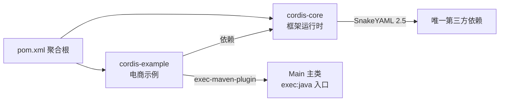
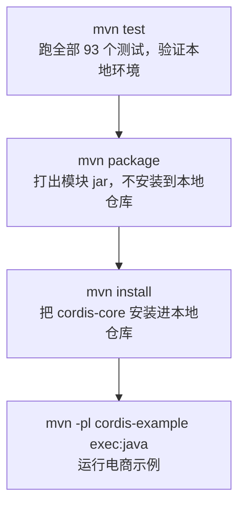

本页面向初次接触 cordis-java 的开发者，介绍运行这个项目所需的开发环境、仓库的多模块 Maven 结构，以及从验证构建到运行两个可执行示例的完整路径。读完本页后，你应当能在本机把 `mvn test` 跑绿，并成功启动电商示例与热更新演示。关于项目定位与整体概念，请先阅读 [项目概览：cordis-java 是什么](1-xiang-mu-gai-lan-cordis-java-shi-shi-yao)。

## 环境要求：JDK 25 是硬性前提

cordis-java 使用 JDK 25 编译目标：根 POM 通过 `maven.compiler.release=25` 声明编译版本，仓库同时提供了 [mise.toml](mise.toml#L1-L2) 固定 `java = "25"`。这意味着：

- 你需要安装 **JDK 25 或更高版本**，低版本 JDK 会直接编译失败；
- 如果使用 [mise](https://mise.jdx.dev/)，在仓库根目录执行 `mise install` 即可自动拉取并激活 Java 25；
- 项目编码统一为 UTF-8，无需额外配置（见 [pom.xml](pom.xml#L20-L24)）。

运行时依赖被刻意压到最低：除 JDK 自带能力外，**唯一第三方依赖是 SnakeYAML 2.5**，用于安全读取 YAML/JSON 配置；编译时关闭注解处理（见 [README.md](README.md#L29-L30)）。这大幅降低了环境搭建的摩擦——不需要数据库、消息队列或任何外部服务。

| 项目 | 要求 | 说明 |
|---|---|---|
| JDK | 25+ | 由 `maven.compiler.release` 强制，mise.toml 声明 |
| 构建工具 | Maven | 编译插件 3.14.1、Surefire 3.2.5 |
| 运行时依赖 | SnakeYAML 2.5 | 唯一第三方库，YAML/JSON 解析 |
| 测试框架 | JUnit Jupiter 5.10.2 | 仅 test 作用域 |
| 编码 | UTF-8 | `project.build.sourceEncoding` |

Sources: [pom.xml](pom.xml#L18-L49), [mise.toml](mise.toml#L1-L2), [cordis-core/pom.xml](cordis-core/pom.xml#L13-L24)

## 仓库结构：两模块聚合工程

项目是一个标准的 Maven 多模块聚合工程（`packaging=pom`），包含两个子模块：

```text
cordis-java/
├── pom.xml               # 聚合 POM：compiler/surefire 版本与 JUnit 版本管理
├── mise.toml             # 声明 java = "25"
├── cordis-core/          # 框架核心（依赖 SnakeYAML + JUnit）
├── cordis-example/       # 电商示例（依赖 cordis-core，配置 exec-maven-plugin）
└── examples/hot-reload/  # 热更新演示数据：cordis.yaml + plugins/HelloPlugin.java
```

依赖方向很简单：`cordis-example` 依赖 `cordis-core`，两者都依赖 SnakeYAML。示例模块在构建插件段配置了 [exec-maven-plugin 3.2.0](cordis-example/pom.xml#L27-L35)，主类为 `dev.cordis.example.Main`，这就是后面 `exec:java` 命令能直接运行的原因。



Sources: [pom.xml](pom.xml#L10-L13), [cordis-core/pom.xml](cordis-core/pom.xml#L9-L24), [cordis-example/pom.xml](cordis-example/pom.xml#L9-L20)

## 构建与验证：test → package → install

从 [README.md](README.md#L16-L27) 的官方指引看，构建遵循 Maven 常规三步走，每一步都有明确目的：



1. **`mvn test`**：最快的健康检查。它验证 JDK 25 是否就位、依赖能否解析、核心语义测试是否通过。建议首次克隆后先跑这一步。
2. **`mvn package`**：编译打包各模块 jar，适合只想拿到构件的场景。
3. **`mvn install`**：**运行示例前必须执行**——`cordis-example` 按坐标 `dev.cordis:cordis-core:1.0.0` 依赖核心模块，需要它先进入本地仓库。

Sources: [README.md](README.md#L16-L30)

## 运行示例一：电商订单业务（exec:java）

电商示例是一个多租户结算流程演示：下单校验、库存预占、沙箱支付、仓配出库、租户隔离与促销热替换。默认每次创建一个临时数据目录并在结束时打印路径；也可以显式指定目录，便于重复运行观察数据恢复（见 [cordis-example/README.md](cordis-example/README.md#L7-L11)）：

```sh
mvn install
mvn -pl cordis-example exec:java
# 指定数据目录：相同演示请求键会复用原订单
mvn -pl cordis-example exec:java -Dexec.args="/tmp/my-commerce-demo"
```

运行后输出的是已执行并校验过的业务结果，例如首次下单金额、重复提交幂等返回、支付拒绝补偿、以及促销上线后的新报价。这个示例涉及的具体插件职责（DatabasePlugin、InventoryPlugin、PaymentPlugin 等）在 [电商示例架构：插件职责、服务组装与本地沙箱适配器](23-dian-shang-shi-li-jia-gou-cha-jian-zhi-ze-fu-wu-shi-yong-yu-ben-di-sha-xiang-gua-pei-qi) 中详细拆解，业务行为观察见 [可观察的业务行为：幂等、补偿、降级与促销热替换](24-ke-guan-cha-de-ye-wu-xing-wei-mi-deng-bu-chang-jiang-ji-yu-cu-xiao-re-ti-huan)。

Sources: [cordis-example/README.md](cordis-example/README.md#L7-L11)

## 运行示例二：Java 源码热更新（--watch）

第二个示例演示 HMR 能力：以**真实 Java 源码 + YAML 配置**作为组件来源，启动后编辑 `HelloPlugin.java` 或 `cordis.yaml`，可以直接观察模块被重新编译、替换与卸载。命令在仓库根目录执行：

```sh
mvn -pl cordis-core org.codehaus.mojo:exec-maven-plugin:3.2.0:java \
  -Dexec.mainClass=dev.cordis.loader.CordisApplication \
  -Dexec.args="examples/hot-reload/cordis.yaml examples/hot-reload/plugins --watch"
```

三个参数各司其由：第一个是 [examples/hot-reload/cordis.yaml](examples/hot-reload/cordis.yaml#L1-L4)（声明组件 `id: hello`、源码 `url: HelloPlugin.java` 与初始 `config`），第二个是源码目录（内含 [examples/hot-reload/plugins/HelloPlugin.java](examples/hot-reload/plugins/HelloPlugin.java)），第三个 `--watch` 开启文件监听。这条命令没有走示例模块的默认主类，而是直接指定了 cordis-core 中的 `CordisApplication` 并通过 `-Dexec.mainClass` 覆盖。热更新背后的动态编译与 ClassLoader 隔离机制见 [JavaModuleResolver：JDK 动态编译与逐代 ClassLoader 隔离](17-javamoduleresolver-jdk-dong-ti-bian-yi-yu-zhu-dai-classloader-ge-chi)，演示应用细节见 [热更新演示应用：CordisApplication 与 examples/hot-reload](25-re-geng-xin-yan-shi-ying-yong-cordisapplication-yu-examples-hot-reload)。

Sources: [README.md](README.md#L23-L27), [examples/hot-reload/cordis.yaml](examples/hot-reload/cordis.yaml#L1-L4)

## 常见问题排查

| 现象 | 原因 | 处理方式 |
|---|---|---|
| 编译报 "invalid target release: 25" | JDK 版本低于 25 | 安装 JDK 25，或用 `mise install` 激活 |
| `exec:java` 找不到 cordis-core | 未执行 `mvn install` | 先在根目录 `mvn install` 再运行示例 |
| 示例重复运行行为不一致 | 数据目录被上次运行占用 | 换一个 `-Dexec.args` 目录，或接受幂等复用原订单的语义 |
| 热更新无反应 | 忘记加 `--watch` 参数 | 检查 `exec.args` 是否以 `--watch` 结尾 |

## 下一步阅读建议

环境就绪后，建议按以下顺序深入：

1. [第一个 Cordis 插件：Context、Plugin 与 Fiber](3-di-ge-cordis-cha-jian-context-plugin-yu-fiber) —— 用最小代码理解三大核心抽象；
2. [电商订单示例：运行与业务流程导览](4-dian-shang-ding-dan-shi-li-yun-xing-yu-ye-wu-liu-cheng-dao-lan) —— 对照刚跑起来的示例读业务流程；
3. [六态生命周期模型：PENDING 到 DISPOSED 的转换与 await 语义](5-liu-tai-sheng-ming-zhou-qi-mo-xing-pending-dao-disposed-de-zhuan-huan-yu-await-yu-yi) —— 进入核心运行时的语义细节。